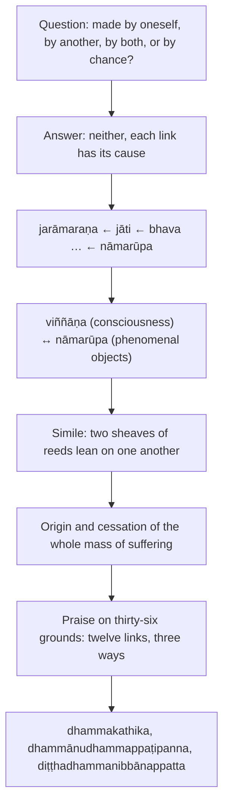

import { Tabs, TabItem } from '@astrojs/starlight/components';

Original text: [12S2/1.7.7 Naḷakalāpīsutta 490–499](https://tipitaka2500.github.io/tipitaka/12S2/1/1.7/1.7.7.html#490) in the [World Tipitaka Edition](https://tipitaka2500.github.io)

## Summary

At Isipatana, āyasmā Mahākoṭṭhika asks āyasmā Sāriputta whether ageing and death, birth and the other links down to phenomenal objects and consciousness are made by oneself, by another, by both, or arise by chance. Sāriputta answers that each has its cause, and that consciousness and phenomenal objects cause each other, like two sheaves of reeds standing by leaning on one another. Mahākoṭṭhika applauds the statement on thirty-six grounds: for each of the twelve links, a bhikkhu who teaches, practises or is liberated for its disenchantment, detachment and cessation earns a fitting name.

## Diagram

## Text

<Tabs syncKey="paliquote">
<TabItem label="My Translation">
(67.)

490\. At one time āyasmā Sāriputta and āyasmā Mahākoṭṭhika were dwelling at Bārāṇasī, at Isipatana in the Deer Park. Then āyasmā Mahākoṭṭhika, having risen from seclusion in the evening, approached āyasmā Sāriputta; having approached, he exchanged greetings with āyasmā Sāriputta. When they had concluded their courteous and amiable talk, he sat down to one side. Seated to one side, āyasmā Mahākoṭṭhika said this to āyasmā Sāriputta: “Is `jarāmaraṇa` (ageing and death), Āvuso Sāriputta, made by oneself, is ageing and death made by another, is ageing and death made both by oneself and by another, or is ageing and death arisen by chance, neither one's own doing nor another's doing?” “Ageing and death, Āvuso Koṭṭhika, is indeed not made by oneself, nor is ageing and death made by another, nor is ageing and death made both by oneself and by another, nor even is ageing and death arisen by chance, neither one's own doing nor another's doing. But rather, with birth as cause, ageing and death [arise].”

491\. “Is `jāti` (birth), Āvuso Sāriputta, made by oneself, is birth made by another, is birth made both by oneself and by another, or is birth arisen by chance, neither one's own doing nor another's doing?” “Birth, Āvuso Koṭṭhika, is indeed not made by oneself, nor is birth made by another, nor is birth made both by oneself and by another, nor even is birth arisen by chance, neither one's own doing nor another's doing. But rather, with existence as cause, birth [arises].”

492\. “Is `bhava` (existence), Āvuso Sāriputta, made by oneself … and so on … is `upādāna` (fuel) made by oneself … is `taṇhā` (craving) made by oneself … is `vedanā` (feeling) made by oneself … is `phassa` (contact) made by oneself … are `saḷāyatana` (the six sense bases) made by oneself … are `nāmarūpa` (phenomenal objects) made by oneself, are phenomenal objects made by another, are phenomenal objects made both by oneself and by another, or are phenomenal objects arisen by chance, neither one's own doing nor another's doing?” “Phenomenal objects, Āvuso Koṭṭhika, are indeed not made by oneself, nor are phenomenal objects made by another, nor are phenomenal objects made both by oneself and by another, nor even are phenomenal objects arisen by chance, neither one's own doing nor another's doing. But rather, with consciousness as cause, phenomenal objects [arise].”

493\. “Is `viññāṇa` (consciousness), Āvuso Sāriputta, made by oneself, is consciousness made by another, is consciousness made both by oneself and by another, or is consciousness arisen by chance, neither one's own doing nor another's doing?” “Consciousness, Āvuso Koṭṭhika, is indeed not made by oneself, nor is consciousness made by another, nor is consciousness made both by oneself and by another, nor even is consciousness arisen by chance, neither one's own doing nor another's doing. But rather, with phenomenal objects as cause, consciousness [arises].”

494\. “Just now, indeed, we understand what āyasmā Sāriputta said thus: ‘Phenomenal objects, Āvuso Koṭṭhika, are indeed not made by oneself, nor are phenomenal objects made by another, nor are phenomenal objects made both by oneself and by another, nor even are phenomenal objects arisen by chance, neither one's own doing nor another's doing. But rather, with consciousness as cause, phenomenal objects [arise].’

495\. And just now too we understand what āyasmā Sāriputta said thus: ‘Consciousness, Āvuso Koṭṭhika, is indeed not made by oneself, nor is consciousness made by another, nor is consciousness made both by oneself and by another, nor even is consciousness arisen by chance, neither one's own doing nor another's doing. But rather, with phenomenal objects as cause, consciousness [arises].’

496\. How then, Āvuso Sāriputta, should the meaning of this statement be seen?” “Well then, Āvuso, I will make a simile for you. By a simile, too, some wise men here understand the meaning of what is said. Suppose, Āvuso, two sheaves of reeds were to stand leaning on one another. In the same way, Āvuso, with phenomenal objects as cause, consciousness [arises]; with consciousness as cause, phenomenal objects [arise]; with phenomenal objects as cause, the six sense bases [arise]; with the six sense bases as cause, contact [arises] … and so on … Thus is the origin of this whole mass of suffering. If, Āvuso, one were to pull away one of those sheaves of reeds, the [other] one would fall; and if one were to pull away the other, the other would fall. In the same way, Āvuso, with the cessation of phenomenal objects comes the cessation of consciousness; with the cessation of consciousness comes the cessation of phenomenal objects; with the cessation of phenomenal objects comes the cessation of the six sense bases; with the cessation of the six sense bases comes the cessation of contact … and so on … Thus is the cessation of this whole mass of suffering.”

497\. “It is wonderful, Āvuso Sāriputta; it is amazing, Āvuso Sāriputta. And how well this has been spoken by āyasmā Sāriputta! And we rejoice in this statement of āyasmā Sāriputta on these thirty-six grounds:

498\. ‘If, Āvuso, a bhikkhu teaches the Dhamma for `nibbidā` (disenchantment) with ageing and death, for `virāga` (detachment) from it and for its `nirodha` (cessation), he is fit to be called ‘a bhikkhu who is a `dhammakathika` (Dhamma teacher)’. If, Āvuso, a bhikkhu is practising for disenchantment with ageing and death, for detachment from it and for its cessation, he is fit to be called ‘a bhikkhu who is `dhammānudhammappaṭipanna` (practising the Dhamma according to the Dhamma)’. If, Āvuso, a bhikkhu is liberated, not grasping, through disenchantment with ageing and death, through detachment from it and through its cessation, he is fit to be called ‘a bhikkhu who is `diṭṭhadhammanibbānappatta` (one who has attained nibbāna in this very life)’. If with birth … if with existence … if with fuel … if with craving … if with feeling … if with contact … if with the six sense bases … if with phenomenal objects … if with consciousness … if with `saṅkhāra` (mental constructions) … if, Āvuso, a bhikkhu teaches the Dhamma for disenchantment with `avijjā` (ignorance), for detachment from it and for its cessation, he is fit to be called ‘a bhikkhu who is a Dhamma teacher’. If, Āvuso, a bhikkhu is practising for disenchantment with ignorance, for detachment from it and for its cessation, he is fit to be called ‘a bhikkhu who is practising the Dhamma according to the Dhamma’. If, Āvuso, a bhikkhu is liberated, not grasping, through disenchantment with ignorance, through detachment from it and through its cessation, he is fit to be called ‘a bhikkhu who has attained nibbāna in this very life’.’”

499\. The seventh [discourse of the chapter].
</TabItem>

<TabItem label="Pāḷi (Roman IAST)">
(67.)

490\. Ekaṃ samayaṃ āyasmā ca sāriputto āyasmā ca mahākoṭṭhiko bārāṇasiyaṃ viharanti isipatane migadāye. Atha kho āyasmā mahākoṭṭhiko sāyanhasamayaṃ paṭisallānā vuṭṭhito yenāyasmā sāriputto tenupasaṅkami; upasaṅkamitvā āyasmatā sāriputtena saddhiṃ sammodi. Sammodanīyaṃ kathaṃ sāraṇīyaṃ vītisāretvā ekamantaṃ nisīdi. Ekamantaṃ nisinno kho āyasmā mahākoṭṭhiko āyasmantaṃ sāriputtaṃ etadavoca— “kiṃ nu kho, āvuso sāriputta, sayaṃkataṃ jarāmaraṇaṃ, paraṃkataṃ jarāmaraṇaṃ, sayaṃkatañca paraṃkatañca jarāmaraṇaṃ, udāhu asayaṃkāraṃ aparaṅkāraṃ adhiccasamuppannaṃ jarāmaraṇan”ti? “Na kho, āvuso koṭṭhika, sayaṃkataṃ jarāmaraṇaṃ, na paraṃkataṃ jarāmaraṇaṃ, na sayaṃkatañca paraṃkatañca jarāmaraṇaṃ, nāpi asayaṃkāraṃ aparaṅkāraṃ adhiccasamuppannaṃ jarāmaraṇaṃ. Api ca jātipaccayā jarāmaraṇan”ti.

491\. “Kiṃ nu kho, āvuso sāriputta, sayaṃkatā jāti, paraṃkatā jāti, sayaṃkatā ca paraṃkatā ca jāti, udāhu asayaṅkārā aparaṅkārā adhiccasamuppannā jātī”ti? “Na kho, āvuso koṭṭhika, sayaṃkatā jāti, na paraṃkatā jāti, na sayaṃkatā ca paraṃkatā ca jāti, nāpi asayaṅkārā aparaṅkārā adhiccasamuppannā jāti. Api ca bhavapaccayā jātī”ti.

492\. “Kiṃ nu kho, āvuso sāriputta, sayaṃkato bhavo…pe… sayaṃkataṃ upādānaṃ… sayaṃkatā taṇhā… sayaṃkatā vedanā… sayaṃkato phasso… sayaṃkataṃ saḷāyatanaṃ… sayaṃkataṃ nāmarūpaṃ, paraṃkataṃ nāmarūpaṃ, sayaṃkatañca paraṃkatañca nāmarūpaṃ, udāhu asayaṃkāraṃ aparaṅkāraṃ adhiccasamuppannaṃ nāmarūpan”ti? “Na kho, āvuso koṭṭhika, sayaṃkataṃ nāmarūpaṃ, na paraṃkataṃ nāmarūpaṃ, na sayaṃkatañca paraṃkatañca nāmarūpaṃ, nāpi asayaṃkāraṃ aparaṅkāraṃ, adhiccasamuppannaṃ nāmarūpaṃ. Api ca viññāṇapaccayā nāmarūpan”ti.

493\. “Kiṃ nu kho, āvuso sāriputta, sayaṃkataṃ viññāṇaṃ, paraṃkataṃ viññāṇaṃ, sayaṃkatañca paraṃkatañca viññāṇaṃ, udāhu asayaṃkāraṃ aparaṅkāraṃ adhiccasamuppannaṃ viññāṇan”ti? “Na kho, āvuso koṭṭhika, sayaṃkataṃ viññāṇaṃ, na paraṃkataṃ viññāṇaṃ, na sayaṃkatañca paraṃkatañca viññāṇaṃ, nāpi asayaṃkāraṃ aparaṅkāraṃ adhiccasamuppannaṃ viññāṇaṃ. Api ca nāmarūpapaccayā viññāṇan”ti.

494\. “Idāneva kho mayaṃ āyasmato sāriputtassa bhāsitaṃ evaṃ ājānāma— ‘na khvāvuso koṭṭhika, sayaṃkataṃ nāmarūpaṃ, na paraṃkataṃ nāmarūpaṃ, na sayaṃkatañca paraṃkatañca nāmarūpaṃ, nāpi asayaṃkāraṃ aparaṅkāraṃ adhiccasamuppannaṃ nāmarūpaṃ. Api ca viññāṇapaccayā nāmarūpan’ti.

495\. Idāneva ca pana mayaṃ āyasmato sāriputtassa bhāsitaṃ evaṃ ājānāma— ‘na khvāvuso koṭṭhika, sayaṃkataṃ viññāṇaṃ, na paraṃkataṃ viññāṇaṃ, na sayaṃkatañca paraṃkatañca viññāṇaṃ, nāpi asayaṃkāraṃ aparaṅkāraṃ adhiccasamuppannaṃ viññāṇaṃ. Api ca nāmarūpapaccayā viññāṇan’ti.

496\. Yathā kathaṃ panāvuso sāriputta, imassa bhāsitassa attho daṭṭhabbo”ti? “Tenahāvuso, upamaṃ te karissāmi. Upamāyapidhekacce viññū purisā bhāsitassa atthaṃ jānanti. Seyyathāpi, āvuso, dve naḷakalāpiyo aññamaññaṃ nissāya tiṭṭheyyuṃ. Evameva kho, āvuso, nāmarūpapaccayā viññāṇaṃ; viññāṇapaccayā nāmarūpaṃ; nāmarūpapaccayā saḷāyatanaṃ; saḷāyatanapaccayā phasso…pe… evametassa kevalassa dukkhakkhandhassa samudayo hoti. Tāsañce, āvuso, naḷakalāpīnaṃ ekaṃ ākaḍḍheyya, ekā papateyya; aparañce ākaḍḍheyya, aparā papateyya. Evameva kho, āvuso, nāmarūpanirodhā viññāṇanirodho; viññāṇanirodhā nāmarūpanirodho; nāmarūpanirodhā saḷāyatananirodho; saḷāyatananirodhā phassanirodho…pe… evametassa kevalassa dukkhakkhandhassa nirodho hotī”ti.

497\. “Acchariyaṃ, āvuso sāriputta; abbhutaṃ, āvuso sāriputta. Yāvasubhāsitañcidaṃ āyasmatā sāriputtena. Idañca pana mayaṃ āyasmato sāriputtassa bhāsitaṃ imehi chattiṃsāya vatthūhi anumodāma—

498\. ‘Jarāmaraṇassa ce, āvuso, bhikkhu nibbidāya virāgāya nirodhāya dhammaṃ deseti, dhammakathiko bhikkhūti alaṃvacanāya. Jarāmaraṇassa ce, āvuso, bhikkhu nibbidāya virāgāya nirodhāya paṭipanno hoti, dhammānudhammappaṭipanno bhikkhūti alaṃvacanāya. Jarāmaraṇassa ce, āvuso, bhikkhu nibbidā virāgā nirodhā anupādā vimutto hoti, diṭṭhadhammanibbānappatto bhikkhūti alaṃvacanāya. Jātiyā ce… bhavassa ce… upādānassa ce… taṇhāya ce… vedanāya ce… phassassa ce… saḷāyatanassa ce… nāmarūpassa ce… viññāṇassa ce… saṅkhārānañce… avijjāya ce, āvuso, bhikkhu nibbidāya virāgāya nirodhāya dhammaṃ deseti, dhammakathiko bhikkhūti alaṃvacanāya. Avijjāya ce, āvuso, bhikkhu nibbidāya virāgāya nirodhāya paṭipanno hoti, dhammānudhammappaṭipanno bhikkhūti alaṃvacanāya. Avijjāya ce, āvuso, bhikkhu nibbidā virāgā nirodhā anupādā vimutto hoti, diṭṭhadhammanibbānappatto bhikkhūti alaṃvacanāyā’”ti.

499\. Sattamaṃ.
</TabItem>

<TabItem label="Pāḷi (Brahmi)">
(67.)

490\. 𑀏𑀓𑀁 𑀲𑀫𑀬𑀁 𑀆𑀬𑀲𑁆𑀫𑀸 𑀘 𑀲𑀸𑀭𑀺𑀧𑀼𑀢𑁆𑀢𑁄 𑀆𑀬𑀲𑁆𑀫𑀸 𑀘 𑀫𑀳𑀸𑀓𑁄𑀝𑁆𑀞𑀺𑀓𑁄 𑀩𑀸𑀭𑀸𑀡𑀲𑀺𑀬𑀁 𑀯𑀺𑀳𑀭𑀦𑁆𑀢𑀺 𑀇𑀲𑀺𑀧𑀢𑀦𑁂 𑀫𑀺𑀕𑀤𑀸𑀬𑁂. 𑀅𑀣 𑀔𑁄 𑀆𑀬𑀲𑁆𑀫𑀸 𑀫𑀳𑀸𑀓𑁄𑀝𑁆𑀞𑀺𑀓𑁄 𑀲𑀸𑀬𑀦𑁆𑀳𑀲𑀫𑀬𑀁 𑀧𑀝𑀺𑀲𑀮𑁆𑀮𑀸𑀦𑀸 𑀯𑀼𑀝𑁆𑀞𑀺𑀢𑁄 𑀬𑁂𑀦𑀸𑀬𑀲𑁆𑀫𑀸 𑀲𑀸𑀭𑀺𑀧𑀼𑀢𑁆𑀢𑁄 𑀢𑁂𑀦𑀼𑀧𑀲𑀗𑁆𑀓𑀫𑀺; 𑀉𑀧𑀲𑀗𑁆𑀓𑀫𑀺𑀢𑁆𑀯𑀸 𑀆𑀬𑀲𑁆𑀫𑀢𑀸 𑀲𑀸𑀭𑀺𑀧𑀼𑀢𑁆𑀢𑁂𑀦 𑀲𑀤𑁆𑀥𑀺𑀁 𑀲𑀫𑁆𑀫𑁄𑀤𑀺. 𑀲𑀫𑁆𑀫𑁄𑀤𑀦𑀻𑀬𑀁 𑀓𑀣𑀁 𑀲𑀸𑀭𑀡𑀻𑀬𑀁 𑀯𑀻𑀢𑀺𑀲𑀸𑀭𑁂𑀢𑁆𑀯𑀸 𑀏𑀓𑀫𑀦𑁆𑀢𑀁 𑀦𑀺𑀲𑀻𑀤𑀺. 𑀏𑀓𑀫𑀦𑁆𑀢𑀁 𑀦𑀺𑀲𑀺𑀦𑁆𑀦𑁄 𑀔𑁄 𑀆𑀬𑀲𑁆𑀫𑀸 𑀫𑀳𑀸𑀓𑁄𑀝𑁆𑀞𑀺𑀓𑁄 𑀆𑀬𑀲𑁆𑀫𑀦𑁆𑀢𑀁 𑀲𑀸𑀭𑀺𑀧𑀼𑀢𑁆𑀢𑀁 𑀏𑀢𑀤𑀯𑁄𑀘— “𑀓𑀺𑀁 𑀦𑀼 𑀔𑁄, 𑀆𑀯𑀼𑀲𑁄 𑀲𑀸𑀭𑀺𑀧𑀼𑀢𑁆𑀢, 𑀲𑀬𑀁𑀓𑀢𑀁 𑀚𑀭𑀸𑀫𑀭𑀡𑀁, 𑀧𑀭𑀁𑀓𑀢𑀁 𑀚𑀭𑀸𑀫𑀭𑀡𑀁, 𑀲𑀬𑀁𑀓𑀢𑀜𑁆𑀘 𑀧𑀭𑀁𑀓𑀢𑀜𑁆𑀘 𑀚𑀭𑀸𑀫𑀭𑀡𑀁, 𑀉𑀤𑀸𑀳𑀼 𑀅𑀲𑀬𑀁𑀓𑀸𑀭𑀁 𑀅𑀧𑀭𑀗𑁆𑀓𑀸𑀭𑀁 𑀅𑀥𑀺𑀘𑁆𑀘𑀲𑀫𑀼𑀧𑁆𑀧𑀦𑁆𑀦𑀁 𑀚𑀭𑀸𑀫𑀭𑀡𑀦𑁆”𑀢𑀺? “𑀦 𑀔𑁄, 𑀆𑀯𑀼𑀲𑁄 𑀓𑁄𑀝𑁆𑀞𑀺𑀓, 𑀲𑀬𑀁𑀓𑀢𑀁 𑀚𑀭𑀸𑀫𑀭𑀡𑀁, 𑀦 𑀧𑀭𑀁𑀓𑀢𑀁 𑀚𑀭𑀸𑀫𑀭𑀡𑀁, 𑀦 𑀲𑀬𑀁𑀓𑀢𑀜𑁆𑀘 𑀧𑀭𑀁𑀓𑀢𑀜𑁆𑀘 𑀚𑀭𑀸𑀫𑀭𑀡𑀁, 𑀦𑀸𑀧𑀺 𑀅𑀲𑀬𑀁𑀓𑀸𑀭𑀁 𑀅𑀧𑀭𑀗𑁆𑀓𑀸𑀭𑀁 𑀅𑀥𑀺𑀘𑁆𑀘𑀲𑀫𑀼𑀧𑁆𑀧𑀦𑁆𑀦𑀁 𑀚𑀭𑀸𑀫𑀭𑀡𑀁. 𑀅𑀧𑀺 𑀘 𑀚𑀸𑀢𑀺𑀧𑀘𑁆𑀘𑀬𑀸 𑀚𑀭𑀸𑀫𑀭𑀡𑀦𑁆”𑀢𑀺.

491\. “𑀓𑀺𑀁 𑀦𑀼 𑀔𑁄, 𑀆𑀯𑀼𑀲𑁄 𑀲𑀸𑀭𑀺𑀧𑀼𑀢𑁆𑀢, 𑀲𑀬𑀁𑀓𑀢𑀸 𑀚𑀸𑀢𑀺, 𑀧𑀭𑀁𑀓𑀢𑀸 𑀚𑀸𑀢𑀺, 𑀲𑀬𑀁𑀓𑀢𑀸 𑀘 𑀧𑀭𑀁𑀓𑀢𑀸 𑀘 𑀚𑀸𑀢𑀺, 𑀉𑀤𑀸𑀳𑀼 𑀅𑀲𑀬𑀗𑁆𑀓𑀸𑀭𑀸 𑀅𑀧𑀭𑀗𑁆𑀓𑀸𑀭𑀸 𑀅𑀥𑀺𑀘𑁆𑀘𑀲𑀫𑀼𑀧𑁆𑀧𑀦𑁆𑀦𑀸 𑀚𑀸𑀢𑀻”𑀢𑀺? “𑀦 𑀔𑁄, 𑀆𑀯𑀼𑀲𑁄 𑀓𑁄𑀝𑁆𑀞𑀺𑀓, 𑀲𑀬𑀁𑀓𑀢𑀸 𑀚𑀸𑀢𑀺, 𑀦 𑀧𑀭𑀁𑀓𑀢𑀸 𑀚𑀸𑀢𑀺, 𑀦 𑀲𑀬𑀁𑀓𑀢𑀸 𑀘 𑀧𑀭𑀁𑀓𑀢𑀸 𑀘 𑀚𑀸𑀢𑀺, 𑀦𑀸𑀧𑀺 𑀅𑀲𑀬𑀗𑁆𑀓𑀸𑀭𑀸 𑀅𑀧𑀭𑀗𑁆𑀓𑀸𑀭𑀸 𑀅𑀥𑀺𑀘𑁆𑀘𑀲𑀫𑀼𑀧𑁆𑀧𑀦𑁆𑀦𑀸 𑀚𑀸𑀢𑀺. 𑀅𑀧𑀺 𑀘 𑀪𑀯𑀧𑀘𑁆𑀘𑀬𑀸 𑀚𑀸𑀢𑀻”𑀢𑀺.

492\. “𑀓𑀺𑀁 𑀦𑀼 𑀔𑁄, 𑀆𑀯𑀼𑀲𑁄 𑀲𑀸𑀭𑀺𑀧𑀼𑀢𑁆𑀢, 𑀲𑀬𑀁𑀓𑀢𑁄 𑀪𑀯𑁄…𑀧𑁂… 𑀲𑀬𑀁𑀓𑀢𑀁 𑀉𑀧𑀸𑀤𑀸𑀦𑀁… 𑀲𑀬𑀁𑀓𑀢𑀸 𑀢𑀡𑁆𑀳𑀸… 𑀲𑀬𑀁𑀓𑀢𑀸 𑀯𑁂𑀤𑀦𑀸… 𑀲𑀬𑀁𑀓𑀢𑁄 𑀨𑀲𑁆𑀲𑁄… 𑀲𑀬𑀁𑀓𑀢𑀁 𑀲𑀍𑀆𑀬𑀢𑀦𑀁… 𑀲𑀬𑀁𑀓𑀢𑀁 𑀦𑀸𑀫𑀭𑀽𑀧𑀁, 𑀧𑀭𑀁𑀓𑀢𑀁 𑀦𑀸𑀫𑀭𑀽𑀧𑀁, 𑀲𑀬𑀁𑀓𑀢𑀜𑁆𑀘 𑀧𑀭𑀁𑀓𑀢𑀜𑁆𑀘 𑀦𑀸𑀫𑀭𑀽𑀧𑀁, 𑀉𑀤𑀸𑀳𑀼 𑀅𑀲𑀬𑀁𑀓𑀸𑀭𑀁 𑀅𑀧𑀭𑀗𑁆𑀓𑀸𑀭𑀁 𑀅𑀥𑀺𑀘𑁆𑀘𑀲𑀫𑀼𑀧𑁆𑀧𑀦𑁆𑀦𑀁 𑀦𑀸𑀫𑀭𑀽𑀧𑀦𑁆”𑀢𑀺? “𑀦 𑀔𑁄, 𑀆𑀯𑀼𑀲𑁄 𑀓𑁄𑀝𑁆𑀞𑀺𑀓, 𑀲𑀬𑀁𑀓𑀢𑀁 𑀦𑀸𑀫𑀭𑀽𑀧𑀁, 𑀦 𑀧𑀭𑀁𑀓𑀢𑀁 𑀦𑀸𑀫𑀭𑀽𑀧𑀁, 𑀦 𑀲𑀬𑀁𑀓𑀢𑀜𑁆𑀘 𑀧𑀭𑀁𑀓𑀢𑀜𑁆𑀘 𑀦𑀸𑀫𑀭𑀽𑀧𑀁, 𑀦𑀸𑀧𑀺 𑀅𑀲𑀬𑀁𑀓𑀸𑀭𑀁 𑀅𑀧𑀭𑀗𑁆𑀓𑀸𑀭𑀁, 𑀅𑀥𑀺𑀘𑁆𑀘𑀲𑀫𑀼𑀧𑁆𑀧𑀦𑁆𑀦𑀁 𑀦𑀸𑀫𑀭𑀽𑀧𑀁. 𑀅𑀧𑀺 𑀘 𑀯𑀺𑀜𑁆𑀜𑀸𑀡𑀧𑀘𑁆𑀘𑀬𑀸 𑀦𑀸𑀫𑀭𑀽𑀧𑀦𑁆”𑀢𑀺.

493\. “𑀓𑀺𑀁 𑀦𑀼 𑀔𑁄, 𑀆𑀯𑀼𑀲𑁄 𑀲𑀸𑀭𑀺𑀧𑀼𑀢𑁆𑀢, 𑀲𑀬𑀁𑀓𑀢𑀁 𑀯𑀺𑀜𑁆𑀜𑀸𑀡𑀁, 𑀧𑀭𑀁𑀓𑀢𑀁 𑀯𑀺𑀜𑁆𑀜𑀸𑀡𑀁, 𑀲𑀬𑀁𑀓𑀢𑀜𑁆𑀘 𑀧𑀭𑀁𑀓𑀢𑀜𑁆𑀘 𑀯𑀺𑀜𑁆𑀜𑀸𑀡𑀁, 𑀉𑀤𑀸𑀳𑀼 𑀅𑀲𑀬𑀁𑀓𑀸𑀭𑀁 𑀅𑀧𑀭𑀗𑁆𑀓𑀸𑀭𑀁 𑀅𑀥𑀺𑀘𑁆𑀘𑀲𑀫𑀼𑀧𑁆𑀧𑀦𑁆𑀦𑀁 𑀯𑀺𑀜𑁆𑀜𑀸𑀡𑀦𑁆”𑀢𑀺? “𑀦 𑀔𑁄, 𑀆𑀯𑀼𑀲𑁄 𑀓𑁄𑀝𑁆𑀞𑀺𑀓, 𑀲𑀬𑀁𑀓𑀢𑀁 𑀯𑀺𑀜𑁆𑀜𑀸𑀡𑀁, 𑀦 𑀧𑀭𑀁𑀓𑀢𑀁 𑀯𑀺𑀜𑁆𑀜𑀸𑀡𑀁, 𑀦 𑀲𑀬𑀁𑀓𑀢𑀜𑁆𑀘 𑀧𑀭𑀁𑀓𑀢𑀜𑁆𑀘 𑀯𑀺𑀜𑁆𑀜𑀸𑀡𑀁, 𑀦𑀸𑀧𑀺 𑀅𑀲𑀬𑀁𑀓𑀸𑀭𑀁 𑀅𑀧𑀭𑀗𑁆𑀓𑀸𑀭𑀁 𑀅𑀥𑀺𑀘𑁆𑀘𑀲𑀫𑀼𑀧𑁆𑀧𑀦𑁆𑀦𑀁 𑀯𑀺𑀜𑁆𑀜𑀸𑀡𑀁. 𑀅𑀧𑀺 𑀘 𑀦𑀸𑀫𑀭𑀽𑀧𑀧𑀘𑁆𑀘𑀬𑀸 𑀯𑀺𑀜𑁆𑀜𑀸𑀡𑀦𑁆”𑀢𑀺.

494\. “𑀇𑀤𑀸𑀦𑁂𑀯 𑀔𑁄 𑀫𑀬𑀁 𑀆𑀬𑀲𑁆𑀫𑀢𑁄 𑀲𑀸𑀭𑀺𑀧𑀼𑀢𑁆𑀢𑀲𑁆𑀲 𑀪𑀸𑀲𑀺𑀢𑀁 𑀏𑀯𑀁 𑀆𑀚𑀸𑀦𑀸𑀫— ‘𑀦 𑀔𑁆𑀯𑀸𑀯𑀼𑀲𑁄 𑀓𑁄𑀝𑁆𑀞𑀺𑀓, 𑀲𑀬𑀁𑀓𑀢𑀁 𑀦𑀸𑀫𑀭𑀽𑀧𑀁, 𑀦 𑀧𑀭𑀁𑀓𑀢𑀁 𑀦𑀸𑀫𑀭𑀽𑀧𑀁, 𑀦 𑀲𑀬𑀁𑀓𑀢𑀜𑁆𑀘 𑀧𑀭𑀁𑀓𑀢𑀜𑁆𑀘 𑀦𑀸𑀫𑀭𑀽𑀧𑀁, 𑀦𑀸𑀧𑀺 𑀅𑀲𑀬𑀁𑀓𑀸𑀭𑀁 𑀅𑀧𑀭𑀗𑁆𑀓𑀸𑀭𑀁 𑀅𑀥𑀺𑀘𑁆𑀘𑀲𑀫𑀼𑀧𑁆𑀧𑀦𑁆𑀦𑀁 𑀦𑀸𑀫𑀭𑀽𑀧𑀁. 𑀅𑀧𑀺 𑀘 𑀯𑀺𑀜𑁆𑀜𑀸𑀡𑀧𑀘𑁆𑀘𑀬𑀸 𑀦𑀸𑀫𑀭𑀽𑀧𑀦𑁆’𑀢𑀺.

495\. 𑀇𑀤𑀸𑀦𑁂𑀯 𑀘 𑀧𑀦 𑀫𑀬𑀁 𑀆𑀬𑀲𑁆𑀫𑀢𑁄 𑀲𑀸𑀭𑀺𑀧𑀼𑀢𑁆𑀢𑀲𑁆𑀲 𑀪𑀸𑀲𑀺𑀢𑀁 𑀏𑀯𑀁 𑀆𑀚𑀸𑀦𑀸𑀫— ‘𑀦 𑀔𑁆𑀯𑀸𑀯𑀼𑀲𑁄 𑀓𑁄𑀝𑁆𑀞𑀺𑀓, 𑀲𑀬𑀁𑀓𑀢𑀁 𑀯𑀺𑀜𑁆𑀜𑀸𑀡𑀁, 𑀦 𑀧𑀭𑀁𑀓𑀢𑀁 𑀯𑀺𑀜𑁆𑀜𑀸𑀡𑀁, 𑀦 𑀲𑀬𑀁𑀓𑀢𑀜𑁆𑀘 𑀧𑀭𑀁𑀓𑀢𑀜𑁆𑀘 𑀯𑀺𑀜𑁆𑀜𑀸𑀡𑀁, 𑀦𑀸𑀧𑀺 𑀅𑀲𑀬𑀁𑀓𑀸𑀭𑀁 𑀅𑀧𑀭𑀗𑁆𑀓𑀸𑀭𑀁 𑀅𑀥𑀺𑀘𑁆𑀘𑀲𑀫𑀼𑀧𑁆𑀧𑀦𑁆𑀦𑀁 𑀯𑀺𑀜𑁆𑀜𑀸𑀡𑀁. 𑀅𑀧𑀺 𑀘 𑀦𑀸𑀫𑀭𑀽𑀧𑀧𑀘𑁆𑀘𑀬𑀸 𑀯𑀺𑀜𑁆𑀜𑀸𑀡𑀦𑁆’𑀢𑀺.

496\. 𑀬𑀣𑀸 𑀓𑀣𑀁 𑀧𑀦𑀸𑀯𑀼𑀲𑁄 𑀲𑀸𑀭𑀺𑀧𑀼𑀢𑁆𑀢, 𑀇𑀫𑀲𑁆𑀲 𑀪𑀸𑀲𑀺𑀢𑀲𑁆𑀲 𑀅𑀢𑁆𑀣𑁄 𑀤𑀝𑁆𑀞𑀩𑁆𑀩𑁄”𑀢𑀺? “𑀢𑁂𑀦𑀳𑀸𑀯𑀼𑀲𑁄, 𑀉𑀧𑀫𑀁 𑀢𑁂 𑀓𑀭𑀺𑀲𑁆𑀲𑀸𑀫𑀺. 𑀉𑀧𑀫𑀸𑀬𑀧𑀺𑀥𑁂𑀓𑀘𑁆𑀘𑁂 𑀯𑀺𑀜𑁆𑀜𑀽 𑀧𑀼𑀭𑀺𑀲𑀸 𑀪𑀸𑀲𑀺𑀢𑀲𑁆𑀲 𑀅𑀢𑁆𑀣𑀁 𑀚𑀸𑀦𑀦𑁆𑀢𑀺. 𑀲𑁂𑀬𑁆𑀬𑀣𑀸𑀧𑀺, 𑀆𑀯𑀼𑀲𑁄, 𑀤𑁆𑀯𑁂 𑀦𑀍𑀅𑀓𑀮𑀸𑀧𑀺𑀬𑁄 𑀅𑀜𑁆𑀜𑀫𑀜𑁆𑀜𑀁 𑀦𑀺𑀲𑁆𑀲𑀸𑀬 𑀢𑀺𑀝𑁆𑀞𑁂𑀬𑁆𑀬𑀼𑀁. 𑀏𑀯𑀫𑁂𑀯 𑀔𑁄, 𑀆𑀯𑀼𑀲𑁄, 𑀦𑀸𑀫𑀭𑀽𑀧𑀧𑀘𑁆𑀘𑀬𑀸 𑀯𑀺𑀜𑁆𑀜𑀸𑀡𑀁; 𑀯𑀺𑀜𑁆𑀜𑀸𑀡𑀧𑀘𑁆𑀘𑀬𑀸 𑀦𑀸𑀫𑀭𑀽𑀧𑀁; 𑀦𑀸𑀫𑀭𑀽𑀧𑀧𑀘𑁆𑀘𑀬𑀸 𑀲𑀍𑀆𑀬𑀢𑀦𑀁; 𑀲𑀍𑀆𑀬𑀢𑀦𑀧𑀘𑁆𑀘𑀬𑀸 𑀨𑀲𑁆𑀲𑁄…𑀧𑁂… 𑀏𑀯𑀫𑁂𑀢𑀲𑁆𑀲 𑀓𑁂𑀯𑀮𑀲𑁆𑀲 𑀤𑀼𑀓𑁆𑀔𑀓𑁆𑀔𑀦𑁆𑀥𑀲𑁆𑀲 𑀲𑀫𑀼𑀤𑀬𑁄 𑀳𑁄𑀢𑀺. 𑀢𑀸𑀲𑀜𑁆𑀘𑁂, 𑀆𑀯𑀼𑀲𑁄, 𑀦𑀍𑀅𑀓𑀮𑀸𑀧𑀻𑀦𑀁 𑀏𑀓𑀁 𑀆𑀓𑀟𑁆𑀠𑁂𑀬𑁆𑀬, 𑀏𑀓𑀸 𑀧𑀧𑀢𑁂𑀬𑁆𑀬; 𑀅𑀧𑀭𑀜𑁆𑀘𑁂 𑀆𑀓𑀟𑁆𑀠𑁂𑀬𑁆𑀬, 𑀅𑀧𑀭𑀸 𑀧𑀧𑀢𑁂𑀬𑁆𑀬. 𑀏𑀯𑀫𑁂𑀯 𑀔𑁄, 𑀆𑀯𑀼𑀲𑁄, 𑀦𑀸𑀫𑀭𑀽𑀧𑀦𑀺𑀭𑁄𑀥𑀸 𑀯𑀺𑀜𑁆𑀜𑀸𑀡𑀦𑀺𑀭𑁄𑀥𑁄; 𑀯𑀺𑀜𑁆𑀜𑀸𑀡𑀦𑀺𑀭𑁄𑀥𑀸 𑀦𑀸𑀫𑀭𑀽𑀧𑀦𑀺𑀭𑁄𑀥𑁄; 𑀦𑀸𑀫𑀭𑀽𑀧𑀦𑀺𑀭𑁄𑀥𑀸 𑀲𑀍𑀆𑀬𑀢𑀦𑀦𑀺𑀭𑁄𑀥𑁄; 𑀲𑀍𑀆𑀬𑀢𑀦𑀦𑀺𑀭𑁄𑀥𑀸 𑀨𑀲𑁆𑀲𑀦𑀺𑀭𑁄𑀥𑁄…𑀧𑁂… 𑀏𑀯𑀫𑁂𑀢𑀲𑁆𑀲 𑀓𑁂𑀯𑀮𑀲𑁆𑀲 𑀤𑀼𑀓𑁆𑀔𑀓𑁆𑀔𑀦𑁆𑀥𑀲𑁆𑀲 𑀦𑀺𑀭𑁄𑀥𑁄 𑀳𑁄𑀢𑀻”𑀢𑀺.

497\. “𑀅𑀘𑁆𑀙𑀭𑀺𑀬𑀁, 𑀆𑀯𑀼𑀲𑁄 𑀲𑀸𑀭𑀺𑀧𑀼𑀢𑁆𑀢; 𑀅𑀩𑁆𑀪𑀼𑀢𑀁, 𑀆𑀯𑀼𑀲𑁄 𑀲𑀸𑀭𑀺𑀧𑀼𑀢𑁆𑀢. 𑀬𑀸𑀯𑀲𑀼𑀪𑀸𑀲𑀺𑀢𑀜𑁆𑀘𑀺𑀤𑀁 𑀆𑀬𑀲𑁆𑀫𑀢𑀸 𑀲𑀸𑀭𑀺𑀧𑀼𑀢𑁆𑀢𑁂𑀦. 𑀇𑀤𑀜𑁆𑀘 𑀧𑀦 𑀫𑀬𑀁 𑀆𑀬𑀲𑁆𑀫𑀢𑁄 𑀲𑀸𑀭𑀺𑀧𑀼𑀢𑁆𑀢𑀲𑁆𑀲 𑀪𑀸𑀲𑀺𑀢𑀁 𑀇𑀫𑁂𑀳𑀺 𑀙𑀢𑁆𑀢𑀺𑀁𑀲𑀸𑀬 𑀯𑀢𑁆𑀣𑀽𑀳𑀺 𑀅𑀦𑀼𑀫𑁄𑀤𑀸𑀫—

498\. ‘𑀚𑀭𑀸𑀫𑀭𑀡𑀲𑁆𑀲 𑀘𑁂, 𑀆𑀯𑀼𑀲𑁄, 𑀪𑀺𑀓𑁆𑀔𑀼 𑀦𑀺𑀩𑁆𑀩𑀺𑀤𑀸𑀬 𑀯𑀺𑀭𑀸𑀕𑀸𑀬 𑀦𑀺𑀭𑁄𑀥𑀸𑀬 𑀥𑀫𑁆𑀫𑀁 𑀤𑁂𑀲𑁂𑀢𑀺, 𑀥𑀫𑁆𑀫𑀓𑀣𑀺𑀓𑁄 𑀪𑀺𑀓𑁆𑀔𑀽𑀢𑀺 𑀅𑀮𑀁𑀯𑀘𑀦𑀸𑀬. 𑀚𑀭𑀸𑀫𑀭𑀡𑀲𑁆𑀲 𑀘𑁂, 𑀆𑀯𑀼𑀲𑁄, 𑀪𑀺𑀓𑁆𑀔𑀼 𑀦𑀺𑀩𑁆𑀩𑀺𑀤𑀸𑀬 𑀯𑀺𑀭𑀸𑀕𑀸𑀬 𑀦𑀺𑀭𑁄𑀥𑀸𑀬 𑀧𑀝𑀺𑀧𑀦𑁆𑀦𑁄 𑀳𑁄𑀢𑀺, 𑀥𑀫𑁆𑀫𑀸𑀦𑀼𑀥𑀫𑁆𑀫𑀧𑁆𑀧𑀝𑀺𑀧𑀦𑁆𑀦𑁄 𑀪𑀺𑀓𑁆𑀔𑀽𑀢𑀺 𑀅𑀮𑀁𑀯𑀘𑀦𑀸𑀬. 𑀚𑀭𑀸𑀫𑀭𑀡𑀲𑁆𑀲 𑀘𑁂, 𑀆𑀯𑀼𑀲𑁄, 𑀪𑀺𑀓𑁆𑀔𑀼 𑀦𑀺𑀩𑁆𑀩𑀺𑀤𑀸 𑀯𑀺𑀭𑀸𑀕𑀸 𑀦𑀺𑀭𑁄𑀥𑀸 𑀅𑀦𑀼𑀧𑀸𑀤𑀸 𑀯𑀺𑀫𑀼𑀢𑁆𑀢𑁄 𑀳𑁄𑀢𑀺, 𑀤𑀺𑀝𑁆𑀞𑀥𑀫𑁆𑀫𑀦𑀺𑀩𑁆𑀩𑀸𑀦𑀧𑁆𑀧𑀢𑁆𑀢𑁄 𑀪𑀺𑀓𑁆𑀔𑀽𑀢𑀺 𑀅𑀮𑀁𑀯𑀘𑀦𑀸𑀬. 𑀚𑀸𑀢𑀺𑀬𑀸 𑀘𑁂… 𑀪𑀯𑀲𑁆𑀲 𑀘𑁂… 𑀉𑀧𑀸𑀤𑀸𑀦𑀲𑁆𑀲 𑀘𑁂… 𑀢𑀡𑁆𑀳𑀸𑀬 𑀘𑁂… 𑀯𑁂𑀤𑀦𑀸𑀬 𑀘𑁂… 𑀨𑀲𑁆𑀲𑀲𑁆𑀲 𑀘𑁂… 𑀲𑀍𑀆𑀬𑀢𑀦𑀲𑁆𑀲 𑀘𑁂… 𑀦𑀸𑀫𑀭𑀽𑀧𑀲𑁆𑀲 𑀘𑁂… 𑀯𑀺𑀜𑁆𑀜𑀸𑀡𑀲𑁆𑀲 𑀘𑁂… 𑀲𑀗𑁆𑀔𑀸𑀭𑀸𑀦𑀜𑁆𑀘𑁂… 𑀅𑀯𑀺𑀚𑁆𑀚𑀸𑀬 𑀘𑁂, 𑀆𑀯𑀼𑀲𑁄, 𑀪𑀺𑀓𑁆𑀔𑀼 𑀦𑀺𑀩𑁆𑀩𑀺𑀤𑀸𑀬 𑀯𑀺𑀭𑀸𑀕𑀸𑀬 𑀦𑀺𑀭𑁄𑀥𑀸𑀬 𑀥𑀫𑁆𑀫𑀁 𑀤𑁂𑀲𑁂𑀢𑀺, 𑀥𑀫𑁆𑀫𑀓𑀣𑀺𑀓𑁄 𑀪𑀺𑀓𑁆𑀔𑀽𑀢𑀺 𑀅𑀮𑀁𑀯𑀘𑀦𑀸𑀬. 𑀅𑀯𑀺𑀚𑁆𑀚𑀸𑀬 𑀘𑁂, 𑀆𑀯𑀼𑀲𑁄, 𑀪𑀺𑀓𑁆𑀔𑀼 𑀦𑀺𑀩𑁆𑀩𑀺𑀤𑀸𑀬 𑀯𑀺𑀭𑀸𑀕𑀸𑀬 𑀦𑀺𑀭𑁄𑀥𑀸𑀬 𑀧𑀝𑀺𑀧𑀦𑁆𑀦𑁄 𑀳𑁄𑀢𑀺, 𑀥𑀫𑁆𑀫𑀸𑀦𑀼𑀥𑀫𑁆𑀫𑀧𑁆𑀧𑀝𑀺𑀧𑀦𑁆𑀦𑁄 𑀪𑀺𑀓𑁆𑀔𑀽𑀢𑀺 𑀅𑀮𑀁𑀯𑀘𑀦𑀸𑀬. 𑀅𑀯𑀺𑀚𑁆𑀚𑀸𑀬 𑀘𑁂, 𑀆𑀯𑀼𑀲𑁄, 𑀪𑀺𑀓𑁆𑀔𑀼 𑀦𑀺𑀩𑁆𑀩𑀺𑀤𑀸 𑀯𑀺𑀭𑀸𑀕𑀸 𑀦𑀺𑀭𑁄𑀥𑀸 𑀅𑀦𑀼𑀧𑀸𑀤𑀸 𑀯𑀺𑀫𑀼𑀢𑁆𑀢𑁄 𑀳𑁄𑀢𑀺, 𑀤𑀺𑀝𑁆𑀞𑀥𑀫𑁆𑀫𑀦𑀺𑀩𑁆𑀩𑀸𑀦𑀧𑁆𑀧𑀢𑁆𑀢𑁄 𑀪𑀺𑀓𑁆𑀔𑀽𑀢𑀺 𑀅𑀮𑀁𑀯𑀘𑀦𑀸𑀬𑀸’”𑀢𑀺.

499\. 𑀲𑀢𑁆𑀢𑀫𑀁.
</TabItem>

<TabItem label="Interlinear">
(67.)

[490](https://tipitaka2500.github.io/tipitaka/12S2/1/1.7/1.7.7.html#490) Ekaṃ samayaṃ āyasmā ca sāriputto āyasmā ca mahākoṭṭhiko bārāṇasiyaṃ viharanti isipatane migadāye.  
*️⃣🤟🚹⨀②(eka) 🚹⨀②(samaya) 🚹⨀①(āyasmant) ⏏️(ca) 🚹⨀①(sāriputta) 🚹⨀①(āyasmant) ⏏️(ca) 🚹⨀①(mahākoṭṭhika) 🚺⨀⑦(bārāṇasī) 🟢⨂🤟▶️(viharati) 🚻⨀⑦(isipatana) 🚹⨀⑦(migadāya)  
one | time | Venerable | and | Sāriputta | Venerable | and | Mahākoṭṭhika | at Bārāṇasī | dwell | at Isipatana | in the Deer Park  
At one time āyasmā Sāriputta and āyasmā Mahākoṭṭhika were dwelling at Bārāṇasī, at Isipatana in the Deer Park.

Atha kho āyasmā mahākoṭṭhiko sāyanhasamayaṃ paṭisallānā vuṭṭhito yenāyasmā sāriputto tenupasaṅkami;  
⏏️(atha) ⏏️(kho) 🚹⨀①(āyasmant) 🚹⨀①(mahākoṭṭhika) 🚹⨀②🆎(sāyanha+samaya) 🚻⨀⑤(paṭisallāna) 🚹⨀①🔽(ta)(vuṭṭhita) *️⃣🤟🚹⨀③(ya) 🚹⨀①(āyasmant) 🚹⨀①(sāriputta) *️⃣🤟🚹⨀③(ta) 🟢⨀🤟⏮(upasaṅkamati)  
then | indeed | Venerable | Mahākoṭṭhika | in the evening | from seclusion | having risen | by where | Venerable | Sāriputta | by there | approached  
Then āyasmā Mahākoṭṭhika, having risen from seclusion in the evening, approached āyasmā Sāriputta;

upasaṅkamitvā āyasmatā sāriputtena saddhiṃ sammodi.  
🔽(tvā)(upasaṅkamati) 🚹⨀③(āyasmant) 🚹⨀③(sāriputta) ⏏️(saddhiṃ) 🟢⨀🤟⏮(sammodati)  
having approached | with Venerable | Sāriputta | together | exchanged greetings  
having approached, he exchanged greetings with āyasmā Sāriputta.

Sammodanīyaṃ kathaṃ sāraṇīyaṃ vītisāretvā ekamantaṃ nisīdi.  
🚺⨀②🔽(anīya)(sammodanīya) 🚺⨀②(kathā) 🚺⨀②🔽(anīya)(sāraṇīya) 🔽(tvā)(vītisāreti) ⏏️🆎(eka+anta) 🟢⨀🤟⏮(nisīdati)  
courteous | talk | amiable | having concluded | to one side | sat down  
When they had concluded their courteous and amiable talk, he sat down to one side.

Ekamantaṃ nisinno kho āyasmā mahākoṭṭhiko āyasmantaṃ sāriputtaṃ etadavoca— “kiṃ nu kho, āvuso sāriputta, sayaṃkataṃ jarāmaraṇaṃ, paraṃkataṃ jarāmaraṇaṃ, sayaṃkatañca paraṃkatañca jarāmaraṇaṃ, udāhu asayaṃkāraṃ aparaṅkāraṃ adhiccasamuppannaṃ jarāmaraṇan”ti?  
⏏️🆎(eka+anta) 🚹⨀①🔽(ta)(nisinna) ⏏️(kho) 🚹⨀①(āyasmant) 🚹⨀①(mahākoṭṭhika) 🚹⨀②(āyasmant) 🚹⨀②(sāriputta) *️⃣🤟🚻⨀②(eta) 🟢⨀🤟⏮(vadati) ⏏️(kiṃ) ⏏️(nu) ⏏️(kho) ⏏️(āvuso) 🚹⨀⓪(sāriputta) 🚻⨀①🆎(sayaṃ+kata) 🚻⨀①🆎(jarā+maraṇa) 🚻⨀①🆎(paraṃ+kata) 🚻⨀①🆎(jarā+maraṇa) 🚻⨀①🆎(sayaṃ+kata) ⏏️(ca) 🚻⨀①🆎(paraṃ+kata) ⏏️(ca) 🚻⨀①🆎(jarā+maraṇa) ⏏️(udāhu) 🚻⨀①🆎(na+sayaṃ+kāra) 🚻⨀①🆎(na+paraṃ+kāra) 🚻⨀①🆎(adhicca+samuppanna) 🚻⨀①🆎(jarā+maraṇa) ⏏️(iti)  
to one side | seated | indeed | Venerable | Mahākoṭṭhika | Venerable | Sāriputta | this | said | (question) | (question) | indeed | Āvuso | Sāriputta | made by oneself | ageing and death | made by another | ageing and death | made by oneself | and | made by another | and | ageing and death | or | not one's own doing | not another's doing | arisen by chance | ageing and death | (end quote)  
Seated to one side, āyasmā Mahākoṭṭhika said this to āyasmā Sāriputta: “Is `jarāmaraṇa` (ageing and death), Āvuso Sāriputta, made by oneself, is ageing and death made by another, is ageing and death made both by oneself and by another, or is ageing and death arisen by chance, neither one's own doing nor another's doing?”

“Na kho, āvuso koṭṭhika, sayaṃkataṃ jarāmaraṇaṃ, na paraṃkataṃ jarāmaraṇaṃ, na sayaṃkatañca paraṃkatañca jarāmaraṇaṃ, nāpi asayaṃkāraṃ aparaṅkāraṃ adhiccasamuppannaṃ jarāmaraṇaṃ.  
⏏️(na) ⏏️(kho) ⏏️(āvuso) 🚹⨀⓪(koṭṭhika) 🚻⨀①🆎(sayaṃ+kata) 🚻⨀①🆎(jarā+maraṇa) ⏏️(na) 🚻⨀①🆎(paraṃ+kata) 🚻⨀①🆎(jarā+maraṇa) ⏏️(na) 🚻⨀①🆎(sayaṃ+kata) ⏏️(ca) 🚻⨀①🆎(paraṃ+kata) ⏏️(ca) 🚻⨀①🆎(jarā+maraṇa) ⏏️(na) ⏏️(api) 🚻⨀①🆎(na+sayaṃ+kāra) 🚻⨀①🆎(na+paraṃ+kāra) 🚻⨀①🆎(adhicca+samuppanna) 🚻⨀①🆎(jarā+maraṇa)  
not | indeed | Āvuso | Koṭṭhika | made by oneself | ageing and death | not | made by another | ageing and death | not | made by oneself | and | made by another | and | ageing and death | not | even | not one's own doing | not another's doing | arisen by chance | ageing and death  
“Ageing and death, Āvuso Koṭṭhika, is indeed not made by oneself, nor is ageing and death made by another, nor is ageing and death made both by oneself and by another, nor even is ageing and death arisen by chance, neither one's own doing nor another's doing.

Api ca jātipaccayā jarāmaraṇan”ti.  
⏏️(api) ⏏️(ca) 🚹⨀⑤🆎(jāti+paccaya) 🚻⨀①🆎(jarā+maraṇa) ⏏️(iti)  
but | rather | with birth as cause | ageing and death | (end quote)  
But rather, with birth as cause, ageing and death [arise].”

[491](https://tipitaka2500.github.io/tipitaka/12S2/1/1.7/1.7.7.html#491) “Kiṃ nu kho, āvuso sāriputta, sayaṃkatā jāti, paraṃkatā jāti, sayaṃkatā ca paraṃkatā ca jāti, udāhu asayaṅkārā aparaṅkārā adhiccasamuppannā jātī”ti?  
⏏️(kiṃ) ⏏️(nu) ⏏️(kho) ⏏️(āvuso) 🚹⨀⓪(sāriputta) 🚺⨀①🆎(sayaṃ+kata) 🚺⨀①(jāti) 🚺⨀①🆎(paraṃ+kata) 🚺⨀①(jāti) 🚺⨀①🆎(sayaṃ+kata) ⏏️(ca) 🚺⨀①🆎(paraṃ+kata) ⏏️(ca) 🚺⨀①(jāti) ⏏️(udāhu) 🚺⨀①🆎(na+sayaṃ+kāra) 🚺⨀①🆎(na+paraṃ+kāra) 🚺⨀①🆎(adhicca+samuppanna) 🚺⨀①(jāti) ⏏️(iti)  
(question) | (question) | indeed | Āvuso | Sāriputta | made by oneself | birth | made by another | birth | made by oneself | and | made by another | and | birth | or | not one's own doing | not another's doing | arisen by chance | birth | (end quote)  
“Is `jāti` (birth), Āvuso Sāriputta, made by oneself, is birth made by another, is birth made both by oneself and by another, or is birth arisen by chance, neither one's own doing nor another's doing?”

“Na kho, āvuso koṭṭhika, sayaṃkatā jāti, na paraṃkatā jāti, na sayaṃkatā ca paraṃkatā ca jāti, nāpi asayaṅkārā aparaṅkārā adhiccasamuppannā jāti.  
⏏️(na) ⏏️(kho) ⏏️(āvuso) 🚹⨀⓪(koṭṭhika) 🚺⨀①🆎(sayaṃ+kata) 🚺⨀①(jāti) ⏏️(na) 🚺⨀①🆎(paraṃ+kata) 🚺⨀①(jāti) ⏏️(na) 🚺⨀①🆎(sayaṃ+kata) ⏏️(ca) 🚺⨀①🆎(paraṃ+kata) ⏏️(ca) 🚺⨀①(jāti) ⏏️(na) ⏏️(api) 🚺⨀①🆎(na+sayaṃ+kāra) 🚺⨀①🆎(na+paraṃ+kāra) 🚺⨀①🆎(adhicca+samuppanna) 🚺⨀①(jāti)  
not | indeed | Āvuso | Koṭṭhika | made by oneself | birth | not | made by another | birth | not | made by oneself | and | made by another | and | birth | not | even | not one's own doing | not another's doing | arisen by chance | birth  
“Birth, Āvuso Koṭṭhika, is indeed not made by oneself, nor is birth made by another, nor is birth made both by oneself and by another, nor even is birth arisen by chance, neither one's own doing nor another's doing.

Api ca bhavapaccayā jātī”ti.  
⏏️(api) ⏏️(ca) 🚹⨀⑤🆎(bhava+paccaya) 🚺⨀①(jāti) ⏏️(iti)  
but | rather | with existence as cause | birth | (end quote)  
But rather, with existence as cause, birth [arises].”

[492](https://tipitaka2500.github.io/tipitaka/12S2/1/1.7/1.7.7.html#492) “Kiṃ nu kho, āvuso sāriputta, sayaṃkato bhavo…pe… sayaṃkataṃ upādānaṃ… sayaṃkatā taṇhā… sayaṃkatā vedanā… sayaṃkato phasso… sayaṃkataṃ saḷāyatanaṃ… sayaṃkataṃ nāmarūpaṃ, paraṃkataṃ nāmarūpaṃ, sayaṃkatañca paraṃkatañca nāmarūpaṃ, udāhu asayaṃkāraṃ aparaṅkāraṃ adhiccasamuppannaṃ nāmarūpan”ti?  
⏏️(kiṃ) ⏏️(nu) ⏏️(kho) ⏏️(āvuso) 🚹⨀⓪(sāriputta) 🚹⨀①🆎(sayaṃ+kata) 🚹⨀①(bhava) ⏏️(peyyāla) 🚻⨀①🆎(sayaṃ+kata) 🚻⨀①(upādāna) 🚺⨀①🆎(sayaṃ+kata) 🚺⨀①(taṇhā) 🚺⨀①🆎(sayaṃ+kata) 🚺⨀①(vedanā) 🚹⨀①🆎(sayaṃ+kata) 🚹⨀①(phassa) 🚻⨀①🆎(sayaṃ+kata) 🚻⨀①🆎(cha+āyatana) 🚻⨀①🆎(sayaṃ+kata) 🚻⨀①🆎(nāma+rūpa) 🚻⨀①🆎(paraṃ+kata) 🚻⨀①🆎(nāma+rūpa) 🚻⨀①🆎(sayaṃ+kata) ⏏️(ca) 🚻⨀①🆎(paraṃ+kata) ⏏️(ca) 🚻⨀①🆎(nāma+rūpa) ⏏️(udāhu) 🚻⨀①🆎(na+sayaṃ+kāra) 🚻⨀①🆎(na+paraṃ+kāra) 🚻⨀①🆎(adhicca+samuppanna) 🚻⨀①🆎(nāma+rūpa) ⏏️(iti)  
(question) | (question) | indeed | Āvuso | Sāriputta | made by oneself | existence | (and so on) | made by oneself | fuel | made by oneself | craving | made by oneself | feeling | made by oneself | contact | made by oneself | the six sense bases | made by oneself | phenomenal objects | made by another | phenomenal objects | made by oneself | and | made by another | and | phenomenal objects | or | not one's own doing | not another's doing | arisen by chance | phenomenal objects | (end quote)  
“Is `bhava` (existence), Āvuso Sāriputta, made by oneself … and so on … is `upādāna` (fuel) made by oneself … is `taṇhā` (craving) made by oneself … is `vedanā` (feeling) made by oneself … is `phassa` (contact) made by oneself … are `saḷāyatana` (the six sense bases) made by oneself … are `nāmarūpa` (phenomenal objects) made by oneself, are phenomenal objects made by another, are phenomenal objects made both by oneself and by another, or are phenomenal objects arisen by chance, neither one's own doing nor another's doing?”

“Na kho, āvuso koṭṭhika, sayaṃkataṃ nāmarūpaṃ, na paraṃkataṃ nāmarūpaṃ, na sayaṃkatañca paraṃkatañca nāmarūpaṃ, nāpi asayaṃkāraṃ aparaṅkāraṃ, adhiccasamuppannaṃ nāmarūpaṃ.  
⏏️(na) ⏏️(kho) ⏏️(āvuso) 🚹⨀⓪(koṭṭhika) 🚻⨀①🆎(sayaṃ+kata) 🚻⨀①🆎(nāma+rūpa) ⏏️(na) 🚻⨀①🆎(paraṃ+kata) 🚻⨀①🆎(nāma+rūpa) ⏏️(na) 🚻⨀①🆎(sayaṃ+kata) ⏏️(ca) 🚻⨀①🆎(paraṃ+kata) ⏏️(ca) 🚻⨀①🆎(nāma+rūpa) ⏏️(na) ⏏️(api) 🚻⨀①🆎(na+sayaṃ+kāra) 🚻⨀①🆎(na+paraṃ+kāra) 🚻⨀①🆎(adhicca+samuppanna) 🚻⨀①🆎(nāma+rūpa)  
not | indeed | Āvuso | Koṭṭhika | made by oneself | phenomenal objects | not | made by another | phenomenal objects | not | made by oneself | and | made by another | and | phenomenal objects | not | even | not one's own doing | not another's doing | arisen by chance | phenomenal objects  
“Phenomenal objects, Āvuso Koṭṭhika, are indeed not made by oneself, nor are phenomenal objects made by another, nor are phenomenal objects made both by oneself and by another, nor even are phenomenal objects arisen by chance, neither one's own doing nor another's doing.

Api ca viññāṇapaccayā nāmarūpan”ti.  
⏏️(api) ⏏️(ca) 🚹⨀⑤🆎(viññāṇa+paccaya) 🚻⨀①🆎(nāma+rūpa) ⏏️(iti)  
but | rather | with consciousness as cause | phenomenal objects | (end quote)  
But rather, with consciousness as cause, phenomenal objects [arise].”

[493](https://tipitaka2500.github.io/tipitaka/12S2/1/1.7/1.7.7.html#493) “Kiṃ nu kho, āvuso sāriputta, sayaṃkataṃ viññāṇaṃ, paraṃkataṃ viññāṇaṃ, sayaṃkatañca paraṃkatañca viññāṇaṃ, udāhu asayaṃkāraṃ aparaṅkāraṃ adhiccasamuppannaṃ viññāṇan”ti?  
⏏️(kiṃ) ⏏️(nu) ⏏️(kho) ⏏️(āvuso) 🚹⨀⓪(sāriputta) 🚻⨀①🆎(sayaṃ+kata) 🚻⨀①(viññāṇa) 🚻⨀①🆎(paraṃ+kata) 🚻⨀①(viññāṇa) 🚻⨀①🆎(sayaṃ+kata) ⏏️(ca) 🚻⨀①🆎(paraṃ+kata) ⏏️(ca) 🚻⨀①(viññāṇa) ⏏️(udāhu) 🚻⨀①🆎(na+sayaṃ+kāra) 🚻⨀①🆎(na+paraṃ+kāra) 🚻⨀①🆎(adhicca+samuppanna) 🚻⨀①(viññāṇa) ⏏️(iti)  
(question) | (question) | indeed | Āvuso | Sāriputta | made by oneself | consciousness | made by another | consciousness | made by oneself | and | made by another | and | consciousness | or | not one's own doing | not another's doing | arisen by chance | consciousness | (end quote)  
“Is `viññāṇa` (consciousness), Āvuso Sāriputta, made by oneself, is consciousness made by another, is consciousness made both by oneself and by another, or is consciousness arisen by chance, neither one's own doing nor another's doing?”

“Na kho, āvuso koṭṭhika, sayaṃkataṃ viññāṇaṃ, na paraṃkataṃ viññāṇaṃ, na sayaṃkatañca paraṃkatañca viññāṇaṃ, nāpi asayaṃkāraṃ aparaṅkāraṃ adhiccasamuppannaṃ viññāṇaṃ.  
⏏️(na) ⏏️(kho) ⏏️(āvuso) 🚹⨀⓪(koṭṭhika) 🚻⨀①🆎(sayaṃ+kata) 🚻⨀①(viññāṇa) ⏏️(na) 🚻⨀①🆎(paraṃ+kata) 🚻⨀①(viññāṇa) ⏏️(na) 🚻⨀①🆎(sayaṃ+kata) ⏏️(ca) 🚻⨀①🆎(paraṃ+kata) ⏏️(ca) 🚻⨀①(viññāṇa) ⏏️(na) ⏏️(api) 🚻⨀①🆎(na+sayaṃ+kāra) 🚻⨀①🆎(na+paraṃ+kāra) 🚻⨀①🆎(adhicca+samuppanna) 🚻⨀①(viññāṇa)  
not | indeed | Āvuso | Koṭṭhika | made by oneself | consciousness | not | made by another | consciousness | not | made by oneself | and | made by another | and | consciousness | not | even | not one's own doing | not another's doing | arisen by chance | consciousness  
“Consciousness, Āvuso Koṭṭhika, is indeed not made by oneself, nor is consciousness made by another, nor is consciousness made both by oneself and by another, nor even is consciousness arisen by chance, neither one's own doing nor another's doing.

Api ca nāmarūpapaccayā viññāṇan”ti.  
⏏️(api) ⏏️(ca) 🚹⨀⑤🆎(nāmarūpa+paccaya) 🚻⨀①(viññāṇa) ⏏️(iti)  
but | rather | with phenomenal objects as cause | consciousness | (end quote)  
But rather, with phenomenal objects as cause, consciousness [arises].”

[494](https://tipitaka2500.github.io/tipitaka/12S2/1/1.7/1.7.7.html#494) “Idāneva kho mayaṃ āyasmato sāriputtassa bhāsitaṃ evaṃ ājānāma— ‘na khvāvuso koṭṭhika, sayaṃkataṃ nāmarūpaṃ, na paraṃkataṃ nāmarūpaṃ, na sayaṃkatañca paraṃkatañca nāmarūpaṃ, nāpi asayaṃkāraṃ aparaṅkāraṃ adhiccasamuppannaṃ nāmarūpaṃ.  
⏏️(idāni) ⏏️(eva) ⏏️(kho) *️⃣👆⚧⨂①(ahaṃ) 🚹⨀⑥(āyasmant) 🚹⨀⑥(sāriputta) 🚻⨀②🔽(ta)(bhāsita) ⏏️(evaṃ) 🟢⨂👆▶️(ājānāti) ⏏️(na) ⏏️(kho) ⏏️(āvuso) 🚹⨀⓪(koṭṭhika) 🚻⨀①🆎(sayaṃ+kata) 🚻⨀①🆎(nāma+rūpa) ⏏️(na) 🚻⨀①🆎(paraṃ+kata) 🚻⨀①🆎(nāma+rūpa) ⏏️(na) 🚻⨀①🆎(sayaṃ+kata) ⏏️(ca) 🚻⨀①🆎(paraṃ+kata) ⏏️(ca) 🚻⨀①🆎(nāma+rūpa) ⏏️(na) ⏏️(api) 🚻⨀①🆎(na+sayaṃ+kāra) 🚻⨀①🆎(na+paraṃ+kāra) 🚻⨀①🆎(adhicca+samuppanna) 🚻⨀①🆎(nāma+rūpa)  
just now | just | indeed | we | of the venerable | Sāriputta | what was spoken | thus | understand | not | indeed | Āvuso | Koṭṭhika | made by oneself | phenomenal objects | not | made by another | phenomenal objects | not | made by oneself | and | made by another | and | phenomenal objects | not | even | not one's own doing | not another's doing | arisen by chance | phenomenal objects  
“Just now, indeed, we understand what āyasmā Sāriputta said thus: ‘Phenomenal objects, Āvuso Koṭṭhika, are indeed not made by oneself, nor are phenomenal objects made by another, nor are phenomenal objects made both by oneself and by another, nor even are phenomenal objects arisen by chance, neither one's own doing nor another's doing.

Api ca viññāṇapaccayā nāmarūpan’ti.  
⏏️(api) ⏏️(ca) 🚹⨀⑤🆎(viññāṇa+paccaya) 🚻⨀①🆎(nāma+rūpa) ⏏️(iti)  
but | rather | with consciousness as cause | phenomenal objects | (end quote)  
But rather, with consciousness as cause, phenomenal objects [arise].’

[495](https://tipitaka2500.github.io/tipitaka/12S2/1/1.7/1.7.7.html#495) Idāneva ca pana mayaṃ āyasmato sāriputtassa bhāsitaṃ evaṃ ājānāma— ‘na khvāvuso koṭṭhika, sayaṃkataṃ viññāṇaṃ, na paraṃkataṃ viññāṇaṃ, na sayaṃkatañca paraṃkatañca viññāṇaṃ, nāpi asayaṃkāraṃ aparaṅkāraṃ adhiccasamuppannaṃ viññāṇaṃ.  
⏏️(idāni) ⏏️(eva) ⏏️(ca) ⏏️(pana) *️⃣👆⚧⨂①(ahaṃ) 🚹⨀⑥(āyasmant) 🚹⨀⑥(sāriputta) 🚻⨀②🔽(ta)(bhāsita) ⏏️(evaṃ) 🟢⨂👆▶️(ājānāti) ⏏️(na) ⏏️(kho) ⏏️(āvuso) 🚹⨀⓪(koṭṭhika) 🚻⨀①🆎(sayaṃ+kata) 🚻⨀①(viññāṇa) ⏏️(na) 🚻⨀①🆎(paraṃ+kata) 🚻⨀①(viññāṇa) ⏏️(na) 🚻⨀①🆎(sayaṃ+kata) ⏏️(ca) 🚻⨀①🆎(paraṃ+kata) ⏏️(ca) 🚻⨀①(viññāṇa) ⏏️(na) ⏏️(api) 🚻⨀①🆎(na+sayaṃ+kāra) 🚻⨀①🆎(na+paraṃ+kāra) 🚻⨀①🆎(adhicca+samuppanna) 🚻⨀①(viññāṇa)  
just now | just | and | moreover | we | of the venerable | Sāriputta | what was spoken | thus | understand | not | indeed | Āvuso | Koṭṭhika | made by oneself | consciousness | not | made by another | consciousness | not | made by oneself | and | made by another | and | consciousness | not | even | not one's own doing | not another's doing | arisen by chance | consciousness  
And just now too we understand what āyasmā Sāriputta said thus: ‘Consciousness, Āvuso Koṭṭhika, is indeed not made by oneself, nor is consciousness made by another, nor is consciousness made both by oneself and by another, nor even is consciousness arisen by chance, neither one's own doing nor another's doing.

Api ca nāmarūpapaccayā viññāṇan’ti.  
⏏️(api) ⏏️(ca) 🚹⨀⑤🆎(nāmarūpa+paccaya) 🚻⨀①(viññāṇa) ⏏️(iti)  
but | rather | with phenomenal objects as cause | consciousness | (end quote)  
But rather, with phenomenal objects as cause, consciousness [arises].’

[496](https://tipitaka2500.github.io/tipitaka/12S2/1/1.7/1.7.7.html#496) Yathā kathaṃ panāvuso sāriputta, imassa bhāsitassa attho daṭṭhabbo”ti?  
⏏️(yathā) ⏏️(kathaṃ) ⏏️(pana) ⏏️(āvuso) 🚹⨀⓪(sāriputta) *️⃣🤟🚻⨀⑥(ima) 🚻⨀⑥🔽(ta)(bhāsita) 🚹⨀①(attha) 🚹⨀①🔽(tabba)(daṭṭhabba) ⏏️(iti)  
in what way | how | then | Āvuso | Sāriputta | of this | of what was spoken | the meaning | should be seen | (end quote)  
How then, Āvuso Sāriputta, should the meaning of this statement be seen?”

“Tenahāvuso, upamaṃ te karissāmi.  
*️⃣🤟🚹⨀③(ta) ⏏️(hi) ⏏️(āvuso) 🚺⨀②(upamā) *️⃣🤘⚧⨀④(tvaṃ) 🟢⨀👆⏭(karoti)  
in that case | indeed | Āvuso | a simile | for you | I will make  
“Well then, Āvuso, I will make a simile for you.

Upamāyapidhekacce viññū purisā bhāsitassa atthaṃ jānanti.  
🚺⨀③(upamā) ⏏️(api) ⏏️(idha) *️⃣🤟🚹⨂①(ekacca) 🚹⨂①(viññū) 🚹⨂①(purisa) 🚻⨀⑥🔽(ta)(bhāsita) 🚹⨀②(attha) 🟢⨂🤟▶️(jānāti)  
by a simile | too | here | some | wise | men | of what was spoken | the meaning | understand  
By a simile, too, some wise men here understand the meaning of what is said.

Seyyathāpi, āvuso, dve naḷakalāpiyo aññamaññaṃ nissāya tiṭṭheyyuṃ.  
⏏️(seyyathāpi) ⏏️(āvuso) ⚧⨂①(dvi) 🚺⨂①🆎(naḷa+kalāpī) ⏏️🆎(añña+añña) 🔽(ya)(nissayati) 🟢⨂🤟⏯(tiṭṭhati)  
just as | Āvuso | two | sheaves of reeds | one another | leaning on | might stand  
Suppose, Āvuso, two sheaves of reeds were to stand leaning on one another.

Evameva kho, āvuso, nāmarūpapaccayā viññāṇaṃ;  
⏏️(evaṃ) ⏏️(eva) ⏏️(kho) ⏏️(āvuso) 🚹⨀⑤🆎(nāmarūpa+paccaya) 🚻⨀①(viññāṇa)  
in the same way | just | indeed | Āvuso | with phenomenal objects as cause | consciousness  
In the same way, Āvuso, with phenomenal objects as cause, consciousness [arises];

viññāṇapaccayā nāmarūpaṃ;  
🚹⨀⑤🆎(viññāṇa+paccaya) 🚻⨀①🆎(nāma+rūpa)  
with consciousness as cause | phenomenal objects  
with consciousness as cause, phenomenal objects [arise];

nāmarūpapaccayā saḷāyatanaṃ;  
🚹⨀⑤🆎(nāmarūpa+paccaya) 🚻⨀①🆎(cha+āyatana)  
with phenomenal objects as cause | the six sense bases  
with phenomenal objects as cause, the six sense bases [arise];

saḷāyatanapaccayā phasso…pe… evametassa kevalassa dukkhakkhandhassa samudayo hoti.  
🚹⨀⑤🆎(saḷāyatana+paccaya) 🚹⨀①(phassa) ⏏️(peyyāla) ⏏️(evaṃ) *️⃣🤟🚹⨀⑥(eta) 🚹⨀⑥(kevala) 🚹⨀⑥🆎(dukkha+khandha) 🚹⨀①(samudaya) 🟢⨀🤟▶️(hoti)  
with the six sense bases as cause | contact | (and so on) | thus | of this | of the entire | of the mass of suffering | origin | is  
with the six sense bases as cause, contact [arises] … and so on … Thus is the origin of this whole mass of suffering.

Tāsañce, āvuso, naḷakalāpīnaṃ ekaṃ ākaḍḍheyya, ekā papateyya;  
*️⃣🤟🚺⨂⑥(ta) ⏏️(ce) ⏏️(āvuso) 🚺⨂⑥🆎(naḷa+kalāpī) *️⃣🤟🚺⨀②(eka) 🟢⨀🤟⏯(ākaḍḍhati) *️⃣🤟🚺⨀①(eka) 🟢⨀🤟⏯(papatati)  
of those | if | Āvuso | sheaves of reeds | one | one were to pull away | the one | would fall  
If, Āvuso, one were to pull away one of those sheaves of reeds, the [other] one would fall;

aparañce ākaḍḍheyya, aparā papateyya.  
*️⃣🤟🚺⨀②(apara) ⏏️(ce) 🟢⨀🤟⏯(ākaḍḍhati) *️⃣🤟🚺⨀①(apara) 🟢⨀🤟⏯(papatati)  
the other | if | one were to pull away | the other | would fall  
and if one were to pull away the other, the other would fall.

Evameva kho, āvuso, nāmarūpanirodhā viññāṇanirodho;  
⏏️(evaṃ) ⏏️(eva) ⏏️(kho) ⏏️(āvuso) 🚹⨀⑤🆎(nāmarūpa+nirodha) 🚹⨀①🆎(viññāṇa+nirodha)  
in the same way | just | indeed | Āvuso | with the cessation of phenomenal objects | the cessation of consciousness  
In the same way, Āvuso, with the cessation of phenomenal objects comes the cessation of consciousness;

viññāṇanirodhā nāmarūpanirodho;  
🚹⨀⑤🆎(viññāṇa+nirodha) 🚹⨀①🆎(nāmarūpa+nirodha)  
with the cessation of consciousness | the cessation of phenomenal objects  
with the cessation of consciousness comes the cessation of phenomenal objects;

nāmarūpanirodhā saḷāyatananirodho;  
🚹⨀⑤🆎(nāmarūpa+nirodha) 🚹⨀①🆎(saḷāyatana+nirodha)  
with the cessation of phenomenal objects | the cessation of the six sense bases  
with the cessation of phenomenal objects comes the cessation of the six sense bases;

saḷāyatananirodhā phassanirodho…pe… evametassa kevalassa dukkhakkhandhassa nirodho hotī”ti.  
🚹⨀⑤🆎(saḷāyatana+nirodha) 🚹⨀①🆎(phassa+nirodha) ⏏️(peyyāla) ⏏️(evaṃ) *️⃣🤟🚹⨀⑥(eta) 🚹⨀⑥(kevala) 🚹⨀⑥🆎(dukkha+khandha) 🚹⨀①(nirodha) 🟢⨀🤟▶️(hoti) ⏏️(iti)  
with the cessation of the six sense bases | the cessation of contact | (and so on) | thus | of this | of the entire | of the mass of suffering | cessation | is | (end quote)  
with the cessation of the six sense bases comes the cessation of contact … and so on … Thus is the cessation of this whole mass of suffering.”

[497](https://tipitaka2500.github.io/tipitaka/12S2/1/1.7/1.7.7.html#497) “Acchariyaṃ, āvuso sāriputta;  
🚻⨀①(acchariya) ⏏️(āvuso) 🚹⨀⓪(sāriputta)  
wonderful | Āvuso | Sāriputta  
“It is wonderful, Āvuso Sāriputta;

abbhutaṃ, āvuso sāriputta.  
🚻⨀①(abbhuta) ⏏️(āvuso) 🚹⨀⓪(sāriputta)  
amazing | Āvuso | Sāriputta  
it is amazing, Āvuso Sāriputta.

Yāvasubhāsitañcidaṃ āyasmatā sāriputtena.  
⏏️(yāva) 🚻⨀①🔽(ta)🆎(su+bhāsita) ⏏️(ca) *️⃣🤟🚻⨀①(ima) 🚹⨀③(āyasmant) 🚹⨀③(sāriputta)  
how | well spoken | and | this | by Venerable | Sāriputta  
And how well this has been spoken by āyasmā Sāriputta!

Idañca pana mayaṃ āyasmato sāriputtassa bhāsitaṃ imehi chattiṃsāya vatthūhi anumodāma—  
*️⃣🤟🚻⨀②(ima) ⏏️(ca) ⏏️(pana) *️⃣👆⚧⨂①(ahaṃ) 🚹⨀⑥(āyasmant) 🚹⨀⑥(sāriputta) 🚻⨀②🔽(ta)(bhāsita) *️⃣🤟🚻⨂③(ima) 🚺⨀③(chattiṃsā) 🚻⨂③(vatthu) 🟢⨂👆▶️(anumodati)  
this | and | moreover | we | of the venerable | Sāriputta | what was spoken | with these | thirty-six | grounds | rejoice in  
And we rejoice in this statement of āyasmā Sāriputta on these thirty-six grounds:

[498](https://tipitaka2500.github.io/tipitaka/12S2/1/1.7/1.7.7.html#498) ‘Jarāmaraṇassa ce, āvuso, bhikkhu nibbidāya virāgāya nirodhāya dhammaṃ deseti, dhammakathiko bhikkhūti alaṃvacanāya.  
🚻⨀⑥🆎(jarā+maraṇa) ⏏️(ce) ⏏️(āvuso) 🚹⨀①(bhikkhu) 🚺⨀④(nibbidā) 🚹⨀④(virāga) 🚹⨀④(nirodha) 🚹⨀②(dhamma) 🟠⨀🤟▶️(deseti) 🚹⨀①🆎(dhamma+kathika) 🚹⨀①(bhikkhu) ⏏️(iti) ⏏️(alaṃvacanāya)  
of ageing and death | if | Āvuso | a bhikkhu | for disenchantment | for detachment | for cessation | the Dhamma | teaches | a Dhamma teacher | bhikkhu | (end quote) | is fit to be called  
‘If, Āvuso, a bhikkhu teaches the Dhamma for `nibbidā` (disenchantment) with ageing and death, for `virāga` (detachment) from it and for its `nirodha` (cessation), he is fit to be called ‘a bhikkhu who is a `dhammakathika` (Dhamma teacher)’.

Jarāmaraṇassa ce, āvuso, bhikkhu nibbidāya virāgāya nirodhāya paṭipanno hoti, dhammānudhammappaṭipanno bhikkhūti alaṃvacanāya.  
🚻⨀⑥🆎(jarā+maraṇa) ⏏️(ce) ⏏️(āvuso) 🚹⨀①(bhikkhu) 🚺⨀④(nibbidā) 🚹⨀④(virāga) 🚹⨀④(nirodha) 🚹⨀①🔽(ta)(paṭipanna) 🟢⨀🤟▶️(hoti) 🚹⨀①🆎(dhamma+anudhamma+paṭipanna) 🚹⨀①(bhikkhu) ⏏️(iti) ⏏️(alaṃvacanāya)  
of ageing and death | if | Āvuso | a bhikkhu | for disenchantment | for detachment | for cessation | practising | is | practising the Dhamma according to the Dhamma | bhikkhu | (end quote) | is fit to be called  
If, Āvuso, a bhikkhu is practising for disenchantment with ageing and death, for detachment from it and for its cessation, he is fit to be called ‘a bhikkhu who is `dhammānudhammappaṭipanna` (practising the Dhamma according to the Dhamma)’.

Jarāmaraṇassa ce, āvuso, bhikkhu nibbidā virāgā nirodhā anupādā vimutto hoti, diṭṭhadhammanibbānappatto bhikkhūti alaṃvacanāya.  
🚻⨀⑥🆎(jarā+maraṇa) ⏏️(ce) ⏏️(āvuso) 🚹⨀①(bhikkhu) 🚺⨀⑤(nibbidā) 🚹⨀⑤(virāga) 🚹⨀⑤(nirodha) 🔽(ya)🆎(na+upādiyati) 🚹⨀①🔽(ta)(vimutta) 🟢⨀🤟▶️(hoti) 🚹⨀①🆎(diṭṭha+dhamma+nibbāna+patta) 🚹⨀①(bhikkhu) ⏏️(iti) ⏏️(alaṃvacanāya)  
of ageing and death | if | Āvuso | a bhikkhu | through disenchantment | through detachment | through cessation | not grasping | liberated | is | who has attained nibbāna in this very life | bhikkhu | (end quote) | is fit to be called  
If, Āvuso, a bhikkhu is liberated, not grasping, through disenchantment with ageing and death, through detachment from it and through its cessation, he is fit to be called ‘a bhikkhu who is `diṭṭhadhammanibbānappatta` (one who has attained nibbāna in this very life)’.

Jātiyā ce… bhavassa ce… upādānassa ce… taṇhāya ce… vedanāya ce… phassassa ce… saḷāyatanassa ce… nāmarūpassa ce… viññāṇassa ce… saṅkhārānañce… avijjāya ce, āvuso, bhikkhu nibbidāya virāgāya nirodhāya dhammaṃ deseti, dhammakathiko bhikkhūti alaṃvacanāya.  
🚺⨀⑥(jāti) ⏏️(ce) 🚹⨀⑥(bhava) ⏏️(ce) 🚻⨀⑥(upādāna) ⏏️(ce) 🚺⨀⑥(taṇhā) ⏏️(ce) 🚺⨀⑥(vedanā) ⏏️(ce) 🚹⨀⑥(phassa) ⏏️(ce) 🚻⨀⑥🆎(cha+āyatana) ⏏️(ce) 🚻⨀⑥🆎(nāma+rūpa) ⏏️(ce) 🚻⨀⑥(viññāṇa) ⏏️(ce) 🚹⨂⑥(saṅkhāra) ⏏️(ce) 🚺⨀⑥(avijjā) ⏏️(ce) ⏏️(āvuso) 🚹⨀①(bhikkhu) 🚺⨀④(nibbidā) 🚹⨀④(virāga) 🚹⨀④(nirodha) 🚹⨀②(dhamma) 🟠⨀🤟▶️(deseti) 🚹⨀①🆎(dhamma+kathika) 🚹⨀①(bhikkhu) ⏏️(iti) ⏏️(alaṃvacanāya)  
of birth | if | of existence | if | of fuel | if | of craving | if | of feeling | if | of contact | if | of the six sense bases | if | of phenomenal objects | if | of consciousness | if | of mental constructions | if | of ignorance | if | Āvuso | a bhikkhu | for disenchantment | for detachment | for cessation | the Dhamma | teaches | a Dhamma teacher | bhikkhu | (end quote) | is fit to be called  
If with birth … if with existence … if with fuel … if with craving … if with feeling … if with contact … if with the six sense bases … if with phenomenal objects … if with consciousness … if with `saṅkhāra` (mental constructions) … if, Āvuso, a bhikkhu teaches the Dhamma for disenchantment with `avijjā` (ignorance), for detachment from it and for its cessation, he is fit to be called ‘a bhikkhu who is a Dhamma teacher’.

Avijjāya ce, āvuso, bhikkhu nibbidāya virāgāya nirodhāya paṭipanno hoti, dhammānudhammappaṭipanno bhikkhūti alaṃvacanāya.  
🚺⨀⑥(avijjā) ⏏️(ce) ⏏️(āvuso) 🚹⨀①(bhikkhu) 🚺⨀④(nibbidā) 🚹⨀④(virāga) 🚹⨀④(nirodha) 🚹⨀①🔽(ta)(paṭipanna) 🟢⨀🤟▶️(hoti) 🚹⨀①🆎(dhamma+anudhamma+paṭipanna) 🚹⨀①(bhikkhu) ⏏️(iti) ⏏️(alaṃvacanāya)  
of ignorance | if | Āvuso | a bhikkhu | for disenchantment | for detachment | for cessation | practising | is | practising the Dhamma according to the Dhamma | bhikkhu | (end quote) | is fit to be called  
If, Āvuso, a bhikkhu is practising for disenchantment with ignorance, for detachment from it and for its cessation, he is fit to be called ‘a bhikkhu who is practising the Dhamma according to the Dhamma’.

Avijjāya ce, āvuso, bhikkhu nibbidā virāgā nirodhā anupādā vimutto hoti, diṭṭhadhammanibbānappatto bhikkhūti alaṃvacanāyā’”ti.  
🚺⨀⑥(avijjā) ⏏️(ce) ⏏️(āvuso) 🚹⨀①(bhikkhu) 🚺⨀⑤(nibbidā) 🚹⨀⑤(virāga) 🚹⨀⑤(nirodha) 🔽(ya)🆎(na+upādiyati) 🚹⨀①🔽(ta)(vimutta) 🟢⨀🤟▶️(hoti) 🚹⨀①🆎(diṭṭha+dhamma+nibbāna+patta) 🚹⨀①(bhikkhu) ⏏️(iti) ⏏️(alaṃvacanāya) ⏏️(iti)  
of ignorance | if | Āvuso | a bhikkhu | through disenchantment | through detachment | through cessation | not grasping | liberated | is | who has attained nibbāna in this very life | bhikkhu | (end quote) | is fit to be called | (end quote)  
If, Āvuso, a bhikkhu is liberated, not grasping, through disenchantment with ignorance, through detachment from it and through its cessation, he is fit to be called ‘a bhikkhu who has attained nibbāna in this very life’.’”

[499](https://tipitaka2500.github.io/tipitaka/12S2/1/1.7/1.7.7.html#499) Sattamaṃ.  
🚻⨀①(sattama)  
the seventh  
The seventh [discourse of the chapter].
</TabItem>
</Tabs>

## Commentary

- The chain stops, as in the Nagarasutta and the Mahāpadāna's part 6, at consciousness and phenomenal objects conditioning each other; the praise counts twelve links, `saṅkhāra` and `avijjā` included, three statements each; the teaching is on buddhavacana: [dependent origination](https://buddhavacana.github.io/sutta/deporig/).
- The four-way question: "made by oneself, made by another, made both by oneself and by another, arisen by chance", with `asayaṃkāra aparaṅkāra` "neither one's own doing nor another's doing" (the DPD).
- The three designations stay in Pāḷi with glosses at first use: `dhammakathika` "Dhamma teacher", `dhammānudhammappaṭipanna` "practising the Dhamma according to the Dhamma", `diṭṭhadhammanibbānappatta` "one who has attained nibbāna in this very life"; `anupādā vimutto` is "liberated, not grasping", as the Mahāpadāna's `anupādāya`.
- `upamaṃ te karissāmi` is "I will make a simile for you"; buddhavacana's devolution page has "I will give you an analogy" for the same words.
- The arrival formula is the Susima page's.

## Parallels

SA 288 (蘆, "Reeds") follows the Naḷakalāpīsutta step by step: two elders meet in the afternoon, one asks whether ageing and death, then the links down to phenomenal objects and consciousness, are made by oneself, by another, by both, or arise without cause; the other answers that each arises conditioned by the next, phenomenal objects by consciousness and consciousness by phenomenal objects; the questioner asks how that is to be understood, and the simile of the reeds leaning on one another is given; praise follows, with the Dhamma-teacher formula for each link (p. 81a–c). The differences are in the setting, the speakers and the counts.

- The setting: the Buddha is at Rājagaha in the Kalandaka Bamboo Grove and the two elders on the Gijjhakūṭa (耆闍崛山); the Pāḷi has them at Bārāṇasī, at Isipatana in the Deer Park (p. 81a).
- The roles are reversed: in SA Sāriputta rises from meditation, visits Mahākoṭṭhika, and asks; Mahākoṭṭhika answers and gives the simile. SA adds the request for leave to ask, "I wish to ask; have you the leisure to answer?" (欲有所問，寧有閑暇見答與不), and two preliminary questions, "Is there ageing?" "Is there death?" (有老不 … 有死不), before the four-way question (p. 81a).
- The four-way question matches, 自作、他作、自他作、非自非他無因作, "made without cause" (無因作) for the Pāḷi's `adhiccasamuppanna` (p. 81a); the links from birth to phenomenal objects are compressed into one question, as the Pāḷi's …pe… (p. 81a).
- The simile has three reeds standing on open ground (三蘆立於空地): remove one and the two do not stand, remove two and the one does not stand (p. 81b); the Pāḷi has two sheaves, each falling when the other is pulled away. SA applies the simile only to consciousness and phenomenal objects "depending on each other and so growing" (展轉相依，而得生長); the Pāḷi runs the whole chain in origin and cessation from it (p. 81b).
- The praise is longer in SA: Mahākoṭṭhika is praised as the Bhagavā's disciple of bright wisdom, like a priceless jewel borne on the head (如無價寶珠，世所頂戴), and Sāriputta says he will praise the statement with "thirty kinds" (三十種讚歎); the Pāḷi has thirty-six grounds, three for each of twelve links, where SA's list runs from ageing and death to consciousness, ten links, and the third statement reads "does not arouse the defilements, the mind well liberated" (不起諸漏，心善解脫) (p. 81b).
- SA gives one name, "Dhamma teacher" (法師), for all three statements, where the Pāḷi distinguishes `dhammakathika`, `dhammānudhammappaṭipanna` and `diṭṭhadhammanibbānappatta` (p. 81b).
- SA ends with Mahākoṭṭhika praising Sāriputta in return and the two "rejoicing in each other and returning each to his dwelling" (更相隨喜，各還所住, p. 81c); the Pāḷi ends with the praise and the sutta's number.

[Go to previous page (Nagarasutta (The Discourse on the City))](/samyuttanikaya/nidanasamyutta/nagarasutta/) / [Go to parent page (Saṃyutta Nikāya)](/samyuttanikaya/) / [Go to next page (Sanidānasutta (The Discourse on What Has a Source))](/samyuttanikaya/dhatusamyutta/sanidanasutta/)
