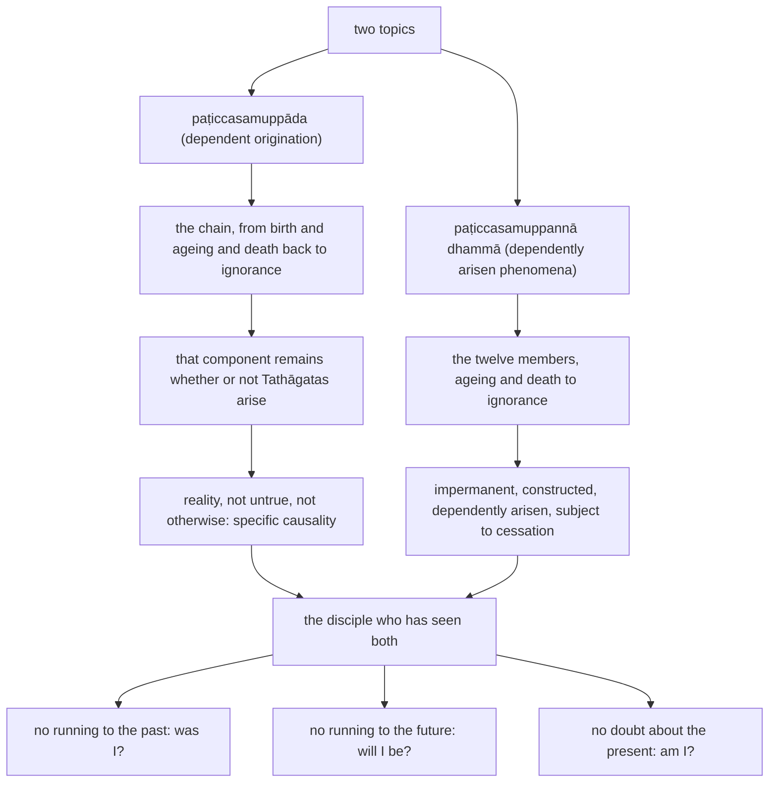

import { Tabs, TabItem } from '@astrojs/starlight/components';

Original text: [12S2/1.2.10 Paccayasutta 119–127](https://tipitaka2500.github.io/tipitaka/12S2/1/1.2/1.2.10.html#119) in the [World Tipitaka Edition](https://tipitaka2500.github.io)

## Summary

The Bhagavā distinguishes dependent origination from the dependently arisen phenomena (12S2/1.2.10). Dependent origination is the causal relation itself, which remains whether or not Tathāgatas arise, specific causality, which the Tathāgata awakens to and makes clear. The dependently arisen phenomena are the twelve members themselves, each impermanent, constructed and subject to cessation. A disciple who has seen both as they really are does not run to the questions of what he was, will be or is.

## Diagram

## Text

<Tabs syncKey="paliquote">
<TabItem label="My Translation">
(20.)

119\. [The Bhagavā] was dwelling at Sāvatthī. “I will teach you, Bhikkhave, `paṭiccasamuppāda` (dependent origination) and the `paṭiccasamuppannā dhammā` (dependently arisen phenomena). Listen and pay close attention, I will speak.” “Yes, Bhante,” those bhikkhū replied to the Bhagavā. The Bhagavā said this:

120\. “And what, Bhikkhave, is `paṭiccasamuppādo` (dependent origination)? With birth as cause, Bhikkhave, `jarāmaraṇa` (ageing and death) [arise]. Whether there is an arising of Tathāgatas or no arising of Tathāgatas, that `dhātu` (component) just remains: `dhammaṭṭhitatā` (the regularity of natural principles), `dhammaniyāmatā` (the invariance of natural principles), `idappaccayatā` (specific causality). That the Tathāgata fully awakens to and completely realises. Having fully awakened to it and completely realised it, he tells of it, teaches it, proclaims it, sets it forth, reveals it, analyses it, and makes it clear. And he says, ‘See!’ — ‘With birth as cause, Bhikkhave, ageing and death [arise]’.

121\. With existence as cause, Bhikkhave, birth [arises] … and so on … with fuel as cause, Bhikkhave, existence [arises] … with craving as cause, Bhikkhave, fuel [arises] … with feeling as cause, Bhikkhave, craving [arises] … with contact as cause, Bhikkhave, feeling [arises] … with the six sense bases as cause, Bhikkhave, contact [arises] … with phenomenal objects as cause, Bhikkhave, the six sense bases [arise] … with consciousness as cause, Bhikkhave, phenomenal objects [arise] … with mental constructions as cause, Bhikkhave, consciousness [arises] … with ignorance as cause, Bhikkhave, mental constructions [arise]: whether there is an arising of Tathāgatas or no arising of Tathāgatas, that component just remains: the regularity of natural principles, the invariance of natural principles, specific causality. That the Tathāgata fully awakens to and completely realises. Having fully awakened to it and completely realised it, he tells of it, teaches it, proclaims it, sets it forth, reveals it, analyses it, and makes it clear. And he says, ‘See!’ — ‘With ignorance as cause, Bhikkhave, mental constructions [arise]’. Thus, Bhikkhave, whatever therein is `tathatā` (reality), `avitathatā` (not being untrue), `anaññathatā` (not being otherwise), specific causality — this, Bhikkhave, is called dependent origination.

122\. And what, Bhikkhave, are the `paṭiccasamuppannā dhammā` (dependently arisen phenomena)? Ageing and death, Bhikkhave, is impermanent, constructed, dependently arisen, subject to decay, subject to disappearance, subject to fading away, subject to cessation. Birth, Bhikkhave, is impermanent, constructed, dependently arisen, subject to decay, subject to disappearance, subject to fading away, subject to cessation. Existence, Bhikkhave, is impermanent, constructed, dependently arisen, subject to decay, subject to disappearance, subject to fading away, subject to cessation. Fuel, Bhikkhave, … and so on … craving, Bhikkhave, … feeling, Bhikkhave, … contact, Bhikkhave, … the six sense bases, Bhikkhave, … phenomenal objects, Bhikkhave, … consciousness, Bhikkhave, … mental constructions, Bhikkhave, … ignorance, Bhikkhave, is impermanent, constructed, dependently arisen, subject to decay, subject to disappearance, subject to fading away, subject to cessation. These, Bhikkhave, are called the dependently arisen phenomena.

123\. When, Bhikkhave, ‘this dependent origination and these dependently arisen phenomena’ have been well seen as they really are with correct understanding by a disciple of the liberated, that he will indeed run back to the past — ‘Was I in the past? Was I not in the past? What was I in the past? How was I in the past? Having been what, what was I in the past?’; or run towards the future — ‘Will I be in the future? Will I not be in the future? What will I be in the future? How will I be in the future? Having been what, what will I be in the future?’; or now, in the present time, be inwardly in doubt — ‘Am I? Am I not? What am I? How am I? This being, where has it come from? Where will it go?’ — this is not possible. For what reason? Because, Bhikkhave, this dependent origination and these dependently arisen phenomena have been well seen as they really are with correct understanding by the disciple of the liberated.”

124\. The tenth [discourse of the chapter].

125\. The Āhāravagga (Chapter on Food), the second.

126\. Its summary:

127\. _Āhāra and Phagguna,_ \
_And the two Samaṇabrāhmaṇa;_ \
_Kaccānagotta, Dhammakathika,_ \
_Acela and Timbaruka;_ \
_And Bālapaṇḍita,_ \
_And the tenth, Paccaya._
</TabItem>

<TabItem label="Pāḷi (Roman IAST)">
(20.)

119\. Sāvatthiyaṃ viharati. “Paṭiccasamuppādañca vo, bhikkhave, desessāmi paṭiccasamuppanne ca dhamme. Taṃ suṇātha, sādhukaṃ manasi karotha, bhāsissāmī”ti. “Evaṃ, bhante”ti kho te bhikkhū bhagavato paccassosuṃ. Bhagavā etadavoca—

120\. “Katamo ca, bhikkhave, paṭiccasamuppādo? Jātipaccayā, bhikkhave, jarāmaraṇaṃ. Uppādā vā tathāgatānaṃ anuppādā vā tathāgatānaṃ, ṭhitāva sā dhātu dhammaṭṭhitatā dhammaniyāmatā idappaccayatā. Taṃ tathāgato abhisambujjhati abhisameti. Abhisambujjhitvā abhisametvā ācikkhati deseti paññāpeti paṭṭhapeti vivarati vibhajati uttānīkaroti. ‘Passathā’ti cāha— ‘jātipaccayā, bhikkhave, jarāmaraṇaṃ’.

121\. Bhavapaccayā, bhikkhave, jāti…pe… upādānapaccayā, bhikkhave, bhavo… taṇhāpaccayā, bhikkhave, upādānaṃ… vedanāpaccayā, bhikkhave, taṇhā… phassapaccayā, bhikkhave, vedanā… saḷāyatanapaccayā, bhikkhave, phasso… nāmarūpapaccayā, bhikkhave, saḷāyatanaṃ… viññāṇapaccayā, bhikkhave, nāmarūpaṃ… saṅkhārapaccayā, bhikkhave, viññāṇaṃ… avijjāpaccayā, bhikkhave, saṅkhārā uppādā vā tathāgatānaṃ anuppādā vā tathāgatānaṃ, ṭhitāva sā dhātu dhammaṭṭhitatā dhammaniyāmatā idappaccayatā. Taṃ tathāgato abhisambujjhati abhisameti. Abhisambujjhitvā abhisametvā ācikkhati deseti paññāpeti paṭṭhapeti vivarati vibhajati uttānīkaroti. ‘Passathā’ti cāha— ‘avijjāpaccayā, bhikkhave, saṅkhārā’. Iti kho, bhikkhave, yā tatra tathatā avitathatā anaññathatā idappaccayatā— ayaṃ vuccati, bhikkhave, paṭiccasamuppādo.

122\. Katame ca, bhikkhave, paṭiccasamuppannā dhammā? Jarāmaraṇaṃ, bhikkhave, aniccaṃ saṅkhataṃ paṭiccasamuppannaṃ khayadhammaṃ vayadhammaṃ virāgadhammaṃ nirodhadhammaṃ. Jāti, bhikkhave, aniccā saṅkhatā paṭiccasamuppannā khayadhammā vayadhammā virāgadhammā nirodhadhammā. Bhavo, bhikkhave, anicco saṅkhato paṭiccasamuppanno khayadhammo vayadhammo virāgadhammo nirodhadhammo. Upādānaṃ bhikkhave…pe… taṇhā, bhikkhave… vedanā, bhikkhave… phasso, bhikkhave… saḷāyatanaṃ, bhikkhave… nāmarūpaṃ, bhikkhave… viññāṇaṃ, bhikkhave… saṅkhārā, bhikkhave… avijjā, bhikkhave, aniccā saṅkhatā paṭiccasamuppannā khayadhammā vayadhammā virāgadhammā nirodhadhammā. Ime vuccanti, bhikkhave, paṭiccasamuppannā dhammā.

123\. Yato kho, bhikkhave, ariyasāvakassa ‘ayañca paṭiccasamuppādo, ime ca paṭiccasamuppannā dhammā’ yathābhūtaṃ sammappaññāya sudiṭṭhā honti, so vata pubbantaṃ vā paṭidhāvissati— ‘ahosiṃ nu kho ahaṃ atītamaddhānaṃ, nanu kho ahosiṃ atītamaddhānaṃ, kiṃ nu kho ahosiṃ atītamaddhānaṃ, kathaṃ nu kho ahosiṃ atītamaddhānaṃ, kiṃ hutvā kiṃ ahosiṃ nu kho ahaṃ atītamaddhānan’ti; aparantaṃ vā upadhāvissati— ‘bhavissāmi nu kho ahaṃ anāgatamaddhānaṃ, nanu kho bhavissāmi anāgatamaddhānaṃ, kiṃ nu kho bhavissāmi anāgatamaddhānaṃ, kathaṃ nu kho bhavissāmi anāgatamaddhānaṃ, kiṃ hutvā kiṃ bhavissāmi nu kho ahaṃ anāgatamaddhānan’ti; etarahi vā paccuppannaṃ addhānaṃ ajjhattaṃ kathaṃkathī bhavissati— ‘ahaṃ nu khosmi, no nu khosmi, kiṃ nu khosmi, kathaṃ nu khosmi, ayaṃ nu kho satto kuto āgato, so kuhiṃ gamissatī’ti— netaṃ ṭhānaṃ vijjati. Taṃ kissa hetu? Tathā hi, bhikkhave, ariyasāvakassa ayañca paṭiccasamuppādo ime ca paṭiccasamuppannā dhammā yathābhūtaṃ sammappaññāya sudiṭṭhā”ti.

124\. Dasamaṃ.

125\. Āhāravaggo dutiyo.

126\. Tassuddānaṃ

127\. _Āhāraṃ phagguno ceva,_  
_Dve ca samaṇabrāhmaṇā;_  
_Kaccānagotta dhammakathikaṃ,_  
_Acelaṃ timbarukena ca;_  
_Bālapaṇḍitato ceva,_  
_Dasamo paccayena cāti._
</TabItem>

<TabItem label="Pāḷi (Brahmi)">
(20.)

119\. 𑀲𑀸𑀯𑀢𑁆𑀣𑀺𑀬𑀁 𑀯𑀺𑀳𑀭𑀢𑀺. “𑀧𑀝𑀺𑀘𑁆𑀘𑀲𑀫𑀼𑀧𑁆𑀧𑀸𑀤𑀜𑁆𑀘 𑀯𑁄, 𑀪𑀺𑀓𑁆𑀔𑀯𑁂, 𑀤𑁂𑀲𑁂𑀲𑁆𑀲𑀸𑀫𑀺 𑀧𑀝𑀺𑀘𑁆𑀘𑀲𑀫𑀼𑀧𑁆𑀧𑀦𑁆𑀦𑁂 𑀘 𑀥𑀫𑁆𑀫𑁂. 𑀢𑀁 𑀲𑀼𑀡𑀸𑀣, 𑀲𑀸𑀥𑀼𑀓𑀁 𑀫𑀦𑀲𑀺 𑀓𑀭𑁄𑀣, 𑀪𑀸𑀲𑀺𑀲𑁆𑀲𑀸𑀫𑀻”𑀢𑀺. “𑀏𑀯𑀁, 𑀪𑀦𑁆𑀢𑁂”𑀢𑀺 𑀔𑁄 𑀢𑁂 𑀪𑀺𑀓𑁆𑀔𑀽 𑀪𑀕𑀯𑀢𑁄 𑀧𑀘𑁆𑀘𑀲𑁆𑀲𑁄𑀲𑀼𑀁. 𑀪𑀕𑀯𑀸 𑀏𑀢𑀤𑀯𑁄𑀘—

120\. “𑀓𑀢𑀫𑁄 𑀘, 𑀪𑀺𑀓𑁆𑀔𑀯𑁂, 𑀧𑀝𑀺𑀘𑁆𑀘𑀲𑀫𑀼𑀧𑁆𑀧𑀸𑀤𑁄? 𑀚𑀸𑀢𑀺𑀧𑀘𑁆𑀘𑀬𑀸, 𑀪𑀺𑀓𑁆𑀔𑀯𑁂, 𑀚𑀭𑀸𑀫𑀭𑀡𑀁. 𑀉𑀧𑁆𑀧𑀸𑀤𑀸 𑀯𑀸 𑀢𑀣𑀸𑀕𑀢𑀸𑀦𑀁 𑀅𑀦𑀼𑀧𑁆𑀧𑀸𑀤𑀸 𑀯𑀸 𑀢𑀣𑀸𑀕𑀢𑀸𑀦𑀁, 𑀞𑀺𑀢𑀸𑀯 𑀲𑀸 𑀥𑀸𑀢𑀼 𑀥𑀫𑁆𑀫𑀝𑁆𑀞𑀺𑀢𑀢𑀸 𑀥𑀫𑁆𑀫𑀦𑀺𑀬𑀸𑀫𑀢𑀸 𑀇𑀤𑀧𑁆𑀧𑀘𑁆𑀘𑀬𑀢𑀸. 𑀢𑀁 𑀢𑀣𑀸𑀕𑀢𑁄 𑀅𑀪𑀺𑀲𑀫𑁆𑀩𑀼𑀚𑁆𑀛𑀢𑀺 𑀅𑀪𑀺𑀲𑀫𑁂𑀢𑀺. 𑀅𑀪𑀺𑀲𑀫𑁆𑀩𑀼𑀚𑁆𑀛𑀺𑀢𑁆𑀯𑀸 𑀅𑀪𑀺𑀲𑀫𑁂𑀢𑁆𑀯𑀸 𑀆𑀘𑀺𑀓𑁆𑀔𑀢𑀺 𑀤𑁂𑀲𑁂𑀢𑀺 𑀧𑀜𑁆𑀜𑀸𑀧𑁂𑀢𑀺 𑀧𑀝𑁆𑀞𑀧𑁂𑀢𑀺 𑀯𑀺𑀯𑀭𑀢𑀺 𑀯𑀺𑀪𑀚𑀢𑀺 𑀉𑀢𑁆𑀢𑀸𑀦𑀻𑀓𑀭𑁄𑀢𑀺. ‘𑀧𑀲𑁆𑀲𑀣𑀸’𑀢𑀺 𑀘𑀸𑀳— ‘𑀚𑀸𑀢𑀺𑀧𑀘𑁆𑀘𑀬𑀸, 𑀪𑀺𑀓𑁆𑀔𑀯𑁂, 𑀚𑀭𑀸𑀫𑀭𑀡𑀁’.

121\. 𑀪𑀯𑀧𑀘𑁆𑀘𑀬𑀸, 𑀪𑀺𑀓𑁆𑀔𑀯𑁂, 𑀚𑀸𑀢𑀺…𑀧𑁂… 𑀉𑀧𑀸𑀤𑀸𑀦𑀧𑀘𑁆𑀘𑀬𑀸, 𑀪𑀺𑀓𑁆𑀔𑀯𑁂, 𑀪𑀯𑁄… 𑀢𑀡𑁆𑀳𑀸𑀧𑀘𑁆𑀘𑀬𑀸, 𑀪𑀺𑀓𑁆𑀔𑀯𑁂, 𑀉𑀧𑀸𑀤𑀸𑀦𑀁… 𑀯𑁂𑀤𑀦𑀸𑀧𑀘𑁆𑀘𑀬𑀸, 𑀪𑀺𑀓𑁆𑀔𑀯𑁂, 𑀢𑀡𑁆𑀳𑀸… 𑀨𑀲𑁆𑀲𑀧𑀘𑁆𑀘𑀬𑀸, 𑀪𑀺𑀓𑁆𑀔𑀯𑁂, 𑀯𑁂𑀤𑀦𑀸… 𑀲𑀍𑀆𑀬𑀢𑀦𑀧𑀘𑁆𑀘𑀬𑀸, 𑀪𑀺𑀓𑁆𑀔𑀯𑁂, 𑀨𑀲𑁆𑀲𑁄… 𑀦𑀸𑀫𑀭𑀽𑀧𑀧𑀘𑁆𑀘𑀬𑀸, 𑀪𑀺𑀓𑁆𑀔𑀯𑁂, 𑀲𑀍𑀆𑀬𑀢𑀦𑀁… 𑀯𑀺𑀜𑁆𑀜𑀸𑀡𑀧𑀘𑁆𑀘𑀬𑀸, 𑀪𑀺𑀓𑁆𑀔𑀯𑁂, 𑀦𑀸𑀫𑀭𑀽𑀧𑀁… 𑀲𑀗𑁆𑀔𑀸𑀭𑀧𑀘𑁆𑀘𑀬𑀸, 𑀪𑀺𑀓𑁆𑀔𑀯𑁂, 𑀯𑀺𑀜𑁆𑀜𑀸𑀡𑀁… 𑀅𑀯𑀺𑀚𑁆𑀚𑀸𑀧𑀘𑁆𑀘𑀬𑀸, 𑀪𑀺𑀓𑁆𑀔𑀯𑁂, 𑀲𑀗𑁆𑀔𑀸𑀭𑀸 𑀉𑀧𑁆𑀧𑀸𑀤𑀸 𑀯𑀸 𑀢𑀣𑀸𑀕𑀢𑀸𑀦𑀁 𑀅𑀦𑀼𑀧𑁆𑀧𑀸𑀤𑀸 𑀯𑀸 𑀢𑀣𑀸𑀕𑀢𑀸𑀦𑀁, 𑀞𑀺𑀢𑀸𑀯 𑀲𑀸 𑀥𑀸𑀢𑀼 𑀥𑀫𑁆𑀫𑀝𑁆𑀞𑀺𑀢𑀢𑀸 𑀥𑀫𑁆𑀫𑀦𑀺𑀬𑀸𑀫𑀢𑀸 𑀇𑀤𑀧𑁆𑀧𑀘𑁆𑀘𑀬𑀢𑀸. 𑀢𑀁 𑀢𑀣𑀸𑀕𑀢𑁄 𑀅𑀪𑀺𑀲𑀫𑁆𑀩𑀼𑀚𑁆𑀛𑀢𑀺 𑀅𑀪𑀺𑀲𑀫𑁂𑀢𑀺. 𑀅𑀪𑀺𑀲𑀫𑁆𑀩𑀼𑀚𑁆𑀛𑀺𑀢𑁆𑀯𑀸 𑀅𑀪𑀺𑀲𑀫𑁂𑀢𑁆𑀯𑀸 𑀆𑀘𑀺𑀓𑁆𑀔𑀢𑀺 𑀤𑁂𑀲𑁂𑀢𑀺 𑀧𑀜𑁆𑀜𑀸𑀧𑁂𑀢𑀺 𑀧𑀝𑁆𑀞𑀧𑁂𑀢𑀺 𑀯𑀺𑀯𑀭𑀢𑀺 𑀯𑀺𑀪𑀚𑀢𑀺 𑀉𑀢𑁆𑀢𑀸𑀦𑀻𑀓𑀭𑁄𑀢𑀺. ‘𑀧𑀲𑁆𑀲𑀣𑀸’𑀢𑀺 𑀘𑀸𑀳— ‘𑀅𑀯𑀺𑀚𑁆𑀚𑀸𑀧𑀘𑁆𑀘𑀬𑀸, 𑀪𑀺𑀓𑁆𑀔𑀯𑁂, 𑀲𑀗𑁆𑀔𑀸𑀭𑀸’. 𑀇𑀢𑀺 𑀔𑁄, 𑀪𑀺𑀓𑁆𑀔𑀯𑁂, 𑀬𑀸 𑀢𑀢𑁆𑀭 𑀢𑀣𑀢𑀸 𑀅𑀯𑀺𑀢𑀣𑀢𑀸 𑀅𑀦𑀜𑁆𑀜𑀣𑀢𑀸 𑀇𑀤𑀧𑁆𑀧𑀘𑁆𑀘𑀬𑀢𑀸— 𑀅𑀬𑀁 𑀯𑀼𑀘𑁆𑀘𑀢𑀺, 𑀪𑀺𑀓𑁆𑀔𑀯𑁂, 𑀧𑀝𑀺𑀘𑁆𑀘𑀲𑀫𑀼𑀧𑁆𑀧𑀸𑀤𑁄.

122\. 𑀓𑀢𑀫𑁂 𑀘, 𑀪𑀺𑀓𑁆𑀔𑀯𑁂, 𑀧𑀝𑀺𑀘𑁆𑀘𑀲𑀫𑀼𑀧𑁆𑀧𑀦𑁆𑀦𑀸 𑀥𑀫𑁆𑀫𑀸? 𑀚𑀭𑀸𑀫𑀭𑀡𑀁, 𑀪𑀺𑀓𑁆𑀔𑀯𑁂, 𑀅𑀦𑀺𑀘𑁆𑀘𑀁 𑀲𑀗𑁆𑀔𑀢𑀁 𑀧𑀝𑀺𑀘𑁆𑀘𑀲𑀫𑀼𑀧𑁆𑀧𑀦𑁆𑀦𑀁 𑀔𑀬𑀥𑀫𑁆𑀫𑀁 𑀯𑀬𑀥𑀫𑁆𑀫𑀁 𑀯𑀺𑀭𑀸𑀕𑀥𑀫𑁆𑀫𑀁 𑀦𑀺𑀭𑁄𑀥𑀥𑀫𑁆𑀫𑀁. 𑀚𑀸𑀢𑀺, 𑀪𑀺𑀓𑁆𑀔𑀯𑁂, 𑀅𑀦𑀺𑀘𑁆𑀘𑀸 𑀲𑀗𑁆𑀔𑀢𑀸 𑀧𑀝𑀺𑀘𑁆𑀘𑀲𑀫𑀼𑀧𑁆𑀧𑀦𑁆𑀦𑀸 𑀔𑀬𑀥𑀫𑁆𑀫𑀸 𑀯𑀬𑀥𑀫𑁆𑀫𑀸 𑀯𑀺𑀭𑀸𑀕𑀥𑀫𑁆𑀫𑀸 𑀦𑀺𑀭𑁄𑀥𑀥𑀫𑁆𑀫𑀸. 𑀪𑀯𑁄, 𑀪𑀺𑀓𑁆𑀔𑀯𑁂, 𑀅𑀦𑀺𑀘𑁆𑀘𑁄 𑀲𑀗𑁆𑀔𑀢𑁄 𑀧𑀝𑀺𑀘𑁆𑀘𑀲𑀫𑀼𑀧𑁆𑀧𑀦𑁆𑀦𑁄 𑀔𑀬𑀥𑀫𑁆𑀫𑁄 𑀯𑀬𑀥𑀫𑁆𑀫𑁄 𑀯𑀺𑀭𑀸𑀕𑀥𑀫𑁆𑀫𑁄 𑀦𑀺𑀭𑁄𑀥𑀥𑀫𑁆𑀫𑁄. 𑀉𑀧𑀸𑀤𑀸𑀦𑀁 𑀪𑀺𑀓𑁆𑀔𑀯𑁂…𑀧𑁂… 𑀢𑀡𑁆𑀳𑀸, 𑀪𑀺𑀓𑁆𑀔𑀯𑁂… 𑀯𑁂𑀤𑀦𑀸, 𑀪𑀺𑀓𑁆𑀔𑀯𑁂… 𑀨𑀲𑁆𑀲𑁄, 𑀪𑀺𑀓𑁆𑀔𑀯𑁂… 𑀲𑀍𑀆𑀬𑀢𑀦𑀁, 𑀪𑀺𑀓𑁆𑀔𑀯𑁂… 𑀦𑀸𑀫𑀭𑀽𑀧𑀁, 𑀪𑀺𑀓𑁆𑀔𑀯𑁂… 𑀯𑀺𑀜𑁆𑀜𑀸𑀡𑀁, 𑀪𑀺𑀓𑁆𑀔𑀯𑁂… 𑀲𑀗𑁆𑀔𑀸𑀭𑀸, 𑀪𑀺𑀓𑁆𑀔𑀯𑁂… 𑀅𑀯𑀺𑀚𑁆𑀚𑀸, 𑀪𑀺𑀓𑁆𑀔𑀯𑁂, 𑀅𑀦𑀺𑀘𑁆𑀘𑀸 𑀲𑀗𑁆𑀔𑀢𑀸 𑀧𑀝𑀺𑀘𑁆𑀘𑀲𑀫𑀼𑀧𑁆𑀧𑀦𑁆𑀦𑀸 𑀔𑀬𑀥𑀫𑁆𑀫𑀸 𑀯𑀬𑀥𑀫𑁆𑀫𑀸 𑀯𑀺𑀭𑀸𑀕𑀥𑀫𑁆𑀫𑀸 𑀦𑀺𑀭𑁄𑀥𑀥𑀫𑁆𑀫𑀸. 𑀇𑀫𑁂 𑀯𑀼𑀘𑁆𑀘𑀦𑁆𑀢𑀺, 𑀪𑀺𑀓𑁆𑀔𑀯𑁂, 𑀧𑀝𑀺𑀘𑁆𑀘𑀲𑀫𑀼𑀧𑁆𑀧𑀦𑁆𑀦𑀸 𑀥𑀫𑁆𑀫𑀸.

123\. 𑀬𑀢𑁄 𑀔𑁄, 𑀪𑀺𑀓𑁆𑀔𑀯𑁂, 𑀅𑀭𑀺𑀬𑀲𑀸𑀯𑀓𑀲𑁆𑀲 ‘𑀅𑀬𑀜𑁆𑀘 𑀧𑀝𑀺𑀘𑁆𑀘𑀲𑀫𑀼𑀧𑁆𑀧𑀸𑀤𑁄, 𑀇𑀫𑁂 𑀘 𑀧𑀝𑀺𑀘𑁆𑀘𑀲𑀫𑀼𑀧𑁆𑀧𑀦𑁆𑀦𑀸 𑀥𑀫𑁆𑀫𑀸’ 𑀬𑀣𑀸𑀪𑀽𑀢𑀁 𑀲𑀫𑁆𑀫𑀧𑁆𑀧𑀜𑁆𑀜𑀸𑀬 𑀲𑀼𑀤𑀺𑀝𑁆𑀞𑀸 𑀳𑁄𑀦𑁆𑀢𑀺, 𑀲𑁄 𑀯𑀢 𑀧𑀼𑀩𑁆𑀩𑀦𑁆𑀢𑀁 𑀯𑀸 𑀧𑀝𑀺𑀥𑀸𑀯𑀺𑀲𑁆𑀲𑀢𑀺— ‘𑀅𑀳𑁄𑀲𑀺𑀁 𑀦𑀼 𑀔𑁄 𑀅𑀳𑀁 𑀅𑀢𑀻𑀢𑀫𑀤𑁆𑀥𑀸𑀦𑀁, 𑀦𑀦𑀼 𑀔𑁄 𑀅𑀳𑁄𑀲𑀺𑀁 𑀅𑀢𑀻𑀢𑀫𑀤𑁆𑀥𑀸𑀦𑀁, 𑀓𑀺𑀁 𑀦𑀼 𑀔𑁄 𑀅𑀳𑁄𑀲𑀺𑀁 𑀅𑀢𑀻𑀢𑀫𑀤𑁆𑀥𑀸𑀦𑀁, 𑀓𑀣𑀁 𑀦𑀼 𑀔𑁄 𑀅𑀳𑁄𑀲𑀺𑀁 𑀅𑀢𑀻𑀢𑀫𑀤𑁆𑀥𑀸𑀦𑀁, 𑀓𑀺𑀁 𑀳𑀼𑀢𑁆𑀯𑀸 𑀓𑀺𑀁 𑀅𑀳𑁄𑀲𑀺𑀁 𑀦𑀼 𑀔𑁄 𑀅𑀳𑀁 𑀅𑀢𑀻𑀢𑀫𑀤𑁆𑀥𑀸𑀦𑀦𑁆’𑀢𑀺; 𑀅𑀧𑀭𑀦𑁆𑀢𑀁 𑀯𑀸 𑀉𑀧𑀥𑀸𑀯𑀺𑀲𑁆𑀲𑀢𑀺— ‘𑀪𑀯𑀺𑀲𑁆𑀲𑀸𑀫𑀺 𑀦𑀼 𑀔𑁄 𑀅𑀳𑀁 𑀅𑀦𑀸𑀕𑀢𑀫𑀤𑁆𑀥𑀸𑀦𑀁, 𑀦𑀦𑀼 𑀔𑁄 𑀪𑀯𑀺𑀲𑁆𑀲𑀸𑀫𑀺 𑀅𑀦𑀸𑀕𑀢𑀫𑀤𑁆𑀥𑀸𑀦𑀁, 𑀓𑀺𑀁 𑀦𑀼 𑀔𑁄 𑀪𑀯𑀺𑀲𑁆𑀲𑀸𑀫𑀺 𑀅𑀦𑀸𑀕𑀢𑀫𑀤𑁆𑀥𑀸𑀦𑀁, 𑀓𑀣𑀁 𑀦𑀼 𑀔𑁄 𑀪𑀯𑀺𑀲𑁆𑀲𑀸𑀫𑀺 𑀅𑀦𑀸𑀕𑀢𑀫𑀤𑁆𑀥𑀸𑀦𑀁, 𑀓𑀺𑀁 𑀳𑀼𑀢𑁆𑀯𑀸 𑀓𑀺𑀁 𑀪𑀯𑀺𑀲𑁆𑀲𑀸𑀫𑀺 𑀦𑀼 𑀔𑁄 𑀅𑀳𑀁 𑀅𑀦𑀸𑀕𑀢𑀫𑀤𑁆𑀥𑀸𑀦𑀦𑁆’𑀢𑀺; 𑀏𑀢𑀭𑀳𑀺 𑀯𑀸 𑀧𑀘𑁆𑀘𑀼𑀧𑁆𑀧𑀦𑁆𑀦𑀁 𑀅𑀤𑁆𑀥𑀸𑀦𑀁 𑀅𑀚𑁆𑀛𑀢𑁆𑀢𑀁 𑀓𑀣𑀁𑀓𑀣𑀻 𑀪𑀯𑀺𑀲𑁆𑀲𑀢𑀺— ‘𑀅𑀳𑀁 𑀦𑀼 𑀔𑁄𑀲𑁆𑀫𑀺, 𑀦𑁄 𑀦𑀼 𑀔𑁄𑀲𑁆𑀫𑀺, 𑀓𑀺𑀁 𑀦𑀼 𑀔𑁄𑀲𑁆𑀫𑀺, 𑀓𑀣𑀁 𑀦𑀼 𑀔𑁄𑀲𑁆𑀫𑀺, 𑀅𑀬𑀁 𑀦𑀼 𑀔𑁄 𑀲𑀢𑁆𑀢𑁄 𑀓𑀼𑀢𑁄 𑀆𑀕𑀢𑁄, 𑀲𑁄 𑀓𑀼𑀳𑀺𑀁 𑀕𑀫𑀺𑀲𑁆𑀲𑀢𑀻’𑀢𑀺— 𑀦𑁂𑀢𑀁 𑀞𑀸𑀦𑀁 𑀯𑀺𑀚𑁆𑀚𑀢𑀺. 𑀢𑀁 𑀓𑀺𑀲𑁆𑀲 𑀳𑁂𑀢𑀼? 𑀢𑀣𑀸 𑀳𑀺, 𑀪𑀺𑀓𑁆𑀔𑀯𑁂, 𑀅𑀭𑀺𑀬𑀲𑀸𑀯𑀓𑀲𑁆𑀲 𑀅𑀬𑀜𑁆𑀘 𑀧𑀝𑀺𑀘𑁆𑀘𑀲𑀫𑀼𑀧𑁆𑀧𑀸𑀤𑁄 𑀇𑀫𑁂 𑀘 𑀧𑀝𑀺𑀘𑁆𑀘𑀲𑀫𑀼𑀧𑁆𑀧𑀦𑁆𑀦𑀸 𑀥𑀫𑁆𑀫𑀸 𑀬𑀣𑀸𑀪𑀽𑀢𑀁 𑀲𑀫𑁆𑀫𑀧𑁆𑀧𑀜𑁆𑀜𑀸𑀬 𑀲𑀼𑀤𑀺𑀝𑁆𑀞𑀸”𑀢𑀺.

124\. 𑀤𑀲𑀫𑀁.

125\. 𑀆𑀳𑀸𑀭𑀯𑀕𑁆𑀕𑁄 𑀤𑀼𑀢𑀺𑀬𑁄.

126\. 𑀢𑀲𑁆𑀲𑀼𑀤𑁆𑀤𑀸𑀦𑀁

127\. _𑀆𑀳𑀸𑀭𑀁 𑀨𑀕𑁆𑀕𑀼𑀦𑁄 𑀘𑁂𑀯,_  
_𑀤𑁆𑀯𑁂 𑀘 𑀲𑀫𑀡𑀩𑁆𑀭𑀸𑀳𑁆𑀫𑀡𑀸;_  
_𑀓𑀘𑁆𑀘𑀸𑀦𑀕𑁄𑀢𑁆𑀢 𑀥𑀫𑁆𑀫𑀓𑀣𑀺𑀓𑀁,_  
_𑀅𑀘𑁂𑀮𑀁 𑀢𑀺𑀫𑁆𑀩𑀭𑀼𑀓𑁂𑀦 𑀘;_  
_𑀩𑀸𑀮𑀧𑀡𑁆𑀟𑀺𑀢𑀢𑁄 𑀘𑁂𑀯,_  
_𑀤𑀲𑀫𑁄 𑀧𑀘𑁆𑀘𑀬𑁂𑀦 𑀘𑀸𑀢𑀺._
</TabItem>

<TabItem label="Interlinear">
(20.)

[119](https://tipitaka2500.github.io/tipitaka/12S2/1/1.2/1.2.10.html#119) Sāvatthiyaṃ viharati.  
🚺⨀⑦(sāvatthī) 🟢⨀🤟▶️(viharati)  
at Sāvatthī | dwells  
[The Bhagavā] was dwelling at Sāvatthī.

“Paṭiccasamuppādañca vo, bhikkhave, desessāmi paṭiccasamuppanne ca dhamme.  
🚹⨀②🆎(paṭicca+samuppāda) ⏏️(ca) *️⃣🤘⚧⨂④(tvaṃ) 🚹⨂⓪(bhikkhu) 🟠⨀👆⏭(deseti) 🚹⨂②🔽(ta)🆎(paṭicca+samuppanna) ⏏️(ca) 🚹⨂②(dhamma)  
dependent origination | and | to you | Bhikkhave | I will teach | dependently arisen | and | phenomena  
“I will teach you, Bhikkhave, `paṭiccasamuppāda` (dependent origination) and the `paṭiccasamuppannā dhammā` (dependently arisen phenomena).

Taṃ suṇātha, sādhukaṃ manasi karotha, bhāsissāmī”ti.  
*️⃣🤟🚹⨀②(ta) 🟢⨂🤘⏹(suṇāti) ⏏️(sādhukaṃ) 🚹⨀⑦(mano) 🟢⨂🤘⏹(karoti) 🟢⨀👆⏭(bhāsati) ⏏️(iti)  
that | listen | carefully | in mind | make | I will speak | (end quote)  
Listen and pay close attention, I will speak.”

“Evaṃ, bhante”ti kho te bhikkhū bhagavato paccassosuṃ.  
⏏️(evaṃ) 🚹⨀⓪(bhavant) ⏏️(iti) ⏏️(kho) *️⃣🤟🚹⨂①(ta) 🚹⨂①(bhikkhu) 🚹⨀④(bhagavant) 🟢⨂🤟⏮(paṭissuṇāti)  
yes | Bhante | (end quote) | indeed | those | bhikkhū | to the Bhagavā | replied  
“Yes, Bhante,” those bhikkhū replied to the Bhagavā.

Bhagavā etadavoca—  
🚹⨀①(bhagavant) *️⃣🤟🚻⨀②(eta) 🟢⨀🤟⏮(vadati)  
the Bhagavā | this | said  
The Bhagavā said this:

[120](https://tipitaka2500.github.io/tipitaka/12S2/1/1.2/1.2.10.html#120) “Katamo ca, bhikkhave, paṭiccasamuppādo?  
*️⃣🤟🚹⨀①(katama) ⏏️(ca) 🚹⨂⓪(bhikkhu) 🚹⨀①🆎(paṭicca+samuppāda)  
which | and | Bhikkhave | dependent origination  
“And what, Bhikkhave, is `paṭiccasamuppādo` (dependent origination)?

Jātipaccayā, bhikkhave, jarāmaraṇaṃ.  
🚹⨀⑤🆎(jāti+paccaya) 🚹⨂⓪(bhikkhu) 🚻⨀①🆎(jarā+maraṇa)  
with birth as cause | Bhikkhave | ageing and death  
With birth as cause, Bhikkhave, `jarāmaraṇa` (ageing and death) [arise].

Uppādā vā tathāgatānaṃ anuppādā vā tathāgatānaṃ, ṭhitāva sā dhātu dhammaṭṭhitatā dhammaniyāmatā idappaccayatā.  
🚹⨀⑤(uppāda) ⏏️(vā) 🚹⨂⑥🆎(tathā+gata) 🚹⨀⑤🆎(na+uppāda) ⏏️(vā) 🚹⨂⑥🆎(tathā+gata) 🚺⨀①🔽(ta)(ṭhita) ⏏️(eva) *️⃣🤟🚺⨀①(ta) 🚺⨀①(dhātu) 🚺⨀①🆎(dhamma+ṭhitatā) 🚺⨀①🆎(dhamma+niyāmatā) 🚺⨀①(idappaccayatā)  
with the arising | or | of Tathāgatas | with the non-arising | or | of Tathāgatas | remains | just | that | component | the regularity of natural principles | the invariance of natural principles | specific causality  
Whether there is an arising of Tathāgatas or no arising of Tathāgatas, that `dhātu` (component) just remains: `dhammaṭṭhitatā` (the regularity of natural principles), `dhammaniyāmatā` (the invariance of natural principles), `idappaccayatā` (specific causality).

Taṃ tathāgato abhisambujjhati abhisameti.  
*️⃣🤟🚺⨀②(ta) 🚹⨀①🆎(tathā+gata) 🟢⨀🤟▶️(abhisambujjhati) 🟢⨀🤟▶️(abhisameti)  
that | the Tathāgata | fully awakens to | completely realises  
That the Tathāgata fully awakens to and completely realises.

Abhisambujjhitvā abhisametvā ācikkhati deseti paññāpeti paṭṭhapeti vivarati vibhajati uttānīkaroti.  
🔽(tvā)(abhisambujjhati) 🔽(tvā)(abhisameti) 🟢⨀🤟▶️(ācikkhati) 🟠⨀🤟▶️(deseti) 🟠⨀🤟▶️(paññāpeti) 🟠⨀🤟▶️(paṭṭhapeti) 🟢⨀🤟▶️(vivarati) 🟢⨀🤟▶️(vibhajati) 🟢⨀🤟▶️(uttānīkaroti)  
having fully awakened to | having completely realised | tells of | teaches | proclaims | sets forth | reveals | analyses | makes clear  
Having fully awakened to it and completely realised it, he tells of it, teaches it, proclaims it, sets it forth, reveals it, analyses it, and makes it clear.

‘Passathā’ti cāha— ‘jātipaccayā, bhikkhave, jarāmaraṇaṃ’.  
🟢⨂🤘⏹(passati) ⏏️(iti) ⏏️(ca) 🟢⨀🤟🔄(āha) 🚹⨀⑤🆎(jāti+paccaya) 🚹⨂⓪(bhikkhu) 🚻⨀①🆎(jarā+maraṇa)  
see | (end quote) | and | says | with birth as cause | Bhikkhave | ageing and death  
And he says, ‘See!’ — ‘With birth as cause, Bhikkhave, ageing and death [arise]’.

[121](https://tipitaka2500.github.io/tipitaka/12S2/1/1.2/1.2.10.html#121) Bhavapaccayā, bhikkhave, jāti…pe… upādānapaccayā, bhikkhave, bhavo… taṇhāpaccayā, bhikkhave, upādānaṃ… vedanāpaccayā, bhikkhave, taṇhā… phassapaccayā, bhikkhave, vedanā… saḷāyatanapaccayā, bhikkhave, phasso… nāmarūpapaccayā, bhikkhave, saḷāyatanaṃ… viññāṇapaccayā, bhikkhave, nāmarūpaṃ… saṅkhārapaccayā, bhikkhave, viññāṇaṃ… avijjāpaccayā, bhikkhave, saṅkhārā uppādā vā tathāgatānaṃ anuppādā vā tathāgatānaṃ, ṭhitāva sā dhātu dhammaṭṭhitatā dhammaniyāmatā idappaccayatā.  
🚹⨀⑤🆎(bhava+paccaya) 🚹⨂⓪(bhikkhu) 🚺⨀①(jāti) ⏏️(peyyāla) 🚹⨀⑤🆎(upādāna+paccaya) 🚹⨂⓪(bhikkhu) 🚹⨀①(bhava) 🚹⨀⑤🆎(taṇhā+paccaya) 🚹⨂⓪(bhikkhu) 🚻⨀①(upādāna) 🚹⨀⑤🆎(vedanā+paccaya) 🚹⨂⓪(bhikkhu) 🚺⨀①(taṇhā) 🚹⨀⑤🆎(phassa+paccaya) 🚹⨂⓪(bhikkhu) 🚺⨀①(vedanā) 🚹⨀⑤🆎(saḷāyatana+paccaya) 🚹⨂⓪(bhikkhu) 🚹⨀①(phassa) 🚹⨀⑤🆎(nāmarūpa+paccaya) 🚹⨂⓪(bhikkhu) 🚻⨀①🆎(cha+āyatana) 🚹⨀⑤🆎(viññāṇa+paccaya) 🚹⨂⓪(bhikkhu) 🚻⨀①🆎(nāma+rūpa) 🚹⨀⑤🆎(saṅkhāra+paccaya) 🚹⨂⓪(bhikkhu) 🚻⨀①(viññāṇa) 🚹⨀⑤🆎(avijjā+paccaya) 🚹⨂⓪(bhikkhu) 🚹⨂①(saṅkhāra) 🚹⨀⑤(uppāda) ⏏️(vā) 🚹⨂⑥🆎(tathā+gata) 🚹⨀⑤🆎(na+uppāda) ⏏️(vā) 🚹⨂⑥🆎(tathā+gata) 🚺⨀①🔽(ta)(ṭhita) ⏏️(eva) *️⃣🤟🚺⨀①(ta) 🚺⨀①(dhātu) 🚺⨀①🆎(dhamma+ṭhitatā) 🚺⨀①🆎(dhamma+niyāmatā) 🚺⨀①(idappaccayatā)  
with existence as cause | Bhikkhave | birth | (and so on) | with fuel as cause | Bhikkhave | existence | with craving as cause | Bhikkhave | fuel | with feeling as cause | Bhikkhave | craving | with contact as cause | Bhikkhave | feeling | with the six sense bases as cause | Bhikkhave | contact | with phenomenal objects as cause | Bhikkhave | the six sense bases | with consciousness as cause | Bhikkhave | phenomenal objects | with mental constructions as cause | Bhikkhave | consciousness | with ignorance as cause | Bhikkhave | mental constructions | with the arising | or | of Tathāgatas | with the non-arising | or | of Tathāgatas | remains | just | that | component | the regularity of natural principles | the invariance of natural principles | specific causality  
With existence as cause, Bhikkhave, birth [arises] … and so on … with fuel as cause, Bhikkhave, existence [arises] … with craving as cause, Bhikkhave, fuel [arises] … with feeling as cause, Bhikkhave, craving [arises] … with contact as cause, Bhikkhave, feeling [arises] … with the six sense bases as cause, Bhikkhave, contact [arises] … with phenomenal objects as cause, Bhikkhave, the six sense bases [arise] … with consciousness as cause, Bhikkhave, phenomenal objects [arise] … with mental constructions as cause, Bhikkhave, consciousness [arises] … with ignorance as cause, Bhikkhave, mental constructions [arise]: whether there is an arising of Tathāgatas or no arising of Tathāgatas, that component just remains: the regularity of natural principles, the invariance of natural principles, specific causality.

Taṃ tathāgato abhisambujjhati abhisameti.  
*️⃣🤟🚺⨀②(ta) 🚹⨀①🆎(tathā+gata) 🟢⨀🤟▶️(abhisambujjhati) 🟢⨀🤟▶️(abhisameti)  
that | the Tathāgata | fully awakens to | completely realises  
That the Tathāgata fully awakens to and completely realises.

Abhisambujjhitvā abhisametvā ācikkhati deseti paññāpeti paṭṭhapeti vivarati vibhajati uttānīkaroti.  
🔽(tvā)(abhisambujjhati) 🔽(tvā)(abhisameti) 🟢⨀🤟▶️(ācikkhati) 🟠⨀🤟▶️(deseti) 🟠⨀🤟▶️(paññāpeti) 🟠⨀🤟▶️(paṭṭhapeti) 🟢⨀🤟▶️(vivarati) 🟢⨀🤟▶️(vibhajati) 🟢⨀🤟▶️(uttānīkaroti)  
having fully awakened to | having completely realised | tells of | teaches | proclaims | sets forth | reveals | analyses | makes clear  
Having fully awakened to it and completely realised it, he tells of it, teaches it, proclaims it, sets it forth, reveals it, analyses it, and makes it clear.

‘Passathā’ti cāha— ‘avijjāpaccayā, bhikkhave, saṅkhārā’.  
🟢⨂🤘⏹(passati) ⏏️(iti) ⏏️(ca) 🟢⨀🤟🔄(āha) 🚹⨀⑤🆎(avijjā+paccaya) 🚹⨂⓪(bhikkhu) 🚹⨂①(saṅkhāra)  
see | (end quote) | and | says | with ignorance as cause | Bhikkhave | mental constructions  
And he says, ‘See!’ — ‘With ignorance as cause, Bhikkhave, mental constructions [arise]’.

Iti kho, bhikkhave, yā tatra tathatā avitathatā anaññathatā idappaccayatā— ayaṃ vuccati, bhikkhave, paṭiccasamuppādo.  
⏏️(iti) ⏏️(kho) 🚹⨂⓪(bhikkhu) *️⃣🤟🚺⨀①(ya) ⏏️(tatra) 🚺⨀①(tathatā) 🚺⨀①(avitathatā) 🚺⨀①(anaññathatā) 🚺⨀①(idappaccayatā) *️⃣🤟🚹⨀①(ima) 🔴⨀🤟▶️(vuccati) 🚹⨂⓪(bhikkhu) 🚹⨀①🆎(paṭicca+samuppāda)  
thus | indeed | Bhikkhave | whatever | therein | reality | not being untrue | not being otherwise | specific causality | this | is called | Bhikkhave | dependent origination  
Thus, Bhikkhave, whatever therein is `tathatā` (reality), `avitathatā` (not being untrue), `anaññathatā` (not being otherwise), specific causality — this, Bhikkhave, is called dependent origination.

[122](https://tipitaka2500.github.io/tipitaka/12S2/1/1.2/1.2.10.html#122) Katame ca, bhikkhave, paṭiccasamuppannā dhammā?  
*️⃣🤟🚹⨂①(katama) ⏏️(ca) 🚹⨂⓪(bhikkhu) 🚹⨂①🔽(ta)🆎(paṭicca+samuppanna) 🚹⨂①(dhamma)  
which | and | Bhikkhave | dependently arisen | phenomena  
And what, Bhikkhave, are the `paṭiccasamuppannā dhammā` (dependently arisen phenomena)?

Jarāmaraṇaṃ, bhikkhave, aniccaṃ saṅkhataṃ paṭiccasamuppannaṃ khayadhammaṃ vayadhammaṃ virāgadhammaṃ nirodhadhammaṃ.  
🚻⨀①🆎(jarā+maraṇa) 🚹⨂⓪(bhikkhu) 🚻⨀①🆎(na+nicca) 🚻⨀①🔽(ta)(saṅkhata) 🚻⨀①🔽(ta)🆎(paṭicca+samuppanna) 🚻⨀①🆎(khaya+dhamma) 🚻⨀①🆎(vaya+dhamma) 🚻⨀①🆎(virāga+dhamma) 🚻⨀①🆎(nirodha+dhamma)  
ageing and death | Bhikkhave | impermanent | constructed | dependently arisen | subject to decay | subject to disappearance | subject to fading away | subject to cessation  
Ageing and death, Bhikkhave, is impermanent, constructed, dependently arisen, subject to decay, subject to disappearance, subject to fading away, subject to cessation.

Jāti, bhikkhave, aniccā saṅkhatā paṭiccasamuppannā khayadhammā vayadhammā virāgadhammā nirodhadhammā.  
🚺⨀①(jāti) 🚹⨂⓪(bhikkhu) 🚺⨀①🆎(na+nicca) 🚺⨀①🔽(ta)(saṅkhata) 🚺⨀①🔽(ta)🆎(paṭicca+samuppanna) 🚺⨀①🆎(khaya+dhamma) 🚺⨀①🆎(vaya+dhamma) 🚺⨀①🆎(virāga+dhamma) 🚺⨀①🆎(nirodha+dhamma)  
birth | Bhikkhave | impermanent | constructed | dependently arisen | subject to decay | subject to disappearance | subject to fading away | subject to cessation  
Birth, Bhikkhave, is impermanent, constructed, dependently arisen, subject to decay, subject to disappearance, subject to fading away, subject to cessation.

Bhavo, bhikkhave, anicco saṅkhato paṭiccasamuppanno khayadhammo vayadhammo virāgadhammo nirodhadhammo.  
🚹⨀①(bhava) 🚹⨂⓪(bhikkhu) 🚹⨀①🆎(na+nicca) 🚹⨀①🔽(ta)(saṅkhata) 🚹⨀①🔽(ta)🆎(paṭicca+samuppanna) 🚹⨀①🆎(khaya+dhamma) 🚹⨀①🆎(vaya+dhamma) 🚹⨀①🆎(virāga+dhamma) 🚹⨀①🆎(nirodha+dhamma)  
existence | Bhikkhave | impermanent | constructed | dependently arisen | subject to decay | subject to disappearance | subject to fading away | subject to cessation  
Existence, Bhikkhave, is impermanent, constructed, dependently arisen, subject to decay, subject to disappearance, subject to fading away, subject to cessation.

Upādānaṃ bhikkhave…pe… taṇhā, bhikkhave… vedanā, bhikkhave… phasso, bhikkhave… saḷāyatanaṃ, bhikkhave… nāmarūpaṃ, bhikkhave… viññāṇaṃ, bhikkhave… saṅkhārā, bhikkhave… avijjā, bhikkhave, aniccā saṅkhatā paṭiccasamuppannā khayadhammā vayadhammā virāgadhammā nirodhadhammā.  
🚻⨀①(upādāna) 🚹⨂⓪(bhikkhu) ⏏️(peyyāla) 🚺⨀①(taṇhā) 🚹⨂⓪(bhikkhu) 🚺⨀①(vedanā) 🚹⨂⓪(bhikkhu) 🚹⨀①(phassa) 🚹⨂⓪(bhikkhu) 🚻⨀①🆎(cha+āyatana) 🚹⨂⓪(bhikkhu) 🚻⨀①🆎(nāma+rūpa) 🚹⨂⓪(bhikkhu) 🚻⨀①(viññāṇa) 🚹⨂⓪(bhikkhu) 🚹⨂①(saṅkhāra) 🚹⨂⓪(bhikkhu) 🚺⨀①🆎(na+vijjā) 🚹⨂⓪(bhikkhu) 🚺⨀①🆎(na+nicca) 🚺⨀①🔽(ta)(saṅkhata) 🚺⨀①🔽(ta)🆎(paṭicca+samuppanna) 🚺⨀①🆎(khaya+dhamma) 🚺⨀①🆎(vaya+dhamma) 🚺⨀①🆎(virāga+dhamma) 🚺⨀①🆎(nirodha+dhamma)  
fuel | Bhikkhave | (and so on) | craving | Bhikkhave | feeling | Bhikkhave | contact | Bhikkhave | the six sense bases | Bhikkhave | phenomenal objects | Bhikkhave | consciousness | Bhikkhave | mental constructions | Bhikkhave | ignorance | Bhikkhave | impermanent | constructed | dependently arisen | subject to decay | subject to disappearance | subject to fading away | subject to cessation  
Fuel, Bhikkhave, … and so on … craving, Bhikkhave, … feeling, Bhikkhave, … contact, Bhikkhave, … the six sense bases, Bhikkhave, … phenomenal objects, Bhikkhave, … consciousness, Bhikkhave, … mental constructions, Bhikkhave, … ignorance, Bhikkhave, is impermanent, constructed, dependently arisen, subject to decay, subject to disappearance, subject to fading away, subject to cessation.

Ime vuccanti, bhikkhave, paṭiccasamuppannā dhammā.  
*️⃣🤟🚹⨂①(ima) 🔴⨂🤟▶️(vuccati) 🚹⨂⓪(bhikkhu) 🚹⨂①🔽(ta)🆎(paṭicca+samuppanna) 🚹⨂①(dhamma)  
these | are called | Bhikkhave | dependently arisen | phenomena  
These, Bhikkhave, are called the dependently arisen phenomena.

[123](https://tipitaka2500.github.io/tipitaka/12S2/1/1.2/1.2.10.html#123) Yato kho, bhikkhave, ariyasāvakassa ‘ayañca paṭiccasamuppādo, ime ca paṭiccasamuppannā dhammā’ yathābhūtaṃ sammappaññāya sudiṭṭhā honti, so vata pubbantaṃ vā paṭidhāvissati— ‘ahosiṃ nu kho ahaṃ atītamaddhānaṃ, nanu kho ahosiṃ atītamaddhānaṃ, kiṃ nu kho ahosiṃ atītamaddhānaṃ, kathaṃ nu kho ahosiṃ atītamaddhānaṃ, kiṃ hutvā kiṃ ahosiṃ nu kho ahaṃ atītamaddhānan’ti;  
⏏️(yato) ⏏️(kho) 🚹⨂⓪(bhikkhu) 🚹⨀⑥🆎(ariya+sāvaka) *️⃣🤟🚹⨀①(ima) ⏏️(ca) 🚹⨀①🆎(paṭicca+samuppāda) *️⃣🤟🚹⨂①(ima) ⏏️(ca) 🚹⨂①🔽(ta)🆎(paṭicca+samuppanna) 🚹⨂①(dhamma) ⏏️🆎(yathā+bhūta) 🚺⨀③🆎(sammā+paññā) 🚹⨂①🔽(ta)🆎(su+diṭṭha) 🟢⨂🤟▶️(hoti) *️⃣🤟🚹⨀①(ta) ⏏️(vata) 🚹⨀②🆎(pubba+anta) ⏏️(vā) 🟢⨀🤟⏭(paṭidhāvati) 🟢⨀👆⏮(hoti) ⏏️(nu) ⏏️(kho) *️⃣👆⚧⨀①(ahaṃ) 🚹⨀②🔽(ta)(atīta) 🚹⨀②(addha) ⏏️(nanu) ⏏️(kho) 🟢⨀👆⏮(hoti) 🚹⨀②🔽(ta)(atīta) 🚹⨀②(addha) *️⃣🤟🚻⨀①(kiṃ) ⏏️(nu) ⏏️(kho) 🟢⨀👆⏮(hoti) 🚹⨀②🔽(ta)(atīta) 🚹⨀②(addha) ⏏️(kathaṃ) ⏏️(nu) ⏏️(kho) 🟢⨀👆⏮(hoti) 🚹⨀②🔽(ta)(atīta) 🚹⨀②(addha) *️⃣🤟🚻⨀①(kiṃ) 🔽(tvā)(hoti) *️⃣🤟🚻⨀①(kiṃ) 🟢⨀👆⏮(hoti) ⏏️(nu) ⏏️(kho) *️⃣👆⚧⨀①(ahaṃ) 🚹⨀②🔽(ta)(atīta) 🚹⨀②(addha) ⏏️(iti)  
when | indeed | Bhikkhave | by a disciple of the liberated | this | and | dependent origination | these | and | dependently arisen | phenomena | as they really are | with correct understanding | well seen | are | he | indeed | to the past | or | will run back | was | (question) | indeed | I | past | time | not? | indeed | was | past | time | what | (question) | indeed | was | past | time | how | (question) | indeed | was | past | time | what | having been | what | was | (question) | indeed | I | past | time | (end quote)  
When, Bhikkhave, ‘this dependent origination and these dependently arisen phenomena’ have been well seen as they really are with correct understanding by a disciple of the liberated, that he will indeed run back to the past — ‘Was I in the past? Was I not in the past? What was I in the past? How was I in the past? Having been what, what was I in the past?’;

aparantaṃ vā upadhāvissati— ‘bhavissāmi nu kho ahaṃ anāgatamaddhānaṃ, nanu kho bhavissāmi anāgatamaddhānaṃ, kiṃ nu kho bhavissāmi anāgatamaddhānaṃ, kathaṃ nu kho bhavissāmi anāgatamaddhānaṃ, kiṃ hutvā kiṃ bhavissāmi nu kho ahaṃ anāgatamaddhānan’ti;  
🚹⨀②🆎(apara+anta) ⏏️(vā) 🟢⨀🤟⏭(upadhāvati) 🟢⨀👆⏭(bhavati) ⏏️(nu) ⏏️(kho) *️⃣👆⚧⨀①(ahaṃ) 🚹⨀②🔽(ta)🆎(na+āgata) 🚹⨀②(addha) ⏏️(nanu) ⏏️(kho) 🟢⨀👆⏭(bhavati) 🚹⨀②🔽(ta)🆎(na+āgata) 🚹⨀②(addha) *️⃣🤟🚻⨀①(kiṃ) ⏏️(nu) ⏏️(kho) 🟢⨀👆⏭(bhavati) 🚹⨀②🔽(ta)🆎(na+āgata) 🚹⨀②(addha) ⏏️(kathaṃ) ⏏️(nu) ⏏️(kho) 🟢⨀👆⏭(bhavati) 🚹⨀②🔽(ta)🆎(na+āgata) 🚹⨀②(addha) *️⃣🤟🚻⨀①(kiṃ) 🔽(tvā)(hoti) *️⃣🤟🚻⨀①(kiṃ) 🟢⨀👆⏭(bhavati) ⏏️(nu) ⏏️(kho) *️⃣👆⚧⨀①(ahaṃ) 🚹⨀②🔽(ta)🆎(na+āgata) 🚹⨀②(addha) ⏏️(iti)  
to the future | or | will run towards | will be | (question) | indeed | I | future | time | not? | indeed | will be | future | time | what | (question) | indeed | will be | future | time | how | (question) | indeed | will be | future | time | what | having been | what | will be | (question) | indeed | I | future | time | (end quote)  
or run towards the future — ‘Will I be in the future? Will I not be in the future? What will I be in the future? How will I be in the future? Having been what, what will I be in the future?’;

etarahi vā paccuppannaṃ addhānaṃ ajjhattaṃ kathaṃkathī bhavissati— ‘ahaṃ nu khosmi, no nu khosmi, kiṃ nu khosmi, kathaṃ nu khosmi, ayaṃ nu kho satto kuto āgato, so kuhiṃ gamissatī’ti— netaṃ ṭhānaṃ vijjati.  
⏏️(etarahi) ⏏️(vā) 🚹⨀②🔽(ta)(paccuppanna) 🚹⨀②(addha) ⏏️(ajjhattaṃ) 🚹⨀①🆎(kathaṃ+kathī) 🟢⨀🤟⏭(bhavati) *️⃣👆⚧⨀①(ahaṃ) ⏏️(nu) ⏏️(kho) 🟢⨀👆▶️(atthi) ⏏️(no) ⏏️(nu) ⏏️(kho) 🟢⨀👆▶️(atthi) *️⃣🤟🚻⨀①(kiṃ) ⏏️(nu) ⏏️(kho) 🟢⨀👆▶️(atthi) ⏏️(kathaṃ) ⏏️(nu) ⏏️(kho) 🟢⨀👆▶️(atthi) *️⃣🤟🚹⨀①(ima) ⏏️(nu) ⏏️(kho) 🚹⨀①(satta) ⏏️(kuto) 🚹⨀①🔽(ta)(āgata) *️⃣🤟🚹⨀①(ta) ⏏️(kuhiṃ) 🟢⨀🤟⏭(gacchati) ⏏️(iti) ⏏️(na) *️⃣🤟🚻⨀①(eta) 🚻⨀①(ṭhāna) 🟢⨀🤟▶️(vijjati)  
now | or | present | time | inwardly | in doubt | will be | I | (question) | indeed | am | not | (question) | indeed | am | what | (question) | indeed | am | how | (question) | indeed | am | this | (question) | indeed | being | from where | come | he | where | will go | (end quote) | not | this | possibility | exists  
or now, in the present time, be inwardly in doubt — ‘Am I? Am I not? What am I? How am I? This being, where has it come from? Where will it go?’ — this is not possible.

Taṃ kissa hetu?  
*️⃣🤟🚻⨀①(ta) *️⃣🤟🚻⨀⑥(kiṃ) 🚹⨀①(hetu)  
that | of what | the reason  
For what reason?

Tathā hi, bhikkhave, ariyasāvakassa ayañca paṭiccasamuppādo ime ca paṭiccasamuppannā dhammā yathābhūtaṃ sammappaññāya sudiṭṭhā”ti.  
⏏️(tathā) ⏏️(hi) 🚹⨂⓪(bhikkhu) 🚹⨀⑥🆎(ariya+sāvaka) *️⃣🤟🚹⨀①(ima) ⏏️(ca) 🚹⨀①🆎(paṭicca+samuppāda) *️⃣🤟🚹⨂①(ima) ⏏️(ca) 🚹⨂①🔽(ta)🆎(paṭicca+samuppanna) 🚹⨂①(dhamma) ⏏️🆎(yathā+bhūta) 🚺⨀③🆎(sammā+paññā) 🚹⨂①🔽(ta)🆎(su+diṭṭha) ⏏️(iti)  
so | because | Bhikkhave | by the disciple of the liberated | this | and | dependent origination | these | and | dependently arisen | phenomena | as they really are | with correct understanding | well seen | (end quote)  
Because, Bhikkhave, this dependent origination and these dependently arisen phenomena have been well seen as they really are with correct understanding by the disciple of the liberated.”

[124](https://tipitaka2500.github.io/tipitaka/12S2/1/1.2/1.2.10.html#124) Dasamaṃ.  
🚻⨀①(dasama)  
the tenth  
The tenth [discourse of the chapter].

[125](https://tipitaka2500.github.io/tipitaka/12S2/1/1.2/1.2.10.html#125) Āhāravaggo dutiyo.  
🚹⨀①🆎(āhāra+vagga) 🚹⨀①(dutiya)  
the Chapter on Food | the second  
The Āhāravagga (Chapter on Food), the second.

[126](https://tipitaka2500.github.io/tipitaka/12S2/1/1.2/1.2.10.html#126) Tassuddānaṃ  
*️⃣🤟🚹⨀⑥(ta) 🚻⨀①(uddāna)  
of it | summary  
Its summary:

[127](https://tipitaka2500.github.io/tipitaka/12S2/1/1.2/1.2.10.html#127) Āhāraṃ phagguno ceva,  
🚹⨀②(āhāra) 🚹⨀①(phagguna) ⏏️(ca) ⏏️(eva)  
Āhāra | Phagguna | and | just  
Dve ca samaṇabrāhmaṇā;  
⚧⨂①(dvi) ⏏️(ca) 🚹⨂①🆎(samaṇa+brāhmaṇa)  
two | and | Samaṇabrāhmaṇa  
Kaccānagotta dhammakathikaṃ,  
🚹⨀①(kaccānagotta) 🚹⨀②🆎(dhamma+kathika)  
Kaccānagotta | Dhammakathika  
Acelaṃ timbarukena ca;  
🚹⨀②(acela) 🚹⨀③(timbaruka) ⏏️(ca)  
Acela | Timbaruka | and  
Bālapaṇḍitato ceva,  
🚹⨀⑤🆎(bāla+paṇḍita) ⏏️(ca) ⏏️(eva)  
Bālapaṇḍita | and | just  
Dasamo paccayena cāti.  
🚹⨀①(dasama) 🚹⨀③(paccaya) ⏏️(ca) ⏏️(iti)  
the tenth | Paccaya | and | (end quote)  

Āhāra and Phagguna,  
And the two Samaṇabrāhmaṇa;  
Kaccānagotta, Dhammakathika,  
Acela and Timbaruka;  
And Bālapaṇḍita,  
And the tenth, Paccaya.
</TabItem>
</Tabs>

## Commentary

- Dependent origination is distinguished from the dependently arisen phenomena: the relation ("with birth as cause, ageing and death") is what remains whether or not Tathāgatas arise; the twelve members are what is impermanent and subject to cessation.
- `idappaccayatā` is "specific causality" (the glossary); `dhammaṭṭhitatā` and `dhammaniyāmatā` take the DPD's "regularity of natural principles" and "invariance of natural principles"; `tathatā`, `avitathatā`, `anaññathatā` are "reality, not being untrue, not being otherwise"; `dhātu` is "component".
- The seven verbs of teaching (ācikkhati deseti paññāpeti paṭṭhapeti vivarati vibhajati uttānīkaroti) are "tells of, teaches, proclaims, sets forth, reveals, analyses, makes clear".
- The sixteen questions about a self in the three times are answered by the not-self teaching, which buddhavacana's textbook treats in [chapter 7](https://buddhavacana.github.io/pali-textbook/7-anatta/).
- The sutta closes the Āhāravagga; its `uddāna` (summary verse) lists the vagga's ten suttas by name, kept as names here.

## Parallels

The frame and the sequence are the same: the Buddha announces that he will teach the law of causation and the dependently arisen phenomena (我今當說因緣法及緣生法, p. 84b), defines the first by the chain, states that whether a Buddha arises or not this principle stands constant and the Tathāgata awakens to it himself, attains perfect awakening and expounds, opens and reveals it to people (若佛出世，若未出世，此法常住，法住法界，彼如來自所覺知，成等正覺，為人演說，開示顯發, p. 84b), defines the dependently arisen phenomena, and ends with the learned disciple of the liberated (多聞聖弟子) who, knowing and seeing both, does not seek the past, does not seek the future and is not inwardly perplexed about the present (不求前際 … 不求後際 … 內不猶豫, pp. 84b–c), with the same questions, "did I exist in the past or not, what was I, how was I; will I exist in the future or not; what is this, where did this being come from, where will it go" (p. 84c). The differences, read in CBETA's text:

- **Setting.** The Chinese places the sutta at Rājagaha, in the Kalandaka bamboo grove (王舍城迦蘭陀竹園, p. 84b); the Pāḷi at Sāvatthī.
- **Where the constancy passage stands.** The Pāḷi states "whether there is an arising of Tathāgatas or no arising of Tathāgatas, that component just remains" under dependent origination, for each of the twelve links; the Chinese defines the law of causation briefly, by the abstract formula and the chain (此有故彼有，謂緣無明行，緣行識，乃至如是如是純大苦聚集, p. 84b), and puts the constancy passage under the dependently arisen phenomena, stating it twice, for "with ignorance as cause, mental constructions, up to with birth as cause, ageing and death" and again for "with birth as cause, ageing, illness, death, sorrow, lamentation, distress and suffering" (p. 84b).
- **The qualities of the principle.** The Chinese expands the Pāḷi's "reality, not being untrue, not being otherwise, specific causality" into "stability of principle, emptiness of principle, suchness of principle, thusness, not apart from suchness, not different from suchness, truly real, not inverted" (法住、法空、法如、法爾，法不離如，法不異如，審諦真實、不顛倒, p. 84b).
- **The dependently arisen phenomena.** The Chinese merely lists them, "ignorance, mental constructions, consciousness, name-and-form, the six sense bases, contact, feeling, craving, fuel, existence, birth, ageing, illness, death, sorrow, lamentation, distress and suffering" (p. 84b), adding illness; the Pāḷi declares each of the twelve impermanent, constructed, dependently arisen, subject to decay, disappearance, fading away and cessation (paragraph 122).
- **The disciple.** The Chinese adds that for such a disciple the worldly views that wanderers and brahmins arise with, views of a self, of beings, of a life and of taboo and auspice (我見所繫、說眾生見所繫、說壽命見所繫、忌諱吉慶見所繫), are all cut off at the root like the crown of a palmyra tree, not to arise in the future (p. 84c); the Pāḷi has only the sixteen questions and "this is not possible".
- **The ending.** The Chinese closes with the bhikkhus' delight (佛說此經已，諸比丘聞佛所說，歡喜奉行, p. 84c); the Pāḷi has no closing formula, the colophon of the Āhāravagga and its summary verse following instead.

[Go to previous page (Kaccānagottasutta (The Discourse to Kaccānagotta))](/samyuttanikaya/nidanasamyutta/kaccanagottasutta/) / [Go to parent page (Saṃyutta Nikāya)](/samyuttanikaya/) / [Go to next page (Nagarasutta (The Discourse on the City))](/samyuttanikaya/nidanasamyutta/nagarasutta/)
