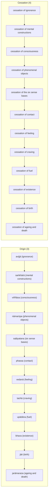

import { Tabs, TabItem } from '@astrojs/starlight/components';

Original text: [12S2/1.1.1 Paṭiccasamuppādasutta 2–5](https://tipitaka2500.github.io/tipitaka/12S2/1/1.1/1.1.1.html#2) in the [World Tipitaka Edition](https://tipitaka2500.github.io)

## Summary

At Sāvatthī the Bhagavā states `paṭiccasamuppāda` (dependent origination) to the bhikkhū: the twelve causes from ignorance to ageing and death, by which this whole mass of suffering originates, and their cessation in turn with the remainderless fading away of ignorance. It is the first discourse of the Nidānasaṃyutta (12S2/1.1.1) and gives the formula bare; the Vibhaṅgasutta that follows defines its terms.

## Diagram

## Text

<Tabs syncKey="paliquote">
<TabItem label="My Translation">
(1.)

2\. Thus heard by me — At one time the Bhagavā was dwelling at Sāvatthī, in Jeta’s Grove, Anāthapiṇḍika’s Park. There the Bhagavā addressed the bhikkhū: “Bhikkhavo!” “Bhadante,” those bhikkhū replied to the Bhagavā. The Bhagavā said this: “I will teach you, Bhikkhave, `paṭiccasamuppāda` (dependent origination). Listen and pay close attention, I will speak.” “Yes, Bhante,” those bhikkhū replied to the Bhagavā. The Bhagavā said this:

3\. “And what, Bhikkhave, is `paṭiccasamuppādo` (dependent origination)? With `avijjā` (ignorance) as cause, Bhikkhave, `saṅkhārā` (mental constructions) [arise]; with mental constructions as cause, `viññāṇaṃ` (consciousness) [arises]; with consciousness as cause, `nāmarūpaṃ` (phenomenal objects) [arise]; with phenomenal objects as cause, `saḷāyatanaṃ` (the six sense bases) [arise]; with the six sense bases as cause, `phasso` (contact) [arises]; with contact as cause, `vedanā` (feeling) [arises]; with feeling as cause, `taṇhā` (craving) [arises]; with craving as cause, `upādānaṃ` (fuel for existence: the will to live) [arises]; with fuel as cause, `bhavo` (existence of a false perception of an eternal independent “self” (`atta`)) [arises]; with existence as cause, `jāti` (birth of suffering) [arises]; with birth as cause, `jarāmaraṇaṃ` (ageing and death), sorrow, lamentation, pain, displeasure and despair come into being. Thus is the origin of this whole mass of `dukkha` (suffering). This, Bhikkhave, is called dependent origination.

4\. But with the remainderless fading away and cessation of ignorance comes the cessation of mental constructions; with the cessation of mental constructions comes the cessation of consciousness; with the cessation of consciousness comes the cessation of phenomenal objects; with the cessation of phenomenal objects comes the cessation of the six sense bases; with the cessation of the six sense bases comes the cessation of contact; with the cessation of contact comes the cessation of feeling; with the cessation of feeling comes the cessation of craving; with the cessation of craving comes the cessation of fuel for existence; with the cessation of fuel comes the cessation of existence (constructed self); with the cessation of existence comes the cessation of the birth (of suffering); with the cessation of birth, ageing and death, sorrow, lamentation, pain, displeasure and despair cease. Thus is the cessation of this whole mass of suffering.” This the Bhagavā said. Those bhikkhū, delighted, rejoiced in the Bhagavā’s words.

5\. The first [discourse of the chapter].
</TabItem>

<TabItem label="Pāḷi (Roman IAST)">
(1.)

2\. Evaṃ me sutaṃ— ekaṃ samayaṃ bhagavā sāvatthiyaṃ viharati jetavane anāthapiṇḍikassa ārāme. Tatra kho bhagavā bhikkhū āmantesi— “bhikkhavo”ti. “Bhadante”ti te bhikkhū bhagavato paccassosuṃ. Bhagavā etadavoca— “paṭiccasamuppādaṃ vo, bhikkhave, desessāmi. Taṃ suṇātha, sādhukaṃ manasi karotha, bhāsissāmī”ti. “Evaṃ, bhante”ti kho te bhikkhū bhagavato paccassosuṃ. Bhagavā etadavoca—

3\. “Katamo ca, bhikkhave, paṭiccasamuppādo? Avijjāpaccayā, bhikkhave, saṅkhārā; saṅkhārapaccayā viññāṇaṃ; viññāṇapaccayā nāmarūpaṃ; nāmarūpapaccayā saḷāyatanaṃ; saḷāyatanapaccayā phasso; phassapaccayā vedanā; vedanāpaccayā taṇhā; taṇhāpaccayā upādānaṃ; upādānapaccayā bhavo; bhavapaccayā jāti; jātipaccayā jarāmaraṇaṃ sokaparidevadukkhadomanassupāyāsā sambhavanti. Evametassa kevalassa dukkhakkhandhassa samudayo hoti. Ayaṃ vuccati, bhikkhave, paṭiccasamuppādo.

4\. Avijjāya tveva asesavirāganirodhā saṅkhāranirodho; saṅkhāranirodhā viññāṇanirodho; viññāṇanirodhā nāmarūpanirodho; nāmarūpanirodhā saḷāyatananirodho; saḷāyatananirodhā phassanirodho; phassanirodhā vedanānirodho; vedanānirodhā taṇhānirodho; taṇhānirodhā upādānanirodho; upādānanirodhā bhavanirodho; bhavanirodhā jātinirodho; jātinirodhā jarāmaraṇaṃ sokaparidevadukkhadomanassupāyāsā nirujjhanti. Evametassa kevalassa dukkhakkhandhassa nirodho hotī”ti. Idamavoca bhagavā. Attamanā te bhikkhū bhagavato bhāsitaṃ abhinandunti.

5\. Paṭhamaṃ.
</TabItem>

<TabItem label="Pāḷi (Brahmi)">
(1.)

2\. 𑀏𑀯𑀁 𑀫𑁂 𑀲𑀼𑀢𑀁— 𑀏𑀓𑀁 𑀲𑀫𑀬𑀁 𑀪𑀕𑀯𑀸 𑀲𑀸𑀯𑀢𑁆𑀣𑀺𑀬𑀁 𑀯𑀺𑀳𑀭𑀢𑀺 𑀚𑁂𑀢𑀯𑀦𑁂 𑀅𑀦𑀸𑀣𑀧𑀺𑀡𑁆𑀟𑀺𑀓𑀲𑁆𑀲 𑀆𑀭𑀸𑀫𑁂. 𑀢𑀢𑁆𑀭 𑀔𑁄 𑀪𑀕𑀯𑀸 𑀪𑀺𑀓𑁆𑀔𑀽 𑀆𑀫𑀦𑁆𑀢𑁂𑀲𑀺— “𑀪𑀺𑀓𑁆𑀔𑀯𑁄”𑀢𑀺. “𑀪𑀤𑀦𑁆𑀢𑁂”𑀢𑀺 𑀢𑁂 𑀪𑀺𑀓𑁆𑀔𑀽 𑀪𑀕𑀯𑀢𑁄 𑀧𑀘𑁆𑀘𑀲𑁆𑀲𑁄𑀲𑀼𑀁. 𑀪𑀕𑀯𑀸 𑀏𑀢𑀤𑀯𑁄𑀘— “𑀧𑀝𑀺𑀘𑁆𑀘𑀲𑀫𑀼𑀧𑁆𑀧𑀸𑀤𑀁 𑀯𑁄, 𑀪𑀺𑀓𑁆𑀔𑀯𑁂, 𑀤𑁂𑀲𑁂𑀲𑁆𑀲𑀸𑀫𑀺. 𑀢𑀁 𑀲𑀼𑀡𑀸𑀣, 𑀲𑀸𑀥𑀼𑀓𑀁 𑀫𑀦𑀲𑀺 𑀓𑀭𑁄𑀣, 𑀪𑀸𑀲𑀺𑀲𑁆𑀲𑀸𑀫𑀻”𑀢𑀺. “𑀏𑀯𑀁, 𑀪𑀦𑁆𑀢𑁂”𑀢𑀺 𑀔𑁄 𑀢𑁂 𑀪𑀺𑀓𑁆𑀔𑀽 𑀪𑀕𑀯𑀢𑁄 𑀧𑀘𑁆𑀘𑀲𑁆𑀲𑁄𑀲𑀼𑀁. 𑀪𑀕𑀯𑀸 𑀏𑀢𑀤𑀯𑁄𑀘—

3\. “𑀓𑀢𑀫𑁄 𑀘, 𑀪𑀺𑀓𑁆𑀔𑀯𑁂, 𑀧𑀝𑀺𑀘𑁆𑀘𑀲𑀫𑀼𑀧𑁆𑀧𑀸𑀤𑁄? 𑀅𑀯𑀺𑀚𑁆𑀚𑀸𑀧𑀘𑁆𑀘𑀬𑀸, 𑀪𑀺𑀓𑁆𑀔𑀯𑁂, 𑀲𑀗𑁆𑀔𑀸𑀭𑀸; 𑀲𑀗𑁆𑀔𑀸𑀭𑀧𑀘𑁆𑀘𑀬𑀸 𑀯𑀺𑀜𑁆𑀜𑀸𑀡𑀁; 𑀯𑀺𑀜𑁆𑀜𑀸𑀡𑀧𑀘𑁆𑀘𑀬𑀸 𑀦𑀸𑀫𑀭𑀽𑀧𑀁; 𑀦𑀸𑀫𑀭𑀽𑀧𑀧𑀘𑁆𑀘𑀬𑀸 𑀲𑀍𑀆𑀬𑀢𑀦𑀁; 𑀲𑀍𑀆𑀬𑀢𑀦𑀧𑀘𑁆𑀘𑀬𑀸 𑀨𑀲𑁆𑀲𑁄; 𑀨𑀲𑁆𑀲𑀧𑀘𑁆𑀘𑀬𑀸 𑀯𑁂𑀤𑀦𑀸; 𑀯𑁂𑀤𑀦𑀸𑀧𑀘𑁆𑀘𑀬𑀸 𑀢𑀡𑁆𑀳𑀸; 𑀢𑀡𑁆𑀳𑀸𑀧𑀘𑁆𑀘𑀬𑀸 𑀉𑀧𑀸𑀤𑀸𑀦𑀁; 𑀉𑀧𑀸𑀤𑀸𑀦𑀧𑀘𑁆𑀘𑀬𑀸 𑀪𑀯𑁄; 𑀪𑀯𑀧𑀘𑁆𑀘𑀬𑀸 𑀚𑀸𑀢𑀺; 𑀚𑀸𑀢𑀺𑀧𑀘𑁆𑀘𑀬𑀸 𑀚𑀭𑀸𑀫𑀭𑀡𑀁 𑀲𑁄𑀓𑀧𑀭𑀺𑀤𑁂𑀯𑀤𑀼𑀓𑁆𑀔𑀤𑁄𑀫𑀦𑀲𑁆𑀲𑀼𑀧𑀸𑀬𑀸𑀲𑀸 𑀲𑀫𑁆𑀪𑀯𑀦𑁆𑀢𑀺. 𑀏𑀯𑀫𑁂𑀢𑀲𑁆𑀲 𑀓𑁂𑀯𑀮𑀲𑁆𑀲 𑀤𑀼𑀓𑁆𑀔𑀓𑁆𑀔𑀦𑁆𑀥𑀲𑁆𑀲 𑀲𑀫𑀼𑀤𑀬𑁄 𑀳𑁄𑀢𑀺. 𑀅𑀬𑀁 𑀯𑀼𑀘𑁆𑀘𑀢𑀺, 𑀪𑀺𑀓𑁆𑀔𑀯𑁂, 𑀧𑀝𑀺𑀘𑁆𑀘𑀲𑀫𑀼𑀧𑁆𑀧𑀸𑀤𑁄.

4\. 𑀅𑀯𑀺𑀚𑁆𑀚𑀸𑀬 𑀢𑁆𑀯𑁂𑀯 𑀅𑀲𑁂𑀲𑀯𑀺𑀭𑀸𑀕𑀦𑀺𑀭𑁄𑀥𑀸 𑀲𑀗𑁆𑀔𑀸𑀭𑀦𑀺𑀭𑁄𑀥𑁄; 𑀲𑀗𑁆𑀔𑀸𑀭𑀦𑀺𑀭𑁄𑀥𑀸 𑀯𑀺𑀜𑁆𑀜𑀸𑀡𑀦𑀺𑀭𑁄𑀥𑁄; 𑀯𑀺𑀜𑁆𑀜𑀸𑀡𑀦𑀺𑀭𑁄𑀥𑀸 𑀦𑀸𑀫𑀭𑀽𑀧𑀦𑀺𑀭𑁄𑀥𑁄; 𑀦𑀸𑀫𑀭𑀽𑀧𑀦𑀺𑀭𑁄𑀥𑀸 𑀲𑀍𑀆𑀬𑀢𑀦𑀦𑀺𑀭𑁄𑀥𑁄; 𑀲𑀍𑀆𑀬𑀢𑀦𑀦𑀺𑀭𑁄𑀥𑀸 𑀨𑀲𑁆𑀲𑀦𑀺𑀭𑁄𑀥𑁄; 𑀨𑀲𑁆𑀲𑀦𑀺𑀭𑁄𑀥𑀸 𑀯𑁂𑀤𑀦𑀸𑀦𑀺𑀭𑁄𑀥𑁄; 𑀯𑁂𑀤𑀦𑀸𑀦𑀺𑀭𑁄𑀥𑀸 𑀢𑀡𑁆𑀳𑀸𑀦𑀺𑀭𑁄𑀥𑁄; 𑀢𑀡𑁆𑀳𑀸𑀦𑀺𑀭𑁄𑀥𑀸 𑀉𑀧𑀸𑀤𑀸𑀦𑀦𑀺𑀭𑁄𑀥𑁄; 𑀉𑀧𑀸𑀤𑀸𑀦𑀦𑀺𑀭𑁄𑀥𑀸 𑀪𑀯𑀦𑀺𑀭𑁄𑀥𑁄; 𑀪𑀯𑀦𑀺𑀭𑁄𑀥𑀸 𑀚𑀸𑀢𑀺𑀦𑀺𑀭𑁄𑀥𑁄; 𑀚𑀸𑀢𑀺𑀦𑀺𑀭𑁄𑀥𑀸 𑀚𑀭𑀸𑀫𑀭𑀡𑀁 𑀲𑁄𑀓𑀧𑀭𑀺𑀤𑁂𑀯𑀤𑀼𑀓𑁆𑀔𑀤𑁄𑀫𑀦𑀲𑁆𑀲𑀼𑀧𑀸𑀬𑀸𑀲𑀸 𑀦𑀺𑀭𑀼𑀚𑁆𑀛𑀦𑁆𑀢𑀺. 𑀏𑀯𑀫𑁂𑀢𑀲𑁆𑀲 𑀓𑁂𑀯𑀮𑀲𑁆𑀲 𑀤𑀼𑀓𑁆𑀔𑀓𑁆𑀔𑀦𑁆𑀥𑀲𑁆𑀲 𑀦𑀺𑀭𑁄𑀥𑁄 𑀳𑁄𑀢𑀻”𑀢𑀺. 𑀇𑀤𑀫𑀯𑁄𑀘 𑀪𑀕𑀯𑀸. 𑀅𑀢𑁆𑀢𑀫𑀦𑀸 𑀢𑁂 𑀪𑀺𑀓𑁆𑀔𑀽 𑀪𑀕𑀯𑀢𑁄 𑀪𑀸𑀲𑀺𑀢𑀁 𑀅𑀪𑀺𑀦𑀦𑁆𑀤𑀼𑀦𑁆𑀢𑀺.

5\. 𑀧𑀞𑀫𑀁.
</TabItem>

<TabItem label="Interlinear">
(1.)

[2](https://tipitaka2500.github.io/tipitaka/12S2/1/1.1/1.1.1.html#2) Evaṃ me sutaṃ— ekaṃ samayaṃ bhagavā sāvatthiyaṃ viharati jetavane anāthapiṇḍikassa ārāme.  
⏏️(evaṃ) *️⃣👆⚧⨀⑥(ahaṃ) 🚻⨀①🔽(ta)(suta) *️⃣🤟🚹⨀②(eka) 🚹⨀②(samaya) 🚹⨀①(bhagavant) 🚺⨀⑦(sāvatthī) 🟢⨀🤟▶️(viharati) 🚻⨀⑦(jetavana) 🚹⨀⑥(anāthapiṇḍika) 🚹⨀⑦(ārāma)  
thus | by me | heard | one | time | the Bhagavā | at Sāvatthī | dwells | in Jeta’s Grove | of Anāthapiṇḍika | in the park  
Thus heard by me — At one time the Bhagavā was dwelling at Sāvatthī, in Jeta’s Grove, Anāthapiṇḍika’s Park.

Tatra kho bhagavā bhikkhū āmantesi— “bhikkhavo”ti.  
⏏️(tatra) ⏏️(kho) 🚹⨀①(bhagavant) 🚹⨂②(bhikkhu) 🟢⨀🤟⏮(āmanteti) 🚹⨂⓪(bhikkhu) ⏏️(iti)  
there | indeed | the Bhagavā | the bhikkhū | addressed | Bhikkhavo | (end quote)  
There the Bhagavā addressed the bhikkhū: “Bhikkhavo!”

“Bhadante”ti te bhikkhū bhagavato paccassosuṃ.  
🚹⨀⓪(bhadanta) ⏏️(iti) *️⃣🤟🚹⨂①(ta) 🚹⨂①(bhikkhu) 🚹⨀④(bhagavant) 🟢⨂🤟⏮(paṭissuṇāti)  
Bhadante | (end quote) | those | bhikkhū | to the Bhagavā | replied  
“Bhadante,” those bhikkhū replied to the Bhagavā.

Bhagavā etadavoca— “paṭiccasamuppādaṃ vo, bhikkhave, desessāmi.  
🚹⨀①(bhagavant) *️⃣🤟🚻⨀②(eta) 🟢⨀🤟⏮(vadati) 🚹⨀②🆎(paṭicca+samuppāda) *️⃣🤘⚧⨂④(tvaṃ) 🚹⨂⓪(bhikkhu) 🟠⨀👆⏭(deseti)  
the Bhagavā | this | said | dependent origination | to you | Bhikkhave | I will teach  
The Bhagavā said this: “I will teach you, Bhikkhave, `paṭiccasamuppāda` (dependent origination).

Taṃ suṇātha, sādhukaṃ manasi karotha, bhāsissāmī”ti.  
*️⃣🤟🚹⨀②(ta) 🟢⨂🤘⏹(suṇāti) ⏏️(sādhukaṃ) 🚹⨀⑦(mano) 🟢⨂🤘⏹(karoti) 🟢⨀👆⏭(bhāsati) ⏏️(iti)  
that | listen | carefully | in mind | make | I will speak | (end quote)  
Listen and pay close attention, I will speak.”

“Evaṃ, bhante”ti kho te bhikkhū bhagavato paccassosuṃ.  
⏏️(evaṃ) 🚹⨀⓪(bhavant) ⏏️(iti) ⏏️(kho) *️⃣🤟🚹⨂①(ta) 🚹⨂①(bhikkhu) 🚹⨀④(bhagavant) 🟢⨂🤟⏮(paṭissuṇāti)  
yes | Bhante | (end quote) | indeed | those | bhikkhū | to the Bhagavā | replied  
“Yes, Bhante,” those bhikkhū replied to the Bhagavā.

Bhagavā etadavoca—  
🚹⨀①(bhagavant) *️⃣🤟🚻⨀②(eta) 🟢⨀🤟⏮(vadati)  
the Bhagavā | this | said  
The Bhagavā said this:

[3](https://tipitaka2500.github.io/tipitaka/12S2/1/1.1/1.1.1.html#3) “Katamo ca, bhikkhave, paṭiccasamuppādo?  
*️⃣🤟🚹⨀①(katama) ⏏️(ca) 🚹⨂⓪(bhikkhu) 🚹⨀①🆎(paṭicca+samuppāda)  
which | and | Bhikkhave | dependent origination  
“And what, Bhikkhave, is `paṭiccasamuppādo` (dependent origination)?

Avijjāpaccayā, bhikkhave, saṅkhārā;  
🚹⨀⑤🆎(avijjā+paccaya) 🚹⨂⓪(bhikkhu) 🚹⨂①(saṅkhāra)  
with ignorance as cause | Bhikkhave | mental constructions  
With `avijjā` (ignorance) as cause, Bhikkhave, `saṅkhārā` (mental constructions) [arise];

saṅkhārapaccayā viññāṇaṃ;  
🚹⨀⑤🆎(saṅkhāra+paccaya) 🚻⨀①(viññāṇa)  
with mental constructions as cause | consciousness  
with mental constructions as cause, `viññāṇaṃ` (consciousness) [arises];

viññāṇapaccayā nāmarūpaṃ;  
🚹⨀⑤🆎(viññāṇa+paccaya) 🚻⨀①🆎(nāma+rūpa)  
with consciousness as cause | phenomenal objects  
with consciousness as cause, `nāmarūpaṃ` (phenomenal objects) [arise];

nāmarūpapaccayā saḷāyatanaṃ;  
🚹⨀⑤🆎(nāmarūpa+paccaya) 🚻⨀①🆎(cha+āyatana)  
with phenomenal objects as cause | the six sense bases  
with phenomenal objects as cause, `saḷāyatanaṃ` (the six sense bases) [arise];

saḷāyatanapaccayā phasso;  
🚹⨀⑤🆎(saḷāyatana+paccaya) 🚹⨀①(phassa)  
with the six sense bases as cause | contact  
with the six sense bases as cause, `phasso` (contact) [arises];

phassapaccayā vedanā;  
🚹⨀⑤🆎(phassa+paccaya) 🚺⨀①(vedanā)  
with contact as cause | feeling  
with contact as cause, `vedanā` (feeling) [arises];

vedanāpaccayā taṇhā;  
🚹⨀⑤🆎(vedanā+paccaya) 🚺⨀①(taṇhā)  
with feeling as cause | craving  
with feeling as cause, `taṇhā` (craving) [arises];

taṇhāpaccayā upādānaṃ;  
🚹⨀⑤🆎(taṇhā+paccaya) 🚻⨀①(upādāna)  
with craving as cause | fuel  
with craving as cause, `upādānaṃ` (fuel for existence: the will to live) [arises];

upādānapaccayā bhavo;  
🚹⨀⑤🆎(upādāna+paccaya) 🚹⨀①(bhava)  
with fuel as cause | existence  
with fuel as cause, `bhavo` (existence of a false perception of an eternal independent “self” (`atta`)) [arises];

bhavapaccayā jāti;  
🚹⨀⑤🆎(bhava+paccaya) 🚺⨀①(jāti)  
with existence as cause | birth  
with existence as cause, `jāti` (birth of suffering) [arises];

jātipaccayā jarāmaraṇaṃ sokaparidevadukkhadomanassupāyāsā sambhavanti.  
🚹⨀⑤🆎(jāti+paccaya) 🚻⨀①🆎(jarā+maraṇa) 🚹⨂①🆎(soka+parideva+dukkha+domanassa+upāyāsa) 🟢⨂🤟▶️(sambhavati)  
with birth as cause | ageing and death | sorrow, lamentation, pain, displeasure and despair | come into being  
with birth as cause, `jarāmaraṇaṃ` (ageing and death), sorrow, lamentation, pain, displeasure and despair come into being.

Evametassa kevalassa dukkhakkhandhassa samudayo hoti.  
⏏️(evaṃ) *️⃣🤟🚹⨀⑥(eta) 🚹⨀⑥(kevala) 🚹⨀⑥🆎(dukkha+khandha) 🚹⨀①(samudaya) 🟢⨀🤟▶️(hoti)  
thus | of this | of the entire | of the mass of suffering | origin | is  
Thus is the origin of this whole mass of `dukkha` (suffering).

Ayaṃ vuccati, bhikkhave, paṭiccasamuppādo.  
*️⃣🤟🚹⨀①(ima) 🔴⨀🤟▶️(vuccati) 🚹⨂⓪(bhikkhu) 🚹⨀①🆎(paṭicca+samuppāda)  
this | is called | Bhikkhave | dependent origination  
This, Bhikkhave, is called dependent origination.

[4](https://tipitaka2500.github.io/tipitaka/12S2/1/1.1/1.1.1.html#4) Avijjāya tveva asesavirāganirodhā saṅkhāranirodho;  
🚺⨀⑥(avijjā) ⏏️(tu) ⏏️(eva) 🚹⨀⑤🆎(asesa+virāga+nirodha) 🚹⨀①🆎(saṅkhāra+nirodha)  
of ignorance | but | just | with the complete fading away and cessation | the cessation of mental constructions  
But with the remainderless fading away and cessation of ignorance comes the cessation of mental constructions;

saṅkhāranirodhā viññāṇanirodho;  
🚹⨀⑤🆎(saṅkhāra+nirodha) 🚹⨀①🆎(viññāṇa+nirodha)  
with the cessation of mental constructions | the cessation of consciousness  
with the cessation of mental constructions comes the cessation of consciousness;

viññāṇanirodhā nāmarūpanirodho;  
🚹⨀⑤🆎(viññāṇa+nirodha) 🚹⨀①🆎(nāmarūpa+nirodha)  
with the cessation of consciousness | the cessation of phenomenal objects  
with the cessation of consciousness comes the cessation of phenomenal objects;

nāmarūpanirodhā saḷāyatananirodho;  
🚹⨀⑤🆎(nāmarūpa+nirodha) 🚹⨀①🆎(saḷāyatana+nirodha)  
with the cessation of phenomenal objects | the cessation of the six sense bases  
with the cessation of phenomenal objects comes the cessation of the six sense bases;

saḷāyatananirodhā phassanirodho;  
🚹⨀⑤🆎(saḷāyatana+nirodha) 🚹⨀①🆎(phassa+nirodha)  
with the cessation of the six sense bases | the cessation of contact  
with the cessation of the six sense bases comes the cessation of contact;

phassanirodhā vedanānirodho;  
🚹⨀⑤🆎(phassa+nirodha) 🚹⨀①🆎(vedanā+nirodha)  
with the cessation of contact | the cessation of feeling  
with the cessation of contact comes the cessation of feeling;

vedanānirodhā taṇhānirodho;  
🚹⨀⑤🆎(vedanā+nirodha) 🚹⨀①🆎(taṇhā+nirodha)  
with the cessation of feeling | the cessation of craving  
with the cessation of feeling comes the cessation of craving;

taṇhānirodhā upādānanirodho;  
🚹⨀⑤🆎(taṇhā+nirodha) 🚹⨀①🆎(upādāna+nirodha)  
with the cessation of craving | the cessation of fuel  
with the cessation of craving comes the cessation of fuel for existence;

upādānanirodhā bhavanirodho;  
🚹⨀⑤🆎(upādāna+nirodha) 🚹⨀①🆎(bhava+nirodha)  
with the cessation of fuel | the cessation of existence  
with the cessation of fuel comes the cessation of existence (constructed self);

bhavanirodhā jātinirodho;  
🚹⨀⑤🆎(bhava+nirodha) 🚹⨀①🆎(jāti+nirodha)  
with the cessation of existence | the cessation of birth  
with the cessation of existence comes the cessation of the birth (of suffering);

jātinirodhā jarāmaraṇaṃ sokaparidevadukkhadomanassupāyāsā nirujjhanti.  
🚹⨀⑤🆎(jāti+nirodha) 🚻⨀①🆎(jarā+maraṇa) 🚹⨂①🆎(soka+parideva+dukkha+domanassa+upāyāsa) 🔴⨂🤟▶️(nirujjhati)  
with the cessation of birth | ageing and death | sorrow, lamentation, pain, displeasure and despair | cease  
with the cessation of birth, ageing and death, sorrow, lamentation, pain, displeasure and despair cease.

Evametassa kevalassa dukkhakkhandhassa nirodho hotī”ti.  
⏏️(evaṃ) *️⃣🤟🚹⨀⑥(eta) 🚹⨀⑥(kevala) 🚹⨀⑥🆎(dukkha+khandha) 🚹⨀①(nirodha) 🟢⨀🤟▶️(hoti) ⏏️(iti)  
thus | of this | of the entire | of the mass of suffering | cessation | is | (end quote)  
Thus is the cessation of this whole mass of suffering.”

Idamavoca bhagavā.  
*️⃣🤟🚻⨀②(ima) 🟢⨀🤟⏮(vadati) 🚹⨀①(bhagavant)  
this | said | the Bhagavā  
This the Bhagavā said.

Attamanā te bhikkhū bhagavato bhāsitaṃ abhinandunti.  
🚹⨂①🆎(atta+mana) *️⃣🤟🚹⨂①(ta) 🚹⨂①(bhikkhu) 🚹⨀⑥(bhagavant) 🚻⨀②🔽(ta)(bhāsita) 🟢⨂🤟⏮(abhinandati) ⏏️(iti)  
delighted | those | bhikkhū | of the Bhagavā | what was spoken | rejoiced in | (end quote)  
Those bhikkhū, delighted, rejoiced in the Bhagavā’s words.

[5](https://tipitaka2500.github.io/tipitaka/12S2/1/1.1/1.1.1.html#5) Paṭhamaṃ.  
🚻⨀①(paṭhama)  
the first  
The first [discourse of the chapter].
</TabItem>
</Tabs>

## Commentary

- The bare formula of the twelve causes, in origin and in cessation; the [Vibhaṅgasutta](/samyuttanikaya/nidanasamyutta/vibhangasutta/) that follows it (12S2/1.1.2) defines each term.
- Paragraphs 3–4 are the text of buddhavacana's [Dependent Origination](https://buddhavacana.github.io/sutta/deporig/) page and of the textbook's [chapter 3](https://buddhavacana.github.io/pali-textbook/3-awakening/); their wording stands here verbatim, with the author's glosses of `upādāna` and `bhava` that belong to this chain alone.
- `paccaya` is "cause", never "condition": "with ignorance as cause, mental constructions [arise]".
- The same chain is reviewed under the Bodhi tree in the Mahākhandhaka's [Bodhikathā](/khandhaka/1-1/).
- As the first sutta of the saṃyutta it carries the full opening (Evaṃ me sutaṃ, Tatra kho bhagavā bhikkhū āmantesi); the suttas that follow abbreviate it to "Sāvatthiyaṃ viharati".

## Parallels

SA 298 is one sūtra for this sutta and the Vibhaṅgasutta that follows it. Its frame is the same: the Buddha addresses the bhikkhus, announces that he will teach dependent origination (緣起法) and asks them to listen and attend well (諦聽，善思，當為汝說, p. 85a), and the bhikkhus delight at the end (佛說此經已，諸比丘聞佛所說，歡喜奉行, p. 85b). It divides the teaching into a "teaching of the principle" (法說) and a "teaching of the meaning" (義說); the 法說 (p. 85a) corresponds to the Paṭiccasamuppādasutta, the 義說 (pp. 85a–b) to the Vibhaṅgasutta. The differences, read in CBETA's text:

- **Setting.** The Chinese places the discourse among the Kurus, at the village of Kammāsadhamma (佛住拘留搜調牛聚落, p. 85a); the Pāḷi at Sāvatthī, in Jeta's Grove.
- **The abstract formula.** The Chinese prefaces the chain with "this existing, that exists; this arising, that arises" (此有故彼有，此起故彼起, p. 85a), which the Pāḷi Paṭiccasamuppādasutta does not have.
- **Origin only.** The 法說 gives the chain in origination alone, abbreviated to its first link and its end (謂緣無明行，乃至純大苦聚集, p. 85a); the Pāḷi gives all twelve links in origination (paragraph 3) and again in cessation (paragraph 4). SA 298 has no cessation sequence anywhere.
- **The closing.** The Chinese ends the 法說 with "this is called the teaching of the principle of dependent origination" (是名緣起法法說, p. 85a) and goes straight on to the definitions; the Pāḷi closes the sutta with "This, Bhikkhave, is called dependent origination" and the bhikkhus' delight.

[Go to parent page (Saṃyutta Nikāya)](/samyuttanikaya/) / [Go to next page (Vibhaṅgasutta (The Discourse on the Analysis))](/samyuttanikaya/nidanasamyutta/vibhangasutta/)
