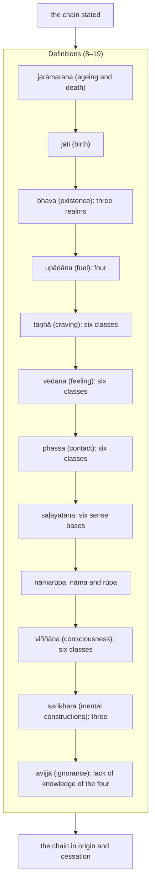

import { Tabs, TabItem } from '@astrojs/starlight/components';

Original text: [12S2/1.1.2 Vibhaṅgasutta 6–21](https://tipitaka2500.github.io/tipitaka/12S2/1/1.1/1.1.2.html#6) in the [World Tipitaka Edition](https://tipitaka2500.github.io)

## Summary

The Bhagavā states the chain of dependent origination and then analyses it, defining each of its twelve terms in turn from ageing and death back to ignorance: what ageing and death, birth, existence, fuel, craving, feeling, contact, the six sense bases, phenomenal objects, consciousness, mental constructions and ignorance each are. The sutta (12S2/1.1.2) closes with the chain in origin and in cessation.

## Diagram

## Text

<Tabs syncKey="paliquote">
<TabItem label="My Translation">
(2.)

6\. [The Bhagavā] was dwelling at Sāvatthī. “I will teach you, Bhikkhave, `paṭiccasamuppāda` (dependent origination), and I will analyse it. Listen and pay close attention, I will speak.” “Yes, Bhante,” those bhikkhū replied to the Bhagavā. The Bhagavā said this:

7\. “And what, Bhikkhave, is `paṭiccasamuppādo` (dependent origination)? With `avijjā` (ignorance) as cause, Bhikkhave, `saṅkhārā` (mental constructions) [arise]; with mental constructions as cause, `viññāṇaṃ` (consciousness) [arises]; with consciousness as cause, `nāmarūpaṃ` (phenomenal objects) [arise]; with phenomenal objects as cause, `saḷāyatanaṃ` (the six sense bases) [arise]; with the six sense bases as cause, `phasso` (contact) [arises]; with contact as cause, `vedanā` (feeling) [arises]; with feeling as cause, `taṇhā` (craving) [arises]; with craving as cause, `upādānaṃ` (fuel for existence: the will to live) [arises]; with fuel as cause, `bhavo` (existence of a false perception of an eternal independent “self” (`atta`)) [arises]; with existence as cause, `jāti` (birth of suffering) [arises]; with birth as cause, `jarāmaraṇaṃ` (ageing and death), sorrow, lamentation, pain, displeasure and despair come into being. Thus is the origin of this whole mass of `dukkha` (suffering).

8\. And what, Bhikkhave, is `jarāmaraṇa` (ageing and death)? Whatever is the ageing, decrepitude, broken teeth, grey hair, wrinkled skin, decline of life, and decay of the faculties of the various beings in the various classes of beings; this is called ageing. Whatever is the passing away, falling away, breaking up, disappearance, death, demise, completion of time, breaking up of the collections, and casting off the body of the various beings from the various classes of beings; this is called death. Thus this is ageing, and this is death. This, Bhikkhave, is called ageing and death.

9\. And what, Bhikkhave, is `jāti` (birth)? Whatever is the birth, generation, descent, production, appearance of the collections, and acquisition of the sense bases of the various beings in the various classes of beings. This, Bhikkhave, is called birth.

10\. And what, Bhikkhave, is `bhava` (existence)? There are, Bhikkhave, these three existences: existence in the realm of sensual desire, existence in the realm of form, and existence in the formless realm. This, Bhikkhave, is called existence.

11\. And what, Bhikkhave, is `upādāna` (fuel)? There are, Bhikkhave, these four fuels: the fuel of sensual pleasures, the fuel of views, the fuel of rites and rituals, and the fuel of the theory of self. This, Bhikkhave, is called fuel.

12\. And what, Bhikkhave, is `taṇhā` (craving)? There are, Bhikkhave, these six classes of craving: craving for forms, craving for sounds, craving for odours, craving for tastes, craving for tangibles, and craving for mind-objects. This, Bhikkhave, is called craving.

13\. And what, Bhikkhave, is `vedanā` (feeling)? There are, Bhikkhave, these six classes of feeling: feeling arisen from eye-contact, feeling arisen from ear-contact, feeling arisen from nose-contact, feeling arisen from tongue-contact, feeling arisen from body-contact, and feeling arisen from mind-contact. This, Bhikkhave, is called feeling.

14\. And what, Bhikkhave, is `phassa` (contact)? There are, Bhikkhave, these six classes of contact: eye-contact, ear-contact, nose-contact, tongue-contact, body-contact, and mind-contact. This, Bhikkhave, is called contact.

15\. And what, Bhikkhave, is `saḷāyatana` (the six sense bases)? The sense base of the eye, the sense base of the ear, the sense base of the nose, the sense base of the tongue, the sense base of the body, and the sense base of the mind — this, Bhikkhave, is called the six sense bases.

16\. And what, Bhikkhave, is `nāmarūpa` (phenomenal objects)? Feeling, apperception, intention, contact, attention — this is called `nāma` (mental objects). And the four great elements, and the form derived from the four great elements. This is called `rūpa` (form). Thus this is `nāma`, and this is `rūpa`. This, Bhikkhave, is called phenomenal objects.

17\. And what, Bhikkhave, is `viññāṇa` (consciousness)? There are, Bhikkhave, these six classes of consciousness: eye-consciousness, ear-consciousness, nose-consciousness, tongue-consciousness, body-consciousness, and mind-consciousness. This, Bhikkhave, is called consciousness.

18\. And what, Bhikkhave, are `saṅkhārā` (mental constructions)? There are, Bhikkhave, these three mental constructions: `kāyasaṅkhāra` (intention which results in bodily action), `vacīsaṅkhāra` (intention which results in verbal action), and `cittasaṅkhāra` (intention which results in mental action). These, Bhikkhave, are called mental constructions.

19\. And what, Bhikkhave, is `avijjā` (ignorance)? It is, Bhikkhave, the lack of knowledge of suffering, the lack of knowledge of the origin of suffering, the lack of knowledge of the cessation of suffering, and the lack of knowledge of the path leading to the cessation of suffering. This, Bhikkhave, is called ignorance.

20\. Thus, Bhikkhave, with ignorance as cause, mental constructions [arise]; with mental constructions as cause, `viññāṇaṃ` (consciousness) [arises] ... and so on ... Thus is the origin of this whole mass of suffering. But with the remainderless fading away and cessation of ignorance comes the cessation of mental constructions; with the cessation of mental constructions comes the cessation of consciousness ... and so on ... Thus is the cessation of this whole mass of suffering.”

21\. The second [discourse of the chapter].
</TabItem>

<TabItem label="Pāḷi (Roman IAST)">
(2.)

6\. Sāvatthiyaṃ viharati. “Paṭiccasamuppādaṃ vo, bhikkhave, desessāmi vibhajissāmi. Taṃ suṇātha, sādhukaṃ manasi karotha, bhāsissāmī”ti. “Evaṃ, bhante”ti kho te bhikkhū bhagavato paccassosuṃ. Bhagavā etadavoca—

7\. “Katamo ca, bhikkhave, paṭiccasamuppādo? Avijjāpaccayā, bhikkhave, saṅkhārā; saṅkhārapaccayā viññāṇaṃ; viññāṇapaccayā nāmarūpaṃ; nāmarūpapaccayā saḷāyatanaṃ; saḷāyatanapaccayā phasso; phassapaccayā vedanā; vedanāpaccayā taṇhā; taṇhāpaccayā upādānaṃ; upādānapaccayā bhavo; bhavapaccayā jāti; jātipaccayā jarāmaraṇaṃ sokaparidevadukkhadomanassupāyāsā sambhavanti. Evametassa kevalassa dukkhakkhandhassa samudayo hoti.

8\. Katamañca, bhikkhave, jarāmaraṇaṃ? Yā tesaṃ tesaṃ sattānaṃ tamhi tamhi sattanikāye jarā jīraṇatā khaṇḍiccaṃ pāliccaṃ valittacatā āyuno saṃhāni indriyānaṃ paripāko; ayaṃ vuccati jarā. Yā tesaṃ tesaṃ sattānaṃ tamhā tamhā sattanikāyā cuti cavanatā bhedo antaradhānaṃ maccu maraṇaṃ kālakiriyā khandhānaṃ bhedo kaḷevarassa nikkhepo ( ), idaṃ vuccati maraṇaṃ. Iti ayañca jarā, idañca maraṇaṃ. Idaṃ vuccati, bhikkhave, jarāmaraṇaṃ.

9\. Katamā ca, bhikkhave, jāti? Yā tesaṃ tesaṃ sattānaṃ tamhi tamhi sattanikāye jāti sañjāti okkanti abhinibbatti khandhānaṃ pātubhāvo āyatanānaṃ paṭilābho. Ayaṃ vuccati, bhikkhave, jāti.

10\. Katamo ca, bhikkhave, bhavo? Tayome, bhikkhave, bhavā— kāmabhavo, rūpabhavo, arūpabhavo. Ayaṃ vuccati, bhikkhave, bhavo.

11\. Katamañca, bhikkhave, upādānaṃ? Cattārimāni, bhikkhave, upādānāni— kāmupādānaṃ, diṭṭhupādānaṃ, sīlabbatupādānaṃ, attavādupādānaṃ. Idaṃ vuccati, bhikkhave, upādānaṃ.

12\. Katamā ca, bhikkhave, taṇhā? Chayime, bhikkhave, taṇhākāyā— rūpataṇhā, saddataṇhā, gandhataṇhā, rasataṇhā, phoṭṭhabbataṇhā, dhammataṇhā. Ayaṃ vuccati, bhikkhave, taṇhā.

13\. Katamā ca, bhikkhave, vedanā? Chayime, bhikkhave, vedanākāyā— cakkhusamphassajā vedanā, sotasamphassajā vedanā, ghānasamphassajā vedanā, jivhāsamphassajā vedanā, kāyasamphassajā vedanā, manosamphassajā vedanā. Ayaṃ vuccati, bhikkhave, vedanā.

14\. Katamo ca, bhikkhave, phasso? Chayime, bhikkhave, phassakāyā— cakkhusamphasso, sotasamphasso, ghānasamphasso, jivhāsamphasso, kāyasamphasso, manosamphasso. Ayaṃ vuccati, bhikkhave, phasso.

15\. Katamañca, bhikkhave, saḷāyatanaṃ? Cakkhāyatanaṃ, sotāyatanaṃ, ghānāyatanaṃ, jivhāyatanaṃ, kāyāyatanaṃ, manāyatanaṃ— idaṃ vuccati, bhikkhave, saḷāyatanaṃ.

16\. Katamañca, bhikkhave, nāmarūpaṃ? Vedanā, saññā, cetanā, phasso, manasikāro— idaṃ vuccati nāmaṃ. Cattāro ca mahābhūtā, catunnañca mahābhūtānaṃ upādāyarūpaṃ. Idaṃ vuccati rūpaṃ. Iti idañca nāmaṃ, idañca rūpaṃ. Idaṃ vuccati, bhikkhave, nāmarūpaṃ.

17\. Katamañca, bhikkhave, viññāṇaṃ? Chayime, bhikkhave, viññāṇakāyā— cakkhuviññāṇaṃ, sotaviññāṇaṃ, ghānaviññāṇaṃ, jivhāviññāṇaṃ, kāyaviññāṇaṃ, manoviññāṇaṃ. Idaṃ vuccati, bhikkhave, viññāṇaṃ.

18\. Katame ca, bhikkhave, saṅkhārā? Tayome, bhikkhave, saṅkhārā— kāyasaṅkhāro, vacīsaṅkhāro, cittasaṅkhāro. Ime vuccanti, bhikkhave, saṅkhārā.

19\. Katamā ca, bhikkhave, avijjā? Yaṃ kho, bhikkhave, dukkhe aññāṇaṃ, dukkhasamudaye aññāṇaṃ, dukkhanirodhe aññāṇaṃ, dukkhanirodhagāminiyā paṭipadāya aññāṇaṃ. Ayaṃ vuccati, bhikkhave, avijjā.

20\. Iti kho, bhikkhave, avijjāpaccayā saṅkhārā; saṅkhārapaccayā viññāṇaṃ…pe… evametassa kevalassa dukkhakkhandhassa samudayo hoti. Avijjāya tveva asesavirāganirodhā saṅkhāranirodho; saṅkhāranirodhā viññāṇanirodho…pe… evametassa kevalassa dukkhakkhandhassa nirodho hotī”ti.

21\. Dutiyaṃ.
</TabItem>

<TabItem label="Pāḷi (Brahmi)">
(2.)

6\. 𑀲𑀸𑀯𑀢𑁆𑀣𑀺𑀬𑀁 𑀯𑀺𑀳𑀭𑀢𑀺. “𑀧𑀝𑀺𑀘𑁆𑀘𑀲𑀫𑀼𑀧𑁆𑀧𑀸𑀤𑀁 𑀯𑁄, 𑀪𑀺𑀓𑁆𑀔𑀯𑁂, 𑀤𑁂𑀲𑁂𑀲𑁆𑀲𑀸𑀫𑀺 𑀯𑀺𑀪𑀚𑀺𑀲𑁆𑀲𑀸𑀫𑀺. 𑀢𑀁 𑀲𑀼𑀡𑀸𑀣, 𑀲𑀸𑀥𑀼𑀓𑀁 𑀫𑀦𑀲𑀺 𑀓𑀭𑁄𑀣, 𑀪𑀸𑀲𑀺𑀲𑁆𑀲𑀸𑀫𑀻”𑀢𑀺. “𑀏𑀯𑀁, 𑀪𑀦𑁆𑀢𑁂”𑀢𑀺 𑀔𑁄 𑀢𑁂 𑀪𑀺𑀓𑁆𑀔𑀽 𑀪𑀕𑀯𑀢𑁄 𑀧𑀘𑁆𑀘𑀲𑁆𑀲𑁄𑀲𑀼𑀁. 𑀪𑀕𑀯𑀸 𑀏𑀢𑀤𑀯𑁄𑀘—

7\. “𑀓𑀢𑀫𑁄 𑀘, 𑀪𑀺𑀓𑁆𑀔𑀯𑁂, 𑀧𑀝𑀺𑀘𑁆𑀘𑀲𑀫𑀼𑀧𑁆𑀧𑀸𑀤𑁄? 𑀅𑀯𑀺𑀚𑁆𑀚𑀸𑀧𑀘𑁆𑀘𑀬𑀸, 𑀪𑀺𑀓𑁆𑀔𑀯𑁂, 𑀲𑀗𑁆𑀔𑀸𑀭𑀸; 𑀲𑀗𑁆𑀔𑀸𑀭𑀧𑀘𑁆𑀘𑀬𑀸 𑀯𑀺𑀜𑁆𑀜𑀸𑀡𑀁; 𑀯𑀺𑀜𑁆𑀜𑀸𑀡𑀧𑀘𑁆𑀘𑀬𑀸 𑀦𑀸𑀫𑀭𑀽𑀧𑀁; 𑀦𑀸𑀫𑀭𑀽𑀧𑀧𑀘𑁆𑀘𑀬𑀸 𑀲𑀍𑀆𑀬𑀢𑀦𑀁; 𑀲𑀍𑀆𑀬𑀢𑀦𑀧𑀘𑁆𑀘𑀬𑀸 𑀨𑀲𑁆𑀲𑁄; 𑀨𑀲𑁆𑀲𑀧𑀘𑁆𑀘𑀬𑀸 𑀯𑁂𑀤𑀦𑀸; 𑀯𑁂𑀤𑀦𑀸𑀧𑀘𑁆𑀘𑀬𑀸 𑀢𑀡𑁆𑀳𑀸; 𑀢𑀡𑁆𑀳𑀸𑀧𑀘𑁆𑀘𑀬𑀸 𑀉𑀧𑀸𑀤𑀸𑀦𑀁; 𑀉𑀧𑀸𑀤𑀸𑀦𑀧𑀘𑁆𑀘𑀬𑀸 𑀪𑀯𑁄; 𑀪𑀯𑀧𑀘𑁆𑀘𑀬𑀸 𑀚𑀸𑀢𑀺; 𑀚𑀸𑀢𑀺𑀧𑀘𑁆𑀘𑀬𑀸 𑀚𑀭𑀸𑀫𑀭𑀡𑀁 𑀲𑁄𑀓𑀧𑀭𑀺𑀤𑁂𑀯𑀤𑀼𑀓𑁆𑀔𑀤𑁄𑀫𑀦𑀲𑁆𑀲𑀼𑀧𑀸𑀬𑀸𑀲𑀸 𑀲𑀫𑁆𑀪𑀯𑀦𑁆𑀢𑀺. 𑀏𑀯𑀫𑁂𑀢𑀲𑁆𑀲 𑀓𑁂𑀯𑀮𑀲𑁆𑀲 𑀤𑀼𑀓𑁆𑀔𑀓𑁆𑀔𑀦𑁆𑀥𑀲𑁆𑀲 𑀲𑀫𑀼𑀤𑀬𑁄 𑀳𑁄𑀢𑀺.

8\. 𑀓𑀢𑀫𑀜𑁆𑀘, 𑀪𑀺𑀓𑁆𑀔𑀯𑁂, 𑀚𑀭𑀸𑀫𑀭𑀡𑀁? 𑀬𑀸 𑀢𑁂𑀲𑀁 𑀢𑁂𑀲𑀁 𑀲𑀢𑁆𑀢𑀸𑀦𑀁 𑀢𑀫𑁆𑀳𑀺 𑀢𑀫𑁆𑀳𑀺 𑀲𑀢𑁆𑀢𑀦𑀺𑀓𑀸𑀬𑁂 𑀚𑀭𑀸 𑀚𑀻𑀭𑀡𑀢𑀸 𑀔𑀡𑁆𑀟𑀺𑀘𑁆𑀘𑀁 𑀧𑀸𑀮𑀺𑀘𑁆𑀘𑀁 𑀯𑀮𑀺𑀢𑁆𑀢𑀘𑀢𑀸 𑀆𑀬𑀼𑀦𑁄 𑀲𑀁𑀳𑀸𑀦𑀺 𑀇𑀦𑁆𑀤𑁆𑀭𑀺𑀬𑀸𑀦𑀁 𑀧𑀭𑀺𑀧𑀸𑀓𑁄; 𑀅𑀬𑀁 𑀯𑀼𑀘𑁆𑀘𑀢𑀺 𑀚𑀭𑀸. 𑀬𑀸 𑀢𑁂𑀲𑀁 𑀢𑁂𑀲𑀁 𑀲𑀢𑁆𑀢𑀸𑀦𑀁 𑀢𑀫𑁆𑀳𑀸 𑀢𑀫𑁆𑀳𑀸 𑀲𑀢𑁆𑀢𑀦𑀺𑀓𑀸𑀬𑀸 𑀘𑀼𑀢𑀺 𑀘𑀯𑀦𑀢𑀸 𑀪𑁂𑀤𑁄 𑀅𑀦𑁆𑀢𑀭𑀥𑀸𑀦𑀁 𑀫𑀘𑁆𑀘𑀼 𑀫𑀭𑀡𑀁 𑀓𑀸𑀮𑀓𑀺𑀭𑀺𑀬𑀸 𑀔𑀦𑁆𑀥𑀸𑀦𑀁 𑀪𑁂𑀤𑁄 𑀓𑀍𑀏𑀯𑀭𑀲𑁆𑀲 𑀦𑀺𑀓𑁆𑀔𑁂𑀧𑁄 ( ), 𑀇𑀤𑀁 𑀯𑀼𑀘𑁆𑀘𑀢𑀺 𑀫𑀭𑀡𑀁. 𑀇𑀢𑀺 𑀅𑀬𑀜𑁆𑀘 𑀚𑀭𑀸, 𑀇𑀤𑀜𑁆𑀘 𑀫𑀭𑀡𑀁. 𑀇𑀤𑀁 𑀯𑀼𑀘𑁆𑀘𑀢𑀺, 𑀪𑀺𑀓𑁆𑀔𑀯𑁂, 𑀚𑀭𑀸𑀫𑀭𑀡𑀁.

9\. 𑀓𑀢𑀫𑀸 𑀘, 𑀪𑀺𑀓𑁆𑀔𑀯𑁂, 𑀚𑀸𑀢𑀺? 𑀬𑀸 𑀢𑁂𑀲𑀁 𑀢𑁂𑀲𑀁 𑀲𑀢𑁆𑀢𑀸𑀦𑀁 𑀢𑀫𑁆𑀳𑀺 𑀢𑀫𑁆𑀳𑀺 𑀲𑀢𑁆𑀢𑀦𑀺𑀓𑀸𑀬𑁂 𑀚𑀸𑀢𑀺 𑀲𑀜𑁆𑀚𑀸𑀢𑀺 𑀑𑀓𑁆𑀓𑀦𑁆𑀢𑀺 𑀅𑀪𑀺𑀦𑀺𑀩𑁆𑀩𑀢𑁆𑀢𑀺 𑀔𑀦𑁆𑀥𑀸𑀦𑀁 𑀧𑀸𑀢𑀼𑀪𑀸𑀯𑁄 𑀆𑀬𑀢𑀦𑀸𑀦𑀁 𑀧𑀝𑀺𑀮𑀸𑀪𑁄. 𑀅𑀬𑀁 𑀯𑀼𑀘𑁆𑀘𑀢𑀺, 𑀪𑀺𑀓𑁆𑀔𑀯𑁂, 𑀚𑀸𑀢𑀺.

10\. 𑀓𑀢𑀫𑁄 𑀘, 𑀪𑀺𑀓𑁆𑀔𑀯𑁂, 𑀪𑀯𑁄? 𑀢𑀬𑁄𑀫𑁂, 𑀪𑀺𑀓𑁆𑀔𑀯𑁂, 𑀪𑀯𑀸— 𑀓𑀸𑀫𑀪𑀯𑁄, 𑀭𑀽𑀧𑀪𑀯𑁄, 𑀅𑀭𑀽𑀧𑀪𑀯𑁄. 𑀅𑀬𑀁 𑀯𑀼𑀘𑁆𑀘𑀢𑀺, 𑀪𑀺𑀓𑁆𑀔𑀯𑁂, 𑀪𑀯𑁄.

11\. 𑀓𑀢𑀫𑀜𑁆𑀘, 𑀪𑀺𑀓𑁆𑀔𑀯𑁂, 𑀉𑀧𑀸𑀤𑀸𑀦𑀁? 𑀘𑀢𑁆𑀢𑀸𑀭𑀺𑀫𑀸𑀦𑀺, 𑀪𑀺𑀓𑁆𑀔𑀯𑁂, 𑀉𑀧𑀸𑀤𑀸𑀦𑀸𑀦𑀺— 𑀓𑀸𑀫𑀼𑀧𑀸𑀤𑀸𑀦𑀁, 𑀤𑀺𑀝𑁆𑀞𑀼𑀧𑀸𑀤𑀸𑀦𑀁, 𑀲𑀻𑀮𑀩𑁆𑀩𑀢𑀼𑀧𑀸𑀤𑀸𑀦𑀁, 𑀅𑀢𑁆𑀢𑀯𑀸𑀤𑀼𑀧𑀸𑀤𑀸𑀦𑀁. 𑀇𑀤𑀁 𑀯𑀼𑀘𑁆𑀘𑀢𑀺, 𑀪𑀺𑀓𑁆𑀔𑀯𑁂, 𑀉𑀧𑀸𑀤𑀸𑀦𑀁.

12\. 𑀓𑀢𑀫𑀸 𑀘, 𑀪𑀺𑀓𑁆𑀔𑀯𑁂, 𑀢𑀡𑁆𑀳𑀸? 𑀙𑀬𑀺𑀫𑁂, 𑀪𑀺𑀓𑁆𑀔𑀯𑁂, 𑀢𑀡𑁆𑀳𑀸𑀓𑀸𑀬𑀸— 𑀭𑀽𑀧𑀢𑀡𑁆𑀳𑀸, 𑀲𑀤𑁆𑀤𑀢𑀡𑁆𑀳𑀸, 𑀕𑀦𑁆𑀥𑀢𑀡𑁆𑀳𑀸, 𑀭𑀲𑀢𑀡𑁆𑀳𑀸, 𑀨𑁄𑀝𑁆𑀞𑀩𑁆𑀩𑀢𑀡𑁆𑀳𑀸, 𑀥𑀫𑁆𑀫𑀢𑀡𑁆𑀳𑀸. 𑀅𑀬𑀁 𑀯𑀼𑀘𑁆𑀘𑀢𑀺, 𑀪𑀺𑀓𑁆𑀔𑀯𑁂, 𑀢𑀡𑁆𑀳𑀸.

13\. 𑀓𑀢𑀫𑀸 𑀘, 𑀪𑀺𑀓𑁆𑀔𑀯𑁂, 𑀯𑁂𑀤𑀦𑀸? 𑀙𑀬𑀺𑀫𑁂, 𑀪𑀺𑀓𑁆𑀔𑀯𑁂, 𑀯𑁂𑀤𑀦𑀸𑀓𑀸𑀬𑀸— 𑀘𑀓𑁆𑀔𑀼𑀲𑀫𑁆𑀨𑀲𑁆𑀲𑀚𑀸 𑀯𑁂𑀤𑀦𑀸, 𑀲𑁄𑀢𑀲𑀫𑁆𑀨𑀲𑁆𑀲𑀚𑀸 𑀯𑁂𑀤𑀦𑀸, 𑀖𑀸𑀦𑀲𑀫𑁆𑀨𑀲𑁆𑀲𑀚𑀸 𑀯𑁂𑀤𑀦𑀸, 𑀚𑀺𑀯𑁆𑀳𑀸𑀲𑀫𑁆𑀨𑀲𑁆𑀲𑀚𑀸 𑀯𑁂𑀤𑀦𑀸, 𑀓𑀸𑀬𑀲𑀫𑁆𑀨𑀲𑁆𑀲𑀚𑀸 𑀯𑁂𑀤𑀦𑀸, 𑀫𑀦𑁄𑀲𑀫𑁆𑀨𑀲𑁆𑀲𑀚𑀸 𑀯𑁂𑀤𑀦𑀸. 𑀅𑀬𑀁 𑀯𑀼𑀘𑁆𑀘𑀢𑀺, 𑀪𑀺𑀓𑁆𑀔𑀯𑁂, 𑀯𑁂𑀤𑀦𑀸.

14\. 𑀓𑀢𑀫𑁄 𑀘, 𑀪𑀺𑀓𑁆𑀔𑀯𑁂, 𑀨𑀲𑁆𑀲𑁄? 𑀙𑀬𑀺𑀫𑁂, 𑀪𑀺𑀓𑁆𑀔𑀯𑁂, 𑀨𑀲𑁆𑀲𑀓𑀸𑀬𑀸— 𑀘𑀓𑁆𑀔𑀼𑀲𑀫𑁆𑀨𑀲𑁆𑀲𑁄, 𑀲𑁄𑀢𑀲𑀫𑁆𑀨𑀲𑁆𑀲𑁄, 𑀖𑀸𑀦𑀲𑀫𑁆𑀨𑀲𑁆𑀲𑁄, 𑀚𑀺𑀯𑁆𑀳𑀸𑀲𑀫𑁆𑀨𑀲𑁆𑀲𑁄, 𑀓𑀸𑀬𑀲𑀫𑁆𑀨𑀲𑁆𑀲𑁄, 𑀫𑀦𑁄𑀲𑀫𑁆𑀨𑀲𑁆𑀲𑁄. 𑀅𑀬𑀁 𑀯𑀼𑀘𑁆𑀘𑀢𑀺, 𑀪𑀺𑀓𑁆𑀔𑀯𑁂, 𑀨𑀲𑁆𑀲𑁄.

15\. 𑀓𑀢𑀫𑀜𑁆𑀘, 𑀪𑀺𑀓𑁆𑀔𑀯𑁂, 𑀲𑀍𑀆𑀬𑀢𑀦𑀁? 𑀘𑀓𑁆𑀔𑀸𑀬𑀢𑀦𑀁, 𑀲𑁄𑀢𑀸𑀬𑀢𑀦𑀁, 𑀖𑀸𑀦𑀸𑀬𑀢𑀦𑀁, 𑀚𑀺𑀯𑁆𑀳𑀸𑀬𑀢𑀦𑀁, 𑀓𑀸𑀬𑀸𑀬𑀢𑀦𑀁, 𑀫𑀦𑀸𑀬𑀢𑀦𑀁— 𑀇𑀤𑀁 𑀯𑀼𑀘𑁆𑀘𑀢𑀺, 𑀪𑀺𑀓𑁆𑀔𑀯𑁂, 𑀲𑀍𑀆𑀬𑀢𑀦𑀁.

16\. 𑀓𑀢𑀫𑀜𑁆𑀘, 𑀪𑀺𑀓𑁆𑀔𑀯𑁂, 𑀦𑀸𑀫𑀭𑀽𑀧𑀁? 𑀯𑁂𑀤𑀦𑀸, 𑀲𑀜𑁆𑀜𑀸, 𑀘𑁂𑀢𑀦𑀸, 𑀨𑀲𑁆𑀲𑁄, 𑀫𑀦𑀲𑀺𑀓𑀸𑀭𑁄— 𑀇𑀤𑀁 𑀯𑀼𑀘𑁆𑀘𑀢𑀺 𑀦𑀸𑀫𑀁. 𑀘𑀢𑁆𑀢𑀸𑀭𑁄 𑀘 𑀫𑀳𑀸𑀪𑀽𑀢𑀸, 𑀘𑀢𑀼𑀦𑁆𑀦𑀜𑁆𑀘 𑀫𑀳𑀸𑀪𑀽𑀢𑀸𑀦𑀁 𑀉𑀧𑀸𑀤𑀸𑀬𑀭𑀽𑀧𑀁. 𑀇𑀤𑀁 𑀯𑀼𑀘𑁆𑀘𑀢𑀺 𑀭𑀽𑀧𑀁. 𑀇𑀢𑀺 𑀇𑀤𑀜𑁆𑀘 𑀦𑀸𑀫𑀁, 𑀇𑀤𑀜𑁆𑀘 𑀭𑀽𑀧𑀁. 𑀇𑀤𑀁 𑀯𑀼𑀘𑁆𑀘𑀢𑀺, 𑀪𑀺𑀓𑁆𑀔𑀯𑁂, 𑀦𑀸𑀫𑀭𑀽𑀧𑀁.

17\. 𑀓𑀢𑀫𑀜𑁆𑀘, 𑀪𑀺𑀓𑁆𑀔𑀯𑁂, 𑀯𑀺𑀜𑁆𑀜𑀸𑀡𑀁? 𑀙𑀬𑀺𑀫𑁂, 𑀪𑀺𑀓𑁆𑀔𑀯𑁂, 𑀯𑀺𑀜𑁆𑀜𑀸𑀡𑀓𑀸𑀬𑀸— 𑀘𑀓𑁆𑀔𑀼𑀯𑀺𑀜𑁆𑀜𑀸𑀡𑀁, 𑀲𑁄𑀢𑀯𑀺𑀜𑁆𑀜𑀸𑀡𑀁, 𑀖𑀸𑀦𑀯𑀺𑀜𑁆𑀜𑀸𑀡𑀁, 𑀚𑀺𑀯𑁆𑀳𑀸𑀯𑀺𑀜𑁆𑀜𑀸𑀡𑀁, 𑀓𑀸𑀬𑀯𑀺𑀜𑁆𑀜𑀸𑀡𑀁, 𑀫𑀦𑁄𑀯𑀺𑀜𑁆𑀜𑀸𑀡𑀁. 𑀇𑀤𑀁 𑀯𑀼𑀘𑁆𑀘𑀢𑀺, 𑀪𑀺𑀓𑁆𑀔𑀯𑁂, 𑀯𑀺𑀜𑁆𑀜𑀸𑀡𑀁.

18\. 𑀓𑀢𑀫𑁂 𑀘, 𑀪𑀺𑀓𑁆𑀔𑀯𑁂, 𑀲𑀗𑁆𑀔𑀸𑀭𑀸? 𑀢𑀬𑁄𑀫𑁂, 𑀪𑀺𑀓𑁆𑀔𑀯𑁂, 𑀲𑀗𑁆𑀔𑀸𑀭𑀸— 𑀓𑀸𑀬𑀲𑀗𑁆𑀔𑀸𑀭𑁄, 𑀯𑀘𑀻𑀲𑀗𑁆𑀔𑀸𑀭𑁄, 𑀘𑀺𑀢𑁆𑀢𑀲𑀗𑁆𑀔𑀸𑀭𑁄. 𑀇𑀫𑁂 𑀯𑀼𑀘𑁆𑀘𑀦𑁆𑀢𑀺, 𑀪𑀺𑀓𑁆𑀔𑀯𑁂, 𑀲𑀗𑁆𑀔𑀸𑀭𑀸.

19\. 𑀓𑀢𑀫𑀸 𑀘, 𑀪𑀺𑀓𑁆𑀔𑀯𑁂, 𑀅𑀯𑀺𑀚𑁆𑀚𑀸? 𑀬𑀁 𑀔𑁄, 𑀪𑀺𑀓𑁆𑀔𑀯𑁂, 𑀤𑀼𑀓𑁆𑀔𑁂 𑀅𑀜𑁆𑀜𑀸𑀡𑀁, 𑀤𑀼𑀓𑁆𑀔𑀲𑀫𑀼𑀤𑀬𑁂 𑀅𑀜𑁆𑀜𑀸𑀡𑀁, 𑀤𑀼𑀓𑁆𑀔𑀦𑀺𑀭𑁄𑀥𑁂 𑀅𑀜𑁆𑀜𑀸𑀡𑀁, 𑀤𑀼𑀓𑁆𑀔𑀦𑀺𑀭𑁄𑀥𑀕𑀸𑀫𑀺𑀦𑀺𑀬𑀸 𑀧𑀝𑀺𑀧𑀤𑀸𑀬 𑀅𑀜𑁆𑀜𑀸𑀡𑀁. 𑀅𑀬𑀁 𑀯𑀼𑀘𑁆𑀘𑀢𑀺, 𑀪𑀺𑀓𑁆𑀔𑀯𑁂, 𑀅𑀯𑀺𑀚𑁆𑀚𑀸.

20\. 𑀇𑀢𑀺 𑀔𑁄, 𑀪𑀺𑀓𑁆𑀔𑀯𑁂, 𑀅𑀯𑀺𑀚𑁆𑀚𑀸𑀧𑀘𑁆𑀘𑀬𑀸 𑀲𑀗𑁆𑀔𑀸𑀭𑀸; 𑀲𑀗𑁆𑀔𑀸𑀭𑀧𑀘𑁆𑀘𑀬𑀸 𑀯𑀺𑀜𑁆𑀜𑀸𑀡𑀁…𑀧𑁂… 𑀏𑀯𑀫𑁂𑀢𑀲𑁆𑀲 𑀓𑁂𑀯𑀮𑀲𑁆𑀲 𑀤𑀼𑀓𑁆𑀔𑀓𑁆𑀔𑀦𑁆𑀥𑀲𑁆𑀲 𑀲𑀫𑀼𑀤𑀬𑁄 𑀳𑁄𑀢𑀺. 𑀅𑀯𑀺𑀚𑁆𑀚𑀸𑀬 𑀢𑁆𑀯𑁂𑀯 𑀅𑀲𑁂𑀲𑀯𑀺𑀭𑀸𑀕𑀦𑀺𑀭𑁄𑀥𑀸 𑀲𑀗𑁆𑀔𑀸𑀭𑀦𑀺𑀭𑁄𑀥𑁄; 𑀲𑀗𑁆𑀔𑀸𑀭𑀦𑀺𑀭𑁄𑀥𑀸 𑀯𑀺𑀜𑁆𑀜𑀸𑀡𑀦𑀺𑀭𑁄𑀥𑁄…𑀧𑁂… 𑀏𑀯𑀫𑁂𑀢𑀲𑁆𑀲 𑀓𑁂𑀯𑀮𑀲𑁆𑀲 𑀤𑀼𑀓𑁆𑀔𑀓𑁆𑀔𑀦𑁆𑀥𑀲𑁆𑀲 𑀦𑀺𑀭𑁄𑀥𑁄 𑀳𑁄𑀢𑀻”𑀢𑀺.

21\. 𑀤𑀼𑀢𑀺𑀬𑀁.
</TabItem>

<TabItem label="Interlinear">
(2.)

[6](https://tipitaka2500.github.io/tipitaka/12S2/1/1.1/1.1.2.html#6) Sāvatthiyaṃ viharati.  
🚺⨀⑦(sāvatthī) 🟢⨀🤟▶️(viharati)  
at Sāvatthī | dwells  
[The Bhagavā] was dwelling at Sāvatthī.

“Paṭiccasamuppādaṃ vo, bhikkhave, desessāmi vibhajissāmi.  
🚹⨀②🆎(paṭicca+samuppāda) *️⃣🤘⚧⨂④(tvaṃ) 🚹⨂⓪(bhikkhu) 🟠⨀👆⏭(deseti) 🟢⨀👆⏭(vibhajati)  
dependent origination | to you | Bhikkhave | I will teach | I will analyse  
“I will teach you, Bhikkhave, `paṭiccasamuppāda` (dependent origination), and I will analyse it.

Taṃ suṇātha, sādhukaṃ manasi karotha, bhāsissāmī”ti.  
*️⃣🤟🚹⨀②(ta) 🟢⨂🤘⏹(suṇāti) ⏏️(sādhukaṃ) 🚹⨀⑦(mano) 🟢⨂🤘⏹(karoti) 🟢⨀👆⏭(bhāsati) ⏏️(iti)  
that | listen | carefully | in mind | make | I will speak | (end quote)  
Listen and pay close attention, I will speak.”

“Evaṃ, bhante”ti kho te bhikkhū bhagavato paccassosuṃ.  
⏏️(evaṃ) 🚹⨀⓪(bhavant) ⏏️(iti) ⏏️(kho) *️⃣🤟🚹⨂①(ta) 🚹⨂①(bhikkhu) 🚹⨀④(bhagavant) 🟢⨂🤟⏮(paṭissuṇāti)  
yes | Bhante | (end quote) | indeed | those | bhikkhū | to the Bhagavā | replied  
“Yes, Bhante,” those bhikkhū replied to the Bhagavā.

Bhagavā etadavoca—  
🚹⨀①(bhagavant) *️⃣🤟🚻⨀②(eta) 🟢⨀🤟⏮(vadati)  
the Bhagavā | this | said  
The Bhagavā said this:

[7](https://tipitaka2500.github.io/tipitaka/12S2/1/1.1/1.1.2.html#7) “Katamo ca, bhikkhave, paṭiccasamuppādo?  
*️⃣🤟🚹⨀①(katama) ⏏️(ca) 🚹⨂⓪(bhikkhu) 🚹⨀①🆎(paṭicca+samuppāda)  
which | and | Bhikkhave | dependent origination  
“And what, Bhikkhave, is `paṭiccasamuppādo` (dependent origination)?

Avijjāpaccayā, bhikkhave, saṅkhārā;  
🚹⨀⑤🆎(avijjā+paccaya) 🚹⨂⓪(bhikkhu) 🚹⨂①(saṅkhāra)  
with ignorance as cause | Bhikkhave | mental constructions  
With `avijjā` (ignorance) as cause, Bhikkhave, `saṅkhārā` (mental constructions) [arise];

saṅkhārapaccayā viññāṇaṃ;  
🚹⨀⑤🆎(saṅkhāra+paccaya) 🚻⨀①(viññāṇa)  
with mental constructions as cause | consciousness  
with mental constructions as cause, `viññāṇaṃ` (consciousness) [arises];

viññāṇapaccayā nāmarūpaṃ;  
🚹⨀⑤🆎(viññāṇa+paccaya) 🚻⨀①🆎(nāma+rūpa)  
with consciousness as cause | phenomenal objects  
with consciousness as cause, `nāmarūpaṃ` (phenomenal objects) [arise];

nāmarūpapaccayā saḷāyatanaṃ;  
🚹⨀⑤🆎(nāmarūpa+paccaya) 🚻⨀①🆎(cha+āyatana)  
with phenomenal objects as cause | the six sense bases  
with phenomenal objects as cause, `saḷāyatanaṃ` (the six sense bases) [arise];

saḷāyatanapaccayā phasso;  
🚹⨀⑤🆎(saḷāyatana+paccaya) 🚹⨀①(phassa)  
with the six sense bases as cause | contact  
with the six sense bases as cause, `phasso` (contact) [arises];

phassapaccayā vedanā;  
🚹⨀⑤🆎(phassa+paccaya) 🚺⨀①(vedanā)  
with contact as cause | feeling  
with contact as cause, `vedanā` (feeling) [arises];

vedanāpaccayā taṇhā;  
🚹⨀⑤🆎(vedanā+paccaya) 🚺⨀①(taṇhā)  
with feeling as cause | craving  
with feeling as cause, `taṇhā` (craving) [arises];

taṇhāpaccayā upādānaṃ;  
🚹⨀⑤🆎(taṇhā+paccaya) 🚻⨀①(upādāna)  
with craving as cause | fuel  
with craving as cause, `upādānaṃ` (fuel for existence: the will to live) [arises];

upādānapaccayā bhavo;  
🚹⨀⑤🆎(upādāna+paccaya) 🚹⨀①(bhava)  
with fuel as cause | existence  
with fuel as cause, `bhavo` (existence of a false perception of an eternal independent “self” (`atta`)) [arises];

bhavapaccayā jāti;  
🚹⨀⑤🆎(bhava+paccaya) 🚺⨀①(jāti)  
with existence as cause | birth  
with existence as cause, `jāti` (birth of suffering) [arises];

jātipaccayā jarāmaraṇaṃ sokaparidevadukkhadomanassupāyāsā sambhavanti.  
🚹⨀⑤🆎(jāti+paccaya) 🚻⨀①🆎(jarā+maraṇa) 🚹⨂①🆎(soka+parideva+dukkha+domanassa+upāyāsa) 🟢⨂🤟▶️(sambhavati)  
with birth as cause | ageing and death | sorrow, lamentation, pain, displeasure and despair | come into being  
with birth as cause, `jarāmaraṇaṃ` (ageing and death), sorrow, lamentation, pain, displeasure and despair come into being.

Evametassa kevalassa dukkhakkhandhassa samudayo hoti.  
⏏️(evaṃ) *️⃣🤟🚹⨀⑥(eta) 🚹⨀⑥(kevala) 🚹⨀⑥🆎(dukkha+khandha) 🚹⨀①(samudaya) 🟢⨀🤟▶️(hoti)  
thus | of this | of the entire | of the mass of suffering | origin | is  
Thus is the origin of this whole mass of `dukkha` (suffering).

[8](https://tipitaka2500.github.io/tipitaka/12S2/1/1.1/1.1.2.html#8) Katamañca, bhikkhave, jarāmaraṇaṃ?  
*️⃣🤟🚻⨀①(katama) ⏏️(ca) 🚹⨂⓪(bhikkhu) 🚻⨀①🆎(jarā+maraṇa)  
which | and | Bhikkhave | ageing and death  
And what, Bhikkhave, is `jarāmaraṇa` (ageing and death)?

Yā tesaṃ tesaṃ sattānaṃ tamhi tamhi sattanikāye jarā jīraṇatā khaṇḍiccaṃ pāliccaṃ valittacatā āyuno saṃhāni indriyānaṃ paripāko;  
*️⃣🤟🚺⨀①(ya) *️⃣🤟🚹⨂⑥(ta) *️⃣🤟🚹⨂⑥(ta) 🚹⨂⑥(satta) *️⃣🤟🚹⨀⑦(ta) *️⃣🤟🚹⨀⑦(ta) 🚹⨀⑦🆎(satta+nikāya) 🚺⨀①(jarā) 🚺⨀①(jīraṇatā) 🚻⨀①(khaṇḍicca) 🚻⨀①(pālicca) 🚺⨀①(valittacatā) 🚻⨀⑥(āyu) 🚺⨀①(saṃhāni) 🚻⨂⑥(indriya) 🚹⨀①(paripāka)  
whatever | of those | various | beings | in that | or that | class of beings | ageing | decrepitude | broken teeth | grey hair | wrinkled skin | of life | decline | of the faculties | decay  
Whatever is the ageing, decrepitude, broken teeth, grey hair, wrinkled skin, decline of life, and decay of the faculties of the various beings in the various classes of beings;

ayaṃ vuccati jarā.  
*️⃣🤟🚺⨀①(ima) 🔴⨀🤟▶️(vuccati) 🚺⨀①(jarā)  
this | is called | ageing  
this is called ageing.

Yā tesaṃ tesaṃ sattānaṃ tamhā tamhā sattanikāyā cuti cavanatā bhedo antaradhānaṃ maccu maraṇaṃ kālakiriyā khandhānaṃ bhedo kaḷevarassa nikkhepo ( ), idaṃ vuccati maraṇaṃ.  
*️⃣🤟🚺⨀①(ya) *️⃣🤟🚹⨂⑥(ta) *️⃣🤟🚹⨂⑥(ta) 🚹⨂⑥(satta) *️⃣🤟🚹⨀⑤(ta) *️⃣🤟🚹⨀⑤(ta) 🚹⨀⑤🆎(satta+nikāya) 🚺⨀①(cuti) 🚺⨀①(cavanatā) 🚹⨀①(bheda) 🚻⨀①🆎(antara+dhāna) 🚹⨀①(maccu) 🚻⨀①(maraṇa) 🚺⨀①🆎(kāla+kiriyā) 🚹⨂⑥(khandha) 🚹⨀①(bheda) 🚻⨀⑥(kaḷevara) 🚹⨀①(nikkhepa) *️⃣🤟🚻⨀①(ima) 🔴⨀🤟▶️(vuccati) 🚻⨀①(maraṇa)  
whatever | of those | various | beings | from that | or that | class of beings | passing away | falling away | breaking up | disappearance | death | demise | completion of time | of the collections | breaking up | of the body | casting off | this | is called | death  
Whatever is the passing away, falling away, breaking up, disappearance, death, demise, completion of time, breaking up of the collections, and casting off the body of the various beings from the various classes of beings; this is called death.

Iti ayañca jarā, idañca maraṇaṃ.  
⏏️(iti) *️⃣🤟🚺⨀①(ima) ⏏️(ca) 🚺⨀①(jarā) *️⃣🤟🚻⨀①(ima) ⏏️(ca) 🚻⨀①(maraṇa)  
thus | this | and | ageing | this | and | death  
Thus this is ageing, and this is death.

Idaṃ vuccati, bhikkhave, jarāmaraṇaṃ.  
*️⃣🤟🚻⨀①(ima) 🔴⨀🤟▶️(vuccati) 🚹⨂⓪(bhikkhu) 🚻⨀①🆎(jarā+maraṇa)  
this | is called | Bhikkhave | ageing and death  
This, Bhikkhave, is called ageing and death.

[9](https://tipitaka2500.github.io/tipitaka/12S2/1/1.1/1.1.2.html#9) Katamā ca, bhikkhave, jāti?  
*️⃣🤟🚺⨀①(katama) ⏏️(ca) 🚹⨂⓪(bhikkhu) 🚺⨀①(jāti)  
which | and | Bhikkhave | birth  
And what, Bhikkhave, is `jāti` (birth)?

Yā tesaṃ tesaṃ sattānaṃ tamhi tamhi sattanikāye jāti sañjāti okkanti abhinibbatti khandhānaṃ pātubhāvo āyatanānaṃ paṭilābho.  
*️⃣🤟🚺⨀①(ya) *️⃣🤟🚹⨂⑥(ta) *️⃣🤟🚹⨂⑥(ta) 🚹⨂⑥(satta) *️⃣🤟🚹⨀⑦(ta) *️⃣🤟🚹⨀⑦(ta) 🚹⨀⑦🆎(satta+nikāya) 🚺⨀①(jāti) 🚺⨀①(sañjāti) 🚺⨀①(okkanti) 🚺⨀①(abhinibbatti) 🚹⨂⑥(khandha) 🚹⨀①🆎(pātu+bhāva) 🚻⨂⑥(āyatana) 🚹⨀①(paṭilābha)  
whatever | of those | various | beings | in that | or that | class of beings | birth | generation | descent | production | of the collections | appearance | of the sense bases | acquisition  
Whatever is the birth, generation, descent, production, appearance of the collections, and acquisition of the sense bases of the various beings in the various classes of beings.

Ayaṃ vuccati, bhikkhave, jāti.  
*️⃣🤟🚺⨀①(ima) 🔴⨀🤟▶️(vuccati) 🚹⨂⓪(bhikkhu) 🚺⨀①(jāti)  
this | is called | Bhikkhave | birth  
This, Bhikkhave, is called birth.

[10](https://tipitaka2500.github.io/tipitaka/12S2/1/1.1/1.1.2.html#10) Katamo ca, bhikkhave, bhavo?  
*️⃣🤟🚹⨀①(katama) ⏏️(ca) 🚹⨂⓪(bhikkhu) 🚹⨀①(bhava)  
which | and | Bhikkhave | existence  
And what, Bhikkhave, is `bhava` (existence)?

Tayome, bhikkhave, bhavā— kāmabhavo, rūpabhavo, arūpabhavo.  
🚹⨂①(ti) *️⃣🤟🚹⨂①(ima) 🚹⨂⓪(bhikkhu) 🚹⨂①(bhava) 🚹⨀①🆎(kāma+bhava) 🚹⨀①🆎(rūpa+bhava) 🚹⨀①🆎(na+rūpa+bhava)  
three | these | Bhikkhave | existences | existence in the realm of sensual desire | existence in the realm of form | existence in the formless realm  
There are these three existences, Bhikkhave: existence in the realm of sensual desire, existence in the realm of form, and existence in the formless realm.

Ayaṃ vuccati, bhikkhave, bhavo.  
*️⃣🤟🚹⨀①(ima) 🔴⨀🤟▶️(vuccati) 🚹⨂⓪(bhikkhu) 🚹⨀①(bhava)  
this | is called | Bhikkhave | existence  
This, Bhikkhave, is called existence.

[11](https://tipitaka2500.github.io/tipitaka/12S2/1/1.1/1.1.2.html#11) Katamañca, bhikkhave, upādānaṃ?  
*️⃣🤟🚻⨀①(katama) ⏏️(ca) 🚹⨂⓪(bhikkhu) 🚻⨀①(upādāna)  
which | and | Bhikkhave | fuel  
And what, Bhikkhave, is `upādāna` (fuel)?

Cattārimāni, bhikkhave, upādānāni— kāmupādānaṃ, diṭṭhupādānaṃ, sīlabbatupādānaṃ, attavādupādānaṃ.  
🚻⨂①(catu) *️⃣🤟🚻⨂①(ima) 🚹⨂⓪(bhikkhu) 🚻⨂①(upādāna) 🚻⨀①🆎(kāma+upādāna) 🚻⨀①🆎(diṭṭhi+upādāna) 🚻⨀①🆎(sīla+vata+upādāna) 🚻⨀①🆎(atta+vāda+upādāna)  
four | these | Bhikkhave | fuels | the fuel of sensual pleasures | the fuel of views | the fuel of rites and rituals | the fuel of the theory of self  
There are these four fuels, Bhikkhave: the fuel of sensual pleasures, the fuel of views, the fuel of rites and rituals, and the fuel of the theory of self.

Idaṃ vuccati, bhikkhave, upādānaṃ.  
*️⃣🤟🚻⨀①(ima) 🔴⨀🤟▶️(vuccati) 🚹⨂⓪(bhikkhu) 🚻⨀①(upādāna)  
this | is called | Bhikkhave | fuel  
This, Bhikkhave, is called fuel.

[12](https://tipitaka2500.github.io/tipitaka/12S2/1/1.1/1.1.2.html#12) Katamā ca, bhikkhave, taṇhā?  
*️⃣🤟🚺⨀①(katama) ⏏️(ca) 🚹⨂⓪(bhikkhu) 🚺⨀①(taṇhā)  
which | and | Bhikkhave | craving  
And what, Bhikkhave, is `taṇhā` (craving)?

Chayime, bhikkhave, taṇhākāyā— rūpataṇhā, saddataṇhā, gandhataṇhā, rasataṇhā, phoṭṭhabbataṇhā, dhammataṇhā.  
⚧⨂①(cha) *️⃣🤟🚹⨂①(ima) 🚹⨂⓪(bhikkhu) 🚹⨂①🆎(taṇhā+kāya) 🚺⨀①🆎(rūpa+taṇhā) 🚺⨀①🆎(sadda+taṇhā) 🚺⨀①🆎(gandha+taṇhā) 🚺⨀①🆎(rasa+taṇhā) 🚺⨀①🆎(phoṭṭhabba+taṇhā) 🚺⨀①🆎(dhamma+taṇhā)  
six | these | Bhikkhave | classes of craving | craving for forms | craving for sounds | craving for odours | craving for tastes | craving for tangibles | craving for mind-objects  
There are these six classes of craving, Bhikkhave: craving for forms, craving for sounds, craving for odours, craving for tastes, craving for tangibles, and craving for mind-objects.

Ayaṃ vuccati, bhikkhave, taṇhā.  
*️⃣🤟🚺⨀①(ima) 🔴⨀🤟▶️(vuccati) 🚹⨂⓪(bhikkhu) 🚺⨀①(taṇhā)  
this | is called | Bhikkhave | craving  
This, Bhikkhave, is called craving.

[13](https://tipitaka2500.github.io/tipitaka/12S2/1/1.1/1.1.2.html#13) Katamā ca, bhikkhave, vedanā?  
*️⃣🤟🚺⨀①(katama) ⏏️(ca) 🚹⨂⓪(bhikkhu) 🚺⨀①(vedanā)  
which | and | Bhikkhave | feeling  
And what, Bhikkhave, is `vedanā` (feeling)?

Chayime, bhikkhave, vedanākāyā— cakkhusamphassajā vedanā, sotasamphassajā vedanā, ghānasamphassajā vedanā, jivhāsamphassajā vedanā, kāyasamphassajā vedanā, manosamphassajā vedanā.  
⚧⨂①(cha) *️⃣🤟🚹⨂①(ima) 🚹⨂⓪(bhikkhu) 🚹⨂①🆎(vedanā+kāya) 🚺⨀①🆎(cakkhu+samphassa+ja) 🚺⨀①(vedanā) 🚺⨀①🆎(sota+samphassa+ja) 🚺⨀①(vedanā) 🚺⨀①🆎(ghāna+samphassa+ja) 🚺⨀①(vedanā) 🚺⨀①🆎(jivhā+samphassa+ja) 🚺⨀①(vedanā) 🚺⨀①🆎(kāya+samphassa+ja) 🚺⨀①(vedanā) 🚺⨀①🆎(mano+samphassa+ja) 🚺⨀①(vedanā)  
six | these | Bhikkhave | classes of feeling | arisen from eye-contact | feeling | arisen from ear-contact | feeling | arisen from nose-contact | feeling | arisen from tongue-contact | feeling | arisen from body-contact | feeling | arisen from mind-contact | feeling  
There are these six classes of feeling, Bhikkhave: feeling arisen from eye-contact, feeling arisen from ear-contact, feeling arisen from nose-contact, feeling arisen from tongue-contact, feeling arisen from body-contact, and feeling arisen from mind-contact.

Ayaṃ vuccati, bhikkhave, vedanā.  
*️⃣🤟🚺⨀①(ima) 🔴⨀🤟▶️(vuccati) 🚹⨂⓪(bhikkhu) 🚺⨀①(vedanā)  
this | is called | Bhikkhave | feeling  
This, Bhikkhave, is called feeling.

[14](https://tipitaka2500.github.io/tipitaka/12S2/1/1.1/1.1.2.html#14) Katamo ca, bhikkhave, phasso?  
*️⃣🤟🚹⨀①(katama) ⏏️(ca) 🚹⨂⓪(bhikkhu) 🚹⨀①(phassa)  
which | and | Bhikkhave | contact  
And what, Bhikkhave, is `phassa` (contact)?

Chayime, bhikkhave, phassakāyā— cakkhusamphasso, sotasamphasso, ghānasamphasso, jivhāsamphasso, kāyasamphasso, manosamphasso.  
⚧⨂①(cha) *️⃣🤟🚹⨂①(ima) 🚹⨂⓪(bhikkhu) 🚹⨂①🆎(phassa+kāya) 🚹⨀①🆎(cakkhu+samphassa) 🚹⨀①🆎(sota+samphassa) 🚹⨀①🆎(ghāna+samphassa) 🚹⨀①🆎(jivhā+samphassa) 🚹⨀①🆎(kāya+samphassa) 🚹⨀①🆎(mano+samphassa)  
six | these | Bhikkhave | classes of contact | eye-contact | ear-contact | nose-contact | tongue-contact | body-contact | mind-contact  
There are these six classes of contact, Bhikkhave: eye-contact, ear-contact, nose-contact, tongue-contact, body-contact, and mind-contact.

Ayaṃ vuccati, bhikkhave, phasso.  
*️⃣🤟🚹⨀①(ima) 🔴⨀🤟▶️(vuccati) 🚹⨂⓪(bhikkhu) 🚹⨀①(phassa)  
this | is called | Bhikkhave | contact  
This, Bhikkhave, is called contact.

[15](https://tipitaka2500.github.io/tipitaka/12S2/1/1.1/1.1.2.html#15) Katamañca, bhikkhave, saḷāyatanaṃ?  
*️⃣🤟🚻⨀①(katama) ⏏️(ca) 🚹⨂⓪(bhikkhu) 🚻⨀①🆎(cha+āyatana)  
which | and | Bhikkhave | the six sense bases  
And what, Bhikkhave, is `saḷāyatana` (the six sense bases)?

Cakkhāyatanaṃ, sotāyatanaṃ, ghānāyatanaṃ, jivhāyatanaṃ, kāyāyatanaṃ, manāyatanaṃ— idaṃ vuccati, bhikkhave, saḷāyatanaṃ.  
🚻⨀①🆎(cakkhu+āyatana) 🚻⨀①🆎(sota+āyatana) 🚻⨀①🆎(ghāna+āyatana) 🚻⨀①🆎(jivhā+āyatana) 🚻⨀①🆎(kāya+āyatana) 🚻⨀①🆎(mano+āyatana) *️⃣🤟🚻⨀①(ima) 🔴⨀🤟▶️(vuccati) 🚹⨂⓪(bhikkhu) 🚻⨀①🆎(cha+āyatana)  
sense base of the eye | sense base of the ear | sense base of the nose | sense base of the tongue | sense base of the body | sense base of the mind | this | is called | Bhikkhave | the six sense bases  
The sense base of the eye, the sense base of the ear, the sense base of the nose, the sense base of the tongue, the sense base of the body, and the sense base of the mind — this, Bhikkhave, is called the six sense bases.

[16](https://tipitaka2500.github.io/tipitaka/12S2/1/1.1/1.1.2.html#16) Katamañca, bhikkhave, nāmarūpaṃ?  
*️⃣🤟🚻⨀①(katama) ⏏️(ca) 🚹⨂⓪(bhikkhu) 🚻⨀①🆎(nāma+rūpa)  
which | and | Bhikkhave | phenomenal objects  
And what, Bhikkhave, is `nāmarūpa` (phenomenal objects)?

Vedanā, saññā, cetanā, phasso, manasikāro— idaṃ vuccati nāmaṃ.  
🚺⨀①(vedanā) 🚺⨀①(saññā) 🚺⨀①(cetanā) 🚹⨀①(phassa) 🚹⨀①(manasikāra) *️⃣🤟🚻⨀①(ima) 🔴⨀🤟▶️(vuccati) 🚻⨀①(nāma)  
feeling | apperception | intention | contact | attention | this | is called | mental objects  
Feeling, apperception, intention, contact, attention — this is called `nāma` (mental objects).

Cattāro ca mahābhūtā, catunnañca mahābhūtānaṃ upādāyarūpaṃ.  
🚹⨂①(catu) ⏏️(ca) 🚹⨂①🆎(mahā+bhūta) 🚹⨂⑥(catu) ⏏️(ca) 🚹⨂⑥🆎(mahā+bhūta) 🚻⨀①🆎(upādāya+rūpa)  
four | and | great elements | of the four | and | great elements | derived form  
And the four great elements, and the form derived from the four great elements.

Idaṃ vuccati rūpaṃ.  
*️⃣🤟🚻⨀①(ima) 🔴⨀🤟▶️(vuccati) 🚻⨀①(rūpa)  
this | is called | form  
This is called `rūpa` (form).

Iti idañca nāmaṃ, idañca rūpaṃ.  
⏏️(iti) *️⃣🤟🚻⨀①(ima) ⏏️(ca) 🚻⨀①(nāma) *️⃣🤟🚻⨀①(ima) ⏏️(ca) 🚻⨀①(rūpa)  
thus | this | and | mental objects | this | and | form  
Thus this is `nāma`, and this is `rūpa`.

Idaṃ vuccati, bhikkhave, nāmarūpaṃ.  
*️⃣🤟🚻⨀①(ima) 🔴⨀🤟▶️(vuccati) 🚹⨂⓪(bhikkhu) 🚻⨀①🆎(nāma+rūpa)  
this | is called | Bhikkhave | phenomenal objects  
This, Bhikkhave, is called phenomenal objects.

[17](https://tipitaka2500.github.io/tipitaka/12S2/1/1.1/1.1.2.html#17) Katamañca, bhikkhave, viññāṇaṃ?  
*️⃣🤟🚻⨀①(katama) ⏏️(ca) 🚹⨂⓪(bhikkhu) 🚻⨀①(viññāṇa)  
which | and | Bhikkhave | consciousness  
And what, Bhikkhave, is `viññāṇa` (consciousness)?

Chayime, bhikkhave, viññāṇakāyā— cakkhuviññāṇaṃ, sotaviññāṇaṃ, ghānaviññāṇaṃ, jivhāviññāṇaṃ, kāyaviññāṇaṃ, manoviññāṇaṃ.  
⚧⨂①(cha) *️⃣🤟🚹⨂①(ima) 🚹⨂⓪(bhikkhu) 🚹⨂①🆎(viññāṇa+kāya) 🚻⨀①🆎(cakkhu+viññāṇa) 🚻⨀①🆎(sota+viññāṇa) 🚻⨀①🆎(ghāna+viññāṇa) 🚻⨀①🆎(jivhā+viññāṇa) 🚻⨀①🆎(kāya+viññāṇa) 🚻⨀①🆎(mano+viññāṇa)  
six | these | Bhikkhave | classes of consciousness | eye-consciousness | ear-consciousness | nose-consciousness | tongue-consciousness | body-consciousness | mind-consciousness  
There are these six classes of consciousness, Bhikkhave: eye-consciousness, ear-consciousness, nose-consciousness, tongue-consciousness, body-consciousness, and mind-consciousness.

Idaṃ vuccati, bhikkhave, viññāṇaṃ.  
*️⃣🤟🚻⨀①(ima) 🔴⨀🤟▶️(vuccati) 🚹⨂⓪(bhikkhu) 🚻⨀①(viññāṇa)  
this | is called | Bhikkhave | consciousness  
This, Bhikkhave, is called consciousness.

[18](https://tipitaka2500.github.io/tipitaka/12S2/1/1.1/1.1.2.html#18) Katame ca, bhikkhave, saṅkhārā?  
*️⃣🤟🚹⨂①(katama) ⏏️(ca) 🚹⨂⓪(bhikkhu) 🚹⨂①(saṅkhāra)  
which | and | Bhikkhave | mental constructions  
And what, Bhikkhave, are `saṅkhārā` (mental constructions)?

Tayome, bhikkhave, saṅkhārā— kāyasaṅkhāro, vacīsaṅkhāro, cittasaṅkhāro.  
🚹⨂①(ti) *️⃣🤟🚹⨂①(ima) 🚹⨂⓪(bhikkhu) 🚹⨂①(saṅkhāra) 🚹⨀①🆎(kāya+saṅkhāra) 🚹⨀①🆎(vacī+saṅkhāra) 🚹⨀①🆎(citta+saṅkhāra)  
three | these | Bhikkhave | mental constructions | intention which results in bodily action | intention which results in verbal action | intention which results in mental action  
There are these three mental constructions, Bhikkhave: `kāyasaṅkhāra` (intention which results in bodily action), `vacīsaṅkhāra` (intention which results in verbal action), and `cittasaṅkhāra` (intention which results in mental action).

Ime vuccanti, bhikkhave, saṅkhārā.  
*️⃣🤟🚹⨂①(ima) 🔴⨂🤟▶️(vuccati) 🚹⨂⓪(bhikkhu) 🚹⨂①(saṅkhāra)  
these | are called | Bhikkhave | mental constructions  
These, Bhikkhave, are called mental constructions.

[19](https://tipitaka2500.github.io/tipitaka/12S2/1/1.1/1.1.2.html#19) Katamā ca, bhikkhave, avijjā?  
*️⃣🤟🚺⨀①(katama) ⏏️(ca) 🚹⨂⓪(bhikkhu) 🚺⨀①🆎(na+vijjā)  
which | and | Bhikkhave | ignorance  
And what, Bhikkhave, is `avijjā` (ignorance)?

Yaṃ kho, bhikkhave, dukkhe aññāṇaṃ, dukkhasamudaye aññāṇaṃ, dukkhanirodhe aññāṇaṃ, dukkhanirodhagāminiyā paṭipadāya aññāṇaṃ.  
*️⃣🤟🚻⨀①(ya) ⏏️(kho) 🚹⨂⓪(bhikkhu) 🚻⨀⑦(dukkha) 🚻⨀①🆎(na+ñāṇa) 🚹⨀⑦🆎(dukkha+samudaya) 🚻⨀①🆎(na+ñāṇa) 🚹⨀⑦🆎(dukkha+nirodha) 🚻⨀①🆎(na+ñāṇa) 🚺⨀⑦🆎(dukkha+nirodha+gāmī) 🚺⨀⑦(paṭipadā) 🚻⨀①🆎(na+ñāṇa)  
whatever | indeed | Bhikkhave | of suffering | lack of knowledge | of the origin of suffering | lack of knowledge | of the cessation of suffering | lack of knowledge | leading to the cessation of suffering | of the path | lack of knowledge  
It is, Bhikkhave, the lack of knowledge of suffering, the lack of knowledge of the origin of suffering, the lack of knowledge of the cessation of suffering, and the lack of knowledge of the path leading to the cessation of suffering.

Ayaṃ vuccati, bhikkhave, avijjā.  
*️⃣🤟🚺⨀①(ima) 🔴⨀🤟▶️(vuccati) 🚹⨂⓪(bhikkhu) 🚺⨀①🆎(na+vijjā)  
this | is called | Bhikkhave | ignorance  
This, Bhikkhave, is called ignorance.

[20](https://tipitaka2500.github.io/tipitaka/12S2/1/1.1/1.1.2.html#20) Iti kho, bhikkhave, avijjāpaccayā saṅkhārā;  
⏏️(iti) ⏏️(kho) 🚹⨂⓪(bhikkhu) 🚹⨀⑤🆎(avijjā+paccaya) 🚹⨂①(saṅkhāra)  
thus | indeed | Bhikkhave | with ignorance as cause | mental constructions  
Thus, Bhikkhave, with ignorance as cause, mental constructions [arise];

saṅkhārapaccayā viññāṇaṃ…pe… evametassa kevalassa dukkhakkhandhassa samudayo hoti.  
🚹⨀⑤🆎(saṅkhāra+paccaya) 🚻⨀①(viññāṇa) ⏏️(peyyāla) ⏏️(evaṃ) *️⃣🤟🚹⨀⑥(eta) 🚹⨀⑥(kevala) 🚹⨀⑥🆎(dukkha+khandha) 🚹⨀①(samudaya) 🟢⨀🤟▶️(hoti)  
with mental constructions as cause | consciousness | (and so on) | thus | of this | of the entire | of the mass of suffering | origin | is  
with mental constructions as cause, `viññāṇaṃ` (consciousness) [arises] ... and so on ... Thus is the origin of this whole mass of suffering.

Avijjāya tveva asesavirāganirodhā saṅkhāranirodho;  
🚺⨀⑥(avijjā) ⏏️(tu) ⏏️(eva) 🚹⨀⑤🆎(asesa+virāga+nirodha) 🚹⨀①🆎(saṅkhāra+nirodha)  
of ignorance | but | just | with the complete fading away and cessation | the cessation of mental constructions  
But with the remainderless fading away and cessation of ignorance comes the cessation of mental constructions;

saṅkhāranirodhā viññāṇanirodho…pe… evametassa kevalassa dukkhakkhandhassa nirodho hotī”ti.  
🚹⨀⑤🆎(saṅkhāra+nirodha) 🚹⨀①🆎(viññāṇa+nirodha) ⏏️(peyyāla) ⏏️(evaṃ) *️⃣🤟🚹⨀⑥(eta) 🚹⨀⑥(kevala) 🚹⨀⑥🆎(dukkha+khandha) 🚹⨀①(nirodha) 🟢⨀🤟▶️(hoti) ⏏️(iti)  
with the cessation of mental constructions | the cessation of consciousness | (and so on) | thus | of this | of the entire | of the mass of suffering | cessation | is | (end quote)  
with the cessation of mental constructions comes the cessation of consciousness ... and so on ... Thus is the cessation of this whole mass of suffering.”

[21](https://tipitaka2500.github.io/tipitaka/12S2/1/1.1/1.1.2.html#21) Dutiyaṃ.  
🚻⨀①(dutiya)  
the second  
The second [discourse of the chapter].
</TabItem>
</Tabs>

## Commentary

- The analysis (`vibhaṅga`) of the chain stated bare in the [Paṭiccasamuppādasutta](/samyuttanikaya/nidanasamyutta/paticcasamuppadasutta/): each term defined in reverse order, ageing and death first, ignorance last.
- The definitions of ageing, death and birth are worded as on buddhavacana's [Realisations](https://buddhavacana.github.io/sutta/arealisations/) page; the lists of three, four and six as in the Saṅgītisutta ([Tika](/dighanikaya/sangitisutta/4-tika/), [Catukka](/dighanikaya/sangitisutta/5-catukka/), [Chakka](/dighanikaya/sangitisutta/7-chakka/)).
- `nāma` is "mental objects" (feeling, apperception, intention, contact, attention) and `rūpa` "form", so that `nāmarūpa` stays "phenomenal objects"; `mahābhūta` "great elements", `upādāyarūpa` "derived form", `aññāṇa` "lack of knowledge".
- `bhava` is defined here as the three realms of existence, while the chain in paragraph 7, a twin of buddhavacana's page, glosses it as the existence of a constructed self; the author may prefer the plain chain on this page.
- The edition prints an empty bracket in the definition of death where the CST reads jīvitindriyassupacchedo (the cutting off of the life faculty).

## Parallels

SA 298 is one sūtra for the Paṭiccasamuppādasutta and this one: its "teaching of the meaning" (義說, pp. 85a–b) is the Vibhaṅgasutta's analysis, defining the twelve terms one by one, with the same lists for most of them: three mental constructions (身行、口行、意行, p. 85a), six classes of consciousness (六識身), six internal sense bases (六內入處, p. 85b), six classes of contact (六觸身), four fuels (四取——欲取、見取、戒取、我取), three existences (三有——欲有、色有、無色有), and form as the four great elements and form derived from them (四大、四大所造色, p. 85b). The differences, read in CBETA's text:

- **Order.** The Chinese defines forward from ignorance to ageing and death (緣無明行者 … 緣生老死者, pp. 85a–b); the Pāḷi backward from ageing and death to ignorance.
- **Ignorance.** The Chinese definition is far longer (p. 85a): not knowing past, future and present (不知前際、不知後際、不知前後際), inside and outside, action and its result (不知業、不知報), Buddha, Dhamma and Saṅgha, the four truths (不知苦、不知集、不知滅、不知道), cause and what arises from a cause, wholesome and unwholesome, blameworthy and blameless, inferior and superior, defiled and pure, dependent origination and the six sense bases, "not knowing, not seeing, without breakthrough, dark and deluded" (不知、不見、無無間等、癡闇、無明、大冥); the Pāḷi has only the lack of knowledge of suffering, its origin, its cessation and the path.
- **Nāma.** The Chinese defines 名 as the four formless collections, feeling, apperception, mental constructions and consciousness (四無色陰——受陰、想陰、行陰、識陰, p. 85a); the Pāḷi as feeling, apperception, intention, contact and attention.
- **Feeling and craving.** The Chinese gives three feelings, painful, pleasant and neither (三受——苦受、樂受、不苦不樂受, p. 85b), and three cravings, for sensual pleasure, form and the formless (三愛——欲愛、色愛、無色愛, p. 85b); the Pāḷi gives six classes of each, by the six contacts and the six objects.
- **Birth, ageing and death.** The Chinese defines birth with "obtaining the collections, the components, the sense bases and the life faculty" (得陰、得界、得入處、得命根, p. 85b), describes old age at length, white hair and bald head, loose skin, weak limbs and bent back, groaning with bowed head, short of breath, walking with a stick (髮白露頂，皮緩根熟，支弱背僂，垂頭呻吟，短氣前輸，柱杖而行, p. 85b), and ends death with "the departure of warmth, the extinction of life, the time of discarding the collections" (火離、命滅，捨陰時到, p. 85b); the Pāḷi lists are shorter, and its definition of death has an empty bracket where other editions read "the cutting off of the life faculty".
- **The close.** The Chinese ends with "this is called the teaching of the meaning of dependent origination" (是名緣起義說, p. 85b) and the bhikkhus' delight; the Pāḷi recapitulates the chain in origin and in cessation (paragraph 20) and has no closing formula.

[Go to previous page (Paṭiccasamuppādasutta (The Discourse on Dependent Origination))](/samyuttanikaya/nidanasamyutta/paticcasamuppadasutta/) / [Go to parent page (Saṃyutta Nikāya)](/samyuttanikaya/) / [Go to next page (Kaccānagottasutta (The Discourse to Kaccānagotta))](/samyuttanikaya/nidanasamyutta/kaccanagottasutta/)
