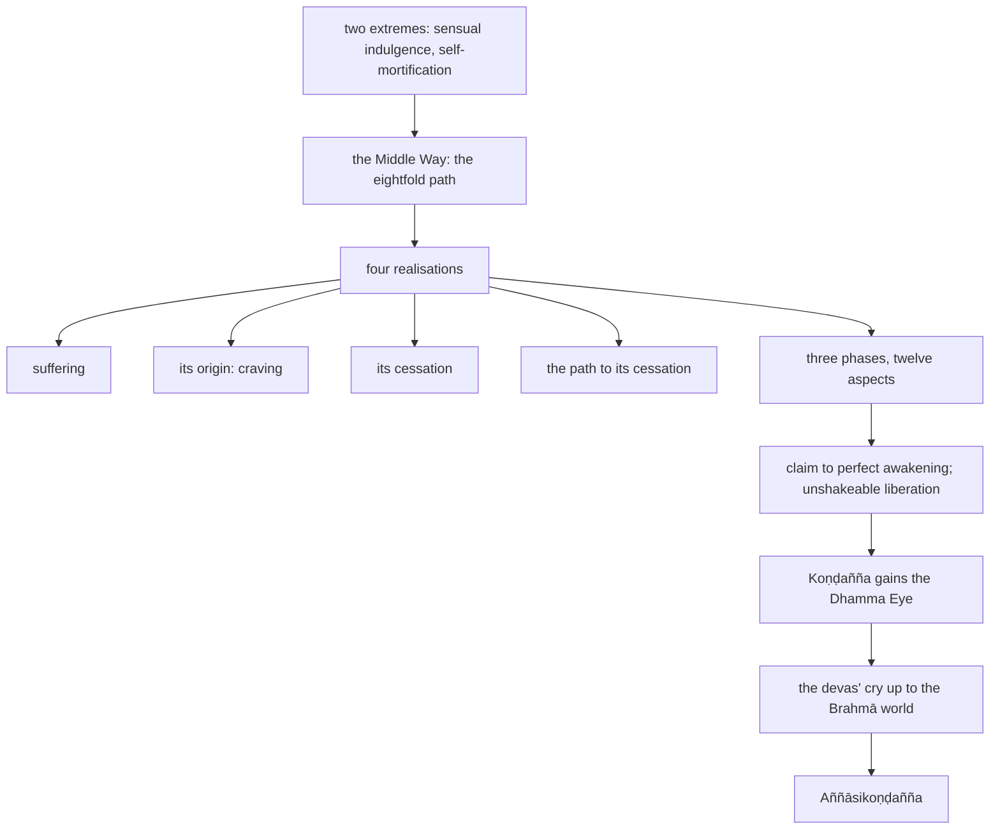

import { Tabs, TabItem } from '@astrojs/starlight/components';

Original text: [14S5/12.2.1 Dhammacakkappavattanasutta 2206–2220](https://tipitaka2500.github.io/tipitaka/14S5/12/12.2/12.2.1.html#2206) in the [World Tipitaka Edition](https://tipitaka2500.github.io)

## Summary

The Bhagavā's first discourse, to the group of five bhikkhū at Isipatana: the two extremes not to be cultivated and the Middle Way, the eightfold path; the four realisations of suffering, its origin, its cessation and the path to it; the three phases and twelve aspects in which his knowledge of them was purified; and his claim to perfect awakening. Koṇḍañña gains the Dhamma Eye, the devas carry the news of the wheel of the Dhamma up to the Brahmā world, and Koṇḍañña receives the name Aññāsikoṇḍañña.

## Diagram

## Text

<Tabs syncKey="paliquote">
<TabItem label="My Translation">
(1081.)

2206\. At one time the Bhagavā was dwelling at Bārāṇasī, at Isipatana in the Deer Park. There the Bhagavā addressed the group of five bhikkhū:

2207\. “These two extremes, Bhikkhave, should not be cultivated by one who has gone forth. What two? That which is this pursuit of sensual happiness in sensual pleasures, which is low, vulgar, worldly, ignoble, not conducive to welfare; and that which is this pursuit of self-mortification, which is painful, ignoble, not conducive to welfare. Without veering towards either of these two extremes, Bhikkhave, the `majjhimā paṭipadā` (Middle Way) has been `abhisambuddha` (fully awakened) by the Tathāgata, which produces vision, produces knowledge, leads to calm, to `abhiññā` (experiential understanding), to `sambodhi` (full awakening), to `nibbāna` (extinguishment).

2208\. And what, Bhikkhave, is that `majjhimā paṭipadā` (Middle Way), fully awakened by the Tathāgata, which produces vision, produces knowledge, leads to calm, to `abhiññā`, to `sambodhi`, to `nibbāna`? It is this very `ariyo aṭṭhaṅgiko maggo` (Eightfold Path), that is to say: `sammādiṭṭhi` (right view), `sammāsaṅkappa` (right resolve), `sammāvācā` (right speech), `sammākammanta` (right action), `sammāājīva` (right livelihood), `sammāvāyāma` (right effort), `sammāsati` (right awareness), `sammāsamādhi` (right focus). This, Bhikkhave, is that `majjhimā paṭipadā` (Middle Way), `abhisambuddha` (fully awakened) by the Tathāgata, which produces vision, produces knowledge, leads to calm, to `abhiññā`, to `sambodhi`, to `nibbāna`.

2209\. Now this, Bhikkhave, is the `dukkha ariyasacca` (realisation of suffering). Birth is `dukkha` (suffering), ageing is `dukkha`, illness is `dukkha`, death is `dukkha`, association with the unloved is `dukkha`, separation from the loved is `dukkha`, not getting what one wants is `dukkha`. In short, the `pañcupādānakkhandhā` (the five collections of fuel) are `dukkha`. Now this, Bhikkhave, is the `dukkhasamudaya ariyasacca` (realisation of the origin of suffering): it is this `taṇhā` (craving) which leads to renewed existence, accompanied by delight and lust, relishing now here, now there; that is to say, `kāmataṇhā` (craving for sensual pleasures), `bhavataṇhā` (craving for existence), `vibhavataṇhā` (craving for non-existence). Now this, Bhikkhave, is the `dukkhanirodha ariyasacca` (realisation of the cessation of suffering): it is the remainderless fading away and cessation of that same `taṇhā`, the giving up, the relinquishing of it, freedom from it, non-attachment to it. Now this, Bhikkhave, is the `dukkhanirodhagāminī paṭipadā ariyasacca` (realisation of the path leading to the cessation of suffering): it is this very `ariyo aṭṭhaṅgiko maggo`, that is to say: `sammādiṭṭhi` … and so on … `sammāsamādhi`.

2210\. ‘This is the `dukkha ariyasacca`’ (realisation of suffering): thus, Bhikkhave, concerning dhammas not heard before, `cakkhuṃ` (insight) arose in me, `ñāṇaṃ` (knowledge) arose, `paññā` (wisdom) arose, `vijjā` (understanding) arose, `āloko` (light) arose. ‘This `dukkha ariyasacca` should be `pariññeyyaṃ` (fully understood)’: thus, Bhikkhave, [concerning dhammas not heard] before … and so on … [light] arose. ‘This `dukkha ariyasacca` has been `pariññātaṃ` (fully understood)’: thus, Bhikkhave, concerning dhammas not heard before, insight arose in me, knowledge arose, wisdom arose, understanding arose, light arose.

2211\. ‘This is the `dukkhasamudaya ariyasacca`’ (realisation of the origin of suffering): thus, Bhikkhave, concerning dhammas not heard before, insight arose in me, knowledge arose, wisdom arose, understanding arose, light arose. ‘This `dukkhasamudaya ariyasacca` should be `pahātabbaṃ` (given up)’: thus, Bhikkhave, [concerning dhammas not heard] before … and so on … [light] arose. ‘This `dukkhasamudaya ariyasacca` has been `pahīnaṃ` (given up)’: thus, Bhikkhave, concerning dhammas not heard before, insight arose in me, knowledge arose, wisdom arose, understanding arose, light arose.

2212\. ‘This is the `dukkhanirodha ariyasacca`’ (realisation of the cessation of suffering): thus, Bhikkhave, concerning dhammas not heard before, insight arose in me, knowledge arose, wisdom arose, understanding arose, light arose. ‘This `dukkhanirodha ariyasacca` should be `sacchikātabbaṃ` (personally experienced)’: thus, Bhikkhave, [concerning dhammas not heard] before … and so on … [light] arose. ‘This `dukkhanirodha ariyasacca` has been `sacchikataṃ` (personally experienced)’: thus, Bhikkhave, concerning dhammas not heard before, insight arose in me, knowledge arose, wisdom arose, understanding arose, light arose.

2213\. ‘This is the `dukkhanirodhagāminī paṭipadā ariyasacca`’ (realisation of the path leading to the cessation of suffering): thus, Bhikkhave, concerning dhammas not heard before, insight arose in me, knowledge arose, wisdom arose, understanding arose, light arose. ‘This `dukkhanirodhagāminī paṭipadā ariyasacca` should be `bhāvetabbaṃ` (developed)’: thus, Bhikkhave, [concerning dhammas not heard] before … and so on … [light] arose. ‘This `dukkhanirodhagāminī paṭipadā ariyasacca` has been `bhāvitaṃ` (developed)’: thus, Bhikkhave, concerning dhammas not heard before, insight arose in me, knowledge arose, wisdom arose, understanding arose, light arose.

2214\. And as long as, Bhikkhave, I did not have `yathābhūta` (in reality) `ñāṇadassana` (total understanding) and `suvisuddha` (total purification) in these four realisations with `tiparivaṭṭa` (three phases) and `dvādasākāra` (twelve aspects), then, Bhikkhave, I did not claim to have `abhisambuddha anuttara sammāsambodhi` (fully awakened to the perfect awakening unsurpassed by anything) in this world having devas, Māra, Brahmā, religious practitioners, `pajā` (living beings), `sadevamanussa` (devas and humans).

2215\. But when, Bhikkhave, I had `yathābhūta` (in reality) `ñāṇadassana` (total understanding) and `suvisuddha` (total purification) in these four realisations with `tiparivaṭṭa` (three phases) and `dvādasākāra` (twelve aspects), then, Bhikkhave, I claimed to have `abhisambuddha anuttara sammāsambodhi` (fully awakened to the perfect awakening unsurpassed by anything) in this world having devas, Māra, Brahmā, religious practitioners, `pajā` (living beings), `sadevamanussa` (devas and humans). And knowledge and insight arose in me: ‘Unshakeable is my liberation, this is the final birth (of suffering), there is now no more appearing again (of suffering).’” This the Bhagavā said. The group of five bhikkhū, delighted, rejoiced in the Bhagavā’s words.

2216\. And while this detailed exposition was being spoken, there arose in `āyasmā` Koṇḍañña the `viraja` (pure), `vītamala` (stainless) `dhammacakkhu` (Dhamma Eye): “Whatever phenomenon is subject to origination is completely subject to cessation.”

2217\. And when the `Dhammacakka` (Dhamma wheel) had been set in motion by the Bhagavā, `bhummā devā` (the earth-dwelling devas) raised a cry: “This unsurpassed `Dhammacakka` has been set in motion by the Bhagavā in Bārāṇasī, at Isipatana in the Deer Park, which cannot be stopped by any wanderer or brahmin or deva or Māra or Brahmā or by anyone in the world.” Hearing the cry of the earth-dwelling devas, the Cātumahārājikā devas raised a cry: “This unsurpassed `Dhammacakka` has been set in motion by the Bhagavā in Bārāṇasī, at Isipatana in the Deer Park, which cannot be stopped by any wanderer or brahmin or deva or Māra or Brahmā or by anyone in the world.” Hearing the cry of the Cātumahārājikā devas, the Tāvatiṃsa devas … and so on … the Yāma devas … and so on … the Tusita devas … and so on … the Nimmānaratī devas … and so on … the Paranimmitavasavattī devas … and so on … the Brahmakāyika devas raised a cry: “This unsurpassed `Dhammacakka` has been set in motion by the Bhagavā in Bārāṇasī, at Isipatana in the Deer Park, which cannot be stopped by any wanderer or brahmin or deva or Māra or Brahmā or by anyone in the world.”

2218\. Thus indeed, in that moment, in that instant, in that flash, the sound arose up to `brahmalokā` (the Brahmā world). And this `dasasahassilokadhātu` (ten-thousand-fold world system) trembled, shook, quaked; and an immeasurable and excellent `obhāso` (radiance) appeared in the world, surpassing the divine majesty of the devas.

2219\. Then the Bhagavā uttered this inspired utterance: “Indeed, Bho Koṇḍañña has understood! Indeed, Bho Koṇḍañña has understood!” Thus it was that `āyasmā` Koṇḍañña came to be known as Aññāsikoṇḍañña (Koṇḍañña who understood).

2220\. The first [discourse of the chapter].
</TabItem>

<TabItem label="Pāḷi (Roman IAST)">
(1081.)

2206\. Ekaṃ samayaṃ bhagavā bārāṇasiyaṃ viharati isipatane migadāye. Tatra kho bhagavā pañcavaggiye bhikkhū āmantesi—

2207\. “Dveme, bhikkhave, antā pabbajitena na sevitabbā. Katame dve? Yo cāyaṃ kāmesu kāmasukhallikānuyogo hīno gammo pothujjaniko anariyo anatthasaṃhito, yo cāyaṃ attakilamathānuyogo dukkho anariyo anatthasaṃhito. Ete kho, bhikkhave, ubho ante anupagamma majjhimā paṭipadā tathāgatena abhisambuddhā cakkhukaraṇī ñāṇakaraṇī upasamāya abhiññāya sambodhāya nibbānāya saṃvattati.

2208\. Katamā ca sā, bhikkhave, majjhimā paṭipadā tathāgatena abhisambuddhā cakkhukaraṇī ñāṇakaraṇī upasamāya abhiññāya sambodhāya nibbānāya saṃvattati? Ayameva ariyo aṭṭhaṅgiko maggo, seyyathidaṃ— sammādiṭṭhi sammāsaṅkappo sammāvācā sammākammanto sammāājīvo sammāvāyāmo sammāsati sammāsamādhi. Ayaṃ kho sā, bhikkhave, majjhimā paṭipadā tathāgatena abhisambuddhā cakkhukaraṇī ñāṇakaraṇī upasamāya abhiññāya sambodhāya nibbānāya saṃvattati.

2209\. Idaṃ kho pana, bhikkhave, dukkhaṃ ariyasaccaṃ— jātipi dukkhā, jarāpi dukkhā, byādhipi dukkho, maraṇampi dukkhaṃ, appiyehi sampayogo dukkho, piyehi vippayogo dukkho, yampicchaṃ na labhati tampi dukkhaṃ— saṃkhittena pañcupādānakkhandhā dukkhā. Idaṃ kho pana, bhikkhave, dukkhasamudayaṃ ariyasaccaṃ— yāyaṃ taṇhā ponobbhavikā nandirāgasahagatā tatratatrābhinandinī, seyyathidaṃ— kāmataṇhā, bhavataṇhā, vibhavataṇhā. Idaṃ kho pana, bhikkhave, dukkhanirodhaṃ ariyasaccaṃ— yo tassāyeva taṇhāya asesavirāganirodho cāgo paṭinissaggo mutti anālayo. Idaṃ kho pana, bhikkhave, dukkhanirodhagāminī paṭipadā ariyasaccaṃ— ayameva ariyo aṭṭhaṅgiko maggo, seyyathidaṃ— sammādiṭṭhi…pe… sammāsamādhi.

2210\. ‘Idaṃ dukkhaṃ ariyasaccan’ti me, bhikkhave, pubbe ananussutesu dhammesu cakkhuṃ udapādi, ñāṇaṃ udapādi, paññā udapādi, vijjā udapādi, āloko udapādi. ‘Taṃ kho panidaṃ dukkhaṃ ariyasaccaṃ pariññeyyan’ti me, bhikkhave, pubbe…pe… udapādi. ‘Taṃ kho panidaṃ dukkhaṃ ariyasaccaṃ pariññātan’ti me, bhikkhave, pubbe ananussutesu dhammesu cakkhuṃ udapādi, ñāṇaṃ udapādi, paññā udapādi, vijjā udapādi, āloko udapādi.

2211\. ‘Idaṃ dukkhasamudayaṃ ariyasaccan’ti me, bhikkhave, pubbe ananussutesu dhammesu cakkhuṃ udapādi, ñāṇaṃ udapādi, paññā udapādi, vijjā udapādi, āloko udapādi. ‘Taṃ kho panidaṃ dukkhasamudayaṃ ariyasaccaṃ pahātabban’ti me, bhikkhave, pubbe…pe… udapādi. ‘Taṃ kho panidaṃ dukkhasamudayaṃ ariyasaccaṃ pahīnan’ti me, bhikkhave, pubbe ananussutesu dhammesu cakkhuṃ udapādi, ñāṇaṃ udapādi, paññā udapādi, vijjā udapādi, āloko udapādi.

2212\. ‘Idaṃ dukkhanirodhaṃ ariyasaccan’ti me, bhikkhave, pubbe ananussutesu dhammesu cakkhuṃ udapādi, ñāṇaṃ udapādi, paññā udapādi, vijjā udapādi, āloko udapādi. ‘Taṃ kho panidaṃ dukkhanirodhaṃ ariyasaccaṃ sacchikātabban’ti me, bhikkhave, pubbe…pe… udapādi. ‘Taṃ kho panidaṃ dukkhanirodhaṃ ariyasaccaṃ sacchikatan’ti me, bhikkhave, pubbe ananussutesu dhammesu cakkhuṃ udapādi, ñāṇaṃ udapādi, paññā udapādi, vijjā udapādi, āloko udapādi.

2213\. ‘Idaṃ dukkhanirodhagāminī paṭipadā ariyasaccan’ti me, bhikkhave, pubbe ananussutesu dhammesu cakkhuṃ udapādi, ñāṇaṃ udapādi, paññā udapādi, vijjā udapādi, āloko udapādi. ‘Taṃ kho panidaṃ dukkhanirodhagāminī paṭipadā ariyasaccaṃ bhāvetabban’ti me, bhikkhave, pubbe…pe… udapādi. ‘Taṃ kho panidaṃ dukkhanirodhagāminī paṭipadā ariyasaccaṃ bhāvitan’ti me, bhikkhave, pubbe ananussutesu dhammesu cakkhuṃ udapādi, ñāṇaṃ udapādi, paññā udapādi, vijjā udapādi, āloko udapādi.

2214\. Yāvakīvañca me, bhikkhave, imesu catūsu ariyasaccesu evaṃ tiparivaṭṭaṃ dvādasākāraṃ yathābhūtaṃ ñāṇadassanaṃ na suvisuddhaṃ ahosi, neva tāvāhaṃ, bhikkhave, sadevake loke samārake sabrahmake sassamaṇabrāhmaṇiyā pajāya sadevamanussāya ‘anuttaraṃ sammāsambodhiṃ abhisambuddho’ti paccaññāsiṃ.

2215\. Yato ca kho me, bhikkhave, imesu catūsu ariyasaccesu evaṃ tiparivaṭṭaṃ dvādasākāraṃ yathābhūtaṃ ñāṇadassanaṃ suvisuddhaṃ ahosi, athāhaṃ, bhikkhave, sadevake loke samārake sabrahmake sassamaṇabrāhmaṇiyā pajāya sadevamanussāya ‘anuttaraṃ sammāsambodhiṃ abhisambuddho’ti paccaññāsiṃ. Ñāṇañca pana me dassanaṃ udapādi— ‘akuppā me vimutti, ayamantimā jāti, natthi dāni punabbhavo’”ti. Idamavoca bhagavā. Attamanā pañcavaggiyā bhikkhū bhagavato bhāsitaṃ abhinandunti.

2216\. Imasmiñca pana veyyākaraṇasmiṃ bhaññamāne āyasmato koṇḍaññassa virajaṃ vītamalaṃ dhammacakkhuṃ udapādi— “yaṃ kiñci samudayadhammaṃ sabbaṃ taṃ nirodhadhamman”ti.

2217\. Pavattite ca pana bhagavatā dhammacakke bhummā devā saddamanussāvesuṃ— “etaṃ bhagavatā bārāṇasiyaṃ isipatane migadāye anuttaraṃ dhammacakkaṃ pavattitaṃ appaṭivattiyaṃ samaṇena vā brāhmaṇena vā devena vā mārena vā brahmunā vā kenaci vā lokasmin”ti. Bhummānaṃ devānaṃ saddaṃ sutvā cātumahārājikā devā saddamanussāvesuṃ— “etaṃ bhagavatā bārāṇasiyaṃ isipatane migadāye anuttaraṃ dhammacakkaṃ pavattitaṃ, appaṭivattiyaṃ samaṇena vā brāhmaṇena vā devena vā mārena vā brahmunā vā kenaci vā lokasmin”ti. Cātumahārājikānaṃ devānaṃ saddaṃ sutvā tāvatiṃsā devā…pe… yāmā devā…pe… tusitā devā…pe… nimmānaratī devā…pe… paranimmitavasavattī devā…pe… brahmakāyikā devā saddamanussāvesuṃ— “etaṃ bhagavatā bārāṇasiyaṃ isipatane migadāye anuttaraṃ dhammacakkaṃ pavattitaṃ appaṭivattiyaṃ samaṇena vā brāhmaṇena vā devena vā mārena vā brahmunā vā kenaci vā lokasmin”ti.

2218\. Itiha tena khaṇena tena layena tena muhuttena yāva brahmalokā saddo abbhuggacchi. Ayañca dasasahassilokadhātu saṅkampi sampakampi sampavedhi, appamāṇo ca uḷāro obhāso loke pāturahosi atikkamma devānaṃ devānubhāvanti.

2219\. Atha kho bhagavā imaṃ udānaṃ udānesi— “aññāsi vata bho, koṇḍañño, aññāsi vata bho, koṇḍañño”ti. Iti hidaṃ āyasmato koṇḍaññassa “aññāsikoṇḍañño” tveva nāmaṃ ahosīti.

2220\. Paṭhamaṃ.
</TabItem>

<TabItem label="Pāḷi (Brahmi)">
(1081.)

2206\. 𑀏𑀓𑀁 𑀲𑀫𑀬𑀁 𑀪𑀕𑀯𑀸 𑀩𑀸𑀭𑀸𑀡𑀲𑀺𑀬𑀁 𑀯𑀺𑀳𑀭𑀢𑀺 𑀇𑀲𑀺𑀧𑀢𑀦𑁂 𑀫𑀺𑀕𑀤𑀸𑀬𑁂. 𑀢𑀢𑁆𑀭 𑀔𑁄 𑀪𑀕𑀯𑀸 𑀧𑀜𑁆𑀘𑀯𑀕𑁆𑀕𑀺𑀬𑁂 𑀪𑀺𑀓𑁆𑀔𑀽 𑀆𑀫𑀦𑁆𑀢𑁂𑀲𑀺—

2207\. “𑀤𑁆𑀯𑁂𑀫𑁂, 𑀪𑀺𑀓𑁆𑀔𑀯𑁂, 𑀅𑀦𑁆𑀢𑀸 𑀧𑀩𑁆𑀩𑀚𑀺𑀢𑁂𑀦 𑀦 𑀲𑁂𑀯𑀺𑀢𑀩𑁆𑀩𑀸. 𑀓𑀢𑀫𑁂 𑀤𑁆𑀯𑁂? 𑀬𑁄 𑀘𑀸𑀬𑀁 𑀓𑀸𑀫𑁂𑀲𑀼 𑀓𑀸𑀫𑀲𑀼𑀔𑀮𑁆𑀮𑀺𑀓𑀸𑀦𑀼𑀬𑁄𑀕𑁄 𑀳𑀻𑀦𑁄 𑀕𑀫𑁆𑀫𑁄 𑀧𑁄𑀣𑀼𑀚𑁆𑀚𑀦𑀺𑀓𑁄 𑀅𑀦𑀭𑀺𑀬𑁄 𑀅𑀦𑀢𑁆𑀣𑀲𑀁𑀳𑀺𑀢𑁄, 𑀬𑁄 𑀘𑀸𑀬𑀁 𑀅𑀢𑁆𑀢𑀓𑀺𑀮𑀫𑀣𑀸𑀦𑀼𑀬𑁄𑀕𑁄 𑀤𑀼𑀓𑁆𑀔𑁄 𑀅𑀦𑀭𑀺𑀬𑁄 𑀅𑀦𑀢𑁆𑀣𑀲𑀁𑀳𑀺𑀢𑁄. 𑀏𑀢𑁂 𑀔𑁄, 𑀪𑀺𑀓𑁆𑀔𑀯𑁂, 𑀉𑀪𑁄 𑀅𑀦𑁆𑀢𑁂 𑀅𑀦𑀼𑀧𑀕𑀫𑁆𑀫 𑀫𑀚𑁆𑀛𑀺𑀫𑀸 𑀧𑀝𑀺𑀧𑀤𑀸 𑀢𑀣𑀸𑀕𑀢𑁂𑀦 𑀅𑀪𑀺𑀲𑀫𑁆𑀩𑀼𑀤𑁆𑀥𑀸 𑀘𑀓𑁆𑀔𑀼𑀓𑀭𑀡𑀻 𑀜𑀸𑀡𑀓𑀭𑀡𑀻 𑀉𑀧𑀲𑀫𑀸𑀬 𑀅𑀪𑀺𑀜𑁆𑀜𑀸𑀬 𑀲𑀫𑁆𑀩𑁄𑀥𑀸𑀬 𑀦𑀺𑀩𑁆𑀩𑀸𑀦𑀸𑀬 𑀲𑀁𑀯𑀢𑁆𑀢𑀢𑀺.

2208\. 𑀓𑀢𑀫𑀸 𑀘 𑀲𑀸, 𑀪𑀺𑀓𑁆𑀔𑀯𑁂, 𑀫𑀚𑁆𑀛𑀺𑀫𑀸 𑀧𑀝𑀺𑀧𑀤𑀸 𑀢𑀣𑀸𑀕𑀢𑁂𑀦 𑀅𑀪𑀺𑀲𑀫𑁆𑀩𑀼𑀤𑁆𑀥𑀸 𑀘𑀓𑁆𑀔𑀼𑀓𑀭𑀡𑀻 𑀜𑀸𑀡𑀓𑀭𑀡𑀻 𑀉𑀧𑀲𑀫𑀸𑀬 𑀅𑀪𑀺𑀜𑁆𑀜𑀸𑀬 𑀲𑀫𑁆𑀩𑁄𑀥𑀸𑀬 𑀦𑀺𑀩𑁆𑀩𑀸𑀦𑀸𑀬 𑀲𑀁𑀯𑀢𑁆𑀢𑀢𑀺? 𑀅𑀬𑀫𑁂𑀯 𑀅𑀭𑀺𑀬𑁄 𑀅𑀝𑁆𑀞𑀗𑁆𑀕𑀺𑀓𑁄 𑀫𑀕𑁆𑀕𑁄, 𑀲𑁂𑀬𑁆𑀬𑀣𑀺𑀤𑀁— 𑀲𑀫𑁆𑀫𑀸𑀤𑀺𑀝𑁆𑀞𑀺 𑀲𑀫𑁆𑀫𑀸𑀲𑀗𑁆𑀓𑀧𑁆𑀧𑁄 𑀲𑀫𑁆𑀫𑀸𑀯𑀸𑀘𑀸 𑀲𑀫𑁆𑀫𑀸𑀓𑀫𑁆𑀫𑀦𑁆𑀢𑁄 𑀲𑀫𑁆𑀫𑀸𑀆𑀚𑀻𑀯𑁄 𑀲𑀫𑁆𑀫𑀸𑀯𑀸𑀬𑀸𑀫𑁄 𑀲𑀫𑁆𑀫𑀸𑀲𑀢𑀺 𑀲𑀫𑁆𑀫𑀸𑀲𑀫𑀸𑀥𑀺. 𑀅𑀬𑀁 𑀔𑁄 𑀲𑀸, 𑀪𑀺𑀓𑁆𑀔𑀯𑁂, 𑀫𑀚𑁆𑀛𑀺𑀫𑀸 𑀧𑀝𑀺𑀧𑀤𑀸 𑀢𑀣𑀸𑀕𑀢𑁂𑀦 𑀅𑀪𑀺𑀲𑀫𑁆𑀩𑀼𑀤𑁆𑀥𑀸 𑀘𑀓𑁆𑀔𑀼𑀓𑀭𑀡𑀻 𑀜𑀸𑀡𑀓𑀭𑀡𑀻 𑀉𑀧𑀲𑀫𑀸𑀬 𑀅𑀪𑀺𑀜𑁆𑀜𑀸𑀬 𑀲𑀫𑁆𑀩𑁄𑀥𑀸𑀬 𑀦𑀺𑀩𑁆𑀩𑀸𑀦𑀸𑀬 𑀲𑀁𑀯𑀢𑁆𑀢𑀢𑀺.

2209\. 𑀇𑀤𑀁 𑀔𑁄 𑀧𑀦, 𑀪𑀺𑀓𑁆𑀔𑀯𑁂, 𑀤𑀼𑀓𑁆𑀔𑀁 𑀅𑀭𑀺𑀬𑀲𑀘𑁆𑀘𑀁— 𑀚𑀸𑀢𑀺𑀧𑀺 𑀤𑀼𑀓𑁆𑀔𑀸, 𑀚𑀭𑀸𑀧𑀺 𑀤𑀼𑀓𑁆𑀔𑀸, 𑀩𑁆𑀬𑀸𑀥𑀺𑀧𑀺 𑀤𑀼𑀓𑁆𑀔𑁄, 𑀫𑀭𑀡𑀫𑁆𑀧𑀺 𑀤𑀼𑀓𑁆𑀔𑀁, 𑀅𑀧𑁆𑀧𑀺𑀬𑁂𑀳𑀺 𑀲𑀫𑁆𑀧𑀬𑁄𑀕𑁄 𑀤𑀼𑀓𑁆𑀔𑁄, 𑀧𑀺𑀬𑁂𑀳𑀺 𑀯𑀺𑀧𑁆𑀧𑀬𑁄𑀕𑁄 𑀤𑀼𑀓𑁆𑀔𑁄, 𑀬𑀫𑁆𑀧𑀺𑀘𑁆𑀙𑀁 𑀦 𑀮𑀪𑀢𑀺 𑀢𑀫𑁆𑀧𑀺 𑀤𑀼𑀓𑁆𑀔𑀁— 𑀲𑀁𑀔𑀺𑀢𑁆𑀢𑁂𑀦 𑀧𑀜𑁆𑀘𑀼𑀧𑀸𑀤𑀸𑀦𑀓𑁆𑀔𑀦𑁆𑀥𑀸 𑀤𑀼𑀓𑁆𑀔𑀸. 𑀇𑀤𑀁 𑀔𑁄 𑀧𑀦, 𑀪𑀺𑀓𑁆𑀔𑀯𑁂, 𑀤𑀼𑀓𑁆𑀔𑀲𑀫𑀼𑀤𑀬𑀁 𑀅𑀭𑀺𑀬𑀲𑀘𑁆𑀘𑀁— 𑀬𑀸𑀬𑀁 𑀢𑀡𑁆𑀳𑀸 𑀧𑁄𑀦𑁄𑀩𑁆𑀪𑀯𑀺𑀓𑀸 𑀦𑀦𑁆𑀤𑀺𑀭𑀸𑀕𑀲𑀳𑀕𑀢𑀸 𑀢𑀢𑁆𑀭𑀢𑀢𑁆𑀭𑀸𑀪𑀺𑀦𑀦𑁆𑀤𑀺𑀦𑀻, 𑀲𑁂𑀬𑁆𑀬𑀣𑀺𑀤𑀁— 𑀓𑀸𑀫𑀢𑀡𑁆𑀳𑀸, 𑀪𑀯𑀢𑀡𑁆𑀳𑀸, 𑀯𑀺𑀪𑀯𑀢𑀡𑁆𑀳𑀸. 𑀇𑀤𑀁 𑀔𑁄 𑀧𑀦, 𑀪𑀺𑀓𑁆𑀔𑀯𑁂, 𑀤𑀼𑀓𑁆𑀔𑀦𑀺𑀭𑁄𑀥𑀁 𑀅𑀭𑀺𑀬𑀲𑀘𑁆𑀘𑀁— 𑀬𑁄 𑀢𑀲𑁆𑀲𑀸𑀬𑁂𑀯 𑀢𑀡𑁆𑀳𑀸𑀬 𑀅𑀲𑁂𑀲𑀯𑀺𑀭𑀸𑀕𑀦𑀺𑀭𑁄𑀥𑁄 𑀘𑀸𑀕𑁄 𑀧𑀝𑀺𑀦𑀺𑀲𑁆𑀲𑀕𑁆𑀕𑁄 𑀫𑀼𑀢𑁆𑀢𑀺 𑀅𑀦𑀸𑀮𑀬𑁄. 𑀇𑀤𑀁 𑀔𑁄 𑀧𑀦, 𑀪𑀺𑀓𑁆𑀔𑀯𑁂, 𑀤𑀼𑀓𑁆𑀔𑀦𑀺𑀭𑁄𑀥𑀕𑀸𑀫𑀺𑀦𑀻 𑀧𑀝𑀺𑀧𑀤𑀸 𑀅𑀭𑀺𑀬𑀲𑀘𑁆𑀘𑀁— 𑀅𑀬𑀫𑁂𑀯 𑀅𑀭𑀺𑀬𑁄 𑀅𑀝𑁆𑀞𑀗𑁆𑀕𑀺𑀓𑁄 𑀫𑀕𑁆𑀕𑁄, 𑀲𑁂𑀬𑁆𑀬𑀣𑀺𑀤𑀁— 𑀲𑀫𑁆𑀫𑀸𑀤𑀺𑀝𑁆𑀞𑀺…𑀧𑁂… 𑀲𑀫𑁆𑀫𑀸𑀲𑀫𑀸𑀥𑀺.

2210\. ‘𑀇𑀤𑀁 𑀤𑀼𑀓𑁆𑀔𑀁 𑀅𑀭𑀺𑀬𑀲𑀘𑁆𑀘𑀦𑁆’𑀢𑀺 𑀫𑁂, 𑀪𑀺𑀓𑁆𑀔𑀯𑁂, 𑀧𑀼𑀩𑁆𑀩𑁂 𑀅𑀦𑀦𑀼𑀲𑁆𑀲𑀼𑀢𑁂𑀲𑀼 𑀥𑀫𑁆𑀫𑁂𑀲𑀼 𑀘𑀓𑁆𑀔𑀼𑀁 𑀉𑀤𑀧𑀸𑀤𑀺, 𑀜𑀸𑀡𑀁 𑀉𑀤𑀧𑀸𑀤𑀺, 𑀧𑀜𑁆𑀜𑀸 𑀉𑀤𑀧𑀸𑀤𑀺, 𑀯𑀺𑀚𑁆𑀚𑀸 𑀉𑀤𑀧𑀸𑀤𑀺, 𑀆𑀮𑁄𑀓𑁄 𑀉𑀤𑀧𑀸𑀤𑀺. ‘𑀢𑀁 𑀔𑁄 𑀧𑀦𑀺𑀤𑀁 𑀤𑀼𑀓𑁆𑀔𑀁 𑀅𑀭𑀺𑀬𑀲𑀘𑁆𑀘𑀁 𑀧𑀭𑀺𑀜𑁆𑀜𑁂𑀬𑁆𑀬𑀦𑁆’𑀢𑀺 𑀫𑁂, 𑀪𑀺𑀓𑁆𑀔𑀯𑁂, 𑀧𑀼𑀩𑁆𑀩𑁂…𑀧𑁂… 𑀉𑀤𑀧𑀸𑀤𑀺. ‘𑀢𑀁 𑀔𑁄 𑀧𑀦𑀺𑀤𑀁 𑀤𑀼𑀓𑁆𑀔𑀁 𑀅𑀭𑀺𑀬𑀲𑀘𑁆𑀘𑀁 𑀧𑀭𑀺𑀜𑁆𑀜𑀸𑀢𑀦𑁆’𑀢𑀺 𑀫𑁂, 𑀪𑀺𑀓𑁆𑀔𑀯𑁂, 𑀧𑀼𑀩𑁆𑀩𑁂 𑀅𑀦𑀦𑀼𑀲𑁆𑀲𑀼𑀢𑁂𑀲𑀼 𑀥𑀫𑁆𑀫𑁂𑀲𑀼 𑀘𑀓𑁆𑀔𑀼𑀁 𑀉𑀤𑀧𑀸𑀤𑀺, 𑀜𑀸𑀡𑀁 𑀉𑀤𑀧𑀸𑀤𑀺, 𑀧𑀜𑁆𑀜𑀸 𑀉𑀤𑀧𑀸𑀤𑀺, 𑀯𑀺𑀚𑁆𑀚𑀸 𑀉𑀤𑀧𑀸𑀤𑀺, 𑀆𑀮𑁄𑀓𑁄 𑀉𑀤𑀧𑀸𑀤𑀺.

2211\. ‘𑀇𑀤𑀁 𑀤𑀼𑀓𑁆𑀔𑀲𑀫𑀼𑀤𑀬𑀁 𑀅𑀭𑀺𑀬𑀲𑀘𑁆𑀘𑀦𑁆’𑀢𑀺 𑀫𑁂, 𑀪𑀺𑀓𑁆𑀔𑀯𑁂, 𑀧𑀼𑀩𑁆𑀩𑁂 𑀅𑀦𑀦𑀼𑀲𑁆𑀲𑀼𑀢𑁂𑀲𑀼 𑀥𑀫𑁆𑀫𑁂𑀲𑀼 𑀘𑀓𑁆𑀔𑀼𑀁 𑀉𑀤𑀧𑀸𑀤𑀺, 𑀜𑀸𑀡𑀁 𑀉𑀤𑀧𑀸𑀤𑀺, 𑀧𑀜𑁆𑀜𑀸 𑀉𑀤𑀧𑀸𑀤𑀺, 𑀯𑀺𑀚𑁆𑀚𑀸 𑀉𑀤𑀧𑀸𑀤𑀺, 𑀆𑀮𑁄𑀓𑁄 𑀉𑀤𑀧𑀸𑀤𑀺. ‘𑀢𑀁 𑀔𑁄 𑀧𑀦𑀺𑀤𑀁 𑀤𑀼𑀓𑁆𑀔𑀲𑀫𑀼𑀤𑀬𑀁 𑀅𑀭𑀺𑀬𑀲𑀘𑁆𑀘𑀁 𑀧𑀳𑀸𑀢𑀩𑁆𑀩𑀦𑁆’𑀢𑀺 𑀫𑁂, 𑀪𑀺𑀓𑁆𑀔𑀯𑁂, 𑀧𑀼𑀩𑁆𑀩𑁂…𑀧𑁂… 𑀉𑀤𑀧𑀸𑀤𑀺. ‘𑀢𑀁 𑀔𑁄 𑀧𑀦𑀺𑀤𑀁 𑀤𑀼𑀓𑁆𑀔𑀲𑀫𑀼𑀤𑀬𑀁 𑀅𑀭𑀺𑀬𑀲𑀘𑁆𑀘𑀁 𑀧𑀳𑀻𑀦𑀦𑁆’𑀢𑀺 𑀫𑁂, 𑀪𑀺𑀓𑁆𑀔𑀯𑁂, 𑀧𑀼𑀩𑁆𑀩𑁂 𑀅𑀦𑀦𑀼𑀲𑁆𑀲𑀼𑀢𑁂𑀲𑀼 𑀥𑀫𑁆𑀫𑁂𑀲𑀼 𑀘𑀓𑁆𑀔𑀼𑀁 𑀉𑀤𑀧𑀸𑀤𑀺, 𑀜𑀸𑀡𑀁 𑀉𑀤𑀧𑀸𑀤𑀺, 𑀧𑀜𑁆𑀜𑀸 𑀉𑀤𑀧𑀸𑀤𑀺, 𑀯𑀺𑀚𑁆𑀚𑀸 𑀉𑀤𑀧𑀸𑀤𑀺, 𑀆𑀮𑁄𑀓𑁄 𑀉𑀤𑀧𑀸𑀤𑀺.

2212\. ‘𑀇𑀤𑀁 𑀤𑀼𑀓𑁆𑀔𑀦𑀺𑀭𑁄𑀥𑀁 𑀅𑀭𑀺𑀬𑀲𑀘𑁆𑀘𑀦𑁆’𑀢𑀺 𑀫𑁂, 𑀪𑀺𑀓𑁆𑀔𑀯𑁂, 𑀧𑀼𑀩𑁆𑀩𑁂 𑀅𑀦𑀦𑀼𑀲𑁆𑀲𑀼𑀢𑁂𑀲𑀼 𑀥𑀫𑁆𑀫𑁂𑀲𑀼 𑀘𑀓𑁆𑀔𑀼𑀁 𑀉𑀤𑀧𑀸𑀤𑀺, 𑀜𑀸𑀡𑀁 𑀉𑀤𑀧𑀸𑀤𑀺, 𑀧𑀜𑁆𑀜𑀸 𑀉𑀤𑀧𑀸𑀤𑀺, 𑀯𑀺𑀚𑁆𑀚𑀸 𑀉𑀤𑀧𑀸𑀤𑀺, 𑀆𑀮𑁄𑀓𑁄 𑀉𑀤𑀧𑀸𑀤𑀺. ‘𑀢𑀁 𑀔𑁄 𑀧𑀦𑀺𑀤𑀁 𑀤𑀼𑀓𑁆𑀔𑀦𑀺𑀭𑁄𑀥𑀁 𑀅𑀭𑀺𑀬𑀲𑀘𑁆𑀘𑀁 𑀲𑀘𑁆𑀙𑀺𑀓𑀸𑀢𑀩𑁆𑀩𑀦𑁆’𑀢𑀺 𑀫𑁂, 𑀪𑀺𑀓𑁆𑀔𑀯𑁂, 𑀧𑀼𑀩𑁆𑀩𑁂…𑀧𑁂… 𑀉𑀤𑀧𑀸𑀤𑀺. ‘𑀢𑀁 𑀔𑁄 𑀧𑀦𑀺𑀤𑀁 𑀤𑀼𑀓𑁆𑀔𑀦𑀺𑀭𑁄𑀥𑀁 𑀅𑀭𑀺𑀬𑀲𑀘𑁆𑀘𑀁 𑀲𑀘𑁆𑀙𑀺𑀓𑀢𑀦𑁆’𑀢𑀺 𑀫𑁂, 𑀪𑀺𑀓𑁆𑀔𑀯𑁂, 𑀧𑀼𑀩𑁆𑀩𑁂 𑀅𑀦𑀦𑀼𑀲𑁆𑀲𑀼𑀢𑁂𑀲𑀼 𑀥𑀫𑁆𑀫𑁂𑀲𑀼 𑀘𑀓𑁆𑀔𑀼𑀁 𑀉𑀤𑀧𑀸𑀤𑀺, 𑀜𑀸𑀡𑀁 𑀉𑀤𑀧𑀸𑀤𑀺, 𑀧𑀜𑁆𑀜𑀸 𑀉𑀤𑀧𑀸𑀤𑀺, 𑀯𑀺𑀚𑁆𑀚𑀸 𑀉𑀤𑀧𑀸𑀤𑀺, 𑀆𑀮𑁄𑀓𑁄 𑀉𑀤𑀧𑀸𑀤𑀺.

2213\. ‘𑀇𑀤𑀁 𑀤𑀼𑀓𑁆𑀔𑀦𑀺𑀭𑁄𑀥𑀕𑀸𑀫𑀺𑀦𑀻 𑀧𑀝𑀺𑀧𑀤𑀸 𑀅𑀭𑀺𑀬𑀲𑀘𑁆𑀘𑀦𑁆’𑀢𑀺 𑀫𑁂, 𑀪𑀺𑀓𑁆𑀔𑀯𑁂, 𑀧𑀼𑀩𑁆𑀩𑁂 𑀅𑀦𑀦𑀼𑀲𑁆𑀲𑀼𑀢𑁂𑀲𑀼 𑀥𑀫𑁆𑀫𑁂𑀲𑀼 𑀘𑀓𑁆𑀔𑀼𑀁 𑀉𑀤𑀧𑀸𑀤𑀺, 𑀜𑀸𑀡𑀁 𑀉𑀤𑀧𑀸𑀤𑀺, 𑀧𑀜𑁆𑀜𑀸 𑀉𑀤𑀧𑀸𑀤𑀺, 𑀯𑀺𑀚𑁆𑀚𑀸 𑀉𑀤𑀧𑀸𑀤𑀺, 𑀆𑀮𑁄𑀓𑁄 𑀉𑀤𑀧𑀸𑀤𑀺. ‘𑀢𑀁 𑀔𑁄 𑀧𑀦𑀺𑀤𑀁 𑀤𑀼𑀓𑁆𑀔𑀦𑀺𑀭𑁄𑀥𑀕𑀸𑀫𑀺𑀦𑀻 𑀧𑀝𑀺𑀧𑀤𑀸 𑀅𑀭𑀺𑀬𑀲𑀘𑁆𑀘𑀁 𑀪𑀸𑀯𑁂𑀢𑀩𑁆𑀩𑀦𑁆’𑀢𑀺 𑀫𑁂, 𑀪𑀺𑀓𑁆𑀔𑀯𑁂, 𑀧𑀼𑀩𑁆𑀩𑁂…𑀧𑁂… 𑀉𑀤𑀧𑀸𑀤𑀺. ‘𑀢𑀁 𑀔𑁄 𑀧𑀦𑀺𑀤𑀁 𑀤𑀼𑀓𑁆𑀔𑀦𑀺𑀭𑁄𑀥𑀕𑀸𑀫𑀺𑀦𑀻 𑀧𑀝𑀺𑀧𑀤𑀸 𑀅𑀭𑀺𑀬𑀲𑀘𑁆𑀘𑀁 𑀪𑀸𑀯𑀺𑀢𑀦𑁆’𑀢𑀺 𑀫𑁂, 𑀪𑀺𑀓𑁆𑀔𑀯𑁂, 𑀧𑀼𑀩𑁆𑀩𑁂 𑀅𑀦𑀦𑀼𑀲𑁆𑀲𑀼𑀢𑁂𑀲𑀼 𑀥𑀫𑁆𑀫𑁂𑀲𑀼 𑀘𑀓𑁆𑀔𑀼𑀁 𑀉𑀤𑀧𑀸𑀤𑀺, 𑀜𑀸𑀡𑀁 𑀉𑀤𑀧𑀸𑀤𑀺, 𑀧𑀜𑁆𑀜𑀸 𑀉𑀤𑀧𑀸𑀤𑀺, 𑀯𑀺𑀚𑁆𑀚𑀸 𑀉𑀤𑀧𑀸𑀤𑀺, 𑀆𑀮𑁄𑀓𑁄 𑀉𑀤𑀧𑀸𑀤𑀺.

2214\. 𑀬𑀸𑀯𑀓𑀻𑀯𑀜𑁆𑀘 𑀫𑁂, 𑀪𑀺𑀓𑁆𑀔𑀯𑁂, 𑀇𑀫𑁂𑀲𑀼 𑀘𑀢𑀽𑀲𑀼 𑀅𑀭𑀺𑀬𑀲𑀘𑁆𑀘𑁂𑀲𑀼 𑀏𑀯𑀁 𑀢𑀺𑀧𑀭𑀺𑀯𑀝𑁆𑀝𑀁 𑀤𑁆𑀯𑀸𑀤𑀲𑀸𑀓𑀸𑀭𑀁 𑀬𑀣𑀸𑀪𑀽𑀢𑀁 𑀜𑀸𑀡𑀤𑀲𑁆𑀲𑀦𑀁 𑀦 𑀲𑀼𑀯𑀺𑀲𑀼𑀤𑁆𑀥𑀁 𑀅𑀳𑁄𑀲𑀺, 𑀦𑁂𑀯 𑀢𑀸𑀯𑀸𑀳𑀁, 𑀪𑀺𑀓𑁆𑀔𑀯𑁂, 𑀲𑀤𑁂𑀯𑀓𑁂 𑀮𑁄𑀓𑁂 𑀲𑀫𑀸𑀭𑀓𑁂 𑀲𑀩𑁆𑀭𑀳𑁆𑀫𑀓𑁂 𑀲𑀲𑁆𑀲𑀫𑀡𑀩𑁆𑀭𑀸𑀳𑁆𑀫𑀡𑀺𑀬𑀸 𑀧𑀚𑀸𑀬 𑀲𑀤𑁂𑀯𑀫𑀦𑀼𑀲𑁆𑀲𑀸𑀬 ‘𑀅𑀦𑀼𑀢𑁆𑀢𑀭𑀁 𑀲𑀫𑁆𑀫𑀸𑀲𑀫𑁆𑀩𑁄𑀥𑀺𑀁 𑀅𑀪𑀺𑀲𑀫𑁆𑀩𑀼𑀤𑁆𑀥𑁄’𑀢𑀺 𑀧𑀘𑁆𑀘𑀜𑁆𑀜𑀸𑀲𑀺𑀁.

2215\. 𑀬𑀢𑁄 𑀘 𑀔𑁄 𑀫𑁂, 𑀪𑀺𑀓𑁆𑀔𑀯𑁂, 𑀇𑀫𑁂𑀲𑀼 𑀘𑀢𑀽𑀲𑀼 𑀅𑀭𑀺𑀬𑀲𑀘𑁆𑀘𑁂𑀲𑀼 𑀏𑀯𑀁 𑀢𑀺𑀧𑀭𑀺𑀯𑀝𑁆𑀝𑀁 𑀤𑁆𑀯𑀸𑀤𑀲𑀸𑀓𑀸𑀭𑀁 𑀬𑀣𑀸𑀪𑀽𑀢𑀁 𑀜𑀸𑀡𑀤𑀲𑁆𑀲𑀦𑀁 𑀲𑀼𑀯𑀺𑀲𑀼𑀤𑁆𑀥𑀁 𑀅𑀳𑁄𑀲𑀺, 𑀅𑀣𑀸𑀳𑀁, 𑀪𑀺𑀓𑁆𑀔𑀯𑁂, 𑀲𑀤𑁂𑀯𑀓𑁂 𑀮𑁄𑀓𑁂 𑀲𑀫𑀸𑀭𑀓𑁂 𑀲𑀩𑁆𑀭𑀳𑁆𑀫𑀓𑁂 𑀲𑀲𑁆𑀲𑀫𑀡𑀩𑁆𑀭𑀸𑀳𑁆𑀫𑀡𑀺𑀬𑀸 𑀧𑀚𑀸𑀬 𑀲𑀤𑁂𑀯𑀫𑀦𑀼𑀲𑁆𑀲𑀸𑀬 ‘𑀅𑀦𑀼𑀢𑁆𑀢𑀭𑀁 𑀲𑀫𑁆𑀫𑀸𑀲𑀫𑁆𑀩𑁄𑀥𑀺𑀁 𑀅𑀪𑀺𑀲𑀫𑁆𑀩𑀼𑀤𑁆𑀥𑁄’𑀢𑀺 𑀧𑀘𑁆𑀘𑀜𑁆𑀜𑀸𑀲𑀺𑀁. 𑀜𑀸𑀡𑀜𑁆𑀘 𑀧𑀦 𑀫𑁂 𑀤𑀲𑁆𑀲𑀦𑀁 𑀉𑀤𑀧𑀸𑀤𑀺— ‘𑀅𑀓𑀼𑀧𑁆𑀧𑀸 𑀫𑁂 𑀯𑀺𑀫𑀼𑀢𑁆𑀢𑀺, 𑀅𑀬𑀫𑀦𑁆𑀢𑀺𑀫𑀸 𑀚𑀸𑀢𑀺, 𑀦𑀢𑁆𑀣𑀺 𑀤𑀸𑀦𑀺 𑀧𑀼𑀦𑀩𑁆𑀪𑀯𑁄’”𑀢𑀺. 𑀇𑀤𑀫𑀯𑁄𑀘 𑀪𑀕𑀯𑀸. 𑀅𑀢𑁆𑀢𑀫𑀦𑀸 𑀧𑀜𑁆𑀘𑀯𑀕𑁆𑀕𑀺𑀬𑀸 𑀪𑀺𑀓𑁆𑀔𑀽 𑀪𑀕𑀯𑀢𑁄 𑀪𑀸𑀲𑀺𑀢𑀁 𑀅𑀪𑀺𑀦𑀦𑁆𑀤𑀼𑀦𑁆𑀢𑀺.

2216\. 𑀇𑀫𑀲𑁆𑀫𑀺𑀜𑁆𑀘 𑀧𑀦 𑀯𑁂𑀬𑁆𑀬𑀸𑀓𑀭𑀡𑀲𑁆𑀫𑀺𑀁 𑀪𑀜𑁆𑀜𑀫𑀸𑀦𑁂 𑀆𑀬𑀲𑁆𑀫𑀢𑁄 𑀓𑁄𑀡𑁆𑀟𑀜𑁆𑀜𑀲𑁆𑀲 𑀯𑀺𑀭𑀚𑀁 𑀯𑀻𑀢𑀫𑀮𑀁 𑀥𑀫𑁆𑀫𑀘𑀓𑁆𑀔𑀼𑀁 𑀉𑀤𑀧𑀸𑀤𑀺— “𑀬𑀁 𑀓𑀺𑀜𑁆𑀘𑀺 𑀲𑀫𑀼𑀤𑀬𑀥𑀫𑁆𑀫𑀁 𑀲𑀩𑁆𑀩𑀁 𑀢𑀁 𑀦𑀺𑀭𑁄𑀥𑀥𑀫𑁆𑀫𑀦𑁆”𑀢𑀺.

2217\. 𑀧𑀯𑀢𑁆𑀢𑀺𑀢𑁂 𑀘 𑀧𑀦 𑀪𑀕𑀯𑀢𑀸 𑀥𑀫𑁆𑀫𑀘𑀓𑁆𑀓𑁂 𑀪𑀼𑀫𑁆𑀫𑀸 𑀤𑁂𑀯𑀸 𑀲𑀤𑁆𑀤𑀫𑀦𑀼𑀲𑁆𑀲𑀸𑀯𑁂𑀲𑀼𑀁— “𑀏𑀢𑀁 𑀪𑀕𑀯𑀢𑀸 𑀩𑀸𑀭𑀸𑀡𑀲𑀺𑀬𑀁 𑀇𑀲𑀺𑀧𑀢𑀦𑁂 𑀫𑀺𑀕𑀤𑀸𑀬𑁂 𑀅𑀦𑀼𑀢𑁆𑀢𑀭𑀁 𑀥𑀫𑁆𑀫𑀘𑀓𑁆𑀓𑀁 𑀧𑀯𑀢𑁆𑀢𑀺𑀢𑀁 𑀅𑀧𑁆𑀧𑀝𑀺𑀯𑀢𑁆𑀢𑀺𑀬𑀁 𑀲𑀫𑀡𑁂𑀦 𑀯𑀸 𑀩𑁆𑀭𑀸𑀳𑁆𑀫𑀡𑁂𑀦 𑀯𑀸 𑀤𑁂𑀯𑁂𑀦 𑀯𑀸 𑀫𑀸𑀭𑁂𑀦 𑀯𑀸 𑀩𑁆𑀭𑀳𑁆𑀫𑀼𑀦𑀸 𑀯𑀸 𑀓𑁂𑀦𑀘𑀺 𑀯𑀸 𑀮𑁄𑀓𑀲𑁆𑀫𑀺𑀦𑁆”𑀢𑀺. 𑀪𑀼𑀫𑁆𑀫𑀸𑀦𑀁 𑀤𑁂𑀯𑀸𑀦𑀁 𑀲𑀤𑁆𑀤𑀁 𑀲𑀼𑀢𑁆𑀯𑀸 𑀘𑀸𑀢𑀼𑀫𑀳𑀸𑀭𑀸𑀚𑀺𑀓𑀸 𑀤𑁂𑀯𑀸 𑀲𑀤𑁆𑀤𑀫𑀦𑀼𑀲𑁆𑀲𑀸𑀯𑁂𑀲𑀼𑀁— “𑀏𑀢𑀁 𑀪𑀕𑀯𑀢𑀸 𑀩𑀸𑀭𑀸𑀡𑀲𑀺𑀬𑀁 𑀇𑀲𑀺𑀧𑀢𑀦𑁂 𑀫𑀺𑀕𑀤𑀸𑀬𑁂 𑀅𑀦𑀼𑀢𑁆𑀢𑀭𑀁 𑀥𑀫𑁆𑀫𑀘𑀓𑁆𑀓𑀁 𑀧𑀯𑀢𑁆𑀢𑀺𑀢𑀁, 𑀅𑀧𑁆𑀧𑀝𑀺𑀯𑀢𑁆𑀢𑀺𑀬𑀁 𑀲𑀫𑀡𑁂𑀦 𑀯𑀸 𑀩𑁆𑀭𑀸𑀳𑁆𑀫𑀡𑁂𑀦 𑀯𑀸 𑀤𑁂𑀯𑁂𑀦 𑀯𑀸 𑀫𑀸𑀭𑁂𑀦 𑀯𑀸 𑀩𑁆𑀭𑀳𑁆𑀫𑀼𑀦𑀸 𑀯𑀸 𑀓𑁂𑀦𑀘𑀺 𑀯𑀸 𑀮𑁄𑀓𑀲𑁆𑀫𑀺𑀦𑁆”𑀢𑀺. 𑀘𑀸𑀢𑀼𑀫𑀳𑀸𑀭𑀸𑀚𑀺𑀓𑀸𑀦𑀁 𑀤𑁂𑀯𑀸𑀦𑀁 𑀲𑀤𑁆𑀤𑀁 𑀲𑀼𑀢𑁆𑀯𑀸 𑀢𑀸𑀯𑀢𑀺𑀁𑀲𑀸 𑀤𑁂𑀯𑀸…𑀧𑁂… 𑀬𑀸𑀫𑀸 𑀤𑁂𑀯𑀸…𑀧𑁂… 𑀢𑀼𑀲𑀺𑀢𑀸 𑀤𑁂𑀯𑀸…𑀧𑁂… 𑀦𑀺𑀫𑁆𑀫𑀸𑀦𑀭𑀢𑀻 𑀤𑁂𑀯𑀸…𑀧𑁂… 𑀧𑀭𑀦𑀺𑀫𑁆𑀫𑀺𑀢𑀯𑀲𑀯𑀢𑁆𑀢𑀻 𑀤𑁂𑀯𑀸…𑀧𑁂… 𑀩𑁆𑀭𑀳𑁆𑀫𑀓𑀸𑀬𑀺𑀓𑀸 𑀤𑁂𑀯𑀸 𑀲𑀤𑁆𑀤𑀫𑀦𑀼𑀲𑁆𑀲𑀸𑀯𑁂𑀲𑀼𑀁— “𑀏𑀢𑀁 𑀪𑀕𑀯𑀢𑀸 𑀩𑀸𑀭𑀸𑀡𑀲𑀺𑀬𑀁 𑀇𑀲𑀺𑀧𑀢𑀦𑁂 𑀫𑀺𑀕𑀤𑀸𑀬𑁂 𑀅𑀦𑀼𑀢𑁆𑀢𑀭𑀁 𑀥𑀫𑁆𑀫𑀘𑀓𑁆𑀓𑀁 𑀧𑀯𑀢𑁆𑀢𑀺𑀢𑀁 𑀅𑀧𑁆𑀧𑀝𑀺𑀯𑀢𑁆𑀢𑀺𑀬𑀁 𑀲𑀫𑀡𑁂𑀦 𑀯𑀸 𑀩𑁆𑀭𑀸𑀳𑁆𑀫𑀡𑁂𑀦 𑀯𑀸 𑀤𑁂𑀯𑁂𑀦 𑀯𑀸 𑀫𑀸𑀭𑁂𑀦 𑀯𑀸 𑀩𑁆𑀭𑀳𑁆𑀫𑀼𑀦𑀸 𑀯𑀸 𑀓𑁂𑀦𑀘𑀺 𑀯𑀸 𑀮𑁄𑀓𑀲𑁆𑀫𑀺𑀦𑁆”𑀢𑀺.

2218\. 𑀇𑀢𑀺𑀳 𑀢𑁂𑀦 𑀔𑀡𑁂𑀦 𑀢𑁂𑀦 𑀮𑀬𑁂𑀦 𑀢𑁂𑀦 𑀫𑀼𑀳𑀼𑀢𑁆𑀢𑁂𑀦 𑀬𑀸𑀯 𑀩𑁆𑀭𑀳𑁆𑀫𑀮𑁄𑀓𑀸 𑀲𑀤𑁆𑀤𑁄 𑀅𑀩𑁆𑀪𑀼𑀕𑁆𑀕𑀘𑁆𑀙𑀺. 𑀅𑀬𑀜𑁆𑀘 𑀤𑀲𑀲𑀳𑀲𑁆𑀲𑀺𑀮𑁄𑀓𑀥𑀸𑀢𑀼 𑀲𑀗𑁆𑀓𑀫𑁆𑀧𑀺 𑀲𑀫𑁆𑀧𑀓𑀫𑁆𑀧𑀺 𑀲𑀫𑁆𑀧𑀯𑁂𑀥𑀺, 𑀅𑀧𑁆𑀧𑀫𑀸𑀡𑁄 𑀘 𑀉𑀍𑀆𑀭𑁄 𑀑𑀪𑀸𑀲𑁄 𑀮𑁄𑀓𑁂 𑀧𑀸𑀢𑀼𑀭𑀳𑁄𑀲𑀺 𑀅𑀢𑀺𑀓𑁆𑀓𑀫𑁆𑀫 𑀤𑁂𑀯𑀸𑀦𑀁 𑀤𑁂𑀯𑀸𑀦𑀼𑀪𑀸𑀯𑀦𑁆𑀢𑀺.

2219\. 𑀅𑀣 𑀔𑁄 𑀪𑀕𑀯𑀸 𑀇𑀫𑀁 𑀉𑀤𑀸𑀦𑀁 𑀉𑀤𑀸𑀦𑁂𑀲𑀺— “𑀅𑀜𑁆𑀜𑀸𑀲𑀺 𑀯𑀢 𑀪𑁄, 𑀓𑁄𑀡𑁆𑀟𑀜𑁆𑀜𑁄, 𑀅𑀜𑁆𑀜𑀸𑀲𑀺 𑀯𑀢 𑀪𑁄, 𑀓𑁄𑀡𑁆𑀟𑀜𑁆𑀜𑁄”𑀢𑀺. 𑀇𑀢𑀺 𑀳𑀺𑀤𑀁 𑀆𑀬𑀲𑁆𑀫𑀢𑁄 𑀓𑁄𑀡𑁆𑀟𑀜𑁆𑀜𑀲𑁆𑀲 “𑀅𑀜𑁆𑀜𑀸𑀲𑀺𑀓𑁄𑀡𑁆𑀟𑀜𑁆𑀜𑁄” 𑀢𑁆𑀯𑁂𑀯 𑀦𑀸𑀫𑀁 𑀅𑀳𑁄𑀲𑀻𑀢𑀺.

2220\. 𑀧𑀞𑀫𑀁.
</TabItem>

<TabItem label="Interlinear">
(1081.)

[2206](https://tipitaka2500.github.io/tipitaka/14S5/12/12.2/12.2.1.html#2206) Ekaṃ samayaṃ bhagavā bārāṇasiyaṃ viharati isipatane migadāye.  
*️⃣🤟🚹⨀②(eka) 🚹⨀②(samaya) 🚹⨀①(bhagavant) 🚺⨀⑦(bārāṇasī) 🟢⨀🤟▶️(viharati) 🚻⨀⑦(isipatana) 🚹⨀⑦(migadāya)  
one | time | the Bhagavā | at Bārāṇasī | dwells | at Isipatana | in the Deer Park  
At one time the Bhagavā was dwelling at Bārāṇasī, at Isipatana in the Deer Park.

Tatra kho bhagavā pañcavaggiye bhikkhū āmantesi—  
⏏️(tatra) ⏏️(kho) 🚹⨀①(bhagavant) 🚹⨂②🆎(pañca+vaggiya) 🚹⨂②(bhikkhu) 🟢⨀🤟⏮(āmanteti)  
there | indeed | the Bhagavā | of the group of five | bhikkhū | addressed  
There the Bhagavā addressed the group of five bhikkhū:

[2207](https://tipitaka2500.github.io/tipitaka/14S5/12/12.2/12.2.1.html#2207) “Dveme, bhikkhave, antā pabbajitena na sevitabbā.  
⚧⨂①(dvi) *️⃣🤟🚹⨂①(ima) 🚹⨂⓪(bhikkhu) 🚹⨂①(anta) 🚹⨀③🔽(ta)(pabbajita) ⏏️(na) 🚹⨂①🔽(tabba)(sevitabba)  
two | these | Bhikkhave | extremes | by one gone forth | not | should be cultivated  
“These two extremes, Bhikkhave, should not be cultivated by one who has gone forth.

Katame dve?  
*️⃣🤟🚹⨂①(katama) ⚧⨂①(dvi)  
which | two  
What two?

Yo cāyaṃ kāmesu kāmasukhallikānuyogo hīno gammo pothujjaniko anariyo anatthasaṃhito, yo cāyaṃ attakilamathānuyogo dukkho anariyo anatthasaṃhito.  
*️⃣🤟🚹⨀①(ya) ⏏️(ca) *️⃣🤟🚹⨀①(ima) 🚹⨂⑦(kāma) 🚹⨀①🆎(kāma+sukhallikā+anuyoga) 🚹⨀①(hīna) 🚹⨀①(gamma) 🚹⨀①(pothujjanika) 🚹⨀①🆎(na+ariya) 🚹⨀①🆎(anattha+saṃhita) *️⃣🤟🚹⨀①(ya) ⏏️(ca) *️⃣🤟🚹⨀①(ima) 🚹⨀①🆎(atta+kilamatha+anuyoga) 🚹⨀①(dukkha) 🚹⨀①🆎(na+ariya) 🚹⨀①🆎(anattha+saṃhita)  
which | and | this | in sensual pleasures | pursuit of sensual happiness | low | vulgar | worldly | ignoble | not conducive to welfare | which | and | this | pursuit of self-mortification | painful | ignoble | not conducive to welfare  
That which is this pursuit of sensual happiness in sensual pleasures, which is low, vulgar, worldly, ignoble, not conducive to welfare; and that which is this pursuit of self-mortification, which is painful, ignoble, not conducive to welfare.

Ete kho, bhikkhave, ubho ante anupagamma majjhimā paṭipadā tathāgatena abhisambuddhā cakkhukaraṇī ñāṇakaraṇī upasamāya abhiññāya sambodhāya nibbānāya saṃvattati.  
*️⃣🤟🚹⨂②(eta) ⏏️(kho) 🚹⨂⓪(bhikkhu) *️⃣🤟🚹⨂②(ubha) 🚹⨂②(anta) 🔽(ya)(anupagacchati) 🚺⨀①(majjhima) 🚺⨀①(paṭipadā) 🚹⨀③🆎(tathā+gata) 🚺⨀①🔽(ta)(abhisambuddha) 🚺⨀①🆎(cakkhu+karaṇa) 🚺⨀①🆎(ñāṇa+karaṇa) 🚹⨀④(upasama) 🚺⨀④(abhiññā) 🚹⨀④(sambodha) 🚻⨀④(nibbāna) 🟢⨀🤟▶️(saṃvattati)  
these | indeed | Bhikkhave | both | extremes | not approaching | middle | way | by the Tathāgata | fully awakened | producing vision | producing knowledge | to calm | to experiential understanding | to full awakening | to extinguishment | leads  
Without veering towards either of these two extremes, Bhikkhave, the `majjhimā paṭipadā` (Middle Way) has been `abhisambuddha` (fully awakened) by the Tathāgata, which produces vision, produces knowledge, leads to calm, to `abhiññā` (experiential understanding), to `sambodhi` (full awakening), to `nibbāna` (extinguishment).

[2208](https://tipitaka2500.github.io/tipitaka/14S5/12/12.2/12.2.1.html#2208) Katamā ca sā, bhikkhave, majjhimā paṭipadā tathāgatena abhisambuddhā cakkhukaraṇī ñāṇakaraṇī upasamāya abhiññāya sambodhāya nibbānāya saṃvattati?  
*️⃣🤟🚺⨀①(katama) ⏏️(ca) *️⃣🤟🚺⨀①(ta) 🚹⨂⓪(bhikkhu) 🚺⨀①(majjhima) 🚺⨀①(paṭipadā) 🚹⨀③🆎(tathā+gata) 🚺⨀①🔽(ta)(abhisambuddha) 🚺⨀①🆎(cakkhu+karaṇa) 🚺⨀①🆎(ñāṇa+karaṇa) 🚹⨀④(upasama) 🚺⨀④(abhiññā) 🚹⨀④(sambodha) 🚻⨀④(nibbāna) 🟢⨀🤟▶️(saṃvattati)  
which | and | that | Bhikkhave | middle | way | by the Tathāgata | fully awakened | producing vision | producing knowledge | to calm | to experiential understanding | to full awakening | to extinguishment | leads  
And what, Bhikkhave, is that `majjhimā paṭipadā` (Middle Way), fully awakened by the Tathāgata, which produces vision, produces knowledge, leads to calm, to `abhiññā`, to `sambodhi`, to `nibbāna`?

Ayameva ariyo aṭṭhaṅgiko maggo, seyyathidaṃ— sammādiṭṭhi sammāsaṅkappo sammāvācā sammākammanto sammāājīvo sammāvāyāmo sammāsati sammāsamādhi.  
*️⃣🤟🚹⨀①(ima) ⏏️(eva) 🚹⨀①(ariya) 🚹⨀①🆎(aṭṭha+aṅgika) 🚹⨀①(magga) ⏏️(seyyathidaṃ) 🚺⨀①🆎(sammā+diṭṭhi) 🚹⨀①🆎(sammā+saṅkappa) 🚺⨀①🆎(sammā+vācā) 🚹⨀①🆎(sammā+kammanta) 🚹⨀①🆎(sammā+ājīva) 🚹⨀①🆎(sammā+vāyāma) 🚺⨀①🆎(sammā+sati) 🚹⨀①🆎(sammā+samādhi)  
this | very | of the liberated | eightfold | path | that is to say | right view | right resolve | right speech | right action | right livelihood | right effort | right awareness | right focus  
It is this very `ariyo aṭṭhaṅgiko maggo` (Eightfold Path), that is to say: `sammādiṭṭhi` (right view), `sammāsaṅkappa` (right resolve), `sammāvācā` (right speech), `sammākammanta` (right action), `sammāājīva` (right livelihood), `sammāvāyāma` (right effort), `sammāsati` (right awareness), `sammāsamādhi` (right focus).

Ayaṃ kho sā, bhikkhave, majjhimā paṭipadā tathāgatena abhisambuddhā cakkhukaraṇī ñāṇakaraṇī upasamāya abhiññāya sambodhāya nibbānāya saṃvattati.  
*️⃣🤟🚺⨀①(ima) ⏏️(kho) *️⃣🤟🚺⨀①(ta) 🚹⨂⓪(bhikkhu) 🚺⨀①(majjhima) 🚺⨀①(paṭipadā) 🚹⨀③🆎(tathā+gata) 🚺⨀①🔽(ta)(abhisambuddha) 🚺⨀①🆎(cakkhu+karaṇa) 🚺⨀①🆎(ñāṇa+karaṇa) 🚹⨀④(upasama) 🚺⨀④(abhiññā) 🚹⨀④(sambodha) 🚻⨀④(nibbāna) 🟢⨀🤟▶️(saṃvattati)  
this | indeed | that | Bhikkhave | middle | way | by the Tathāgata | fully awakened | producing vision | producing knowledge | to calm | to experiential understanding | to full awakening | to extinguishment | leads  
This, Bhikkhave, is that `majjhimā paṭipadā` (Middle Way), `abhisambuddha` (fully awakened) by the Tathāgata, which produces vision, produces knowledge, leads to calm, to `abhiññā`, to `sambodhi`, to `nibbāna`.

[2209](https://tipitaka2500.github.io/tipitaka/14S5/12/12.2/12.2.1.html#2209) Idaṃ kho pana, bhikkhave, dukkhaṃ ariyasaccaṃ— jātipi dukkhā, jarāpi dukkhā, byādhipi dukkho, maraṇampi dukkhaṃ, appiyehi sampayogo dukkho, piyehi vippayogo dukkho, yampicchaṃ na labhati tampi dukkhaṃ— saṃkhittena pañcupādānakkhandhā dukkhā.  
*️⃣🤟🚻⨀①(ima) ⏏️(kho) ⏏️(pana) 🚹⨂⓪(bhikkhu) 🚻⨀①(dukkha) 🚻⨀①🆎(ariya+sacca) 🚺⨀①(jāti) ⏏️(api) 🚺⨀①(dukkha) 🚺⨀①(jarā) ⏏️(api) 🚺⨀①(dukkha) 🚹⨀①(byādhi) ⏏️(api) 🚹⨀①(dukkha) 🚻⨀①(maraṇa) ⏏️(api) 🚻⨀①(dukkha) 🚹⨂③🆎(na+piya) 🚹⨀①(sampayoga) 🚹⨀①(dukkha) 🚹⨂⑤(piya) 🚹⨀①(vippayoga) 🚹⨀①(dukkha) *️⃣🤟🚻⨀②(ya) ⏏️(api) 🚹⨀①🔽(anta)(icchanta) ⏏️(na) 🟢⨀🤟▶️(labhati) *️⃣🤟🚻⨀①(ta) ⏏️(api) 🚻⨀①(dukkha) 🚹⨀③🔽(ta)(saṃkhitta) 🚹⨂①🆎(pañca+upādāna+khandha) 🚹⨂①(dukkha)  
this | indeed | now | Bhikkhave | suffering | realisation | birth | too | suffering | ageing | too | suffering | illness | too | suffering | death | too | suffering | with the unloved | association | suffering | from the loved | separation | suffering | what | too | wanting | not | gets | that | too | suffering | in short | the five collections of fuel | suffering  
Now this, Bhikkhave, is the `dukkha ariyasacca` (realisation of suffering). Birth is `dukkha` (suffering), ageing is `dukkha`, illness is `dukkha`, death is `dukkha`, association with the unloved is `dukkha`, separation from the loved is `dukkha`, not getting what one wants is `dukkha`. In short, the `pañcupādānakkhandhā` (the five collections of fuel) are `dukkha`.

Idaṃ kho pana, bhikkhave, dukkhasamudayaṃ ariyasaccaṃ— yāyaṃ taṇhā ponobbhavikā nandirāgasahagatā tatratatrābhinandinī, seyyathidaṃ— kāmataṇhā, bhavataṇhā, vibhavataṇhā.  
*️⃣🤟🚻⨀①(ima) ⏏️(kho) ⏏️(pana) 🚹⨂⓪(bhikkhu) 🚻⨀①🆎(dukkha+samudaya) 🚻⨀①🆎(ariya+sacca) *️⃣🤟🚺⨀①(ya) *️⃣🤟🚺⨀①(ima) 🚺⨀①(taṇhā) 🚺⨀①(ponobbhavika) 🚺⨀①🆎(nandī+rāga+sahagata) 🚺⨀①🆎(tatra+tatra+abhinandī) ⏏️(seyyathidaṃ) 🚺⨀①🆎(kāma+taṇhā) 🚺⨀①🆎(bhava+taṇhā) 🚺⨀①🆎(vibhava+taṇhā)  
this | indeed | now | Bhikkhave | origin of suffering | realisation | which | this | craving | leading to renewed existence | accompanied by delight and lust | relishing here and there | that is to say | craving for sensual pleasures | craving for existence | craving for non-existence  
Now this, Bhikkhave, is the `dukkhasamudaya ariyasacca` (realisation of the origin of suffering): it is this `taṇhā` (craving) which leads to renewed existence, accompanied by delight and lust, relishing now here, now there; that is to say, `kāmataṇhā` (craving for sensual pleasures), `bhavataṇhā` (craving for existence), `vibhavataṇhā` (craving for non-existence).

Idaṃ kho pana, bhikkhave, dukkhanirodhaṃ ariyasaccaṃ— yo tassāyeva taṇhāya asesavirāganirodho cāgo paṭinissaggo mutti anālayo.  
*️⃣🤟🚻⨀①(ima) ⏏️(kho) ⏏️(pana) 🚹⨂⓪(bhikkhu) 🚻⨀①🆎(dukkha+nirodha) 🚻⨀①🆎(ariya+sacca) *️⃣🤟🚹⨀①(ya) *️⃣🤟🚺⨀⑥(ta) ⏏️(eva) 🚺⨀⑥(taṇhā) 🚹⨀①🆎(asesa+virāga+nirodha) 🚹⨀①(cāga) 🚹⨀①(paṭinissagga) 🚺⨀①(mutti) 🚹⨀①🆎(na+ālaya)  
this | indeed | now | Bhikkhave | cessation of suffering | realisation | which | of that | very | craving | remainderless fading away and cessation | giving up | relinquishing | freedom | non-attachment  
Now this, Bhikkhave, is the `dukkhanirodha ariyasacca` (realisation of the cessation of suffering): it is the remainderless fading away and cessation of that same `taṇhā`, the giving up, the relinquishing of it, freedom from it, non-attachment to it.

Idaṃ kho pana, bhikkhave, dukkhanirodhagāminī paṭipadā ariyasaccaṃ— ayameva ariyo aṭṭhaṅgiko maggo, seyyathidaṃ— sammādiṭṭhi…pe… sammāsamādhi.  
*️⃣🤟🚻⨀①(ima) ⏏️(kho) ⏏️(pana) 🚹⨂⓪(bhikkhu) 🚺⨀①🆎(dukkha+nirodha+gāmī) 🚺⨀①(paṭipadā) 🚻⨀①🆎(ariya+sacca) *️⃣🤟🚹⨀①(ima) ⏏️(eva) 🚹⨀①(ariya) 🚹⨀①🆎(aṭṭha+aṅgika) 🚹⨀①(magga) ⏏️(seyyathidaṃ) 🚺⨀①🆎(sammā+diṭṭhi) ⏏️(peyyāla) 🚹⨀①🆎(sammā+samādhi)  
this | indeed | now | Bhikkhave | leading to the cessation of suffering | path | realisation | this | very | of the liberated | eightfold | path | that is to say | right view | (and so on) | right focus  
Now this, Bhikkhave, is the `dukkhanirodhagāminī paṭipadā ariyasacca` (realisation of the path leading to the cessation of suffering): it is this very `ariyo aṭṭhaṅgiko maggo`, that is to say: `sammādiṭṭhi` … and so on … `sammāsamādhi`.

[2210](https://tipitaka2500.github.io/tipitaka/14S5/12/12.2/12.2.1.html#2210) ‘Idaṃ dukkhaṃ ariyasaccan’ti me, bhikkhave, pubbe ananussutesu dhammesu cakkhuṃ udapādi, ñāṇaṃ udapādi, paññā udapādi, vijjā udapādi, āloko udapādi.  
*️⃣🤟🚻⨀①(ima) 🚻⨀①(dukkha) 🚻⨀①🆎(ariya+sacca) ⏏️(iti) *️⃣👆⚧⨀④(ahaṃ) 🚹⨂⓪(bhikkhu) ⏏️(pubbe) 🚹⨂⑦🔽(ta)🆎(na+anussuta) 🚹⨂⑦(dhamma) 🚻⨀①(cakkhu) 🟢⨀🤟⏮(uppajjati) 🚻⨀①(ñāṇa) 🟢⨀🤟⏮(uppajjati) 🚺⨀①(paññā) 🟢⨀🤟⏮(uppajjati) 🚺⨀①(vijjā) 🟢⨀🤟⏮(uppajjati) 🚹⨀①(āloka) 🟢⨀🤟⏮(uppajjati)  
this | suffering | realisation | thus | for me | Bhikkhave | before | not heard | in dhammas | insight | arose | knowledge | arose | wisdom | arose | understanding | arose | light | arose  
‘This is the `dukkha ariyasacca`’ (realisation of suffering): thus, Bhikkhave, concerning dhammas not heard before, `cakkhuṃ` (insight) arose in me, `ñāṇaṃ` (knowledge) arose, `paññā` (wisdom) arose, `vijjā` (understanding) arose, `āloko` (light) arose.

‘Taṃ kho panidaṃ dukkhaṃ ariyasaccaṃ pariññeyyan’ti me, bhikkhave, pubbe…pe… udapādi.  
*️⃣🤟🚻⨀①(ta) ⏏️(kho) ⏏️(pana) *️⃣🤟🚻⨀①(ima) 🚻⨀①(dukkha) 🚻⨀①🆎(ariya+sacca) 🚻⨀①🔽(ṇya)(pariññeyya) ⏏️(iti) *️⃣👆⚧⨀④(ahaṃ) 🚹⨂⓪(bhikkhu) ⏏️(pubbe) ⏏️(peyyāla) 🟢⨀🤟⏮(uppajjati)  
that | indeed | now | this | suffering | realisation | to be fully understood | thus | for me | Bhikkhave | before | (and so on) | arose  
‘This `dukkha ariyasacca` should be `pariññeyyaṃ` (fully understood)’: thus, Bhikkhave, [concerning dhammas not heard] before … and so on … [light] arose.

‘Taṃ kho panidaṃ dukkhaṃ ariyasaccaṃ pariññātan’ti me, bhikkhave, pubbe ananussutesu dhammesu cakkhuṃ udapādi, ñāṇaṃ udapādi, paññā udapādi, vijjā udapādi, āloko udapādi.  
*️⃣🤟🚻⨀①(ta) ⏏️(kho) ⏏️(pana) *️⃣🤟🚻⨀①(ima) 🚻⨀①(dukkha) 🚻⨀①🆎(ariya+sacca) 🚻⨀①🔽(ta)(pariññāta) ⏏️(iti) *️⃣👆⚧⨀④(ahaṃ) 🚹⨂⓪(bhikkhu) ⏏️(pubbe) 🚹⨂⑦🔽(ta)🆎(na+anussuta) 🚹⨂⑦(dhamma) 🚻⨀①(cakkhu) 🟢⨀🤟⏮(uppajjati) 🚻⨀①(ñāṇa) 🟢⨀🤟⏮(uppajjati) 🚺⨀①(paññā) 🟢⨀🤟⏮(uppajjati) 🚺⨀①(vijjā) 🟢⨀🤟⏮(uppajjati) 🚹⨀①(āloka) 🟢⨀🤟⏮(uppajjati)  
that | indeed | now | this | suffering | realisation | fully understood | thus | for me | Bhikkhave | before | not heard | in dhammas | insight | arose | knowledge | arose | wisdom | arose | understanding | arose | light | arose  
‘This `dukkha ariyasacca` has been `pariññātaṃ` (fully understood)’: thus, Bhikkhave, concerning dhammas not heard before, insight arose in me, knowledge arose, wisdom arose, understanding arose, light arose.

[2211](https://tipitaka2500.github.io/tipitaka/14S5/12/12.2/12.2.1.html#2211) ‘Idaṃ dukkhasamudayaṃ ariyasaccan’ti me, bhikkhave, pubbe ananussutesu dhammesu cakkhuṃ udapādi, ñāṇaṃ udapādi, paññā udapādi, vijjā udapādi, āloko udapādi.  
*️⃣🤟🚻⨀①(ima) 🚻⨀①🆎(dukkha+samudaya) 🚻⨀①🆎(ariya+sacca) ⏏️(iti) *️⃣👆⚧⨀④(ahaṃ) 🚹⨂⓪(bhikkhu) ⏏️(pubbe) 🚹⨂⑦🔽(ta)🆎(na+anussuta) 🚹⨂⑦(dhamma) 🚻⨀①(cakkhu) 🟢⨀🤟⏮(uppajjati) 🚻⨀①(ñāṇa) 🟢⨀🤟⏮(uppajjati) 🚺⨀①(paññā) 🟢⨀🤟⏮(uppajjati) 🚺⨀①(vijjā) 🟢⨀🤟⏮(uppajjati) 🚹⨀①(āloka) 🟢⨀🤟⏮(uppajjati)  
this | origin of suffering | realisation | thus | for me | Bhikkhave | before | not heard | in dhammas | insight | arose | knowledge | arose | wisdom | arose | understanding | arose | light | arose  
‘This is the `dukkhasamudaya ariyasacca`’ (realisation of the origin of suffering): thus, Bhikkhave, concerning dhammas not heard before, insight arose in me, knowledge arose, wisdom arose, understanding arose, light arose.

‘Taṃ kho panidaṃ dukkhasamudayaṃ ariyasaccaṃ pahātabban’ti me, bhikkhave, pubbe…pe… udapādi.  
*️⃣🤟🚻⨀①(ta) ⏏️(kho) ⏏️(pana) *️⃣🤟🚻⨀①(ima) 🚻⨀①🆎(dukkha+samudaya) 🚻⨀①🆎(ariya+sacca) 🚻⨀①🔽(tabba)(pahātabba) ⏏️(iti) *️⃣👆⚧⨀④(ahaṃ) 🚹⨂⓪(bhikkhu) ⏏️(pubbe) ⏏️(peyyāla) 🟢⨀🤟⏮(uppajjati)  
that | indeed | now | this | origin of suffering | realisation | to be given up | thus | for me | Bhikkhave | before | (and so on) | arose  
‘This `dukkhasamudaya ariyasacca` should be `pahātabbaṃ` (given up)’: thus, Bhikkhave, [concerning dhammas not heard] before … and so on … [light] arose.

‘Taṃ kho panidaṃ dukkhasamudayaṃ ariyasaccaṃ pahīnan’ti me, bhikkhave, pubbe ananussutesu dhammesu cakkhuṃ udapādi, ñāṇaṃ udapādi, paññā udapādi, vijjā udapādi, āloko udapādi.  
*️⃣🤟🚻⨀①(ta) ⏏️(kho) ⏏️(pana) *️⃣🤟🚻⨀①(ima) 🚻⨀①🆎(dukkha+samudaya) 🚻⨀①🆎(ariya+sacca) 🚻⨀①🔽(ta)(pahīna) ⏏️(iti) *️⃣👆⚧⨀④(ahaṃ) 🚹⨂⓪(bhikkhu) ⏏️(pubbe) 🚹⨂⑦🔽(ta)🆎(na+anussuta) 🚹⨂⑦(dhamma) 🚻⨀①(cakkhu) 🟢⨀🤟⏮(uppajjati) 🚻⨀①(ñāṇa) 🟢⨀🤟⏮(uppajjati) 🚺⨀①(paññā) 🟢⨀🤟⏮(uppajjati) 🚺⨀①(vijjā) 🟢⨀🤟⏮(uppajjati) 🚹⨀①(āloka) 🟢⨀🤟⏮(uppajjati)  
that | indeed | now | this | origin of suffering | realisation | given up | thus | for me | Bhikkhave | before | not heard | in dhammas | insight | arose | knowledge | arose | wisdom | arose | understanding | arose | light | arose  
‘This `dukkhasamudaya ariyasacca` has been `pahīnaṃ` (given up)’: thus, Bhikkhave, concerning dhammas not heard before, insight arose in me, knowledge arose, wisdom arose, understanding arose, light arose.

[2212](https://tipitaka2500.github.io/tipitaka/14S5/12/12.2/12.2.1.html#2212) ‘Idaṃ dukkhanirodhaṃ ariyasaccan’ti me, bhikkhave, pubbe ananussutesu dhammesu cakkhuṃ udapādi, ñāṇaṃ udapādi, paññā udapādi, vijjā udapādi, āloko udapādi.  
*️⃣🤟🚻⨀①(ima) 🚻⨀①🆎(dukkha+nirodha) 🚻⨀①🆎(ariya+sacca) ⏏️(iti) *️⃣👆⚧⨀④(ahaṃ) 🚹⨂⓪(bhikkhu) ⏏️(pubbe) 🚹⨂⑦🔽(ta)🆎(na+anussuta) 🚹⨂⑦(dhamma) 🚻⨀①(cakkhu) 🟢⨀🤟⏮(uppajjati) 🚻⨀①(ñāṇa) 🟢⨀🤟⏮(uppajjati) 🚺⨀①(paññā) 🟢⨀🤟⏮(uppajjati) 🚺⨀①(vijjā) 🟢⨀🤟⏮(uppajjati) 🚹⨀①(āloka) 🟢⨀🤟⏮(uppajjati)  
this | cessation of suffering | realisation | thus | for me | Bhikkhave | before | not heard | in dhammas | insight | arose | knowledge | arose | wisdom | arose | understanding | arose | light | arose  
‘This is the `dukkhanirodha ariyasacca`’ (realisation of the cessation of suffering): thus, Bhikkhave, concerning dhammas not heard before, insight arose in me, knowledge arose, wisdom arose, understanding arose, light arose.

‘Taṃ kho panidaṃ dukkhanirodhaṃ ariyasaccaṃ sacchikātabban’ti me, bhikkhave, pubbe…pe… udapādi.  
*️⃣🤟🚻⨀①(ta) ⏏️(kho) ⏏️(pana) *️⃣🤟🚻⨀①(ima) 🚻⨀①🆎(dukkha+nirodha) 🚻⨀①🆎(ariya+sacca) 🚻⨀①🔽(tabba)(sacchikātabba) ⏏️(iti) *️⃣👆⚧⨀④(ahaṃ) 🚹⨂⓪(bhikkhu) ⏏️(pubbe) ⏏️(peyyāla) 🟢⨀🤟⏮(uppajjati)  
that | indeed | now | this | cessation of suffering | realisation | to be personally experienced | thus | for me | Bhikkhave | before | (and so on) | arose  
‘This `dukkhanirodha ariyasacca` should be `sacchikātabbaṃ` (personally experienced)’: thus, Bhikkhave, [concerning dhammas not heard] before … and so on … [light] arose.

‘Taṃ kho panidaṃ dukkhanirodhaṃ ariyasaccaṃ sacchikatan’ti me, bhikkhave, pubbe ananussutesu dhammesu cakkhuṃ udapādi, ñāṇaṃ udapādi, paññā udapādi, vijjā udapādi, āloko udapādi.  
*️⃣🤟🚻⨀①(ta) ⏏️(kho) ⏏️(pana) *️⃣🤟🚻⨀①(ima) 🚻⨀①🆎(dukkha+nirodha) 🚻⨀①🆎(ariya+sacca) 🚻⨀①🔽(ta)(sacchikata) ⏏️(iti) *️⃣👆⚧⨀④(ahaṃ) 🚹⨂⓪(bhikkhu) ⏏️(pubbe) 🚹⨂⑦🔽(ta)🆎(na+anussuta) 🚹⨂⑦(dhamma) 🚻⨀①(cakkhu) 🟢⨀🤟⏮(uppajjati) 🚻⨀①(ñāṇa) 🟢⨀🤟⏮(uppajjati) 🚺⨀①(paññā) 🟢⨀🤟⏮(uppajjati) 🚺⨀①(vijjā) 🟢⨀🤟⏮(uppajjati) 🚹⨀①(āloka) 🟢⨀🤟⏮(uppajjati)  
that | indeed | now | this | cessation of suffering | realisation | personally experienced | thus | for me | Bhikkhave | before | not heard | in dhammas | insight | arose | knowledge | arose | wisdom | arose | understanding | arose | light | arose  
‘This `dukkhanirodha ariyasacca` has been `sacchikataṃ` (personally experienced)’: thus, Bhikkhave, concerning dhammas not heard before, insight arose in me, knowledge arose, wisdom arose, understanding arose, light arose.

[2213](https://tipitaka2500.github.io/tipitaka/14S5/12/12.2/12.2.1.html#2213) ‘Idaṃ dukkhanirodhagāminī paṭipadā ariyasaccan’ti me, bhikkhave, pubbe ananussutesu dhammesu cakkhuṃ udapādi, ñāṇaṃ udapādi, paññā udapādi, vijjā udapādi, āloko udapādi.  
*️⃣🤟🚻⨀①(ima) 🚺⨀①🆎(dukkha+nirodha+gāmī) 🚺⨀①(paṭipadā) 🚻⨀①🆎(ariya+sacca) ⏏️(iti) *️⃣👆⚧⨀④(ahaṃ) 🚹⨂⓪(bhikkhu) ⏏️(pubbe) 🚹⨂⑦🔽(ta)🆎(na+anussuta) 🚹⨂⑦(dhamma) 🚻⨀①(cakkhu) 🟢⨀🤟⏮(uppajjati) 🚻⨀①(ñāṇa) 🟢⨀🤟⏮(uppajjati) 🚺⨀①(paññā) 🟢⨀🤟⏮(uppajjati) 🚺⨀①(vijjā) 🟢⨀🤟⏮(uppajjati) 🚹⨀①(āloka) 🟢⨀🤟⏮(uppajjati)  
this | leading to the cessation of suffering | path | realisation | thus | for me | Bhikkhave | before | not heard | in dhammas | insight | arose | knowledge | arose | wisdom | arose | understanding | arose | light | arose  
‘This is the `dukkhanirodhagāminī paṭipadā ariyasacca`’ (realisation of the path leading to the cessation of suffering): thus, Bhikkhave, concerning dhammas not heard before, insight arose in me, knowledge arose, wisdom arose, understanding arose, light arose.

‘Taṃ kho panidaṃ dukkhanirodhagāminī paṭipadā ariyasaccaṃ bhāvetabban’ti me, bhikkhave, pubbe…pe… udapādi.  
*️⃣🤟🚻⨀①(ta) ⏏️(kho) ⏏️(pana) *️⃣🤟🚻⨀①(ima) 🚺⨀①🆎(dukkha+nirodha+gāmī) 🚺⨀①(paṭipadā) 🚻⨀①🆎(ariya+sacca) 🚻⨀①🔽(tabba)(bhāvetabba) ⏏️(iti) *️⃣👆⚧⨀④(ahaṃ) 🚹⨂⓪(bhikkhu) ⏏️(pubbe) ⏏️(peyyāla) 🟢⨀🤟⏮(uppajjati)  
that | indeed | now | this | leading to the cessation of suffering | path | realisation | to be developed | thus | for me | Bhikkhave | before | (and so on) | arose  
‘This `dukkhanirodhagāminī paṭipadā ariyasacca` should be `bhāvetabbaṃ` (developed)’: thus, Bhikkhave, [concerning dhammas not heard] before … and so on … [light] arose.

‘Taṃ kho panidaṃ dukkhanirodhagāminī paṭipadā ariyasaccaṃ bhāvitan’ti me, bhikkhave, pubbe ananussutesu dhammesu cakkhuṃ udapādi, ñāṇaṃ udapādi, paññā udapādi, vijjā udapādi, āloko udapādi.  
*️⃣🤟🚻⨀①(ta) ⏏️(kho) ⏏️(pana) *️⃣🤟🚻⨀①(ima) 🚺⨀①🆎(dukkha+nirodha+gāmī) 🚺⨀①(paṭipadā) 🚻⨀①🆎(ariya+sacca) 🚻⨀①🔽(ta)(bhāvita) ⏏️(iti) *️⃣👆⚧⨀④(ahaṃ) 🚹⨂⓪(bhikkhu) ⏏️(pubbe) 🚹⨂⑦🔽(ta)🆎(na+anussuta) 🚹⨂⑦(dhamma) 🚻⨀①(cakkhu) 🟢⨀🤟⏮(uppajjati) 🚻⨀①(ñāṇa) 🟢⨀🤟⏮(uppajjati) 🚺⨀①(paññā) 🟢⨀🤟⏮(uppajjati) 🚺⨀①(vijjā) 🟢⨀🤟⏮(uppajjati) 🚹⨀①(āloka) 🟢⨀🤟⏮(uppajjati)  
that | indeed | now | this | leading to the cessation of suffering | path | realisation | developed | thus | for me | Bhikkhave | before | not heard | in dhammas | insight | arose | knowledge | arose | wisdom | arose | understanding | arose | light | arose  
‘This `dukkhanirodhagāminī paṭipadā ariyasacca` has been `bhāvitaṃ` (developed)’: thus, Bhikkhave, concerning dhammas not heard before, insight arose in me, knowledge arose, wisdom arose, understanding arose, light arose.

[2214](https://tipitaka2500.github.io/tipitaka/14S5/12/12.2/12.2.1.html#2214) Yāvakīvañca me, bhikkhave, imesu catūsu ariyasaccesu evaṃ tiparivaṭṭaṃ dvādasākāraṃ yathābhūtaṃ ñāṇadassanaṃ na suvisuddhaṃ ahosi, neva tāvāhaṃ, bhikkhave, sadevake loke samārake sabrahmake sassamaṇabrāhmaṇiyā pajāya sadevamanussāya ‘anuttaraṃ sammāsambodhiṃ abhisambuddho’ti paccaññāsiṃ.  
⏏️(yāvakīvaṃ) ⏏️(ca) *️⃣👆⚧⨀⑥(ahaṃ) 🚹⨂⓪(bhikkhu) *️⃣🤟🚻⨂⑦(ima) 🚻⨂⑦(catu) 🚻⨂⑦🆎(ariya+sacca) ⏏️(evaṃ) 🚻⨀①🆎(ti+parivaṭṭa) 🚻⨀①🆎(dvādasa+ākāra) ⏏️🆎(yathā+bhūta) 🚻⨀①🆎(ñāṇa+dassana) ⏏️(na) 🚻⨀①🆎(su+visuddha) 🟢⨀🤟⏮(hoti) ⏏️(na) ⏏️(eva) ⏏️(tāva) *️⃣👆⚧⨀①(ahaṃ) 🚹⨂⓪(bhikkhu) 🚹⨀⑦(sadevaka) 🚹⨀⑦(loka) 🚹⨀⑦(samāraka) 🚹⨀⑦(sabrahmaka) 🚺⨀⑦🆎(sa+samaṇa+brāhmaṇa) 🚺⨀⑦(pajā) 🚺⨀⑦🆎(sa+deva+manussa) 🚺⨀②🆎(na+uttara) 🚺⨀②🆎(sammā+sambodhi) 🚹⨀①🔽(ta)(abhisambuddha) ⏏️(iti) 🟢⨀👆⏮(paṭijānāti)  
as long as | and | my | Bhikkhave | in these | four | realisations | thus | with three phases | with twelve aspects | in reality | total understanding | not | totally purified | was | not | indeed | so long | I | Bhikkhave | with its devas | in the world | with Māra | with Brahmā | with its religious practitioners | among living beings | with its devas and humans | unsurpassed | perfect awakening | fully awakened | thus | claimed  
And as long as, Bhikkhave, I did not have `yathābhūta` (in reality) `ñāṇadassana` (total understanding) and `suvisuddha` (total purification) in these four realisations with `tiparivaṭṭa` (three phases) and `dvādasākāra` (twelve aspects), then, Bhikkhave, I did not claim to have `abhisambuddha anuttara sammāsambodhi` (fully awakened to the perfect awakening unsurpassed by anything) in this world having devas, Māra, Brahmā, religious practitioners, `pajā` (living beings), `sadevamanussa` (devas and humans).

[2215](https://tipitaka2500.github.io/tipitaka/14S5/12/12.2/12.2.1.html#2215) Yato ca kho me, bhikkhave, imesu catūsu ariyasaccesu evaṃ tiparivaṭṭaṃ dvādasākāraṃ yathābhūtaṃ ñāṇadassanaṃ suvisuddhaṃ ahosi, athāhaṃ, bhikkhave, sadevake loke samārake sabrahmake sassamaṇabrāhmaṇiyā pajāya sadevamanussāya ‘anuttaraṃ sammāsambodhiṃ abhisambuddho’ti paccaññāsiṃ.  
⏏️(yato) ⏏️(ca) ⏏️(kho) *️⃣👆⚧⨀⑥(ahaṃ) 🚹⨂⓪(bhikkhu) *️⃣🤟🚻⨂⑦(ima) 🚻⨂⑦(catu) 🚻⨂⑦🆎(ariya+sacca) ⏏️(evaṃ) 🚻⨀①🆎(ti+parivaṭṭa) 🚻⨀①🆎(dvādasa+ākāra) ⏏️🆎(yathā+bhūta) 🚻⨀①🆎(ñāṇa+dassana) 🚻⨀①🆎(su+visuddha) 🟢⨀🤟⏮(hoti) ⏏️(atha) *️⃣👆⚧⨀①(ahaṃ) 🚹⨂⓪(bhikkhu) 🚹⨀⑦(sadevaka) 🚹⨀⑦(loka) 🚹⨀⑦(samāraka) 🚹⨀⑦(sabrahmaka) 🚺⨀⑦🆎(sa+samaṇa+brāhmaṇa) 🚺⨀⑦(pajā) 🚺⨀⑦🆎(sa+deva+manussa) 🚺⨀②🆎(na+uttara) 🚺⨀②🆎(sammā+sambodhi) 🚹⨀①🔽(ta)(abhisambuddha) ⏏️(iti) 🟢⨀👆⏮(paṭijānāti)  
but when | and | indeed | my | Bhikkhave | in these | four | realisations | thus | with three phases | with twelve aspects | in reality | total understanding | totally purified | was | then | I | Bhikkhave | with its devas | in the world | with Māra | with Brahmā | with its religious practitioners | among living beings | with its devas and humans | unsurpassed | perfect awakening | fully awakened | thus | claimed  
But when, Bhikkhave, I had `yathābhūta` (in reality) `ñāṇadassana` (total understanding) and `suvisuddha` (total purification) in these four realisations with `tiparivaṭṭa` (three phases) and `dvādasākāra` (twelve aspects), then, Bhikkhave, I claimed to have `abhisambuddha anuttara sammāsambodhi` (fully awakened to the perfect awakening unsurpassed by anything) in this world having devas, Māra, Brahmā, religious practitioners, `pajā` (living beings), `sadevamanussa` (devas and humans).

Ñāṇañca pana me dassanaṃ udapādi— ‘akuppā me vimutti, ayamantimā jāti, natthi dāni punabbhavo’”ti.  
🚻⨀①(ñāṇa) ⏏️(ca) ⏏️(pana) *️⃣👆⚧⨀④(ahaṃ) 🚻⨀①(dassana) 🟢⨀🤟⏮(uppajjati) 🚺⨀①🆎(na+kuppa) *️⃣👆⚧⨀⑥(ahaṃ) 🚺⨀①(vimutti) *️⃣🤟🚺⨀①(ima) 🚺⨀①(antima) 🚺⨀①(jāti) ⏏️(na) 🟢⨀🤟▶️(atthi) ⏏️(dāni) 🚹⨀①🆎(puna+bhava) ⏏️(iti)  
knowledge | and | moreover | for me | insight | arose | unshakeable | my | liberation | this | final | birth | not | there is | now | appearing again | (end quote)  
And knowledge and insight arose in me: ‘Unshakeable is my liberation, this is the final birth (of suffering), there is now no more appearing again (of suffering).’”

Idamavoca bhagavā.  
*️⃣🤟🚻⨀②(ima) 🟢⨀🤟⏮(vadati) 🚹⨀①(bhagavant)  
this | said | the Bhagavā  
This the Bhagavā said.

Attamanā pañcavaggiyā bhikkhū bhagavato bhāsitaṃ abhinandunti.  
🚹⨂①🆎(atta+mana) 🚹⨂①🆎(pañca+vaggiya) 🚹⨂①(bhikkhu) 🚹⨀⑥(bhagavant) 🚻⨀②🔽(ta)(bhāsita) 🟢⨂🤟⏮(abhinandati) ⏏️(iti)  
delighted | of the group of five | bhikkhū | of the Bhagavā | what was spoken | rejoiced in | (end quote)  
The group of five bhikkhū, delighted, rejoiced in the Bhagavā’s words.

[2216](https://tipitaka2500.github.io/tipitaka/14S5/12/12.2/12.2.1.html#2216) Imasmiñca pana veyyākaraṇasmiṃ bhaññamāne āyasmato koṇḍaññassa virajaṃ vītamalaṃ dhammacakkhuṃ udapādi— “yaṃ kiñci samudayadhammaṃ sabbaṃ taṃ nirodhadhamman”ti.  
*️⃣🤟🚻⨀⑦(ima) ⏏️(ca) ⏏️(pana) 🚻⨀⑦(veyyākaraṇa) 🚻⨀⑦🔽(māna)(bhaññamāna) 🚹⨀⑥(āyasmant) 🚹⨀⑥(koṇḍañña) 🚻⨀①(viraja) 🚻⨀①🆎(vīta+mala) 🚻⨀①🆎(dhamma+cakkhu) 🟢⨀🤟⏮(uppajjati) *️⃣🤟🚻⨀①(ya) *️⃣🤟🚻⨀①(kaci) 🚻⨀①🆎(samudaya+dhamma) *️⃣🤟🚻⨀①(sabba) *️⃣🤟🚻⨀①(ta) 🚻⨀①🆎(nirodha+dhamma) ⏏️(iti)  
in this | and | moreover | detailed exposition | being spoken | of the venerable | Koṇḍañña | pure | stainless | Dhamma Eye | arose | whatever | anything | subject to origination | all | that | subject to cessation | (end quote)  
And while this detailed exposition was being spoken, there arose in `āyasmā` Koṇḍañña the `viraja` (pure), `vītamala` (stainless) `dhammacakkhu` (Dhamma Eye): “Whatever phenomenon is subject to origination is completely subject to cessation.”

[2217](https://tipitaka2500.github.io/tipitaka/14S5/12/12.2/12.2.1.html#2217) Pavattite ca pana bhagavatā dhammacakke bhummā devā saddamanussāvesuṃ— “etaṃ bhagavatā bārāṇasiyaṃ isipatane migadāye anuttaraṃ dhammacakkaṃ pavattitaṃ appaṭivattiyaṃ samaṇena vā brāhmaṇena vā devena vā mārena vā brahmunā vā kenaci vā lokasmin”ti.  
🚻⨀⑦🔽(ta)(pavattita) ⏏️(ca) ⏏️(pana) 🚹⨀③(bhagavant) 🚻⨀⑦🆎(dhamma+cakka) 🚹⨂①(bhumma) 🚹⨂①(deva) 🟠⨂🤟⏮(saddamanussāveti) *️⃣🤟🚻⨀①(eta) 🚹⨀③(bhagavant) 🚺⨀⑦(bārāṇasī) 🚻⨀⑦(isipatana) 🚹⨀⑦(migadāya) 🚻⨀①🆎(na+uttara) 🚻⨀①🆎(dhamma+cakka) 🚻⨀①🔽(ta)(pavattita) 🚻⨀①🆎(na+paṭivattiya) 🚹⨀③(samaṇa) ⏏️(vā) 🚹⨀③(brāhmaṇa) ⏏️(vā) 🚹⨀③(deva) ⏏️(vā) 🚹⨀③(māra) ⏏️(vā) 🚹⨀③(brahma) ⏏️(vā) *️⃣🤟🚹⨀③(kaci) ⏏️(vā) 🚹⨀⑦(loka) ⏏️(iti)  
set in motion | and | now | by the Bhagavā | the wheel of the Dhamma | earth-dwelling | devas | raised a cry | this | by the Bhagavā | in Bārāṇasī | at Isipatana | in the Deer Park | unsurpassed | wheel of the Dhamma | set in motion | not to be stopped | by a wanderer | or | by a brahmin | or | by a deva | or | by Māra | or | by Brahmā | or | by anyone | or | in the world | (end quote)  
And when the `Dhammacakka` (Dhamma wheel) had been set in motion by the Bhagavā, `bhummā devā` (the earth-dwelling devas) raised a cry: “This unsurpassed `Dhammacakka` has been set in motion by the Bhagavā in Bārāṇasī, at Isipatana in the Deer Park, which cannot be stopped by any wanderer or brahmin or deva or Māra or Brahmā or by anyone in the world.”

Bhummānaṃ devānaṃ saddaṃ sutvā cātumahārājikā devā saddamanussāvesuṃ— “etaṃ bhagavatā bārāṇasiyaṃ isipatane migadāye anuttaraṃ dhammacakkaṃ pavattitaṃ, appaṭivattiyaṃ samaṇena vā brāhmaṇena vā devena vā mārena vā brahmunā vā kenaci vā lokasmin”ti.  
🚹⨂⑥(bhumma) 🚹⨂⑥(deva) 🚹⨀②(sadda) 🔽(tvā)(suṇāti) 🚹⨂①(cātumahārājika) 🚹⨂①(deva) 🟠⨂🤟⏮(saddamanussāveti) *️⃣🤟🚻⨀①(eta) 🚹⨀③(bhagavant) 🚺⨀⑦(bārāṇasī) 🚻⨀⑦(isipatana) 🚹⨀⑦(migadāya) 🚻⨀①🆎(na+uttara) 🚻⨀①🆎(dhamma+cakka) 🚻⨀①🔽(ta)(pavattita) 🚻⨀①🆎(na+paṭivattiya) 🚹⨀③(samaṇa) ⏏️(vā) 🚹⨀③(brāhmaṇa) ⏏️(vā) 🚹⨀③(deva) ⏏️(vā) 🚹⨀③(māra) ⏏️(vā) 🚹⨀③(brahma) ⏏️(vā) *️⃣🤟🚹⨀③(kaci) ⏏️(vā) 🚹⨀⑦(loka) ⏏️(iti)  
of the earth-dwelling | devas | the cry | having heard | the Cātumahārājikā | devas | raised a cry | this | by the Bhagavā | in Bārāṇasī | at Isipatana | in the Deer Park | unsurpassed | wheel of the Dhamma | set in motion | not to be stopped | by a wanderer | or | by a brahmin | or | by a deva | or | by Māra | or | by Brahmā | or | by anyone | or | in the world | (end quote)  
Hearing the cry of the earth-dwelling devas, the Cātumahārājikā devas raised a cry: “This unsurpassed `Dhammacakka` has been set in motion by the Bhagavā in Bārāṇasī, at Isipatana in the Deer Park, which cannot be stopped by any wanderer or brahmin or deva or Māra or Brahmā or by anyone in the world.”

Cātumahārājikānaṃ devānaṃ saddaṃ sutvā tāvatiṃsā devā…pe… yāmā devā…pe… tusitā devā…pe… nimmānaratī devā…pe… paranimmitavasavattī devā…pe… brahmakāyikā devā saddamanussāvesuṃ— “etaṃ bhagavatā bārāṇasiyaṃ isipatane migadāye anuttaraṃ dhammacakkaṃ pavattitaṃ appaṭivattiyaṃ samaṇena vā brāhmaṇena vā devena vā mārena vā brahmunā vā kenaci vā lokasmin”ti.  
🚹⨂⑥(cātumahārājika) 🚹⨂⑥(deva) 🚹⨀②(sadda) 🔽(tvā)(suṇāti) 🚹⨂①(tāvatiṃsa) 🚹⨂①(deva) ⏏️(peyyāla) 🚹⨂①(yāma) 🚹⨂①(deva) ⏏️(peyyāla) 🚹⨂①(tusita) 🚹⨂①(deva) ⏏️(peyyāla) 🚹⨂①🆎(nimmāna+ratī) 🚹⨂①(deva) ⏏️(peyyāla) 🚹⨂①🆎(para+nimmita+vasa+vattī) 🚹⨂①(deva) ⏏️(peyyāla) 🚹⨂①🆎(brahma+kāyika) 🚹⨂①(deva) 🟠⨂🤟⏮(saddamanussāveti) *️⃣🤟🚻⨀①(eta) 🚹⨀③(bhagavant) 🚺⨀⑦(bārāṇasī) 🚻⨀⑦(isipatana) 🚹⨀⑦(migadāya) 🚻⨀①🆎(na+uttara) 🚻⨀①🆎(dhamma+cakka) 🚻⨀①🔽(ta)(pavattita) 🚻⨀①🆎(na+paṭivattiya) 🚹⨀③(samaṇa) ⏏️(vā) 🚹⨀③(brāhmaṇa) ⏏️(vā) 🚹⨀③(deva) ⏏️(vā) 🚹⨀③(māra) ⏏️(vā) 🚹⨀③(brahma) ⏏️(vā) *️⃣🤟🚹⨀③(kaci) ⏏️(vā) 🚹⨀⑦(loka) ⏏️(iti)  
of the Cātumahārājikā | devas | the cry | having heard | the Tāvatiṃsa | devas | (and so on) | the Yāma | devas | (and so on) | the Tusita | devas | (and so on) | the Nimmānaratī | devas | (and so on) | the Paranimmitavasavattī | devas | (and so on) | the Brahmakāyika | devas | raised a cry | this | by the Bhagavā | in Bārāṇasī | at Isipatana | in the Deer Park | unsurpassed | wheel of the Dhamma | set in motion | not to be stopped | by a wanderer | or | by a brahmin | or | by a deva | or | by Māra | or | by Brahmā | or | by anyone | or | in the world | (end quote)  
Hearing the cry of the Cātumahārājikā devas, the Tāvatiṃsa devas … and so on … the Yāma devas … and so on … the Tusita devas … and so on … the Nimmānaratī devas … and so on … the Paranimmitavasavattī devas … and so on … the Brahmakāyika devas raised a cry: “This unsurpassed `Dhammacakka` has been set in motion by the Bhagavā in Bārāṇasī, at Isipatana in the Deer Park, which cannot be stopped by any wanderer or brahmin or deva or Māra or Brahmā or by anyone in the world.”

[2218](https://tipitaka2500.github.io/tipitaka/14S5/12/12.2/12.2.1.html#2218) Itiha tena khaṇena tena layena tena muhuttena yāva brahmalokā saddo abbhuggacchi.  
⏏️(iti) ⏏️(ha) *️⃣🤟🚹⨀③(ta) 🚹⨀③(khaṇa) *️⃣🤟🚹⨀③(ta) 🚹⨀③(laya) *️⃣🤟🚹⨀③(ta) 🚹⨀③(muhutta) ⏏️(yāva) 🚹⨀⑤🆎(brahma+loka) 🚹⨀①(sadda) 🟢⨀🤟⏮(abbhuggacchati)  
thus | indeed | in that | moment | in that | instant | in that | flash | up to | the Brahmā world | the sound | arose  
Thus indeed, in that moment, in that instant, in that flash, the sound arose up to `brahmalokā` (the Brahmā world).

Ayañca dasasahassilokadhātu saṅkampi sampakampi sampavedhi, appamāṇo ca uḷāro obhāso loke pāturahosi atikkamma devānaṃ devānubhāvanti.  
*️⃣🤟🚺⨀①(ima) ⏏️(ca) 🚺⨀①🆎(dasa+sahassī+loka+dhātu) 🟢⨀🤟⏮(saṅkampati) 🟢⨀🤟⏮(sampakampati) 🟢⨀🤟⏮(sampavedhati) 🚹⨀①🆎(na+pamāṇa) ⏏️(ca) 🚹⨀①(uḷāra) 🚹⨀①(obhāsa) 🚹⨀⑦(loka) 🟢⨀🤟⏮(pātubhavati) 🔽(ya)(atikkamati) 🚹⨂⑥(deva) 🚹⨀②🆎(deva+ānubhāva) ⏏️(iti)  
this | and | ten-thousand-fold world system | trembled | shook | quaked | immeasurable | and | excellent | radiance | in the world | appeared | surpassing | of the devas | divine majesty | (end quote)  
And this `dasasahassilokadhātu` (ten-thousand-fold world system) trembled, shook, quaked; and an immeasurable and excellent `obhāso` (radiance) appeared in the world, surpassing the divine majesty of the devas.

[2219](https://tipitaka2500.github.io/tipitaka/14S5/12/12.2/12.2.1.html#2219) Atha kho bhagavā imaṃ udānaṃ udānesi— “aññāsi vata bho, koṇḍañño, aññāsi vata bho, koṇḍañño”ti.  
⏏️(atha) ⏏️(kho) 🚹⨀①(bhagavant) *️⃣🤟🚻⨀②(ima) 🚻⨀②(udāna) 🟠⨀🤟⏮(udāneti) 🟢⨀🤟⏮(ājānāti) ⏏️(vata) 🚹⨀⓪(bhavant) 🚹⨀①(koṇḍañña) 🟢⨀🤟⏮(ājānāti) ⏏️(vata) 🚹⨀⓪(bhavant) 🚹⨀①(koṇḍañña) ⏏️(iti)  
then | indeed | the Bhagavā | this | inspired utterance | uttered | has understood | indeed | Bho | Koṇḍañña | has understood | indeed | Bho | Koṇḍañña | (end quote)  
Then the Bhagavā uttered this inspired utterance: “Indeed, Bho Koṇḍañña has understood! Indeed, Bho Koṇḍañña has understood!”

Iti hidaṃ āyasmato koṇḍaññassa “aññāsikoṇḍañño” tveva nāmaṃ ahosīti.  
⏏️(iti) ⏏️(hi) *️⃣🤟🚻⨀①(ima) 🚹⨀⑥(āyasmant) 🚹⨀⑥(koṇḍañña) 🚹⨀①(aññāsikoṇḍañña) ⏏️(tu) ⏏️(eva) 🚻⨀①(nāma) 🟢⨀🤟⏮(hoti) ⏏️(iti)  
thus | indeed | this | of the venerable | Koṇḍañña | Aññāsikoṇḍañña | just | so | the name | was | (end quote)  
Thus it was that `āyasmā` Koṇḍañña came to be known as Aññāsikoṇḍañña (Koṇḍañña who understood).

[2220](https://tipitaka2500.github.io/tipitaka/14S5/12/12.2/12.2.1.html#2220) Paṭhamaṃ.  
🚻⨀①(paṭhama)  
the first  
The first [discourse of the chapter].
</TabItem>
</Tabs>

## Commentary

- The first discourse; every sentence but the six the edition abbreviates with `…pe…` is the textbook's chapter 5 verbatim, https://buddhavacana.github.io/pali-textbook/5-dhammacakka/, which writes the abbreviations out in full. The Vinaya's telling is /khandhaka/1-6/.
- The four realisations (`ariyasacca` "realisation") are treated at https://buddhavacana.github.io/sutta/realisations/, the eightfold path at https://buddhavacana.github.io/sutta/eightfold/ and the two extremes at https://buddhavacana.github.io/sutta/middle/.
- 2210.2, 2211.2, 2212.2 and 2213.2 read `pubbe…pe… udapādi`; the elided words are supplied in brackets, "[concerning dhammas not heard] before … and so on … [light] arose".
- "Final birth (of suffering)" and "appearing again (of suffering)" (2215.2) follow the textbook's reading of `jāti` and `punabbhava`, not a rebirth reading.
- The devas' cry (2217), the earthquake and the radiance (2218) are the narrative's acclamation of the teaching, for the author's rational reading.

## Parallels

The Chinese parallel is the 379th sūtra of the 雜阿含經 (Saṃyuktāgama; fascicle 15, CBETA T02, no. 99, pp. 103c–104a), read here in CBETA's text. The two agree in frame and sequence: at Bārāṇasī, in the Deer Park at the Sages' Dwelling (波羅㮈鹿野苑中仙人住處, p. 103c), the Buddha addresses the five bhikkhū (五比丘); of each of the four truths of the liberated, suffering, its arising, its cessation and the path to its cessation (苦聖諦, 苦集, 苦滅, 苦滅道跡聖諦), a dhamma not heard before (本所未曾聞法), he says that knowing it, knowing what is to be done with it and knowing it done gave rise to eye, knowledge, understanding and awakening (生眼、智、明、覺, pp. 103c–104a), the three turnings and twelve aspects (三轉十二行); he declares that until this was so he did not claim perfect awakening (阿耨多羅三藐三菩提) among devas, Māra, Brahmā, wanderers and brahmins (p. 104a); Koṇḍañña (憍陳如) gains the Dhamma Eye and his name Aññā Koṇḍañña (阿若拘隣); and the earth devas' cry that the wheel of the Dhamma has been turned, which no wanderer, brahmin, deva, Māra or Brahmā had turned, passes from heaven to heaven up to the Brahmā world (p. 104a). The differences, checked in CBETA's text:

- **The two extremes and the definitions.** The Pāḷi opens with the two extremes, the Middle Way and the eightfold path (2207–2208) and defines each of the four realisations (2209); the Chinese has none of this and begins with the three turnings (p. 103c).
- **The five and the four.** The Pāḷi's `cakkhuṃ, ñāṇaṃ, paññā, vijjā, āloko` (2210) are four in the Chinese, 眼、智、明、覺, "eye, knowledge, understanding, awakening", and each turning is framed by "when rightly attended to" (當正思惟, p. 103c).
- **The declaration.** The Chinese adds to the claim that, without the twelve aspects, he could not win liberation, release or escape (為解脫、為出、為離) in those assemblies, and that having won them he did (得出、得脫, p. 104a); the Pāḷi has the claim to perfect awakening alone (2214–2215) and then the knowledge and insight "unshakeable is my liberation" (2215.2), which the Chinese lacks.
- **Koṇḍañña's attainment and name.** In the Pāḷi the Dhamma Eye arises in Koṇḍañña alone (2216) and the Bhagavā's inspired utterance "Koṇḍañña has understood!" gives him his name (2219); in the Chinese Koṇḍañña and eighty thousand devas (八萬諸天) gain the Dhamma Eye, the Buddha asks him twice "Have you understood the Dhamma?" (知法未), he answers "Understood, World-Honoured One" and "Understood, Sugata" (已知。善逝), and the name follows from that (p. 104a).
- **The devas' cry.** The Chinese cry adds that the wheel is turned "with much benefit and much ease, out of compassion for the world, for the welfare of devas and humans, increasing the hosts of the devas and diminishing the asuras" (多所饒益 … 增益諸天眾，減損阿修羅眾, p. 104a); it inserts the sky devas (虛空神天) between the earth devas and the Four Great Kings; and it has the Brahmā repeat the cry in full (p. 104a). The Pāḷi repeats the same cry at every heaven (2217).
- **The earthquake.** The ten-thousand-fold world system trembling and the immeasurable radiance (2218) are absent from the Chinese.
- **The title and the close.** The Chinese ends by naming itself: because the Bhagavā turned the wheel of the Dhamma in the Deer Park at Bārāṇasī, "this sūtra is called the Sūtra of Turning the Wheel of the Dhamma" (是故此經名轉法輪經, p. 104a), and the bhikkhū rejoice; the Pāḷi closes with Koṇḍañña's name (2219.2).

[Go to previous page (Sīvakasutta (The Discourse to Sīvaka))](/samyuttanikaya/vedanasamyutta/sivakasutta/) / [Go to parent page (Saṃyutta Nikāya)](/samyuttanikaya/) / [Go to next page (Sīsapāvanasutta (The Discourse in the Siṃsapā Grove))](/samyuttanikaya/saccasamyutta/sisapavanasutta/)
