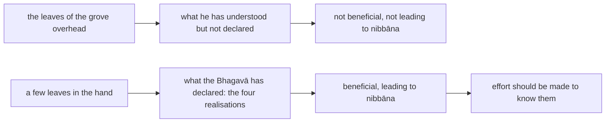

import { Tabs, TabItem } from '@astrojs/starlight/components';

Original text: [14S5/12.4.1 Sīsapāvanasutta 2308–2312](https://tipitaka2500.github.io/tipitaka/14S5/12/12.4/12.4.1.html#2308) in the [World Tipitaka Edition](https://tipitaka2500.github.io)

## Summary

Holding a few siṃsapā leaves in his hand at Kosambī, the Bhagavā asks the bhikkhū which are more, the leaves in his hand or those in the grove overhead. What he has experientially understood and not declared is likewise far more than what he has declared; he did not declare it because it is not beneficial and does not lead to `nibbāna`, and what he has declared is the four realisations, because they do, so that effort should be made to know them.

## Diagram

## Text

<Tabs syncKey="paliquote">
<TabItem label="My Translation">
(1101.)

2308\. At one time the Bhagavā was dwelling at Kosambī, in the Siṃsapā Grove. Then the Bhagavā, having taken a few siṃsapā leaves in his hand, addressed the bhikkhū: “Bhikkhave, what do you consider: which is greater, the few siṃsapā leaves that I have taken in my hand, or those overhead in the Siṃsapā Grove?” “The few siṃsapā leaves the Bhagavā has taken in his hand, Bhante, are trifling; rather, just these are greater, namely those overhead in the Siṃsapā Grove.” “So too, Bhikkhave, just this is greater: what I have experientially understood but not declared to you. And why, Bhikkhave, has this not been declared by me? This indeed, Bhikkhave, is not beneficial, not fundamental to the optimal life; it does not lead to disenchantment, nor to detachment, nor to cessation, nor to calm, nor to experiential understanding, nor to full awakening, nor to `nibbāna` (extinguishment); therefore it has not been declared by me.

2309\. And what, Bhikkhave, has been declared by me? ‘This is `dukkha` (suffering)’, Bhikkhave, has been declared by me; ‘This is the origin of suffering’ has been declared by me; ‘This is the cessation of suffering’ has been declared by me; ‘This is the path leading to the cessation of suffering’ has been declared by me.

2310\. And why, Bhikkhave, has this been declared by me? This indeed, Bhikkhave, is beneficial, this is fundamental to the optimal life, this leads to disenchantment, to detachment, to cessation, to calm, to experiential understanding, to full awakening, to nibbāna; therefore it has been declared by me.

2311\. Therefore here, Bhikkhave, effort should be made [to know]: ‘This is suffering’ … and so on … effort should be made [to know]: ‘This is the path leading to the cessation of suffering.’”

2312\. The first [discourse of the chapter].
</TabItem>

<TabItem label="Pāḷi (Roman IAST)">
(1101.)

2308\. Ekaṃ samayaṃ bhagavā kosambiyaṃ viharati sīsapāvane. Atha kho bhagavā parittāni sīsapāpaṇṇāni pāṇinā gahetvā bhikkhū āmantesi— “taṃ kiṃ maññatha, bhikkhave, katamaṃ nu kho bahutaraṃ— yāni vā mayā parittāni sīsapāpaṇṇāni pāṇinā gahitāni yadidaṃ upari sīsapāvane”ti? “Appamattakāni, bhante, bhagavatā parittāni sīsapāpaṇṇāni pāṇinā gahitāni; atha kho etāneva bahutarāni yadidaṃ upari sīsapāvane”ti. “Evameva kho, bhikkhave, etadeva bahutaraṃ yaṃ vo mayā abhiññāya anakkhātaṃ. Kasmā cetaṃ, bhikkhave, mayā anakkhātaṃ? Na hetaṃ, bhikkhave, atthasaṃhitaṃ nādibrahmacariyakaṃ na nibbidāya na virāgāya na nirodhāya na upasamāya na abhiññāya na sambodhāya na nibbānāya saṃvattati; tasmā taṃ mayā anakkhātaṃ.

2309\. Kiñca, bhikkhave, mayā akkhātaṃ? ‘Idaṃ dukkhan’ti, bhikkhave, mayā akkhātaṃ, ‘ayaṃ dukkhasamudayo’ti mayā akkhātaṃ, ‘ayaṃ dukkhanirodho’ti mayā akkhātaṃ, ‘ayaṃ dukkhanirodhagāminī paṭipadā’ti mayā akkhātaṃ.

2310\. Kasmā cetaṃ, bhikkhave, mayā akkhātaṃ? Etañhi, bhikkhave, atthasaṃhitaṃ etaṃ ādibrahmacariyakaṃ etaṃ nibbidāya virāgāya nirodhāya upasamāya abhiññāya sambodhāya nibbānāya saṃvattati; tasmā taṃ mayā akkhātaṃ.

2311\. Tasmātiha, bhikkhave, ‘idaṃ dukkhan’ti yogo karaṇīyo…pe… ‘ayaṃ dukkhanirodhagāminī paṭipadā’ti yogo karaṇīyo”ti.

2312\. Paṭhamaṃ.
</TabItem>

<TabItem label="Pāḷi (Brahmi)">
(1101.)

2308\. 𑀏𑀓𑀁 𑀲𑀫𑀬𑀁 𑀪𑀕𑀯𑀸 𑀓𑁄𑀲𑀫𑁆𑀩𑀺𑀬𑀁 𑀯𑀺𑀳𑀭𑀢𑀺 𑀲𑀻𑀲𑀧𑀸𑀯𑀦𑁂. 𑀅𑀣 𑀔𑁄 𑀪𑀕𑀯𑀸 𑀧𑀭𑀺𑀢𑁆𑀢𑀸𑀦𑀺 𑀲𑀻𑀲𑀧𑀸𑀧𑀡𑁆𑀡𑀸𑀦𑀺 𑀧𑀸𑀡𑀺𑀦𑀸 𑀕𑀳𑁂𑀢𑁆𑀯𑀸 𑀪𑀺𑀓𑁆𑀔𑀽 𑀆𑀫𑀦𑁆𑀢𑁂𑀲𑀺— “𑀢𑀁 𑀓𑀺𑀁 𑀫𑀜𑁆𑀜𑀣, 𑀪𑀺𑀓𑁆𑀔𑀯𑁂, 𑀓𑀢𑀫𑀁 𑀦𑀼 𑀔𑁄 𑀩𑀳𑀼𑀢𑀭𑀁— 𑀬𑀸𑀦𑀺 𑀯𑀸 𑀫𑀬𑀸 𑀧𑀭𑀺𑀢𑁆𑀢𑀸𑀦𑀺 𑀲𑀻𑀲𑀧𑀸𑀧𑀡𑁆𑀡𑀸𑀦𑀺 𑀧𑀸𑀡𑀺𑀦𑀸 𑀕𑀳𑀺𑀢𑀸𑀦𑀺 𑀬𑀤𑀺𑀤𑀁 𑀉𑀧𑀭𑀺 𑀲𑀻𑀲𑀧𑀸𑀯𑀦𑁂”𑀢𑀺? “𑀅𑀧𑁆𑀧𑀫𑀢𑁆𑀢𑀓𑀸𑀦𑀺, 𑀪𑀦𑁆𑀢𑁂, 𑀪𑀕𑀯𑀢𑀸 𑀧𑀭𑀺𑀢𑁆𑀢𑀸𑀦𑀺 𑀲𑀻𑀲𑀧𑀸𑀧𑀡𑁆𑀡𑀸𑀦𑀺 𑀧𑀸𑀡𑀺𑀦𑀸 𑀕𑀳𑀺𑀢𑀸𑀦𑀺; 𑀅𑀣 𑀔𑁄 𑀏𑀢𑀸𑀦𑁂𑀯 𑀩𑀳𑀼𑀢𑀭𑀸𑀦𑀺 𑀬𑀤𑀺𑀤𑀁 𑀉𑀧𑀭𑀺 𑀲𑀻𑀲𑀧𑀸𑀯𑀦𑁂”𑀢𑀺. “𑀏𑀯𑀫𑁂𑀯 𑀔𑁄, 𑀪𑀺𑀓𑁆𑀔𑀯𑁂, 𑀏𑀢𑀤𑁂𑀯 𑀩𑀳𑀼𑀢𑀭𑀁 𑀬𑀁 𑀯𑁄 𑀫𑀬𑀸 𑀅𑀪𑀺𑀜𑁆𑀜𑀸𑀬 𑀅𑀦𑀓𑁆𑀔𑀸𑀢𑀁. 𑀓𑀲𑁆𑀫𑀸 𑀘𑁂𑀢𑀁, 𑀪𑀺𑀓𑁆𑀔𑀯𑁂, 𑀫𑀬𑀸 𑀅𑀦𑀓𑁆𑀔𑀸𑀢𑀁? 𑀦 𑀳𑁂𑀢𑀁, 𑀪𑀺𑀓𑁆𑀔𑀯𑁂, 𑀅𑀢𑁆𑀣𑀲𑀁𑀳𑀺𑀢𑀁 𑀦𑀸𑀤𑀺𑀩𑁆𑀭𑀳𑁆𑀫𑀘𑀭𑀺𑀬𑀓𑀁 𑀦 𑀦𑀺𑀩𑁆𑀩𑀺𑀤𑀸𑀬 𑀦 𑀯𑀺𑀭𑀸𑀕𑀸𑀬 𑀦 𑀦𑀺𑀭𑁄𑀥𑀸𑀬 𑀦 𑀉𑀧𑀲𑀫𑀸𑀬 𑀦 𑀅𑀪𑀺𑀜𑁆𑀜𑀸𑀬 𑀦 𑀲𑀫𑁆𑀩𑁄𑀥𑀸𑀬 𑀦 𑀦𑀺𑀩𑁆𑀩𑀸𑀦𑀸𑀬 𑀲𑀁𑀯𑀢𑁆𑀢𑀢𑀺; 𑀢𑀲𑁆𑀫𑀸 𑀢𑀁 𑀫𑀬𑀸 𑀅𑀦𑀓𑁆𑀔𑀸𑀢𑀁.

2309\. 𑀓𑀺𑀜𑁆𑀘, 𑀪𑀺𑀓𑁆𑀔𑀯𑁂, 𑀫𑀬𑀸 𑀅𑀓𑁆𑀔𑀸𑀢𑀁? ‘𑀇𑀤𑀁 𑀤𑀼𑀓𑁆𑀔𑀦𑁆’𑀢𑀺, 𑀪𑀺𑀓𑁆𑀔𑀯𑁂, 𑀫𑀬𑀸 𑀅𑀓𑁆𑀔𑀸𑀢𑀁, ‘𑀅𑀬𑀁 𑀤𑀼𑀓𑁆𑀔𑀲𑀫𑀼𑀤𑀬𑁄’𑀢𑀺 𑀫𑀬𑀸 𑀅𑀓𑁆𑀔𑀸𑀢𑀁, ‘𑀅𑀬𑀁 𑀤𑀼𑀓𑁆𑀔𑀦𑀺𑀭𑁄𑀥𑁄’𑀢𑀺 𑀫𑀬𑀸 𑀅𑀓𑁆𑀔𑀸𑀢𑀁, ‘𑀅𑀬𑀁 𑀤𑀼𑀓𑁆𑀔𑀦𑀺𑀭𑁄𑀥𑀕𑀸𑀫𑀺𑀦𑀻 𑀧𑀝𑀺𑀧𑀤𑀸’𑀢𑀺 𑀫𑀬𑀸 𑀅𑀓𑁆𑀔𑀸𑀢𑀁.

2310\. 𑀓𑀲𑁆𑀫𑀸 𑀘𑁂𑀢𑀁, 𑀪𑀺𑀓𑁆𑀔𑀯𑁂, 𑀫𑀬𑀸 𑀅𑀓𑁆𑀔𑀸𑀢𑀁? 𑀏𑀢𑀜𑁆𑀳𑀺, 𑀪𑀺𑀓𑁆𑀔𑀯𑁂, 𑀅𑀢𑁆𑀣𑀲𑀁𑀳𑀺𑀢𑀁 𑀏𑀢𑀁 𑀆𑀤𑀺𑀩𑁆𑀭𑀳𑁆𑀫𑀘𑀭𑀺𑀬𑀓𑀁 𑀏𑀢𑀁 𑀦𑀺𑀩𑁆𑀩𑀺𑀤𑀸𑀬 𑀯𑀺𑀭𑀸𑀕𑀸𑀬 𑀦𑀺𑀭𑁄𑀥𑀸𑀬 𑀉𑀧𑀲𑀫𑀸𑀬 𑀅𑀪𑀺𑀜𑁆𑀜𑀸𑀬 𑀲𑀫𑁆𑀩𑁄𑀥𑀸𑀬 𑀦𑀺𑀩𑁆𑀩𑀸𑀦𑀸𑀬 𑀲𑀁𑀯𑀢𑁆𑀢𑀢𑀺; 𑀢𑀲𑁆𑀫𑀸 𑀢𑀁 𑀫𑀬𑀸 𑀅𑀓𑁆𑀔𑀸𑀢𑀁.

2311\. 𑀢𑀲𑁆𑀫𑀸𑀢𑀺𑀳, 𑀪𑀺𑀓𑁆𑀔𑀯𑁂, ‘𑀇𑀤𑀁 𑀤𑀼𑀓𑁆𑀔𑀦𑁆’𑀢𑀺 𑀬𑁄𑀕𑁄 𑀓𑀭𑀡𑀻𑀬𑁄…𑀧𑁂… ‘𑀅𑀬𑀁 𑀤𑀼𑀓𑁆𑀔𑀦𑀺𑀭𑁄𑀥𑀕𑀸𑀫𑀺𑀦𑀻 𑀧𑀝𑀺𑀧𑀤𑀸’𑀢𑀺 𑀬𑁄𑀕𑁄 𑀓𑀭𑀡𑀻𑀬𑁄”𑀢𑀺.

2312\. 𑀧𑀞𑀫𑀁.
</TabItem>

<TabItem label="Interlinear">
(1101.)

[2308](https://tipitaka2500.github.io/tipitaka/14S5/12/12.4/12.4.1.html#2308) Ekaṃ samayaṃ bhagavā kosambiyaṃ viharati sīsapāvane.  
*️⃣🤟🚹⨀②(eka) 🚹⨀②(samaya) 🚹⨀①(bhagavant) 🚺⨀⑦(kosambī) 🟢⨀🤟▶️(viharati) 🚻⨀⑦🆎(sīsapā+vana)  
one | time | the Bhagavā | at Kosambī | dwells | in the Siṃsapā Grove  
At one time the Bhagavā was dwelling at Kosambī, in the Siṃsapā Grove.

Atha kho bhagavā parittāni sīsapāpaṇṇāni pāṇinā gahetvā bhikkhū āmantesi— “taṃ kiṃ maññatha, bhikkhave, katamaṃ nu kho bahutaraṃ— yāni vā mayā parittāni sīsapāpaṇṇāni pāṇinā gahitāni yadidaṃ upari sīsapāvane”ti?  
⏏️(atha) ⏏️(kho) 🚹⨀①(bhagavant) 🚻⨂②🔽(ta)(paritta) 🚻⨂②🆎(sīsapā+paṇṇa) 🚹⨀③(pāṇi) 🔽(tvā)(gaṇhāti) 🚹⨂②(bhikkhu) 🟢⨀🤟⏮(āmanteti) *️⃣🤟🚻⨀②(ta) *️⃣🤟🚻⨀②(kiṃ) 🟢⨂🤘▶️(maññati) 🚹⨂⓪(bhikkhu) *️⃣🤟🚻⨀①(katama) ⏏️(nu) ⏏️(kho) 🚻⨀①🔽(tara)(bahutara) *️⃣🤟🚻⨂①(ya) ⏏️(vā) *️⃣👆⚧⨀③(ahaṃ) 🚻⨂①🔽(ta)(paritta) 🚻⨂①🆎(sīsapā+paṇṇa) 🚹⨀③(pāṇi) 🚻⨂①🔽(ta)(gahita) ⏏️(yadidaṃ) ⏏️(upari) 🚻⨀⑦🆎(sīsapā+vana) ⏏️(iti)  
then | indeed | the Bhagavā | a few | siṃsapā leaves | with his hand | having taken | the bhikkhū | addressed | that | what | do you think | Bhikkhave | which | (question) | indeed | greater | which | or | by me | few | siṃsapā leaves | with the hand | taken | namely | overhead | in the Siṃsapā Grove | (end quote)  
Then the Bhagavā, having taken a few siṃsapā leaves in his hand, addressed the bhikkhū: “Bhikkhave, what do you consider: which is greater, the few siṃsapā leaves that I have taken in my hand, or those overhead in the Siṃsapā Grove?”

“Appamattakāni, bhante, bhagavatā parittāni sīsapāpaṇṇāni pāṇinā gahitāni;  
🚻⨂①🆎(appa+mattaka) 🚹⨀⓪(bhavant) 🚹⨀③(bhagavant) 🚻⨂①🔽(ta)(paritta) 🚻⨂①🆎(sīsapā+paṇṇa) 🚹⨀③(pāṇi) 🚻⨂①🔽(ta)(gahita)  
trifling | Bhante | by the Bhagavā | few | siṃsapā leaves | with the hand | taken  
“The few siṃsapā leaves the Bhagavā has taken in his hand, Bhante, are trifling;

atha kho etāneva bahutarāni yadidaṃ upari sīsapāvane”ti.  
⏏️(atha) ⏏️(kho) *️⃣🤟🚻⨂①(eta) ⏏️(eva) 🚻⨂①🔽(tara)(bahutara) ⏏️(yadidaṃ) ⏏️(upari) 🚻⨀⑦🆎(sīsapā+vana) ⏏️(iti)  
rather | indeed | these | just | greater | namely | overhead | in the Siṃsapā Grove | (end quote)  
rather, just these are greater, namely those overhead in the Siṃsapā Grove.”

“Evameva kho, bhikkhave, etadeva bahutaraṃ yaṃ vo mayā abhiññāya anakkhātaṃ.  
⏏️(evaṃ) ⏏️(eva) ⏏️(kho) 🚹⨂⓪(bhikkhu) *️⃣🤟🚻⨀①(eta) ⏏️(eva) 🚻⨀①🔽(tara)(bahutara) *️⃣🤟🚻⨀①(ya) *️⃣🤘⚧⨂④(tvaṃ) *️⃣👆⚧⨀③(ahaṃ) 🔽(ya)(abhijānāti) 🚻⨀①🔽(ta)🆎(na+akkhāta)  
in the same way | just | indeed | Bhikkhave | this | just | greater | which | to you | by me | having experientially understood | not declared  
“So too, Bhikkhave, just this is greater: what I have experientially understood but not declared to you.

Kasmā cetaṃ, bhikkhave, mayā anakkhātaṃ?  
⏏️(kasmā) ⏏️(ca) *️⃣🤟🚻⨀①(eta) 🚹⨂⓪(bhikkhu) *️⃣👆⚧⨀③(ahaṃ) 🚻⨀①🔽(ta)🆎(na+akkhāta)  
why | and | this | Bhikkhave | by me | not declared  
And why, Bhikkhave, has this not been declared by me?

Na hetaṃ, bhikkhave, atthasaṃhitaṃ nādibrahmacariyakaṃ na nibbidāya na virāgāya na nirodhāya na upasamāya na abhiññāya na sambodhāya na nibbānāya saṃvattati;  
⏏️(na) ⏏️(hi) *️⃣🤟🚻⨀①(eta) 🚹⨂⓪(bhikkhu) 🚻⨀①🆎(attha+saṃhita) 🚻⨀①🆎(na+ādibrahmacariyaka) ⏏️(na) 🚺⨀④(nibbidā) ⏏️(na) 🚹⨀④(virāga) ⏏️(na) 🚹⨀④(nirodha) ⏏️(na) 🚹⨀④(upasama) ⏏️(na) 🚺⨀④(abhiññā) ⏏️(na) 🚹⨀④(sambodha) ⏏️(na) 🚻⨀④(nibbāna) 🟢⨀🤟▶️(saṃvattati)  
not | indeed | this | Bhikkhave | beneficial | not fundamental to the optimal life | not | to disenchantment | nor | to detachment | nor | to cessation | nor | to calm | nor | to experiential understanding | nor | to full awakening | nor | to extinguishment | leads  
This indeed, Bhikkhave, is not beneficial, not fundamental to the optimal life; it does not lead to disenchantment, nor to detachment, nor to cessation, nor to calm, nor to experiential understanding, nor to full awakening, nor to `nibbāna` (extinguishment);

tasmā taṃ mayā anakkhātaṃ.  
⏏️(tasmā) *️⃣🤟🚻⨀①(ta) *️⃣👆⚧⨀③(ahaṃ) 🚻⨀①🔽(ta)🆎(na+akkhāta)  
therefore | that | by me | not declared  
therefore it has not been declared by me.

[2309](https://tipitaka2500.github.io/tipitaka/14S5/12/12.4/12.4.1.html#2309) Kiñca, bhikkhave, mayā akkhātaṃ?  
*️⃣🤟🚻⨀①(kiṃ) ⏏️(ca) 🚹⨂⓪(bhikkhu) *️⃣👆⚧⨀③(ahaṃ) 🚻⨀①🔽(ta)(akkhāta)  
what | and | Bhikkhave | by me | declared  
And what, Bhikkhave, has been declared by me?

‘Idaṃ dukkhan’ti, bhikkhave, mayā akkhātaṃ, ‘ayaṃ dukkhasamudayo’ti mayā akkhātaṃ, ‘ayaṃ dukkhanirodho’ti mayā akkhātaṃ, ‘ayaṃ dukkhanirodhagāminī paṭipadā’ti mayā akkhātaṃ.  
*️⃣🤟🚻⨀①(ima) 🚻⨀①(dukkha) ⏏️(iti) 🚹⨂⓪(bhikkhu) *️⃣👆⚧⨀③(ahaṃ) 🚻⨀①🔽(ta)(akkhāta) *️⃣🤟🚹⨀①(ima) 🚹⨀①🆎(dukkha+samudaya) ⏏️(iti) *️⃣👆⚧⨀③(ahaṃ) 🚻⨀①🔽(ta)(akkhāta) *️⃣🤟🚹⨀①(ima) 🚹⨀①🆎(dukkha+nirodha) ⏏️(iti) *️⃣👆⚧⨀③(ahaṃ) 🚻⨀①🔽(ta)(akkhāta) *️⃣🤟🚺⨀①(ima) 🚺⨀①🆎(dukkha+nirodha+gāmī) 🚺⨀①(paṭipadā) ⏏️(iti) *️⃣👆⚧⨀③(ahaṃ) 🚻⨀①🔽(ta)(akkhāta)  
this | suffering | (end quote) | Bhikkhave | by me | declared | this | the origin of suffering | (end quote) | by me | declared | this | the cessation of suffering | (end quote) | by me | declared | this | leading to the cessation of suffering | path | (end quote) | by me | declared  
‘This is `dukkha` (suffering)’, Bhikkhave, has been declared by me; ‘This is the origin of suffering’ has been declared by me; ‘This is the cessation of suffering’ has been declared by me; ‘This is the path leading to the cessation of suffering’ has been declared by me.

[2310](https://tipitaka2500.github.io/tipitaka/14S5/12/12.4/12.4.1.html#2310) Kasmā cetaṃ, bhikkhave, mayā akkhātaṃ?  
⏏️(kasmā) ⏏️(ca) *️⃣🤟🚻⨀①(eta) 🚹⨂⓪(bhikkhu) *️⃣👆⚧⨀③(ahaṃ) 🚻⨀①🔽(ta)(akkhāta)  
why | and | this | Bhikkhave | by me | declared  
And why, Bhikkhave, has this been declared by me?

Etañhi, bhikkhave, atthasaṃhitaṃ etaṃ ādibrahmacariyakaṃ etaṃ nibbidāya virāgāya nirodhāya upasamāya abhiññāya sambodhāya nibbānāya saṃvattati;  
*️⃣🤟🚻⨀①(eta) ⏏️(hi) 🚹⨂⓪(bhikkhu) 🚻⨀①🆎(attha+saṃhita) *️⃣🤟🚻⨀①(eta) 🚻⨀①(ādibrahmacariyaka) *️⃣🤟🚻⨀①(eta) 🚺⨀④(nibbidā) 🚹⨀④(virāga) 🚹⨀④(nirodha) 🚹⨀④(upasama) 🚺⨀④(abhiññā) 🚹⨀④(sambodha) 🚻⨀④(nibbāna) 🟢⨀🤟▶️(saṃvattati)  
this | indeed | Bhikkhave | beneficial | this | fundamental to the optimal life | this | to disenchantment | to detachment | to cessation | to calm | to experiential understanding | to full awakening | to extinguishment | leads  
This indeed, Bhikkhave, is beneficial, this is fundamental to the optimal life, this leads to disenchantment, to detachment, to cessation, to calm, to experiential understanding, to full awakening, to nibbāna;

tasmā taṃ mayā akkhātaṃ.  
⏏️(tasmā) *️⃣🤟🚻⨀①(ta) *️⃣👆⚧⨀③(ahaṃ) 🚻⨀①🔽(ta)(akkhāta)  
therefore | that | by me | declared  
therefore it has been declared by me.

[2311](https://tipitaka2500.github.io/tipitaka/14S5/12/12.4/12.4.1.html#2311) Tasmātiha, bhikkhave, ‘idaṃ dukkhan’ti yogo karaṇīyo…pe… ‘ayaṃ dukkhanirodhagāminī paṭipadā’ti yogo karaṇīyo”ti.  
⏏️(tasmā) ⏏️(iha) 🚹⨂⓪(bhikkhu) *️⃣🤟🚻⨀①(ima) 🚻⨀①(dukkha) ⏏️(iti) 🚹⨀①(yoga) 🚹⨀①🔽(anīya)(karaṇīya) ⏏️(peyyāla) *️⃣🤟🚺⨀①(ima) 🚺⨀①🆎(dukkha+nirodha+gāmī) 🚺⨀①(paṭipadā) ⏏️(iti) 🚹⨀①(yoga) 🚹⨀①🔽(anīya)(karaṇīya) ⏏️(iti)  
therefore | here | Bhikkhave | this | suffering | (end quote) | effort | should be made | (and so on) | this | leading to the cessation of suffering | path | (end quote) | effort | should be made | (end quote)  
Therefore here, Bhikkhave, effort should be made [to know]: ‘This is suffering’ … and so on … effort should be made [to know]: ‘This is the path leading to the cessation of suffering.’”

[2312](https://tipitaka2500.github.io/tipitaka/14S5/12/12.4/12.4.1.html#2312) Paṭhamaṃ.  
🚻⨀①(paṭhama)  
the first  
The first [discourse of the chapter].
</TabItem>
</Tabs>

## Commentary

- The simile of the handful of leaves answers what the Bhagavā teaches and why: the four realisations alone, because they lead to `nibbāna`; buddhavacana treats them at https://buddhavacana.github.io/sutta/realisations/ and the question of what the Buddha knew but did not teach at https://buddhavacana.github.io/buddha/omniscient/.
- The frame "what do you consider: which is greater …" is the Nakhasikhāsutta's on buddhavacana's Arriving page, worded as there.
- Renderings: `sīsapāvana` "the Siṃsapā Grove" as the title gives it; `atthasaṃhita` "beneficial"; `ādibrahmacariyaka` "fundamental to the optimal life" (the DPD with the glossary's `brahmacariya`); `abhiññāya` here the absolutive, "having experientially understood"; `yogo karaṇīyo` "effort should be made [to know]", the verb supplied in brackets.
- The list `nibbidāya virāgāya … nibbānāya saṃvattati` is worded as on the Pāsarāsi page, with `virāga` "detachment".
- The `…pe…` of 2311 elides the origin and the cessation; "… and so on …".

## Parallels

The Chinese parallel is the 404th sūtra of the 雜阿含經 (Saṃyuktāgama; fascicle 15, CBETA T02, no. 99, pp. 108a–b), read here in CBETA's text. The two agree in frame and sequence: in a grove of siṃsapā trees (申恕林, p. 108a) the Buddha takes leaves in his hand (手把樹葉) and asks the bhikkhū whether the leaves in his hand or the leaves of the great forest are more (此手中葉為多耶？大林樹葉為多, pp. 108a–b); they answer that those in his hand are very few and those of the forest beyond counting; and he says that what he has himself seen and definitively taught (自所見法，為人定說者) is like the leaves in his hand, because it is beneficial and leads towards `nibbāna` (義饒益、法饒益、梵行饒益、明、慧、正覺、向於涅槃), while what he knows and has not taught is like the leaves of the forest, because it is not (p. 108b), and ends by exhorting the bhikkhū to strive for the four truths of the liberated (四聖諦, p. 108b). The differences, checked in CBETA's text:

- **The setting.** The Pāḷi is at Kosambī in the Siṃsapā Grove (2308.1); the Chinese has the Buddha wandering among the people of Magadha (摩竭國人間遊行) and lodging with the great assembly in a rest house the great king had made (大王於中作福德舍) at a bamboo-grove village between Rājagaha and Pāṭaliputta (王舍城波羅利弗是中間竹林聚落), from which he leads the bhikkhū to the siṃsapā forest and sits under a tree (p. 108a).
- **The bhikkhū's answer.** The Pāḷi says the leaves in his hand are trifling and those overhead greater (2308.3–4); the Chinese measures the difference, the leaves of the forest being immeasurable, a hundred thousand koṭis of times more, beyond any reckoning or comparison (無量，百千億萬倍，乃至算數譬類不可為比, p. 108b).
- **The order of the argument.** The Pāḷi takes the undeclared first, with the reason it was not declared (2308.5–8), then the declared with its reason (2309–2310); the Chinese takes the declared first, like the leaves in the hand, and the undeclared second, like the leaves of the forest (p. 108b).
- **The content of what was declared.** The Pāḷi states it: "This is suffering … this is the path leading to the cessation of suffering" (2309.2); the Chinese names the four truths only in the closing exhortation (p. 108b).
- **The reasons.** The Pāḷi's list is `atthasaṃhita`, `ādibrahmacariyaka` and the seven goals from disenchantment to `nibbāna` (2308.7, 2310.2); the Chinese has benefit in meaning, in Dhamma and for the `brahmacariya`, and understanding, wisdom, right awakening and `nibbāna` (義饒益、法饒益、梵行饒益、明、慧、正覺、向於涅槃, p. 108b), without disenchantment, detachment, cessation or calm.
- **The exhortation and the close.** The Pāḷi says "effort should be made" for each truth (2311); the Chinese says that those who have not yet directly realised the four truths should strive diligently, arouse keen desire and train for direct realisation (當勤方便，起增上欲，學無間等, p. 108b), and ends with the bhikkhū rejoicing, which the Pāḷi lacks.

[Go to previous page (Dhammacakkappavattanasutta (The Discourse on Setting the Wheel of the Dhamma in Motion))](/samyuttanikaya/saccasamyutta/dhammacakkappavattanasutta/) / [Go to parent page (Saṃyutta Nikāya)](/samyuttanikaya/)
