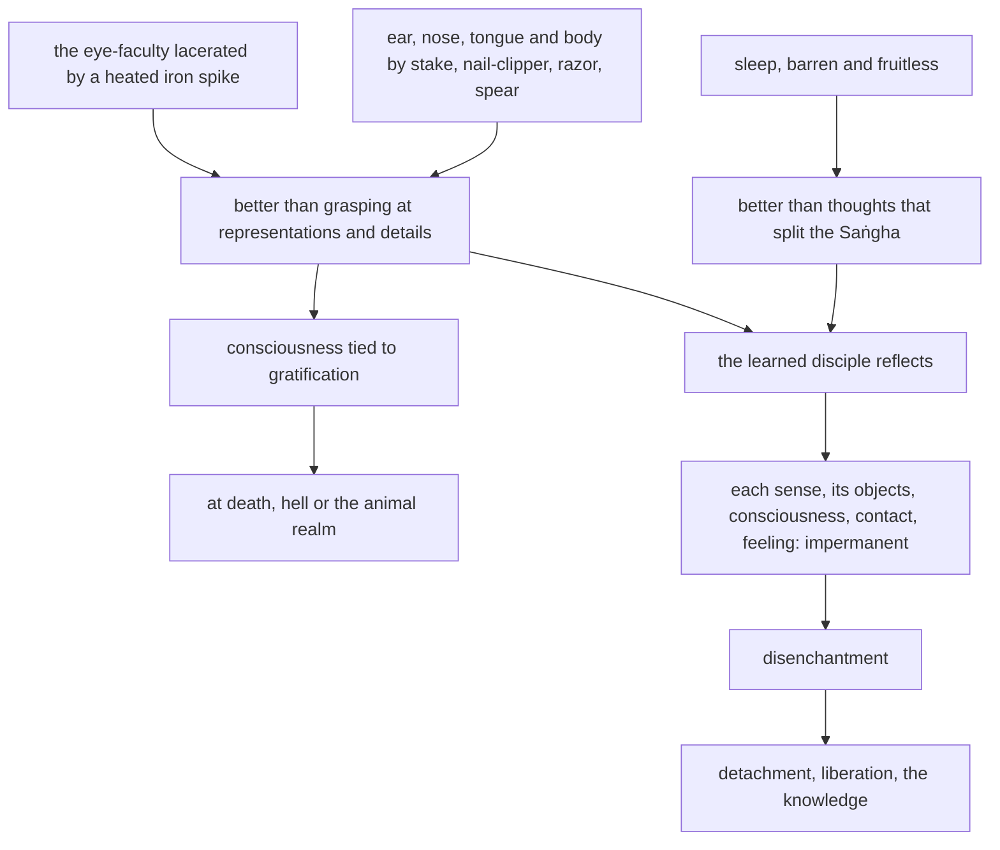

import { Tabs, TabItem } from '@astrojs/starlight/components';

Original text: [13S4/1.4.3.8 Ādittapariyāyasutta 977–990](https://tipitaka2500.github.io/tipitaka/13S4/1/1.4/1.4.3/1.4.3.8.html#977) in the [World Tipitaka Edition](https://tipitaka2500.github.io)

## Summary

The Bhagavā teaches the exposition on burning: better that the eye, ear, nose, tongue and body be lacerated by a burning iron spike, stake, nail-clipper, razor or spear than that one grasp at the representations and details of their objects, since a consciousness tied to their gratification leads at death to hell or the animal realm; and better to sleep than to think the thoughts that split the Saṅgha. The learned disciple sets the torment aside, attends instead to the impermanence of each sense, its objects, consciousness, contact and feeling, and is disenchanted and liberated.

## Diagram

## Text

<Tabs syncKey="paliquote">
<TabItem label="My Translation">
(235.)

977\. “I will teach you, Bhikkhave, the Parable on Burning, a discourse on the Dhamma. Listen to it. And what, Bhikkhave, is the Parable on Burning, the discourse on the Dhamma? Bhikkhave, it would be better for the eye-faculty to be lacerated by a heated iron spike, ablaze, burning, and glowing, rather than grasping at representations by way of details in forms cognisable by the eye. If, Bhikkhave, `viññāṇaṃ` (consciousness) remains tied to the gratification in a representation, or tied to the gratification in a detail, and at that time one were to die, it is possible that one would go to one of two destinations — hell or the animal realm. Seeing this danger, Bhikkhave, I indeed say this.

978\. Bhikkhave, it would be better for the ear-faculty to be lacerated by a sharp iron stake, ablaze, burning, and glowing, rather than grasping at representations by way of details in sounds cognisable by the ear. If, Bhikkhave, consciousness remains tied to the gratification in a representation, or tied to the gratification in a detail, and at that time one were to die, it is possible that one would go to one of two destinations — hell or the animal realm. Seeing this danger, Bhikkhave, I indeed say this.

979\. Bhikkhave, it would be better for the nose-faculty to be lacerated by a sharp nail-clipper, ablaze, burning, and glowing, rather than grasping at representations by way of details in odours cognisable by the nose. If, Bhikkhave, consciousness remains tied to the gratification in a representation, or tied to the gratification in a detail, and at that time one were to die, it is possible that one would go to one of two destinations — hell or the animal realm. Seeing this danger, Bhikkhave, I indeed say this.

980\. Bhikkhave, it would be better for the tongue-faculty to be lacerated by a sharp razor, ablaze, burning, and glowing, rather than grasping at representations by way of details in tastes cognisable by the tongue. If, Bhikkhave, consciousness remains tied to the gratification in a representation, or tied to the gratification in a detail, and at that time one were to die, it is possible that one would go to one of two destinations — hell or the animal realm. Seeing this danger, Bhikkhave, I indeed say this.

981\. Bhikkhave, it would be better for the body-faculty to be lacerated by a sharp spear, ablaze, burning, and glowing, rather than grasping at representations by way of details in tangibles cognisable by the body. If, Bhikkhave, consciousness remains tied to the gratification in a representation, or tied to the gratification in a detail, and at that time one were to die, it is possible that one would go to one of two destinations — hell or the animal realm. Seeing this danger, Bhikkhave, I indeed say this.

982\. Bhikkhave, it would be better to sleep. Now sleep, Bhikkhave, I indeed declare barren of life, fruitless of life, bewildered of life, but one would not think such thoughts as, having come under their power, one would split the Saṅgha. Seeing this danger of barrenness of life, Bhikkhave, I indeed say this.

983\. There, Bhikkhave, the `sutavā` (learned) `ariyasāvako` (disciple of the liberated) reflects thus— ‘Never mind for now the eye-faculty lacerated by a heated iron spike, ablaze, burning, and glowing. Come, let me attend to just this: the eye is impermanent, forms are impermanent, eye-consciousness is impermanent, eye-contact is impermanent, and whatever `vedayitaṃ` (feeling) arises with eye-contact as cause, whether pleasant or painful or neutral, that too is impermanent.’

984\. Never mind for now the ear-faculty lacerated by a sharp iron stake, ablaze, burning, and glowing. Come, let me attend to just this: the ear is impermanent, sounds are impermanent, ear-consciousness is impermanent, ear-contact is impermanent, and whatever feeling arises with ear-contact as cause, whether pleasant or painful or neutral, that too is impermanent.

985\. Never mind for now the nose-faculty lacerated by a sharp nail-clipper, ablaze, burning, and glowing. Come, let me attend to just this: the nose is impermanent, odours are impermanent, nose-consciousness is impermanent, nose-contact is impermanent, and whatever feeling arises with nose-contact as cause … and so on … that too is impermanent.

986\. Never mind for now the tongue-faculty lacerated by a sharp razor, ablaze, burning, and glowing. Come, let me attend to just this: the tongue is impermanent, tastes are impermanent, tongue-consciousness is impermanent, tongue-contact is impermanent, and whatever [feeling] arises with tongue-contact as cause … and so on … that too is impermanent.

987\. Never mind for now the body-faculty lacerated by a sharp spear, ablaze, burning, and glowing. Come, let me attend to just this: the body is impermanent, tangibles are impermanent, body-consciousness is impermanent, body-contact is impermanent, and whatever feeling arises with body-contact as cause … and so on … that too is impermanent.

988\. Never mind sleep for now. Come, let me attend to just this: the mind is impermanent, `dhammā` (mental phenomena) are impermanent, mind-consciousness is impermanent, mind-contact is impermanent, and whatever feeling arises with mind-contact as cause, whether pleasant or painful or neutral, that too is impermanent.”

989\. Thus seeing, Bhikkhave, the learned disciple of the liberated `nibbindati` (is disenchanted with) the eye, is disenchanted with forms, is disenchanted with eye-consciousness, is disenchanted with eye-contact … and so on … and whatever feeling arises with mind-contact as cause, whether pleasant or painful or neutral, that too he is disenchanted with. Being disenchanted, he `virajjati` (becomes detached); from detachment he `vimuccati` (becomes liberated); in liberation there is the `ñāṇaṃ` (knowledge): ‘liberated’. He `pajānāti` (knows clearly): ‘Birth (of suffering) is finished, the optimal life is lived, what had to be done is done, there is nothing further for this present state of existence.’ This, Bhikkhave, is the Parable on Burning, the discourse on the Dhamma.”

990\. The eighth [discourse of the chapter].
</TabItem>

<TabItem label="Pāḷi (Roman IAST)">
(235.)

977\. “Ādittapariyāyaṃ vo, bhikkhave, dhammapariyāyaṃ desessāmi. Taṃ suṇātha. Katamo ca, bhikkhave, ādittapariyāyo, dhammapariyāyo? Varaṃ, bhikkhave, tattāya ayosalākāya ādittāya sampajjalitāya sajotibhūtāya cakkhundriyaṃ sampalimaṭṭhaṃ, na tveva cakkhuviññeyyesu rūpesu anubyañjanaso nimittaggāho. Nimittassādagathitaṃ vā, bhikkhave, viññāṇaṃ tiṭṭhamānaṃ tiṭṭheyya, anubyañjanassādagathitaṃ vā tasmiñce samaye kālaṃ kareyya, ṭhānametaṃ vijjati, yaṃ dvinnaṃ gatīnaṃ aññataraṃ gatiṃ gaccheyya— nirayaṃ vā, tiracchānayoniṃ vā. Imaṃ khvāhaṃ, bhikkhave, ādīnavaṃ disvā evaṃ vadāmi.

978\. Varaṃ, bhikkhave, tiṇhena ayosaṅkunā ādittena sampajjalitena sajotibhūtena sotindriyaṃ sampalimaṭṭhaṃ, na tveva sotaviññeyyesu saddesu anubyañjanaso nimittaggāho. Nimittassādagathitaṃ vā, bhikkhave, viññāṇaṃ tiṭṭhamānaṃ tiṭṭheyya, anubyañjanassādagathitaṃ vā tasmiñce samaye kālaṃ kareyya, ṭhānametaṃ vijjati, yaṃ dvinnaṃ gatīnaṃ aññataraṃ gatiṃ gaccheyya— nirayaṃ vā tiracchānayoniṃ vā. Imaṃ khvāhaṃ, bhikkhave, ādīnavaṃ disvā evaṃ vadāmi.

979\. Varaṃ, bhikkhave, tiṇhena nakhacchedanena ādittena sampajjalitena sajotibhūtena ghānindriyaṃ sampalimaṭṭhaṃ, na tveva ghānaviññeyyesu gandhesu anubyañjanaso nimittaggāho. Nimittassādagathitaṃ vā, bhikkhave, viññāṇaṃ tiṭṭhamānaṃ tiṭṭheyya, anubyañjanassādagathitaṃ vā tasmiñce samaye kālaṃ kareyya. Ṭhānametaṃ vijjati, yaṃ dvinnaṃ gatīnaṃ aññataraṃ gatiṃ gaccheyya— nirayaṃ vā tiracchānayoniṃ vā. Imaṃ khvāhaṃ, bhikkhave, ādīnavaṃ disvā evaṃ vadāmi.

980\. Varaṃ, bhikkhave, tiṇhena khurena ādittena sampajjalitena sajotibhūtena jivhindriyaṃ sampalimaṭṭhaṃ, na tveva jivhāviññeyyesu rasesu anubyañjanaso nimittaggāho. Nimittassādagathitaṃ vā, bhikkhave, viññāṇaṃ tiṭṭhamānaṃ tiṭṭheyya, anubyañjanassādagathitaṃ vā tasmiñce samaye kālaṃ kareyya. Ṭhānametaṃ vijjati, yaṃ dvinnaṃ gatīnaṃ aññataraṃ gatiṃ gaccheyya— nirayaṃ vā tiracchānayoniṃ vā. Imaṃ khvāhaṃ, bhikkhave, ādīnavaṃ disvā evaṃ vadāmi.

981\. Varaṃ, bhikkhave, tiṇhāya sattiyā ādittāya sampajjalitāya sajotibhūtāya kāyindriyaṃ sampalimaṭṭhaṃ, na tveva kāyaviññeyyesu phoṭṭhabbesu anubyañjanaso nimittaggāho. Nimittassādagathitaṃ vā, bhikkhave, viññāṇaṃ tiṭṭhamānaṃ tiṭṭheyya, anubyañjanassādagathitaṃ vā tasmiñce samaye kālaṃ kareyya. Ṭhānametaṃ vijjati, yaṃ dvinnaṃ gatīnaṃ aññataraṃ gatiṃ gaccheyya— nirayaṃ vā tiracchānayoniṃ vā. Imaṃ khvāhaṃ, bhikkhave, ādīnavaṃ disvā evaṃ vadāmi.

982\. Varaṃ, bhikkhave, sottaṃ. Sottaṃ kho panāhaṃ, bhikkhave, vañjhaṃ jīvitānaṃ vadāmi, aphalaṃ jīvitānaṃ vadāmi, momūhaṃ jīvitānaṃ vadāmi, na tveva tathārūpe vitakke vitakkeyya yathārūpānaṃ vitakkānaṃ vasaṃ gato saṃghaṃ bhindeyya. Imaṃ khvāhaṃ, bhikkhave, vañjhaṃ jīvitānaṃ ādīnavaṃ disvā evaṃ vadāmi.

983\. Tattha, bhikkhave, sutavā ariyasāvako iti paṭisañcikkhati— ‘tiṭṭhatu tāva tattāya ayosalākāya ādittāya sampajjalitāya sajotibhūtāya cakkhundriyaṃ sampalimaṭṭhaṃ. Handāhaṃ idameva manasi karomi— iti cakkhu aniccaṃ, rūpā aniccā, cakkhuviññāṇaṃ aniccaṃ, cakkhusamphasso anicco, yampidaṃ cakkhusamphassapaccayā uppajjati vedayitaṃ sukhaṃ vā dukkhaṃ vā adukkhamasukhaṃ vā tampi aniccaṃ’.

984\. Tiṭṭhatu tāva tiṇhena ayosaṅkunā ādittena sampajjalitena sajotibhūtena sotindriyaṃ sampalimaṭṭhaṃ. Handāhaṃ idameva manasi karomi— iti sotaṃ aniccaṃ, saddā aniccā, sotaviññāṇaṃ aniccaṃ, sotasamphasso anicco, yampidaṃ sotasamphassapaccayā uppajjati vedayitaṃ sukhaṃ vā dukkhaṃ vā adukkhamasukhaṃ vā tampi aniccaṃ.

985\. Tiṭṭhatu tāva tiṇhena nakhacchedanena ādittena sampajjalitena sajotibhūtena ghānindriyaṃ sampalimaṭṭhaṃ. Handāhaṃ idameva manasi karomi— iti ghānaṃ aniccaṃ, gandhā aniccā, ghānaviññāṇaṃ aniccaṃ, ghānasamphasso anicco, yampidaṃ ghānasamphassapaccayā uppajjati vedayitaṃ…pe… tampi aniccaṃ.

986\. Tiṭṭhatu tāva tiṇhena khurena ādittena sampajjalitena sajotibhūtena jivhindriyaṃ sampalimaṭṭhaṃ. Handāhaṃ idameva manasi karomi— iti jivhā aniccā, rasā aniccā, jivhāviññāṇaṃ aniccaṃ, jivhāsamphasso anicco, yampidaṃ jivhāsamphassapaccayā uppajjati…pe… tampi aniccaṃ.

987\. Tiṭṭhatu tāva tiṇhāya sattiyā ādittāya sampajjalitāya sajotibhūtāya kāyindriyaṃ sampalimaṭṭhaṃ. Handāhaṃ idameva manasi karomi— iti kāyo anicco, phoṭṭhabbā aniccā, kāyaviññāṇaṃ aniccaṃ, kāyasamphasso anicco, yampidaṃ kāyasamphassapaccayā uppajjati vedayitaṃ…pe… tampi aniccaṃ.

988\. Tiṭṭhatu tāva sottaṃ. Handāhaṃ idameva manasi karomi— iti mano anicco, dhammā aniccā, manoviññāṇaṃ aniccaṃ, manosamphasso anicco, yampidaṃ manosamphassapaccayā uppajjati vedayitaṃ sukhaṃ vā dukkhaṃ vā adukkhamasukhaṃ vā tampi aniccaṃ”.

989\. Evaṃ passaṃ, bhikkhave, sutavā ariyasāvako cakkhusmimpi nibbindati, rūpesupi nibbindati, cakkhuviññāṇepi nibbindati, cakkhusamphassepi nibbindati…pe… yampidaṃ manosamphassapaccayā uppajjati vedayitaṃ sukhaṃ vā dukkhaṃ vā adukkhamasukhaṃ vā tasmimpi nibbindati. Nibbindaṃ virajjati; virāgā vimuccati; vimuttasmiṃ vimuttamiti ñāṇaṃ hoti. ‘Khīṇā jāti, vusitaṃ brahmacariyaṃ, kataṃ karaṇīyaṃ, nāparaṃ itthattāyā’ti pajānāti. Ayaṃ kho, bhikkhave, ādittapariyāyo, dhammapariyāyo”ti.

990\. Aṭṭhamaṃ.
</TabItem>

<TabItem label="Pāḷi (Brahmi)">
(235.)

977\. “𑀆𑀤𑀺𑀢𑁆𑀢𑀧𑀭𑀺𑀬𑀸𑀬𑀁 𑀯𑁄, 𑀪𑀺𑀓𑁆𑀔𑀯𑁂, 𑀥𑀫𑁆𑀫𑀧𑀭𑀺𑀬𑀸𑀬𑀁 𑀤𑁂𑀲𑁂𑀲𑁆𑀲𑀸𑀫𑀺. 𑀢𑀁 𑀲𑀼𑀡𑀸𑀣. 𑀓𑀢𑀫𑁄 𑀘, 𑀪𑀺𑀓𑁆𑀔𑀯𑁂, 𑀆𑀤𑀺𑀢𑁆𑀢𑀧𑀭𑀺𑀬𑀸𑀬𑁄, 𑀥𑀫𑁆𑀫𑀧𑀭𑀺𑀬𑀸𑀬𑁄? 𑀯𑀭𑀁, 𑀪𑀺𑀓𑁆𑀔𑀯𑁂, 𑀢𑀢𑁆𑀢𑀸𑀬 𑀅𑀬𑁄𑀲𑀮𑀸𑀓𑀸𑀬 𑀆𑀤𑀺𑀢𑁆𑀢𑀸𑀬 𑀲𑀫𑁆𑀧𑀚𑁆𑀚𑀮𑀺𑀢𑀸𑀬 𑀲𑀚𑁄𑀢𑀺𑀪𑀽𑀢𑀸𑀬 𑀘𑀓𑁆𑀔𑀼𑀦𑁆𑀤𑁆𑀭𑀺𑀬𑀁 𑀲𑀫𑁆𑀧𑀮𑀺𑀫𑀝𑁆𑀞𑀁, 𑀦 𑀢𑁆𑀯𑁂𑀯 𑀘𑀓𑁆𑀔𑀼𑀯𑀺𑀜𑁆𑀜𑁂𑀬𑁆𑀬𑁂𑀲𑀼 𑀭𑀽𑀧𑁂𑀲𑀼 𑀅𑀦𑀼𑀩𑁆𑀬𑀜𑁆𑀚𑀦𑀲𑁄 𑀦𑀺𑀫𑀺𑀢𑁆𑀢𑀕𑁆𑀕𑀸𑀳𑁄. 𑀦𑀺𑀫𑀺𑀢𑁆𑀢𑀲𑁆𑀲𑀸𑀤𑀕𑀣𑀺𑀢𑀁 𑀯𑀸, 𑀪𑀺𑀓𑁆𑀔𑀯𑁂, 𑀯𑀺𑀜𑁆𑀜𑀸𑀡𑀁 𑀢𑀺𑀝𑁆𑀞𑀫𑀸𑀦𑀁 𑀢𑀺𑀝𑁆𑀞𑁂𑀬𑁆𑀬, 𑀅𑀦𑀼𑀩𑁆𑀬𑀜𑁆𑀚𑀦𑀲𑁆𑀲𑀸𑀤𑀕𑀣𑀺𑀢𑀁 𑀯𑀸 𑀢𑀲𑁆𑀫𑀺𑀜𑁆𑀘𑁂 𑀲𑀫𑀬𑁂 𑀓𑀸𑀮𑀁 𑀓𑀭𑁂𑀬𑁆𑀬, 𑀞𑀸𑀦𑀫𑁂𑀢𑀁 𑀯𑀺𑀚𑁆𑀚𑀢𑀺, 𑀬𑀁 𑀤𑁆𑀯𑀺𑀦𑁆𑀦𑀁 𑀕𑀢𑀻𑀦𑀁 𑀅𑀜𑁆𑀜𑀢𑀭𑀁 𑀕𑀢𑀺𑀁 𑀕𑀘𑁆𑀙𑁂𑀬𑁆𑀬— 𑀦𑀺𑀭𑀬𑀁 𑀯𑀸, 𑀢𑀺𑀭𑀘𑁆𑀙𑀸𑀦𑀬𑁄𑀦𑀺𑀁 𑀯𑀸. 𑀇𑀫𑀁 𑀔𑁆𑀯𑀸𑀳𑀁, 𑀪𑀺𑀓𑁆𑀔𑀯𑁂, 𑀆𑀤𑀻𑀦𑀯𑀁 𑀤𑀺𑀲𑁆𑀯𑀸 𑀏𑀯𑀁 𑀯𑀤𑀸𑀫𑀺.

978\. 𑀯𑀭𑀁, 𑀪𑀺𑀓𑁆𑀔𑀯𑁂, 𑀢𑀺𑀡𑁆𑀳𑁂𑀦 𑀅𑀬𑁄𑀲𑀗𑁆𑀓𑀼𑀦𑀸 𑀆𑀤𑀺𑀢𑁆𑀢𑁂𑀦 𑀲𑀫𑁆𑀧𑀚𑁆𑀚𑀮𑀺𑀢𑁂𑀦 𑀲𑀚𑁄𑀢𑀺𑀪𑀽𑀢𑁂𑀦 𑀲𑁄𑀢𑀺𑀦𑁆𑀤𑁆𑀭𑀺𑀬𑀁 𑀲𑀫𑁆𑀧𑀮𑀺𑀫𑀝𑁆𑀞𑀁, 𑀦 𑀢𑁆𑀯𑁂𑀯 𑀲𑁄𑀢𑀯𑀺𑀜𑁆𑀜𑁂𑀬𑁆𑀬𑁂𑀲𑀼 𑀲𑀤𑁆𑀤𑁂𑀲𑀼 𑀅𑀦𑀼𑀩𑁆𑀬𑀜𑁆𑀚𑀦𑀲𑁄 𑀦𑀺𑀫𑀺𑀢𑁆𑀢𑀕𑁆𑀕𑀸𑀳𑁄. 𑀦𑀺𑀫𑀺𑀢𑁆𑀢𑀲𑁆𑀲𑀸𑀤𑀕𑀣𑀺𑀢𑀁 𑀯𑀸, 𑀪𑀺𑀓𑁆𑀔𑀯𑁂, 𑀯𑀺𑀜𑁆𑀜𑀸𑀡𑀁 𑀢𑀺𑀝𑁆𑀞𑀫𑀸𑀦𑀁 𑀢𑀺𑀝𑁆𑀞𑁂𑀬𑁆𑀬, 𑀅𑀦𑀼𑀩𑁆𑀬𑀜𑁆𑀚𑀦𑀲𑁆𑀲𑀸𑀤𑀕𑀣𑀺𑀢𑀁 𑀯𑀸 𑀢𑀲𑁆𑀫𑀺𑀜𑁆𑀘𑁂 𑀲𑀫𑀬𑁂 𑀓𑀸𑀮𑀁 𑀓𑀭𑁂𑀬𑁆𑀬, 𑀞𑀸𑀦𑀫𑁂𑀢𑀁 𑀯𑀺𑀚𑁆𑀚𑀢𑀺, 𑀬𑀁 𑀤𑁆𑀯𑀺𑀦𑁆𑀦𑀁 𑀕𑀢𑀻𑀦𑀁 𑀅𑀜𑁆𑀜𑀢𑀭𑀁 𑀕𑀢𑀺𑀁 𑀕𑀘𑁆𑀙𑁂𑀬𑁆𑀬— 𑀦𑀺𑀭𑀬𑀁 𑀯𑀸 𑀢𑀺𑀭𑀘𑁆𑀙𑀸𑀦𑀬𑁄𑀦𑀺𑀁 𑀯𑀸. 𑀇𑀫𑀁 𑀔𑁆𑀯𑀸𑀳𑀁, 𑀪𑀺𑀓𑁆𑀔𑀯𑁂, 𑀆𑀤𑀻𑀦𑀯𑀁 𑀤𑀺𑀲𑁆𑀯𑀸 𑀏𑀯𑀁 𑀯𑀤𑀸𑀫𑀺.

979\. 𑀯𑀭𑀁, 𑀪𑀺𑀓𑁆𑀔𑀯𑁂, 𑀢𑀺𑀡𑁆𑀳𑁂𑀦 𑀦𑀔𑀘𑁆𑀙𑁂𑀤𑀦𑁂𑀦 𑀆𑀤𑀺𑀢𑁆𑀢𑁂𑀦 𑀲𑀫𑁆𑀧𑀚𑁆𑀚𑀮𑀺𑀢𑁂𑀦 𑀲𑀚𑁄𑀢𑀺𑀪𑀽𑀢𑁂𑀦 𑀖𑀸𑀦𑀺𑀦𑁆𑀤𑁆𑀭𑀺𑀬𑀁 𑀲𑀫𑁆𑀧𑀮𑀺𑀫𑀝𑁆𑀞𑀁, 𑀦 𑀢𑁆𑀯𑁂𑀯 𑀖𑀸𑀦𑀯𑀺𑀜𑁆𑀜𑁂𑀬𑁆𑀬𑁂𑀲𑀼 𑀕𑀦𑁆𑀥𑁂𑀲𑀼 𑀅𑀦𑀼𑀩𑁆𑀬𑀜𑁆𑀚𑀦𑀲𑁄 𑀦𑀺𑀫𑀺𑀢𑁆𑀢𑀕𑁆𑀕𑀸𑀳𑁄. 𑀦𑀺𑀫𑀺𑀢𑁆𑀢𑀲𑁆𑀲𑀸𑀤𑀕𑀣𑀺𑀢𑀁 𑀯𑀸, 𑀪𑀺𑀓𑁆𑀔𑀯𑁂, 𑀯𑀺𑀜𑁆𑀜𑀸𑀡𑀁 𑀢𑀺𑀝𑁆𑀞𑀫𑀸𑀦𑀁 𑀢𑀺𑀝𑁆𑀞𑁂𑀬𑁆𑀬, 𑀅𑀦𑀼𑀩𑁆𑀬𑀜𑁆𑀚𑀦𑀲𑁆𑀲𑀸𑀤𑀕𑀣𑀺𑀢𑀁 𑀯𑀸 𑀢𑀲𑁆𑀫𑀺𑀜𑁆𑀘𑁂 𑀲𑀫𑀬𑁂 𑀓𑀸𑀮𑀁 𑀓𑀭𑁂𑀬𑁆𑀬. 𑀞𑀸𑀦𑀫𑁂𑀢𑀁 𑀯𑀺𑀚𑁆𑀚𑀢𑀺, 𑀬𑀁 𑀤𑁆𑀯𑀺𑀦𑁆𑀦𑀁 𑀕𑀢𑀻𑀦𑀁 𑀅𑀜𑁆𑀜𑀢𑀭𑀁 𑀕𑀢𑀺𑀁 𑀕𑀘𑁆𑀙𑁂𑀬𑁆𑀬— 𑀦𑀺𑀭𑀬𑀁 𑀯𑀸 𑀢𑀺𑀭𑀘𑁆𑀙𑀸𑀦𑀬𑁄𑀦𑀺𑀁 𑀯𑀸. 𑀇𑀫𑀁 𑀔𑁆𑀯𑀸𑀳𑀁, 𑀪𑀺𑀓𑁆𑀔𑀯𑁂, 𑀆𑀤𑀻𑀦𑀯𑀁 𑀤𑀺𑀲𑁆𑀯𑀸 𑀏𑀯𑀁 𑀯𑀤𑀸𑀫𑀺.

980\. 𑀯𑀭𑀁, 𑀪𑀺𑀓𑁆𑀔𑀯𑁂, 𑀢𑀺𑀡𑁆𑀳𑁂𑀦 𑀔𑀼𑀭𑁂𑀦 𑀆𑀤𑀺𑀢𑁆𑀢𑁂𑀦 𑀲𑀫𑁆𑀧𑀚𑁆𑀚𑀮𑀺𑀢𑁂𑀦 𑀲𑀚𑁄𑀢𑀺𑀪𑀽𑀢𑁂𑀦 𑀚𑀺𑀯𑁆𑀳𑀺𑀦𑁆𑀤𑁆𑀭𑀺𑀬𑀁 𑀲𑀫𑁆𑀧𑀮𑀺𑀫𑀝𑁆𑀞𑀁, 𑀦 𑀢𑁆𑀯𑁂𑀯 𑀚𑀺𑀯𑁆𑀳𑀸𑀯𑀺𑀜𑁆𑀜𑁂𑀬𑁆𑀬𑁂𑀲𑀼 𑀭𑀲𑁂𑀲𑀼 𑀅𑀦𑀼𑀩𑁆𑀬𑀜𑁆𑀚𑀦𑀲𑁄 𑀦𑀺𑀫𑀺𑀢𑁆𑀢𑀕𑁆𑀕𑀸𑀳𑁄. 𑀦𑀺𑀫𑀺𑀢𑁆𑀢𑀲𑁆𑀲𑀸𑀤𑀕𑀣𑀺𑀢𑀁 𑀯𑀸, 𑀪𑀺𑀓𑁆𑀔𑀯𑁂, 𑀯𑀺𑀜𑁆𑀜𑀸𑀡𑀁 𑀢𑀺𑀝𑁆𑀞𑀫𑀸𑀦𑀁 𑀢𑀺𑀝𑁆𑀞𑁂𑀬𑁆𑀬, 𑀅𑀦𑀼𑀩𑁆𑀬𑀜𑁆𑀚𑀦𑀲𑁆𑀲𑀸𑀤𑀕𑀣𑀺𑀢𑀁 𑀯𑀸 𑀢𑀲𑁆𑀫𑀺𑀜𑁆𑀘𑁂 𑀲𑀫𑀬𑁂 𑀓𑀸𑀮𑀁 𑀓𑀭𑁂𑀬𑁆𑀬. 𑀞𑀸𑀦𑀫𑁂𑀢𑀁 𑀯𑀺𑀚𑁆𑀚𑀢𑀺, 𑀬𑀁 𑀤𑁆𑀯𑀺𑀦𑁆𑀦𑀁 𑀕𑀢𑀻𑀦𑀁 𑀅𑀜𑁆𑀜𑀢𑀭𑀁 𑀕𑀢𑀺𑀁 𑀕𑀘𑁆𑀙𑁂𑀬𑁆𑀬— 𑀦𑀺𑀭𑀬𑀁 𑀯𑀸 𑀢𑀺𑀭𑀘𑁆𑀙𑀸𑀦𑀬𑁄𑀦𑀺𑀁 𑀯𑀸. 𑀇𑀫𑀁 𑀔𑁆𑀯𑀸𑀳𑀁, 𑀪𑀺𑀓𑁆𑀔𑀯𑁂, 𑀆𑀤𑀻𑀦𑀯𑀁 𑀤𑀺𑀲𑁆𑀯𑀸 𑀏𑀯𑀁 𑀯𑀤𑀸𑀫𑀺.

981\. 𑀯𑀭𑀁, 𑀪𑀺𑀓𑁆𑀔𑀯𑁂, 𑀢𑀺𑀡𑁆𑀳𑀸𑀬 𑀲𑀢𑁆𑀢𑀺𑀬𑀸 𑀆𑀤𑀺𑀢𑁆𑀢𑀸𑀬 𑀲𑀫𑁆𑀧𑀚𑁆𑀚𑀮𑀺𑀢𑀸𑀬 𑀲𑀚𑁄𑀢𑀺𑀪𑀽𑀢𑀸𑀬 𑀓𑀸𑀬𑀺𑀦𑁆𑀤𑁆𑀭𑀺𑀬𑀁 𑀲𑀫𑁆𑀧𑀮𑀺𑀫𑀝𑁆𑀞𑀁, 𑀦 𑀢𑁆𑀯𑁂𑀯 𑀓𑀸𑀬𑀯𑀺𑀜𑁆𑀜𑁂𑀬𑁆𑀬𑁂𑀲𑀼 𑀨𑁄𑀝𑁆𑀞𑀩𑁆𑀩𑁂𑀲𑀼 𑀅𑀦𑀼𑀩𑁆𑀬𑀜𑁆𑀚𑀦𑀲𑁄 𑀦𑀺𑀫𑀺𑀢𑁆𑀢𑀕𑁆𑀕𑀸𑀳𑁄. 𑀦𑀺𑀫𑀺𑀢𑁆𑀢𑀲𑁆𑀲𑀸𑀤𑀕𑀣𑀺𑀢𑀁 𑀯𑀸, 𑀪𑀺𑀓𑁆𑀔𑀯𑁂, 𑀯𑀺𑀜𑁆𑀜𑀸𑀡𑀁 𑀢𑀺𑀝𑁆𑀞𑀫𑀸𑀦𑀁 𑀢𑀺𑀝𑁆𑀞𑁂𑀬𑁆𑀬, 𑀅𑀦𑀼𑀩𑁆𑀬𑀜𑁆𑀚𑀦𑀲𑁆𑀲𑀸𑀤𑀕𑀣𑀺𑀢𑀁 𑀯𑀸 𑀢𑀲𑁆𑀫𑀺𑀜𑁆𑀘𑁂 𑀲𑀫𑀬𑁂 𑀓𑀸𑀮𑀁 𑀓𑀭𑁂𑀬𑁆𑀬. 𑀞𑀸𑀦𑀫𑁂𑀢𑀁 𑀯𑀺𑀚𑁆𑀚𑀢𑀺, 𑀬𑀁 𑀤𑁆𑀯𑀺𑀦𑁆𑀦𑀁 𑀕𑀢𑀻𑀦𑀁 𑀅𑀜𑁆𑀜𑀢𑀭𑀁 𑀕𑀢𑀺𑀁 𑀕𑀘𑁆𑀙𑁂𑀬𑁆𑀬— 𑀦𑀺𑀭𑀬𑀁 𑀯𑀸 𑀢𑀺𑀭𑀘𑁆𑀙𑀸𑀦𑀬𑁄𑀦𑀺𑀁 𑀯𑀸. 𑀇𑀫𑀁 𑀔𑁆𑀯𑀸𑀳𑀁, 𑀪𑀺𑀓𑁆𑀔𑀯𑁂, 𑀆𑀤𑀻𑀦𑀯𑀁 𑀤𑀺𑀲𑁆𑀯𑀸 𑀏𑀯𑀁 𑀯𑀤𑀸𑀫𑀺.

982\. 𑀯𑀭𑀁, 𑀪𑀺𑀓𑁆𑀔𑀯𑁂, 𑀲𑁄𑀢𑁆𑀢𑀁. 𑀲𑁄𑀢𑁆𑀢𑀁 𑀔𑁄 𑀧𑀦𑀸𑀳𑀁, 𑀪𑀺𑀓𑁆𑀔𑀯𑁂, 𑀯𑀜𑁆𑀛𑀁 𑀚𑀻𑀯𑀺𑀢𑀸𑀦𑀁 𑀯𑀤𑀸𑀫𑀺, 𑀅𑀨𑀮𑀁 𑀚𑀻𑀯𑀺𑀢𑀸𑀦𑀁 𑀯𑀤𑀸𑀫𑀺, 𑀫𑁄𑀫𑀽𑀳𑀁 𑀚𑀻𑀯𑀺𑀢𑀸𑀦𑀁 𑀯𑀤𑀸𑀫𑀺, 𑀦 𑀢𑁆𑀯𑁂𑀯 𑀢𑀣𑀸𑀭𑀽𑀧𑁂 𑀯𑀺𑀢𑀓𑁆𑀓𑁂 𑀯𑀺𑀢𑀓𑁆𑀓𑁂𑀬𑁆𑀬 𑀬𑀣𑀸𑀭𑀽𑀧𑀸𑀦𑀁 𑀯𑀺𑀢𑀓𑁆𑀓𑀸𑀦𑀁 𑀯𑀲𑀁 𑀕𑀢𑁄 𑀲𑀁𑀖𑀁 𑀪𑀺𑀦𑁆𑀤𑁂𑀬𑁆𑀬. 𑀇𑀫𑀁 𑀔𑁆𑀯𑀸𑀳𑀁, 𑀪𑀺𑀓𑁆𑀔𑀯𑁂, 𑀯𑀜𑁆𑀛𑀁 𑀚𑀻𑀯𑀺𑀢𑀸𑀦𑀁 𑀆𑀤𑀻𑀦𑀯𑀁 𑀤𑀺𑀲𑁆𑀯𑀸 𑀏𑀯𑀁 𑀯𑀤𑀸𑀫𑀺.

983\. 𑀢𑀢𑁆𑀣, 𑀪𑀺𑀓𑁆𑀔𑀯𑁂, 𑀲𑀼𑀢𑀯𑀸 𑀅𑀭𑀺𑀬𑀲𑀸𑀯𑀓𑁄 𑀇𑀢𑀺 𑀧𑀝𑀺𑀲𑀜𑁆𑀘𑀺𑀓𑁆𑀔𑀢𑀺— ‘𑀢𑀺𑀝𑁆𑀞𑀢𑀼 𑀢𑀸𑀯 𑀢𑀢𑁆𑀢𑀸𑀬 𑀅𑀬𑁄𑀲𑀮𑀸𑀓𑀸𑀬 𑀆𑀤𑀺𑀢𑁆𑀢𑀸𑀬 𑀲𑀫𑁆𑀧𑀚𑁆𑀚𑀮𑀺𑀢𑀸𑀬 𑀲𑀚𑁄𑀢𑀺𑀪𑀽𑀢𑀸𑀬 𑀘𑀓𑁆𑀔𑀼𑀦𑁆𑀤𑁆𑀭𑀺𑀬𑀁 𑀲𑀫𑁆𑀧𑀮𑀺𑀫𑀝𑁆𑀞𑀁. 𑀳𑀦𑁆𑀤𑀸𑀳𑀁 𑀇𑀤𑀫𑁂𑀯 𑀫𑀦𑀲𑀺 𑀓𑀭𑁄𑀫𑀺— 𑀇𑀢𑀺 𑀘𑀓𑁆𑀔𑀼 𑀅𑀦𑀺𑀘𑁆𑀘𑀁, 𑀭𑀽𑀧𑀸 𑀅𑀦𑀺𑀘𑁆𑀘𑀸, 𑀘𑀓𑁆𑀔𑀼𑀯𑀺𑀜𑁆𑀜𑀸𑀡𑀁 𑀅𑀦𑀺𑀘𑁆𑀘𑀁, 𑀘𑀓𑁆𑀔𑀼𑀲𑀫𑁆𑀨𑀲𑁆𑀲𑁄 𑀅𑀦𑀺𑀘𑁆𑀘𑁄, 𑀬𑀫𑁆𑀧𑀺𑀤𑀁 𑀘𑀓𑁆𑀔𑀼𑀲𑀫𑁆𑀨𑀲𑁆𑀲𑀧𑀘𑁆𑀘𑀬𑀸 𑀉𑀧𑁆𑀧𑀚𑁆𑀚𑀢𑀺 𑀯𑁂𑀤𑀬𑀺𑀢𑀁 𑀲𑀼𑀔𑀁 𑀯𑀸 𑀤𑀼𑀓𑁆𑀔𑀁 𑀯𑀸 𑀅𑀤𑀼𑀓𑁆𑀔𑀫𑀲𑀼𑀔𑀁 𑀯𑀸 𑀢𑀫𑁆𑀧𑀺 𑀅𑀦𑀺𑀘𑁆𑀘𑀁’.

984\. 𑀢𑀺𑀝𑁆𑀞𑀢𑀼 𑀢𑀸𑀯 𑀢𑀺𑀡𑁆𑀳𑁂𑀦 𑀅𑀬𑁄𑀲𑀗𑁆𑀓𑀼𑀦𑀸 𑀆𑀤𑀺𑀢𑁆𑀢𑁂𑀦 𑀲𑀫𑁆𑀧𑀚𑁆𑀚𑀮𑀺𑀢𑁂𑀦 𑀲𑀚𑁄𑀢𑀺𑀪𑀽𑀢𑁂𑀦 𑀲𑁄𑀢𑀺𑀦𑁆𑀤𑁆𑀭𑀺𑀬𑀁 𑀲𑀫𑁆𑀧𑀮𑀺𑀫𑀝𑁆𑀞𑀁. 𑀳𑀦𑁆𑀤𑀸𑀳𑀁 𑀇𑀤𑀫𑁂𑀯 𑀫𑀦𑀲𑀺 𑀓𑀭𑁄𑀫𑀺— 𑀇𑀢𑀺 𑀲𑁄𑀢𑀁 𑀅𑀦𑀺𑀘𑁆𑀘𑀁, 𑀲𑀤𑁆𑀤𑀸 𑀅𑀦𑀺𑀘𑁆𑀘𑀸, 𑀲𑁄𑀢𑀯𑀺𑀜𑁆𑀜𑀸𑀡𑀁 𑀅𑀦𑀺𑀘𑁆𑀘𑀁, 𑀲𑁄𑀢𑀲𑀫𑁆𑀨𑀲𑁆𑀲𑁄 𑀅𑀦𑀺𑀘𑁆𑀘𑁄, 𑀬𑀫𑁆𑀧𑀺𑀤𑀁 𑀲𑁄𑀢𑀲𑀫𑁆𑀨𑀲𑁆𑀲𑀧𑀘𑁆𑀘𑀬𑀸 𑀉𑀧𑁆𑀧𑀚𑁆𑀚𑀢𑀺 𑀯𑁂𑀤𑀬𑀺𑀢𑀁 𑀲𑀼𑀔𑀁 𑀯𑀸 𑀤𑀼𑀓𑁆𑀔𑀁 𑀯𑀸 𑀅𑀤𑀼𑀓𑁆𑀔𑀫𑀲𑀼𑀔𑀁 𑀯𑀸 𑀢𑀫𑁆𑀧𑀺 𑀅𑀦𑀺𑀘𑁆𑀘𑀁.

985\. 𑀢𑀺𑀝𑁆𑀞𑀢𑀼 𑀢𑀸𑀯 𑀢𑀺𑀡𑁆𑀳𑁂𑀦 𑀦𑀔𑀘𑁆𑀙𑁂𑀤𑀦𑁂𑀦 𑀆𑀤𑀺𑀢𑁆𑀢𑁂𑀦 𑀲𑀫𑁆𑀧𑀚𑁆𑀚𑀮𑀺𑀢𑁂𑀦 𑀲𑀚𑁄𑀢𑀺𑀪𑀽𑀢𑁂𑀦 𑀖𑀸𑀦𑀺𑀦𑁆𑀤𑁆𑀭𑀺𑀬𑀁 𑀲𑀫𑁆𑀧𑀮𑀺𑀫𑀝𑁆𑀞𑀁. 𑀳𑀦𑁆𑀤𑀸𑀳𑀁 𑀇𑀤𑀫𑁂𑀯 𑀫𑀦𑀲𑀺 𑀓𑀭𑁄𑀫𑀺— 𑀇𑀢𑀺 𑀖𑀸𑀦𑀁 𑀅𑀦𑀺𑀘𑁆𑀘𑀁, 𑀕𑀦𑁆𑀥𑀸 𑀅𑀦𑀺𑀘𑁆𑀘𑀸, 𑀖𑀸𑀦𑀯𑀺𑀜𑁆𑀜𑀸𑀡𑀁 𑀅𑀦𑀺𑀘𑁆𑀘𑀁, 𑀖𑀸𑀦𑀲𑀫𑁆𑀨𑀲𑁆𑀲𑁄 𑀅𑀦𑀺𑀘𑁆𑀘𑁄, 𑀬𑀫𑁆𑀧𑀺𑀤𑀁 𑀖𑀸𑀦𑀲𑀫𑁆𑀨𑀲𑁆𑀲𑀧𑀘𑁆𑀘𑀬𑀸 𑀉𑀧𑁆𑀧𑀚𑁆𑀚𑀢𑀺 𑀯𑁂𑀤𑀬𑀺𑀢𑀁…𑀧𑁂… 𑀢𑀫𑁆𑀧𑀺 𑀅𑀦𑀺𑀘𑁆𑀘𑀁.

986\. 𑀢𑀺𑀝𑁆𑀞𑀢𑀼 𑀢𑀸𑀯 𑀢𑀺𑀡𑁆𑀳𑁂𑀦 𑀔𑀼𑀭𑁂𑀦 𑀆𑀤𑀺𑀢𑁆𑀢𑁂𑀦 𑀲𑀫𑁆𑀧𑀚𑁆𑀚𑀮𑀺𑀢𑁂𑀦 𑀲𑀚𑁄𑀢𑀺𑀪𑀽𑀢𑁂𑀦 𑀚𑀺𑀯𑁆𑀳𑀺𑀦𑁆𑀤𑁆𑀭𑀺𑀬𑀁 𑀲𑀫𑁆𑀧𑀮𑀺𑀫𑀝𑁆𑀞𑀁. 𑀳𑀦𑁆𑀤𑀸𑀳𑀁 𑀇𑀤𑀫𑁂𑀯 𑀫𑀦𑀲𑀺 𑀓𑀭𑁄𑀫𑀺— 𑀇𑀢𑀺 𑀚𑀺𑀯𑁆𑀳𑀸 𑀅𑀦𑀺𑀘𑁆𑀘𑀸, 𑀭𑀲𑀸 𑀅𑀦𑀺𑀘𑁆𑀘𑀸, 𑀚𑀺𑀯𑁆𑀳𑀸𑀯𑀺𑀜𑁆𑀜𑀸𑀡𑀁 𑀅𑀦𑀺𑀘𑁆𑀘𑀁, 𑀚𑀺𑀯𑁆𑀳𑀸𑀲𑀫𑁆𑀨𑀲𑁆𑀲𑁄 𑀅𑀦𑀺𑀘𑁆𑀘𑁄, 𑀬𑀫𑁆𑀧𑀺𑀤𑀁 𑀚𑀺𑀯𑁆𑀳𑀸𑀲𑀫𑁆𑀨𑀲𑁆𑀲𑀧𑀘𑁆𑀘𑀬𑀸 𑀉𑀧𑁆𑀧𑀚𑁆𑀚𑀢𑀺…𑀧𑁂… 𑀢𑀫𑁆𑀧𑀺 𑀅𑀦𑀺𑀘𑁆𑀘𑀁.

987\. 𑀢𑀺𑀝𑁆𑀞𑀢𑀼 𑀢𑀸𑀯 𑀢𑀺𑀡𑁆𑀳𑀸𑀬 𑀲𑀢𑁆𑀢𑀺𑀬𑀸 𑀆𑀤𑀺𑀢𑁆𑀢𑀸𑀬 𑀲𑀫𑁆𑀧𑀚𑁆𑀚𑀮𑀺𑀢𑀸𑀬 𑀲𑀚𑁄𑀢𑀺𑀪𑀽𑀢𑀸𑀬 𑀓𑀸𑀬𑀺𑀦𑁆𑀤𑁆𑀭𑀺𑀬𑀁 𑀲𑀫𑁆𑀧𑀮𑀺𑀫𑀝𑁆𑀞𑀁. 𑀳𑀦𑁆𑀤𑀸𑀳𑀁 𑀇𑀤𑀫𑁂𑀯 𑀫𑀦𑀲𑀺 𑀓𑀭𑁄𑀫𑀺— 𑀇𑀢𑀺 𑀓𑀸𑀬𑁄 𑀅𑀦𑀺𑀘𑁆𑀘𑁄, 𑀨𑁄𑀝𑁆𑀞𑀩𑁆𑀩𑀸 𑀅𑀦𑀺𑀘𑁆𑀘𑀸, 𑀓𑀸𑀬𑀯𑀺𑀜𑁆𑀜𑀸𑀡𑀁 𑀅𑀦𑀺𑀘𑁆𑀘𑀁, 𑀓𑀸𑀬𑀲𑀫𑁆𑀨𑀲𑁆𑀲𑁄 𑀅𑀦𑀺𑀘𑁆𑀘𑁄, 𑀬𑀫𑁆𑀧𑀺𑀤𑀁 𑀓𑀸𑀬𑀲𑀫𑁆𑀨𑀲𑁆𑀲𑀧𑀘𑁆𑀘𑀬𑀸 𑀉𑀧𑁆𑀧𑀚𑁆𑀚𑀢𑀺 𑀯𑁂𑀤𑀬𑀺𑀢𑀁…𑀧𑁂… 𑀢𑀫𑁆𑀧𑀺 𑀅𑀦𑀺𑀘𑁆𑀘𑀁.

988\. 𑀢𑀺𑀝𑁆𑀞𑀢𑀼 𑀢𑀸𑀯 𑀲𑁄𑀢𑁆𑀢𑀁. 𑀳𑀦𑁆𑀤𑀸𑀳𑀁 𑀇𑀤𑀫𑁂𑀯 𑀫𑀦𑀲𑀺 𑀓𑀭𑁄𑀫𑀺— 𑀇𑀢𑀺 𑀫𑀦𑁄 𑀅𑀦𑀺𑀘𑁆𑀘𑁄, 𑀥𑀫𑁆𑀫𑀸 𑀅𑀦𑀺𑀘𑁆𑀘𑀸, 𑀫𑀦𑁄𑀯𑀺𑀜𑁆𑀜𑀸𑀡𑀁 𑀅𑀦𑀺𑀘𑁆𑀘𑀁, 𑀫𑀦𑁄𑀲𑀫𑁆𑀨𑀲𑁆𑀲𑁄 𑀅𑀦𑀺𑀘𑁆𑀘𑁄, 𑀬𑀫𑁆𑀧𑀺𑀤𑀁 𑀫𑀦𑁄𑀲𑀫𑁆𑀨𑀲𑁆𑀲𑀧𑀘𑁆𑀘𑀬𑀸 𑀉𑀧𑁆𑀧𑀚𑁆𑀚𑀢𑀺 𑀯𑁂𑀤𑀬𑀺𑀢𑀁 𑀲𑀼𑀔𑀁 𑀯𑀸 𑀤𑀼𑀓𑁆𑀔𑀁 𑀯𑀸 𑀅𑀤𑀼𑀓𑁆𑀔𑀫𑀲𑀼𑀔𑀁 𑀯𑀸 𑀢𑀫𑁆𑀧𑀺 𑀅𑀦𑀺𑀘𑁆𑀘𑀁”.

989\. 𑀏𑀯𑀁 𑀧𑀲𑁆𑀲𑀁, 𑀪𑀺𑀓𑁆𑀔𑀯𑁂, 𑀲𑀼𑀢𑀯𑀸 𑀅𑀭𑀺𑀬𑀲𑀸𑀯𑀓𑁄 𑀘𑀓𑁆𑀔𑀼𑀲𑁆𑀫𑀺𑀫𑁆𑀧𑀺 𑀦𑀺𑀩𑁆𑀩𑀺𑀦𑁆𑀤𑀢𑀺, 𑀭𑀽𑀧𑁂𑀲𑀼𑀧𑀺 𑀦𑀺𑀩𑁆𑀩𑀺𑀦𑁆𑀤𑀢𑀺, 𑀘𑀓𑁆𑀔𑀼𑀯𑀺𑀜𑁆𑀜𑀸𑀡𑁂𑀧𑀺 𑀦𑀺𑀩𑁆𑀩𑀺𑀦𑁆𑀤𑀢𑀺, 𑀘𑀓𑁆𑀔𑀼𑀲𑀫𑁆𑀨𑀲𑁆𑀲𑁂𑀧𑀺 𑀦𑀺𑀩𑁆𑀩𑀺𑀦𑁆𑀤𑀢𑀺…𑀧𑁂… 𑀬𑀫𑁆𑀧𑀺𑀤𑀁 𑀫𑀦𑁄𑀲𑀫𑁆𑀨𑀲𑁆𑀲𑀧𑀘𑁆𑀘𑀬𑀸 𑀉𑀧𑁆𑀧𑀚𑁆𑀚𑀢𑀺 𑀯𑁂𑀤𑀬𑀺𑀢𑀁 𑀲𑀼𑀔𑀁 𑀯𑀸 𑀤𑀼𑀓𑁆𑀔𑀁 𑀯𑀸 𑀅𑀤𑀼𑀓𑁆𑀔𑀫𑀲𑀼𑀔𑀁 𑀯𑀸 𑀢𑀲𑁆𑀫𑀺𑀫𑁆𑀧𑀺 𑀦𑀺𑀩𑁆𑀩𑀺𑀦𑁆𑀤𑀢𑀺. 𑀦𑀺𑀩𑁆𑀩𑀺𑀦𑁆𑀤𑀁 𑀯𑀺𑀭𑀚𑁆𑀚𑀢𑀺; 𑀯𑀺𑀭𑀸𑀕𑀸 𑀯𑀺𑀫𑀼𑀘𑁆𑀘𑀢𑀺; 𑀯𑀺𑀫𑀼𑀢𑁆𑀢𑀲𑁆𑀫𑀺𑀁 𑀯𑀺𑀫𑀼𑀢𑁆𑀢𑀫𑀺𑀢𑀺 𑀜𑀸𑀡𑀁 𑀳𑁄𑀢𑀺. ‘𑀔𑀻𑀡𑀸 𑀚𑀸𑀢𑀺, 𑀯𑀼𑀲𑀺𑀢𑀁 𑀩𑁆𑀭𑀳𑁆𑀫𑀘𑀭𑀺𑀬𑀁, 𑀓𑀢𑀁 𑀓𑀭𑀡𑀻𑀬𑀁, 𑀦𑀸𑀧𑀭𑀁 𑀇𑀢𑁆𑀣𑀢𑁆𑀢𑀸𑀬𑀸’𑀢𑀺 𑀧𑀚𑀸𑀦𑀸𑀢𑀺. 𑀅𑀬𑀁 𑀔𑁄, 𑀪𑀺𑀓𑁆𑀔𑀯𑁂, 𑀆𑀤𑀺𑀢𑁆𑀢𑀧𑀭𑀺𑀬𑀸𑀬𑁄, 𑀥𑀫𑁆𑀫𑀧𑀭𑀺𑀬𑀸𑀬𑁄”𑀢𑀺.

990\. 𑀅𑀝𑁆𑀞𑀫𑀁.
</TabItem>

<TabItem label="Interlinear">
(235.)

[977](https://tipitaka2500.github.io/tipitaka/13S4/1/1.4/1.4.3/1.4.3.8.html#977) “Ādittapariyāyaṃ vo, bhikkhave, dhammapariyāyaṃ desessāmi.  
🚹⨀②🆎(āditta+pariyāya) *️⃣🤘⚧⨂④(tvaṃ) 🚹⨂⓪(bhikkhu) 🚹⨀②🆎(dhamma+pariyāya) 🟠⨀👆⏭(deseti)  
the parable on burning | to you | Bhikkhave | a discourse on the Dhamma | I will teach  
“I will teach you, Bhikkhave, the Parable on Burning, a discourse on the Dhamma.

Taṃ suṇātha.  
*️⃣🤟🚹⨀②(ta) 🟢⨂🤘⏹(suṇāti)  
it | listen  
Listen to it.

Katamo ca, bhikkhave, ādittapariyāyo, dhammapariyāyo?  
*️⃣🤟🚹⨀①(katama) ⏏️(ca) 🚹⨂⓪(bhikkhu) 🚹⨀①🆎(āditta+pariyāya) 🚹⨀①🆎(dhamma+pariyāya)  
what | and | Bhikkhave | the parable on burning | the discourse on the Dhamma  
And what, Bhikkhave, is the Parable on Burning, the discourse on the Dhamma?

Varaṃ, bhikkhave, tattāya ayosalākāya ādittāya sampajjalitāya sajotibhūtāya cakkhundriyaṃ sampalimaṭṭhaṃ, na tveva cakkhuviññeyyesu rūpesu anubyañjanaso nimittaggāho.  
🚻⨀①(vara) 🚹⨂⓪(bhikkhu) 🚺⨀③🔽(ta)(tatta) 🚺⨀③🆎(ayo+salākā) 🚺⨀③🔽(ta)(āditta) 🚺⨀③🔽(ta)(sampajjalita) 🚺⨀③🆎(sa+joti+bhūta) 🚻⨀①🆎(cakkhu+indriya) 🚻⨀①🔽(ta)(sampalimaṭṭha) ⏏️(na) ⏏️(tu) ⏏️(eva) 🚻⨂⑦🆎(cakkhu+viññeyya) 🚻⨂⑦(rūpa) ⏏️(anubyañjanaso) 🚹⨀①🆎(nimitta+gāha)  
better | Bhikkhave | by a heated | iron spike | ablaze | burning | glowing | the eye-faculty | lacerated | not | but | just | cognisable by the eye | in forms | by way of details | grasping at representations  
Bhikkhave, it would be better for the eye-faculty to be lacerated by a heated iron spike, ablaze, burning, and glowing, rather than grasping at representations by way of details in forms cognisable by the eye.

Nimittassādagathitaṃ vā, bhikkhave, viññāṇaṃ tiṭṭhamānaṃ tiṭṭheyya, anubyañjanassādagathitaṃ vā tasmiñce samaye kālaṃ kareyya, ṭhānametaṃ vijjati, yaṃ dvinnaṃ gatīnaṃ aññataraṃ gatiṃ gaccheyya— nirayaṃ vā, tiracchānayoniṃ vā.  
🚻⨀①🆎(nimitta+assāda+gathita) ⏏️(vā) 🚹⨂⓪(bhikkhu) 🚻⨀①(viññāṇa) 🚻⨀①🔽(māna)(tiṭṭhamāna) 🟢⨀🤟⏯(tiṭṭhati) 🚻⨀①🆎(anubyañjana+assāda+gathita) ⏏️(vā) *️⃣🤟🚹⨀⑦(ta) ⏏️(ce) 🚹⨀⑦(samaya) 🚹⨀②(kāla) 🟢⨀🤟⏯(karoti) 🚻⨀①(ṭhāna) *️⃣🤟🚻⨀①(eta) 🟢⨀🤟▶️(vijjati) *️⃣🤟🚻⨀①(ya) ⚧⨂⑥(dvi) 🚺⨂⑥(gati) *️⃣🤟🚺⨀②(aññatara) 🚺⨀②(gati) 🟢⨀🤟⏯(gacchati) 🚹⨀②(niraya) ⏏️(vā) 🚺⨀②🆎(tiracchāna+yoni) ⏏️(vā)  
tied to the gratification in a representation | or | Bhikkhave | consciousness | remaining | should remain | tied to the gratification in a detail | or | at that | if | time | one's time | would make | a possibility | this | exists | that | of two | destinations | one | destination | would go | hell | or | the animal realm | or  
If, Bhikkhave, `viññāṇaṃ` (consciousness) remains tied to the gratification in a representation, or tied to the gratification in a detail, and at that time one were to die, it is possible that one would go to one of two destinations — hell or the animal realm.

Imaṃ khvāhaṃ, bhikkhave, ādīnavaṃ disvā evaṃ vadāmi.  
*️⃣🤟🚹⨀②(ima) ⏏️(kho) *️⃣👆⚧⨀①(ahaṃ) 🚹⨂⓪(bhikkhu) 🚹⨀②(ādīnava) 🔽(tvā)(passati) ⏏️(evaṃ) 🟢⨀👆▶️(vadati)  
this | indeed | I | Bhikkhave | danger | having seen | thus | I say  
Seeing this danger, Bhikkhave, I indeed say this.

[978](https://tipitaka2500.github.io/tipitaka/13S4/1/1.4/1.4.3/1.4.3.8.html#978) Varaṃ, bhikkhave, tiṇhena ayosaṅkunā ādittena sampajjalitena sajotibhūtena sotindriyaṃ sampalimaṭṭhaṃ, na tveva sotaviññeyyesu saddesu anubyañjanaso nimittaggāho.  
🚻⨀①(vara) 🚹⨂⓪(bhikkhu) 🚹⨀③(tiṇha) 🚹⨀③🆎(ayo+saṅku) 🚹⨀③🔽(ta)(āditta) 🚹⨀③🔽(ta)(sampajjalita) 🚹⨀③🆎(sa+joti+bhūta) 🚻⨀①🆎(sota+indriya) 🚻⨀①🔽(ta)(sampalimaṭṭha) ⏏️(na) ⏏️(tu) ⏏️(eva) 🚹⨂⑦🆎(sota+viññeyya) 🚹⨂⑦(sadda) ⏏️(anubyañjanaso) 🚹⨀①🆎(nimitta+gāha)  
better | Bhikkhave | by a sharp | iron stake | ablaze | burning | glowing | the ear-faculty | lacerated | not | but | just | cognisable by the ear | in sounds | by way of details | grasping at representations  
Bhikkhave, it would be better for the ear-faculty to be lacerated by a sharp iron stake, ablaze, burning, and glowing, rather than grasping at representations by way of details in sounds cognisable by the ear.

Nimittassādagathitaṃ vā, bhikkhave, viññāṇaṃ tiṭṭhamānaṃ tiṭṭheyya, anubyañjanassādagathitaṃ vā tasmiñce samaye kālaṃ kareyya, ṭhānametaṃ vijjati, yaṃ dvinnaṃ gatīnaṃ aññataraṃ gatiṃ gaccheyya— nirayaṃ vā tiracchānayoniṃ vā.  
🚻⨀①🆎(nimitta+assāda+gathita) ⏏️(vā) 🚹⨂⓪(bhikkhu) 🚻⨀①(viññāṇa) 🚻⨀①🔽(māna)(tiṭṭhamāna) 🟢⨀🤟⏯(tiṭṭhati) 🚻⨀①🆎(anubyañjana+assāda+gathita) ⏏️(vā) *️⃣🤟🚹⨀⑦(ta) ⏏️(ce) 🚹⨀⑦(samaya) 🚹⨀②(kāla) 🟢⨀🤟⏯(karoti) 🚻⨀①(ṭhāna) *️⃣🤟🚻⨀①(eta) 🟢⨀🤟▶️(vijjati) *️⃣🤟🚻⨀①(ya) ⚧⨂⑥(dvi) 🚺⨂⑥(gati) *️⃣🤟🚺⨀②(aññatara) 🚺⨀②(gati) 🟢⨀🤟⏯(gacchati) 🚹⨀②(niraya) ⏏️(vā) 🚺⨀②🆎(tiracchāna+yoni) ⏏️(vā)  
tied to the gratification in a representation | or | Bhikkhave | consciousness | remaining | should remain | tied to the gratification in a detail | or | at that | if | time | one's time | would make | a possibility | this | exists | that | of two | destinations | one | destination | would go | hell | or | the animal realm | or  
If, Bhikkhave, consciousness remains tied to the gratification in a representation, or tied to the gratification in a detail, and at that time one were to die, it is possible that one would go to one of two destinations — hell or the animal realm.

Imaṃ khvāhaṃ, bhikkhave, ādīnavaṃ disvā evaṃ vadāmi.  
*️⃣🤟🚹⨀②(ima) ⏏️(kho) *️⃣👆⚧⨀①(ahaṃ) 🚹⨂⓪(bhikkhu) 🚹⨀②(ādīnava) 🔽(tvā)(passati) ⏏️(evaṃ) 🟢⨀👆▶️(vadati)  
this | indeed | I | Bhikkhave | danger | having seen | thus | I say  
Seeing this danger, Bhikkhave, I indeed say this.

[979](https://tipitaka2500.github.io/tipitaka/13S4/1/1.4/1.4.3/1.4.3.8.html#979) Varaṃ, bhikkhave, tiṇhena nakhacchedanena ādittena sampajjalitena sajotibhūtena ghānindriyaṃ sampalimaṭṭhaṃ, na tveva ghānaviññeyyesu gandhesu anubyañjanaso nimittaggāho.  
🚻⨀①(vara) 🚹⨂⓪(bhikkhu) 🚻⨀③(tiṇha) 🚻⨀③🆎(nakha+chedana) 🚻⨀③🔽(ta)(āditta) 🚻⨀③🔽(ta)(sampajjalita) 🚻⨀③🆎(sa+joti+bhūta) 🚻⨀①🆎(ghāna+indriya) 🚻⨀①🔽(ta)(sampalimaṭṭha) ⏏️(na) ⏏️(tu) ⏏️(eva) 🚹⨂⑦🆎(ghāna+viññeyya) 🚹⨂⑦(gandha) ⏏️(anubyañjanaso) 🚹⨀①🆎(nimitta+gāha)  
better | Bhikkhave | by a sharp | nail-clipper | ablaze | burning | glowing | the nose-faculty | lacerated | not | but | just | cognisable by the nose | in odours | by way of details | grasping at representations  
Bhikkhave, it would be better for the nose-faculty to be lacerated by a sharp nail-clipper, ablaze, burning, and glowing, rather than grasping at representations by way of details in odours cognisable by the nose.

Nimittassādagathitaṃ vā, bhikkhave, viññāṇaṃ tiṭṭhamānaṃ tiṭṭheyya, anubyañjanassādagathitaṃ vā tasmiñce samaye kālaṃ kareyya.  
🚻⨀①🆎(nimitta+assāda+gathita) ⏏️(vā) 🚹⨂⓪(bhikkhu) 🚻⨀①(viññāṇa) 🚻⨀①🔽(māna)(tiṭṭhamāna) 🟢⨀🤟⏯(tiṭṭhati) 🚻⨀①🆎(anubyañjana+assāda+gathita) ⏏️(vā) *️⃣🤟🚹⨀⑦(ta) ⏏️(ce) 🚹⨀⑦(samaya) 🚹⨀②(kāla) 🟢⨀🤟⏯(karoti)  
tied to the gratification in a representation | or | Bhikkhave | consciousness | remaining | should remain | tied to the gratification in a detail | or | at that | if | time | one's time | would make  
If, Bhikkhave, consciousness remains tied to the gratification in a representation, or tied to the gratification in a detail, and at that time one were to die,

Ṭhānametaṃ vijjati, yaṃ dvinnaṃ gatīnaṃ aññataraṃ gatiṃ gaccheyya— nirayaṃ vā tiracchānayoniṃ vā.  
🚻⨀①(ṭhāna) *️⃣🤟🚻⨀①(eta) 🟢⨀🤟▶️(vijjati) *️⃣🤟🚻⨀①(ya) ⚧⨂⑥(dvi) 🚺⨂⑥(gati) *️⃣🤟🚺⨀②(aññatara) 🚺⨀②(gati) 🟢⨀🤟⏯(gacchati) 🚹⨀②(niraya) ⏏️(vā) 🚺⨀②🆎(tiracchāna+yoni) ⏏️(vā)  
a possibility | this | exists | that | of two | destinations | one | destination | would go | hell | or | the animal realm | or  
it is possible that one would go to one of two destinations — hell or the animal realm.

Imaṃ khvāhaṃ, bhikkhave, ādīnavaṃ disvā evaṃ vadāmi.  
*️⃣🤟🚹⨀②(ima) ⏏️(kho) *️⃣👆⚧⨀①(ahaṃ) 🚹⨂⓪(bhikkhu) 🚹⨀②(ādīnava) 🔽(tvā)(passati) ⏏️(evaṃ) 🟢⨀👆▶️(vadati)  
this | indeed | I | Bhikkhave | danger | having seen | thus | I say  
Seeing this danger, Bhikkhave, I indeed say this.

[980](https://tipitaka2500.github.io/tipitaka/13S4/1/1.4/1.4.3/1.4.3.8.html#980) Varaṃ, bhikkhave, tiṇhena khurena ādittena sampajjalitena sajotibhūtena jivhindriyaṃ sampalimaṭṭhaṃ, na tveva jivhāviññeyyesu rasesu anubyañjanaso nimittaggāho.  
🚻⨀①(vara) 🚹⨂⓪(bhikkhu) 🚻⨀③(tiṇha) 🚻⨀③(khura) 🚻⨀③🔽(ta)(āditta) 🚻⨀③🔽(ta)(sampajjalita) 🚻⨀③🆎(sa+joti+bhūta) 🚻⨀①🆎(jivhā+indriya) 🚻⨀①🔽(ta)(sampalimaṭṭha) ⏏️(na) ⏏️(tu) ⏏️(eva) 🚹⨂⑦🆎(jivhā+viññeyya) 🚹⨂⑦(rasa) ⏏️(anubyañjanaso) 🚹⨀①🆎(nimitta+gāha)  
better | Bhikkhave | by a sharp | razor | ablaze | burning | glowing | the tongue-faculty | lacerated | not | but | just | cognisable by the tongue | in tastes | by way of details | grasping at representations  
Bhikkhave, it would be better for the tongue-faculty to be lacerated by a sharp razor, ablaze, burning, and glowing, rather than grasping at representations by way of details in tastes cognisable by the tongue.

Nimittassādagathitaṃ vā, bhikkhave, viññāṇaṃ tiṭṭhamānaṃ tiṭṭheyya, anubyañjanassādagathitaṃ vā tasmiñce samaye kālaṃ kareyya.  
🚻⨀①🆎(nimitta+assāda+gathita) ⏏️(vā) 🚹⨂⓪(bhikkhu) 🚻⨀①(viññāṇa) 🚻⨀①🔽(māna)(tiṭṭhamāna) 🟢⨀🤟⏯(tiṭṭhati) 🚻⨀①🆎(anubyañjana+assāda+gathita) ⏏️(vā) *️⃣🤟🚹⨀⑦(ta) ⏏️(ce) 🚹⨀⑦(samaya) 🚹⨀②(kāla) 🟢⨀🤟⏯(karoti)  
tied to the gratification in a representation | or | Bhikkhave | consciousness | remaining | should remain | tied to the gratification in a detail | or | at that | if | time | one's time | would make  
If, Bhikkhave, consciousness remains tied to the gratification in a representation, or tied to the gratification in a detail, and at that time one were to die,

Ṭhānametaṃ vijjati, yaṃ dvinnaṃ gatīnaṃ aññataraṃ gatiṃ gaccheyya— nirayaṃ vā tiracchānayoniṃ vā.  
🚻⨀①(ṭhāna) *️⃣🤟🚻⨀①(eta) 🟢⨀🤟▶️(vijjati) *️⃣🤟🚻⨀①(ya) ⚧⨂⑥(dvi) 🚺⨂⑥(gati) *️⃣🤟🚺⨀②(aññatara) 🚺⨀②(gati) 🟢⨀🤟⏯(gacchati) 🚹⨀②(niraya) ⏏️(vā) 🚺⨀②🆎(tiracchāna+yoni) ⏏️(vā)  
a possibility | this | exists | that | of two | destinations | one | destination | would go | hell | or | the animal realm | or  
it is possible that one would go to one of two destinations — hell or the animal realm.

Imaṃ khvāhaṃ, bhikkhave, ādīnavaṃ disvā evaṃ vadāmi.  
*️⃣🤟🚹⨀②(ima) ⏏️(kho) *️⃣👆⚧⨀①(ahaṃ) 🚹⨂⓪(bhikkhu) 🚹⨀②(ādīnava) 🔽(tvā)(passati) ⏏️(evaṃ) 🟢⨀👆▶️(vadati)  
this | indeed | I | Bhikkhave | danger | having seen | thus | I say  
Seeing this danger, Bhikkhave, I indeed say this.

[981](https://tipitaka2500.github.io/tipitaka/13S4/1/1.4/1.4.3/1.4.3.8.html#981) Varaṃ, bhikkhave, tiṇhāya sattiyā ādittāya sampajjalitāya sajotibhūtāya kāyindriyaṃ sampalimaṭṭhaṃ, na tveva kāyaviññeyyesu phoṭṭhabbesu anubyañjanaso nimittaggāho.  
🚻⨀①(vara) 🚹⨂⓪(bhikkhu) 🚺⨀③(tiṇha) 🚺⨀③(satti) 🚺⨀③🔽(ta)(āditta) 🚺⨀③🔽(ta)(sampajjalita) 🚺⨀③🆎(sa+joti+bhūta) 🚻⨀①🆎(kāya+indriya) 🚻⨀①🔽(ta)(sampalimaṭṭha) ⏏️(na) ⏏️(tu) ⏏️(eva) 🚻⨂⑦🆎(kāya+viññeyya) 🚻⨂⑦(phoṭṭhabba) ⏏️(anubyañjanaso) 🚹⨀①🆎(nimitta+gāha)  
better | Bhikkhave | by a sharp | spear | ablaze | burning | glowing | the body-faculty | lacerated | not | but | just | cognisable by the body | in tangibles | by way of details | grasping at representations  
Bhikkhave, it would be better for the body-faculty to be lacerated by a sharp spear, ablaze, burning, and glowing, rather than grasping at representations by way of details in tangibles cognisable by the body.

Nimittassādagathitaṃ vā, bhikkhave, viññāṇaṃ tiṭṭhamānaṃ tiṭṭheyya, anubyañjanassādagathitaṃ vā tasmiñce samaye kālaṃ kareyya.  
🚻⨀①🆎(nimitta+assāda+gathita) ⏏️(vā) 🚹⨂⓪(bhikkhu) 🚻⨀①(viññāṇa) 🚻⨀①🔽(māna)(tiṭṭhamāna) 🟢⨀🤟⏯(tiṭṭhati) 🚻⨀①🆎(anubyañjana+assāda+gathita) ⏏️(vā) *️⃣🤟🚹⨀⑦(ta) ⏏️(ce) 🚹⨀⑦(samaya) 🚹⨀②(kāla) 🟢⨀🤟⏯(karoti)  
tied to the gratification in a representation | or | Bhikkhave | consciousness | remaining | should remain | tied to the gratification in a detail | or | at that | if | time | one's time | would make  
If, Bhikkhave, consciousness remains tied to the gratification in a representation, or tied to the gratification in a detail, and at that time one were to die,

Ṭhānametaṃ vijjati, yaṃ dvinnaṃ gatīnaṃ aññataraṃ gatiṃ gaccheyya— nirayaṃ vā tiracchānayoniṃ vā.  
🚻⨀①(ṭhāna) *️⃣🤟🚻⨀①(eta) 🟢⨀🤟▶️(vijjati) *️⃣🤟🚻⨀①(ya) ⚧⨂⑥(dvi) 🚺⨂⑥(gati) *️⃣🤟🚺⨀②(aññatara) 🚺⨀②(gati) 🟢⨀🤟⏯(gacchati) 🚹⨀②(niraya) ⏏️(vā) 🚺⨀②🆎(tiracchāna+yoni) ⏏️(vā)  
a possibility | this | exists | that | of two | destinations | one | destination | would go | hell | or | the animal realm | or  
it is possible that one would go to one of two destinations — hell or the animal realm.

Imaṃ khvāhaṃ, bhikkhave, ādīnavaṃ disvā evaṃ vadāmi.  
*️⃣🤟🚹⨀②(ima) ⏏️(kho) *️⃣👆⚧⨀①(ahaṃ) 🚹⨂⓪(bhikkhu) 🚹⨀②(ādīnava) 🔽(tvā)(passati) ⏏️(evaṃ) 🟢⨀👆▶️(vadati)  
this | indeed | I | Bhikkhave | danger | having seen | thus | I say  
Seeing this danger, Bhikkhave, I indeed say this.

[982](https://tipitaka2500.github.io/tipitaka/13S4/1/1.4/1.4.3/1.4.3.8.html#982) Varaṃ, bhikkhave, sottaṃ.  
🚻⨀①(vara) 🚹⨂⓪(bhikkhu) 🚻⨀①(sotta)  
better | Bhikkhave | sleep  
Bhikkhave, it would be better to sleep.

Sottaṃ kho panāhaṃ, bhikkhave, vañjhaṃ jīvitānaṃ vadāmi, aphalaṃ jīvitānaṃ vadāmi, momūhaṃ jīvitānaṃ vadāmi, na tveva tathārūpe vitakke vitakkeyya yathārūpānaṃ vitakkānaṃ vasaṃ gato saṃghaṃ bhindeyya.  
🚻⨀②(sotta) ⏏️(kho) ⏏️(pana) *️⃣👆⚧⨀①(ahaṃ) 🚹⨂⓪(bhikkhu) 🚻⨀②(vañjha) 🚻⨂⑥(jīvita) 🟢⨀👆▶️(vadati) 🚻⨀②🆎(na+phala) 🚻⨂⑥(jīvita) 🟢⨀👆▶️(vadati) 🚻⨀②(momūha) 🚻⨂⑥(jīvita) 🟢⨀👆▶️(vadati) ⏏️(na) ⏏️(tu) ⏏️(eva) 🚹⨂②🆎(tathā+rūpa) 🚹⨂②(vitakka) 🟢⨀🤟⏯(vitakketi) 🚹⨂⑥🆎(yathā+rūpa) 🚹⨂⑥(vitakka) 🚹⨀②(vasa) 🚹⨀①🔽(ta)(gata) 🚹⨀②(saṃgha) 🟢⨀🤟⏯(bhindati)  
sleep | indeed | now | I | Bhikkhave | barren | of lives | I say | fruitless | of lives | I say | bewildered | of lives | I say | not | but | just | such | thoughts | would think | of such | thoughts | under the power | gone | the Saṅgha | would split  
Now sleep, Bhikkhave, I indeed declare barren of life, fruitless of life, bewildered of life, but one would not think such thoughts as, having come under their power, one would split the Saṅgha.

Imaṃ khvāhaṃ, bhikkhave, vañjhaṃ jīvitānaṃ ādīnavaṃ disvā evaṃ vadāmi.  
*️⃣🤟🚹⨀②(ima) ⏏️(kho) *️⃣👆⚧⨀①(ahaṃ) 🚹⨂⓪(bhikkhu) 🚹⨀②(vañjha) 🚻⨂⑥(jīvita) 🚹⨀②(ādīnava) 🔽(tvā)(passati) ⏏️(evaṃ) 🟢⨀👆▶️(vadati)  
this | indeed | I | Bhikkhave | barren | of lives | danger | having seen | thus | I say  
Seeing this danger of barrenness of life, Bhikkhave, I indeed say this.

[983](https://tipitaka2500.github.io/tipitaka/13S4/1/1.4/1.4.3/1.4.3.8.html#983) Tattha, bhikkhave, sutavā ariyasāvako iti paṭisañcikkhati— ‘tiṭṭhatu tāva tattāya ayosalākāya ādittāya sampajjalitāya sajotibhūtāya cakkhundriyaṃ sampalimaṭṭhaṃ.  
⏏️(tattha) 🚹⨂⓪(bhikkhu) 🚹⨀①(sutavant) 🚹⨀①🆎(ariya+sāvaka) ⏏️(iti) 🟢⨀🤟▶️(paṭisañcikkhati) 🟢⨀🤟⏹(tiṭṭhati) ⏏️(tāva) 🚺⨀③🔽(ta)(tatta) 🚺⨀③🆎(ayo+salākā) 🚺⨀③🔽(ta)(āditta) 🚺⨀③🔽(ta)(sampajjalita) 🚺⨀③🆎(sa+joti+bhūta) 🚻⨀①🆎(cakkhu+indriya) 🚻⨀①🔽(ta)(sampalimaṭṭha)  
there | Bhikkhave | learned | disciple of the liberated | thus | reflects | never mind | for now | by a heated | iron spike | ablaze | burning | glowing | the eye-faculty | lacerated  
There, Bhikkhave, the `sutavā` (learned) `ariyasāvako` (disciple of the liberated) reflects thus— ‘Never mind for now the eye-faculty lacerated by a heated iron spike, ablaze, burning, and glowing.

Handāhaṃ idameva manasi karomi— iti cakkhu aniccaṃ, rūpā aniccā, cakkhuviññāṇaṃ aniccaṃ, cakkhusamphasso anicco, yampidaṃ cakkhusamphassapaccayā uppajjati vedayitaṃ sukhaṃ vā dukkhaṃ vā adukkhamasukhaṃ vā tampi aniccaṃ’.  
⏏️(handa) *️⃣👆⚧⨀①(ahaṃ) *️⃣🤟🚻⨀②(ima) ⏏️(eva) 🚹⨀⑦(mano) 🟢⨀👆▶️(karoti) ⏏️(iti) 🚻⨀①(cakkhu) 🚻⨀①🆎(na+nicca) 🚻⨂①(rūpa) 🚻⨂①🆎(na+nicca) 🚻⨀①🆎(cakkhu+viññāṇa) 🚻⨀①🆎(na+nicca) 🚹⨀①🆎(cakkhu+samphassa) 🚹⨀①🆎(na+nicca) *️⃣🤟🚻⨀①(ya) ⏏️(api) *️⃣🤟🚻⨀①(ima) 🚹⨀⑤🆎(cakkhu+samphassa+paccaya) 🟢⨀🤟▶️(uppajjati) 🚻⨀①🔽(ta)(vedayita) 🚻⨀①(sukha) ⏏️(vā) 🚻⨀①(dukkha) ⏏️(vā) 🚻⨀①🆎(na+dukkha+na+sukha) ⏏️(vā) *️⃣🤟🚻⨀①(ta) ⏏️(api) 🚻⨀①🆎(na+nicca)  
come | I | this | just | in mind | I make | thus | the eye | impermanent | forms | impermanent | eye-consciousness | impermanent | eye-contact | impermanent | what | too | this | with eye-contact as cause | arises | feeling | pleasant | or | painful | or | neither painful nor pleasant | or | that | too | impermanent  
Come, let me attend to just this: the eye is impermanent, forms are impermanent, eye-consciousness is impermanent, eye-contact is impermanent, and whatever `vedayitaṃ` (feeling) arises with eye-contact as cause, whether pleasant or painful or neutral, that too is impermanent.’

[984](https://tipitaka2500.github.io/tipitaka/13S4/1/1.4/1.4.3/1.4.3.8.html#984) Tiṭṭhatu tāva tiṇhena ayosaṅkunā ādittena sampajjalitena sajotibhūtena sotindriyaṃ sampalimaṭṭhaṃ.  
🟢⨀🤟⏹(tiṭṭhati) ⏏️(tāva) 🚹⨀③(tiṇha) 🚹⨀③🆎(ayo+saṅku) 🚹⨀③🔽(ta)(āditta) 🚹⨀③🔽(ta)(sampajjalita) 🚹⨀③🆎(sa+joti+bhūta) 🚻⨀①🆎(sota+indriya) 🚻⨀①🔽(ta)(sampalimaṭṭha)  
never mind | for now | by a sharp | iron stake | ablaze | burning | glowing | the ear-faculty | lacerated  
Never mind for now the ear-faculty lacerated by a sharp iron stake, ablaze, burning, and glowing.

Handāhaṃ idameva manasi karomi— iti sotaṃ aniccaṃ, saddā aniccā, sotaviññāṇaṃ aniccaṃ, sotasamphasso anicco, yampidaṃ sotasamphassapaccayā uppajjati vedayitaṃ sukhaṃ vā dukkhaṃ vā adukkhamasukhaṃ vā tampi aniccaṃ.  
⏏️(handa) *️⃣👆⚧⨀①(ahaṃ) *️⃣🤟🚻⨀②(ima) ⏏️(eva) 🚹⨀⑦(mano) 🟢⨀👆▶️(karoti) ⏏️(iti) 🚻⨀①(sota) 🚻⨀①🆎(na+nicca) 🚹⨂①(sadda) 🚹⨂①🆎(na+nicca) 🚻⨀①🆎(sota+viññāṇa) 🚻⨀①🆎(na+nicca) 🚹⨀①🆎(sota+samphassa) 🚹⨀①🆎(na+nicca) *️⃣🤟🚻⨀①(ya) ⏏️(api) *️⃣🤟🚻⨀①(ima) 🚹⨀⑤🆎(sota+samphassa+paccaya) 🟢⨀🤟▶️(uppajjati) 🚻⨀①🔽(ta)(vedayita) 🚻⨀①(sukha) ⏏️(vā) 🚻⨀①(dukkha) ⏏️(vā) 🚻⨀①🆎(na+dukkha+na+sukha) ⏏️(vā) *️⃣🤟🚻⨀①(ta) ⏏️(api) 🚻⨀①🆎(na+nicca)  
come | I | this | just | in mind | I make | thus | the ear | impermanent | sounds | impermanent | ear-consciousness | impermanent | ear-contact | impermanent | what | too | this | with ear-contact as cause | arises | feeling | pleasant | or | painful | or | neither painful nor pleasant | or | that | too | impermanent  
Come, let me attend to just this: the ear is impermanent, sounds are impermanent, ear-consciousness is impermanent, ear-contact is impermanent, and whatever feeling arises with ear-contact as cause, whether pleasant or painful or neutral, that too is impermanent.

[985](https://tipitaka2500.github.io/tipitaka/13S4/1/1.4/1.4.3/1.4.3.8.html#985) Tiṭṭhatu tāva tiṇhena nakhacchedanena ādittena sampajjalitena sajotibhūtena ghānindriyaṃ sampalimaṭṭhaṃ.  
🟢⨀🤟⏹(tiṭṭhati) ⏏️(tāva) 🚻⨀③(tiṇha) 🚻⨀③🆎(nakha+chedana) 🚻⨀③🔽(ta)(āditta) 🚻⨀③🔽(ta)(sampajjalita) 🚻⨀③🆎(sa+joti+bhūta) 🚻⨀①🆎(ghāna+indriya) 🚻⨀①🔽(ta)(sampalimaṭṭha)  
never mind | for now | by a sharp | nail-clipper | ablaze | burning | glowing | the nose-faculty | lacerated  
Never mind for now the nose-faculty lacerated by a sharp nail-clipper, ablaze, burning, and glowing.

Handāhaṃ idameva manasi karomi— iti ghānaṃ aniccaṃ, gandhā aniccā, ghānaviññāṇaṃ aniccaṃ, ghānasamphasso anicco, yampidaṃ ghānasamphassapaccayā uppajjati vedayitaṃ…pe… tampi aniccaṃ.  
⏏️(handa) *️⃣👆⚧⨀①(ahaṃ) *️⃣🤟🚻⨀②(ima) ⏏️(eva) 🚹⨀⑦(mano) 🟢⨀👆▶️(karoti) ⏏️(iti) 🚻⨀①(ghāna) 🚻⨀①🆎(na+nicca) 🚹⨂①(gandha) 🚹⨂①🆎(na+nicca) 🚻⨀①🆎(ghāna+viññāṇa) 🚻⨀①🆎(na+nicca) 🚹⨀①🆎(ghāna+samphassa) 🚹⨀①🆎(na+nicca) *️⃣🤟🚻⨀①(ya) ⏏️(api) *️⃣🤟🚻⨀①(ima) 🚹⨀⑤🆎(ghāna+samphassa+paccaya) 🟢⨀🤟▶️(uppajjati) 🚻⨀①🔽(ta)(vedayita) ⏏️(peyyāla) *️⃣🤟🚻⨀①(ta) ⏏️(api) 🚻⨀①🆎(na+nicca)  
come | I | this | just | in mind | I make | thus | the nose | impermanent | odours | impermanent | nose-consciousness | impermanent | nose-contact | impermanent | what | too | this | with nose-contact as cause | arises | feeling | (and so on) | that | too | impermanent  
Come, let me attend to just this: the nose is impermanent, odours are impermanent, nose-consciousness is impermanent, nose-contact is impermanent, and whatever feeling arises with nose-contact as cause … and so on … that too is impermanent.

[986](https://tipitaka2500.github.io/tipitaka/13S4/1/1.4/1.4.3/1.4.3.8.html#986) Tiṭṭhatu tāva tiṇhena khurena ādittena sampajjalitena sajotibhūtena jivhindriyaṃ sampalimaṭṭhaṃ.  
🟢⨀🤟⏹(tiṭṭhati) ⏏️(tāva) 🚻⨀③(tiṇha) 🚻⨀③(khura) 🚻⨀③🔽(ta)(āditta) 🚻⨀③🔽(ta)(sampajjalita) 🚻⨀③🆎(sa+joti+bhūta) 🚻⨀①🆎(jivhā+indriya) 🚻⨀①🔽(ta)(sampalimaṭṭha)  
never mind | for now | by a sharp | razor | ablaze | burning | glowing | the tongue-faculty | lacerated  
Never mind for now the tongue-faculty lacerated by a sharp razor, ablaze, burning, and glowing.

Handāhaṃ idameva manasi karomi— iti jivhā aniccā, rasā aniccā, jivhāviññāṇaṃ aniccaṃ, jivhāsamphasso anicco, yampidaṃ jivhāsamphassapaccayā uppajjati…pe… tampi aniccaṃ.  
⏏️(handa) *️⃣👆⚧⨀①(ahaṃ) *️⃣🤟🚻⨀②(ima) ⏏️(eva) 🚹⨀⑦(mano) 🟢⨀👆▶️(karoti) ⏏️(iti) 🚺⨀①(jivhā) 🚺⨀①🆎(na+nicca) 🚹⨂①(rasa) 🚹⨂①🆎(na+nicca) 🚻⨀①🆎(jivhā+viññāṇa) 🚻⨀①🆎(na+nicca) 🚹⨀①🆎(jivhā+samphassa) 🚹⨀①🆎(na+nicca) *️⃣🤟🚻⨀①(ya) ⏏️(api) *️⃣🤟🚻⨀①(ima) 🚹⨀⑤🆎(jivhā+samphassa+paccaya) 🟢⨀🤟▶️(uppajjati) ⏏️(peyyāla) *️⃣🤟🚻⨀①(ta) ⏏️(api) 🚻⨀①🆎(na+nicca)  
come | I | this | just | in mind | I make | thus | the tongue | impermanent | tastes | impermanent | tongue-consciousness | impermanent | tongue-contact | impermanent | what | too | this | with tongue-contact as cause | arises | (and so on) | that | too | impermanent  
Come, let me attend to just this: the tongue is impermanent, tastes are impermanent, tongue-consciousness is impermanent, tongue-contact is impermanent, and whatever [feeling] arises with tongue-contact as cause … and so on … that too is impermanent.

[987](https://tipitaka2500.github.io/tipitaka/13S4/1/1.4/1.4.3/1.4.3.8.html#987) Tiṭṭhatu tāva tiṇhāya sattiyā ādittāya sampajjalitāya sajotibhūtāya kāyindriyaṃ sampalimaṭṭhaṃ.  
🟢⨀🤟⏹(tiṭṭhati) ⏏️(tāva) 🚺⨀③(tiṇha) 🚺⨀③(satti) 🚺⨀③🔽(ta)(āditta) 🚺⨀③🔽(ta)(sampajjalita) 🚺⨀③🆎(sa+joti+bhūta) 🚻⨀①🆎(kāya+indriya) 🚻⨀①🔽(ta)(sampalimaṭṭha)  
never mind | for now | by a sharp | spear | ablaze | burning | glowing | the body-faculty | lacerated  
Never mind for now the body-faculty lacerated by a sharp spear, ablaze, burning, and glowing.

Handāhaṃ idameva manasi karomi— iti kāyo anicco, phoṭṭhabbā aniccā, kāyaviññāṇaṃ aniccaṃ, kāyasamphasso anicco, yampidaṃ kāyasamphassapaccayā uppajjati vedayitaṃ…pe… tampi aniccaṃ.  
⏏️(handa) *️⃣👆⚧⨀①(ahaṃ) *️⃣🤟🚻⨀②(ima) ⏏️(eva) 🚹⨀⑦(mano) 🟢⨀👆▶️(karoti) ⏏️(iti) 🚹⨀①(kāya) 🚹⨀①🆎(na+nicca) 🚻⨂①(phoṭṭhabba) 🚻⨂①🆎(na+nicca) 🚻⨀①🆎(kāya+viññāṇa) 🚻⨀①🆎(na+nicca) 🚹⨀①🆎(kāya+samphassa) 🚹⨀①🆎(na+nicca) *️⃣🤟🚻⨀①(ya) ⏏️(api) *️⃣🤟🚻⨀①(ima) 🚹⨀⑤🆎(kāya+samphassa+paccaya) 🟢⨀🤟▶️(uppajjati) 🚻⨀①🔽(ta)(vedayita) ⏏️(peyyāla) *️⃣🤟🚻⨀①(ta) ⏏️(api) 🚻⨀①🆎(na+nicca)  
come | I | this | just | in mind | I make | thus | the body | impermanent | tangibles | impermanent | body-consciousness | impermanent | body-contact | impermanent | what | too | this | with body-contact as cause | arises | feeling | (and so on) | that | too | impermanent  
Come, let me attend to just this: the body is impermanent, tangibles are impermanent, body-consciousness is impermanent, body-contact is impermanent, and whatever feeling arises with body-contact as cause … and so on … that too is impermanent.

[988](https://tipitaka2500.github.io/tipitaka/13S4/1/1.4/1.4.3/1.4.3.8.html#988) Tiṭṭhatu tāva sottaṃ.  
🟢⨀🤟⏹(tiṭṭhati) ⏏️(tāva) 🚻⨀①(sotta)  
never mind | for now | sleep  
Never mind sleep for now.

Handāhaṃ idameva manasi karomi— iti mano anicco, dhammā aniccā, manoviññāṇaṃ aniccaṃ, manosamphasso anicco, yampidaṃ manosamphassapaccayā uppajjati vedayitaṃ sukhaṃ vā dukkhaṃ vā adukkhamasukhaṃ vā tampi aniccaṃ”.  
⏏️(handa) *️⃣👆⚧⨀①(ahaṃ) *️⃣🤟🚻⨀②(ima) ⏏️(eva) 🚹⨀⑦(mano) 🟢⨀👆▶️(karoti) ⏏️(iti) 🚹⨀①(mano) 🚹⨀①🆎(na+nicca) 🚹⨂①(dhamma) 🚹⨂①🆎(na+nicca) 🚻⨀①🆎(mano+viññāṇa) 🚻⨀①🆎(na+nicca) 🚹⨀①🆎(mano+samphassa) 🚹⨀①🆎(na+nicca) *️⃣🤟🚻⨀①(ya) ⏏️(api) *️⃣🤟🚻⨀①(ima) 🚹⨀⑤🆎(mano+samphassa+paccaya) 🟢⨀🤟▶️(uppajjati) 🚻⨀①🔽(ta)(vedayita) 🚻⨀①(sukha) ⏏️(vā) 🚻⨀①(dukkha) ⏏️(vā) 🚻⨀①🆎(na+dukkha+na+sukha) ⏏️(vā) *️⃣🤟🚻⨀①(ta) ⏏️(api) 🚻⨀①🆎(na+nicca)  
come | I | this | just | in mind | I make | thus | the mind | impermanent | mental phenomena | impermanent | mind-consciousness | impermanent | mind-contact | impermanent | what | too | this | with mind-contact as cause | arises | feeling | pleasant | or | painful | or | neither painful nor pleasant | or | that | too | impermanent  
Come, let me attend to just this: the mind is impermanent, `dhammā` (mental phenomena) are impermanent, mind-consciousness is impermanent, mind-contact is impermanent, and whatever feeling arises with mind-contact as cause, whether pleasant or painful or neutral, that too is impermanent.”

[989](https://tipitaka2500.github.io/tipitaka/13S4/1/1.4/1.4.3/1.4.3.8.html#989) Evaṃ passaṃ, bhikkhave, sutavā ariyasāvako cakkhusmimpi nibbindati, rūpesupi nibbindati, cakkhuviññāṇepi nibbindati, cakkhusamphassepi nibbindati…pe… yampidaṃ manosamphassapaccayā uppajjati vedayitaṃ sukhaṃ vā dukkhaṃ vā adukkhamasukhaṃ vā tasmimpi nibbindati.  
⏏️(evaṃ) 🚹⨀①🔽(anta)(passanta) 🚹⨂⓪(bhikkhu) 🚹⨀①(sutavant) 🚹⨀①🆎(ariya+sāvaka) 🚻⨀⑦(cakkhu) ⏏️(api) 🟢⨀🤟▶️(nibbindati) 🚻⨂⑦(rūpa) ⏏️(api) 🟢⨀🤟▶️(nibbindati) 🚻⨀⑦🆎(cakkhu+viññāṇa) ⏏️(api) 🟢⨀🤟▶️(nibbindati) 🚹⨀⑦🆎(cakkhu+samphassa) ⏏️(api) 🟢⨀🤟▶️(nibbindati) ⏏️(peyyāla) *️⃣🤟🚻⨀①(ya) ⏏️(api) *️⃣🤟🚻⨀①(ima) 🚹⨀⑤🆎(mano+samphassa+paccaya) 🟢⨀🤟▶️(uppajjati) 🚻⨀①🔽(ta)(vedayita) 🚻⨀①(sukha) ⏏️(vā) 🚻⨀①(dukkha) ⏏️(vā) 🚻⨀①🆎(na+dukkha+na+sukha) ⏏️(vā) *️⃣🤟🚻⨀⑦(ta) ⏏️(api) 🟢⨀🤟▶️(nibbindati)  
thus | seeing | Bhikkhave | learned | disciple of the liberated | the eye | too | is disenchanted with | forms | too | is disenchanted with | eye-consciousness | too | is disenchanted with | eye-contact | too | is disenchanted with | (and so on) | what | too | this | with mind-contact as cause | arises | feeling | pleasant | or | painful | or | neither painful nor pleasant | or | that | too | is disenchanted with  
Thus seeing, Bhikkhave, the learned disciple of the liberated `nibbindati` (is disenchanted with) the eye, is disenchanted with forms, is disenchanted with eye-consciousness, is disenchanted with eye-contact … and so on … and whatever feeling arises with mind-contact as cause, whether pleasant or painful or neutral, that too he is disenchanted with.

Nibbindaṃ virajjati;  
🚹⨀①🔽(anta)(nibbindanta) 🟢⨀🤟▶️(virajjati)  
being disenchanted | becomes detached  
Being disenchanted, he `virajjati` (becomes detached);

virāgā vimuccati;  
🚹⨀⑤(virāga) 🔴⨀🤟▶️(vimuccati)  
from detachment | is liberated  
from detachment he `vimuccati` (becomes liberated);

vimuttasmiṃ vimuttamiti ñāṇaṃ hoti.  
🚻⨀⑦🔽(ta)(vimutta) 🚻⨀①🔽(ta)(vimutta) ⏏️(iti) 🚻⨀①(ñāṇa) 🟢⨀🤟▶️(hoti)  
in liberation | liberated | (end quote) | knowledge | there is  
in liberation there is the `ñāṇaṃ` (knowledge): ‘liberated’.

‘Khīṇā jāti, vusitaṃ brahmacariyaṃ, kataṃ karaṇīyaṃ, nāparaṃ itthattāyā’ti pajānāti.  
🚺⨀①🔽(ta)(khīṇa) 🚺⨀①(jāti) 🚻⨀①🔽(ta)(vusita) 🚻⨀①🆎(brahma+cariya) 🚻⨀①🔽(ta)(kata) 🚻⨀①🔽(anīya)(karaṇīya) ⏏️(na) *️⃣🤟🚻⨀①(apara) 🚻⨀④(itthatta) ⏏️(iti) 🟢⨀🤟▶️(pajānāti)  
finished | birth | lived | the optimal life | done | what had to be done | not | further | for this state of existence | (end quote) | knows clearly  
He `pajānāti` (knows clearly): ‘Birth (of suffering) is finished, the optimal life is lived, what had to be done is done, there is nothing further for this present state of existence.’

Ayaṃ kho, bhikkhave, ādittapariyāyo, dhammapariyāyo”ti.  
*️⃣🤟🚹⨀①(ima) ⏏️(kho) 🚹⨂⓪(bhikkhu) 🚹⨀①🆎(āditta+pariyāya) 🚹⨀①🆎(dhamma+pariyāya) ⏏️(iti)  
this | indeed | Bhikkhave | the parable on burning | the discourse on the Dhamma | (end quote)  
This, Bhikkhave, is the Parable on Burning, the discourse on the Dhamma.”

[990](https://tipitaka2500.github.io/tipitaka/13S4/1/1.4/1.4.3/1.4.3.8.html#990) Aṭṭhamaṃ.  
🚻⨀①(aṭṭhama)  
the eighth  
The eighth [discourse of the chapter].
</TabItem>
</Tabs>

## Commentary

- The whole text stands on buddhavacana's [Senses](https://buddhavacana.github.io/sutta/senses/) page; every sentence from 977.4 on is its twin, the quotation marks here follow the edition's, and `…pe…` is "… and so on …".
- `pariyāya` is "exposition" in the page title and "Parable" in the twin's closing sentence (989, "the Parable on Burning"); the title's gloss stands as given.
- Renderings, the buddhavacana page's: `nimitta` "representation", `anubyañjana` "detail", `assāda` "gratification", `ādīnava` "danger", `sampalimaṭṭha` "lacerated", `gati` "destination", `sotta` "sleep".
- The six torments, the alternative of sleep, and the two destinations (`niraya`, `tiracchānayoni`) are the text's rhetoric of comparison; a note for the author's rational reading.
- The disenchantment run (989) is the fire sermon's ([13S4/1.1.3.6 Ādittasutta](/samyuttanikaya/salayatanasamyutta/adittasutta/)); the textbook's [chapter 9](https://buddhavacana.github.io/pali-textbook/9-fire/) reads its words one by one.

## Parallels

The Chinese parallel is the 241st sūtra of the 雜阿含經 (fascicle 9, CBETA T02, no. 99, pp. 58a–b), in the Saṃyuktāgama's section on the sense bases [@Choong2000], read here in CBETA's text. The two agree in sequence: better that each sense faculty be destroyed by a heated or sharp instrument than that one grasp at the representation and the details of its objects (取於色相、取隨形好, p. 58a); sleep, though a barren and foolish way of living, is better than the thoughts that follow; the learned disciple resolves instead to contemplate the impermanence of each sense, its objects, consciousness, contact and feeling (p. 58b); and so he is disenchanted, detached and liberated, with the knowledge "birth is ended, the optimal life established, what was to be done done" (我生已盡，梵行已立，所作已作，自知不受後有, p. 58b). The differences:

- **The setting and the subject.** The Chinese opens at Vesālī, in the hall with the peaked roof by the Monkey Pond (毘舍離獼猴池側重閣講堂, p. 58a); the edition's Pāḷi begins with the Bhagavā's words. The Chinese makes "the foolish unlearned ordinary person" (愚癡無聞凡夫) the one for whom the torment would be better, in every section; the Pāḷi names no one, "it would be better for the eye-faculty to be lacerated" (977).
- **The instruments.** A heated copper spike (火燒熱銅籌) burns out the eyes, a heated iron awl (燒鐵錐) bores the ears, a sharp knife (利刀) cuts off the nose and the tongue, a sharp steel spear (剛鐵利槍) pierces the body (p. 58a); the Pāḷi has a heated iron spike, a sharp iron stake, a sharp nail-clipper, a sharp razor and a sharp spear, each "ablaze, burning, and glowing", and the faculty "lacerated" (977–981).
- **The danger.** The Pāḷi's reason is a consciousness tied to the gratification in a representation or a detail, which at death may lead to one of two destinations, hell or the animal realm (977–981); the Chinese says only that one "falls into a bad destination like a sinking iron ball" (墮惡趣中如沈鐵丸, p. 58a), from the ear onward "with the breakup of the body at the end of life" (身壞命終), and in the disciple's reflection "falls into the three bad destinations and suffers for a long night" (墮三惡趣，長夜受苦, p. 58b).
- **Sleep.** Both call sleep barren and foolish (愚癡活、是癡命，無利、無福, p. 58a); the Pāḷi's alternative is "such thoughts as, having come under their power, one would split the Saṅgha" (982), the Chinese's "thoughts about those forms" (於彼色而起覺想) which "give rise to bonds and disputes, make many act against the good, and cannot benefit and gladden gods and humans" (必生纏縛諍訟，能令多眾起於非義，不能饒益安樂天人, p. 58a); the Saṅgha is not mentioned.
- **The reflection.** The Pāḷi disciple sets each torment aside ("never mind for now") and attends to "impermanent" alone (983–988); the Chinese disciple resolves "from today I shall rightly reflect" (我從今日當正思惟) on each as "impermanent, conditioned, a phenomenon arisen with the mind as condition" (無常、有為、心緣生法, p. 58b), the eye torment there being a blazing iron spear through the eyes (熾然鐵槍以貫其目). The Chinese writes out the eye and the body and dismisses the ear, nose and tongue with "should train likewise"; the Pāḷi gives all six, abbreviating only the feeling clause.
- **The mind and sleep.** In the Pāḷi the sixth reflection sets sleep aside and contemplates the mind, mental phenomena, mind-consciousness and mind-contact (988); in the Chinese the disciple resolves "I shall not sleep, nor arouse thoughts" (我當不眠，亦不起覺想, p. 58b) and the mind has no section of its own, being added at the end, "the ear, nose, tongue, body and mind likewise" (耳、鼻、舌、身、意亦復如是, p. 58b).
- **The close.** The Pāḷi ends with the title statement, "This, Bhikkhave, is the Parable on Burning, the discourse on the Dhamma" (989); the Chinese with the standard close, the bhikkhus rejoicing (歡喜奉行, p. 58b).

[Go to previous page (Ādittasutta (The Discourse on Burning))](/samyuttanikaya/salayatanasamyutta/adittasutta/) / [Go to parent page (Saṃyutta Nikāya)](/samyuttanikaya/) / [Go to next page (Dukkhasamudayasutta (The Discourse on the Arising of Suffering))](/samyuttanikaya/salayatanasamyutta/dukkhasamudayasutta/)

## References
