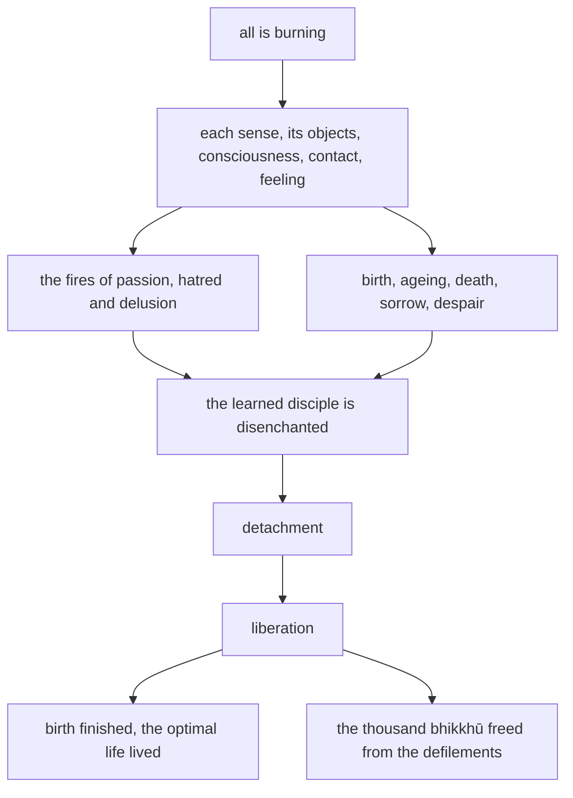

import { Tabs, TabItem } from '@astrojs/starlight/components';

Original text: [13S4/1.1.3.6 Ādittasutta 75–77](https://tipitaka2500.github.io/tipitaka/13S4/1/1.1/1.1.3/1.1.3.6.html#75) in the [World Tipitaka Edition](https://tipitaka2500.github.io)

## Summary

At Gayāsīsa, to a thousand bhikkhū, the Bhagavā declares that all is burning: each sense, its objects, its consciousness, its contact and the feeling that arises from that contact, burning with the fires of passion, hatred and delusion and with birth, ageing, death, sorrow and despair. The learned disciple who sees this is disenchanted, detached and liberated, and while the discourse was being spoken the minds of the thousand bhikkhū were liberated from the defilements.

## Diagram

## Text

<Tabs syncKey="paliquote">
<TabItem label="My Translation">
(28.)

75\. At one time the Bhagavā was dwelling at Gayā, at Gayāsīsa, with a thousand bhikkhū. There the Bhagavā addressed the bhikkhū: “All, Bhikkhave, is `ādittaṃ` (burning). And what, Bhikkhave, is the all that is burning? The `cakkhu` (eye) is burning, `rūpā` (forms) are burning, `cakkhuviññāṇaṃ` (eye-consciousness) is burning, `cakkhusamphasso` (eye-contact) is burning. And whatever `vedayitaṃ` (feeling) arises with eye-contact as cause, whether pleasant or painful or neutral, that too is burning. Burning with what? Burning with the fire of passion (`rāgaggi`), with the fire of hatred (`dosaggi`), with the fire of delusion (`mohaggi`); burning with birth, ageing, death, with sorrows, lamentations, pains, griefs, and despairs, I say … and so on … The tongue is burning, tastes are burning, tongue-consciousness is burning, tongue-contact is burning. And whatever feeling arises with tongue-contact as cause, whether pleasant or painful or neutral, that too is burning. Burning with what? Burning with the fire of passion, with the fire of hatred, with the fire of delusion; burning with birth, ageing, death, with sorrows, lamentations, pains, griefs, and despairs, I say … and so on … The mind is burning, mental phenomena (`dhammā`) are burning, mind-consciousness is burning, mind-contact is burning. And whatever feeling arises with mind-contact as cause, whether pleasant or painful or neutral, that too is burning. Burning with what? Burning with the fire of passion, with the fire of hatred, with the fire of delusion; burning with birth, ageing, death, with sorrows, lamentations, pains, griefs, and despairs, I say. Thus seeing, Bhikkhave, the `sutavā` (learned) `ariyasāvaka` (disciple of the liberated) `nibbindati` (is disenchanted with) the eye, is disenchanted with forms, is disenchanted with eye-consciousness, is disenchanted with eye-contact, and whatever feeling arises with eye-contact as cause, whether pleasant or painful or neutral, that too he is disenchanted with … and so on … and whatever feeling arises with mind-contact as cause, whether pleasant or painful or neutral, that too he is disenchanted with. Being disenchanted, he `virajjati` (becomes detached); from detachment he `vimuccati` (becomes liberated); in liberation there is the `ñāṇa` (knowledge): ‘liberated’. He `pajānāti` (knows clearly): ‘Birth (of suffering) is finished, the optimal life is lived, what had to be done is done, there is nothing further for this present state of existence.’”

76\. This the Bhagavā said. Those bhikkhū, delighted, rejoiced in the Bhagavā’s words. And while this detailed exposition was being spoken, the `cittāni` (minds) of that thousand bhikkhū, `anupādāya` (not grasping), were liberated from the `āsavā` (defilements).

77\. The sixth [discourse of the chapter].
</TabItem>

<TabItem label="Pāḷi (Roman IAST)">
(28.)

75\. Ekaṃ samayaṃ bhagavā gayāyaṃ viharati gayāsīse saddhiṃ bhikkhusahassena. Tatra kho bhagavā bhikkhū āmantesi— “sabbaṃ, bhikkhave, ādittaṃ. Kiñca, bhikkhave, sabbaṃ ādittaṃ? Cakkhu, bhikkhave, ādittaṃ, rūpā ādittā, cakkhuviññāṇaṃ ādittaṃ, cakkhusamphasso āditto. Yampidaṃ cakkhusamphassapaccayā uppajjati vedayitaṃ sukhaṃ vā dukkhaṃ vā adukkhamasukhaṃ vā tampi ādittaṃ. Kena ādittaṃ? ‘Rāgagginā, dosagginā, mohagginā ādittaṃ, jātiyā jarāya maraṇena sokehi paridevehi dukkhehi domanassehi upāyāsehi ādittan’ti vadāmi…pe… jivhā ādittā, rasā ādittā, jivhāviññāṇaṃ ādittaṃ, jivhāsamphasso āditto. Yampidaṃ jivhāsamphassapaccayā uppajjati vedayitaṃ sukhaṃ vā dukkhaṃ vā adukkhamasukhaṃ vā tampi ādittaṃ. Kena ādittaṃ? ‘Rāgagginā, dosagginā, mohagginā ādittaṃ, jātiyā jarāya maraṇena sokehi paridevehi dukkhehi domanassehi upāyāsehi ādittan’ti vadāmi…pe… mano āditto, dhammā ādittā, manoviññāṇaṃ ādittaṃ, manosamphasso āditto. Yampidaṃ manosamphassapaccayā uppajjati vedayitaṃ sukhaṃ vā dukkhaṃ vā adukkhamasukhaṃ vā tampi ādittaṃ. Kena ādittaṃ? ‘Rāgagginā, dosagginā, mohagginā ādittaṃ, jātiyā jarāya maraṇena sokehi paridevehi dukkhehi domanassehi upāyāsehi ādittan’ti vadāmi. Evaṃ passaṃ, bhikkhave, sutavā ariyasāvako cakkhusmimpi nibbindati, rūpesupi nibbindati, cakkhuviññāṇepi nibbindati, cakkhusamphassepi nibbindati, yampidaṃ cakkhusamphassapaccayā uppajjati vedayitaṃ sukhaṃ vā dukkhaṃ vā adukkhamasukhaṃ vā tasmimpi nibbindati…pe… yampidaṃ manosamphassapaccayā uppajjati vedayitaṃ sukhaṃ vā dukkhaṃ vā adukkhamasukhaṃ vā tasmimpi nibbindati. Nibbindaṃ virajjati; virāgā vimuccati; vimuttasmiṃ vimuttamiti ñāṇaṃ hoti. ‘Khīṇā jāti, vusitaṃ brahmacariyaṃ, kataṃ karaṇīyaṃ, nāparaṃ itthattāyā’ti pajānātī”ti.

76\. Idamavoca bhagavā. Attamanā te bhikkhū bhagavato bhāsitaṃ abhinanduṃ. Imasmiñca pana veyyākaraṇasmiṃ bhaññamāne tassa bhikkhusahassassa anupādāya āsavehi cittāni vimucciṃsūti.

77\. Chaṭṭhaṃ.
</TabItem>

<TabItem label="Pāḷi (Brahmi)">
(28.)

75\. 𑀏𑀓𑀁 𑀲𑀫𑀬𑀁 𑀪𑀕𑀯𑀸 𑀕𑀬𑀸𑀬𑀁 𑀯𑀺𑀳𑀭𑀢𑀺 𑀕𑀬𑀸𑀲𑀻𑀲𑁂 𑀲𑀤𑁆𑀥𑀺𑀁 𑀪𑀺𑀓𑁆𑀔𑀼𑀲𑀳𑀲𑁆𑀲𑁂𑀦. 𑀢𑀢𑁆𑀭 𑀔𑁄 𑀪𑀕𑀯𑀸 𑀪𑀺𑀓𑁆𑀔𑀽 𑀆𑀫𑀦𑁆𑀢𑁂𑀲𑀺— “𑀲𑀩𑁆𑀩𑀁, 𑀪𑀺𑀓𑁆𑀔𑀯𑁂, 𑀆𑀤𑀺𑀢𑁆𑀢𑀁. 𑀓𑀺𑀜𑁆𑀘, 𑀪𑀺𑀓𑁆𑀔𑀯𑁂, 𑀲𑀩𑁆𑀩𑀁 𑀆𑀤𑀺𑀢𑁆𑀢𑀁? 𑀘𑀓𑁆𑀔𑀼, 𑀪𑀺𑀓𑁆𑀔𑀯𑁂, 𑀆𑀤𑀺𑀢𑁆𑀢𑀁, 𑀭𑀽𑀧𑀸 𑀆𑀤𑀺𑀢𑁆𑀢𑀸, 𑀘𑀓𑁆𑀔𑀼𑀯𑀺𑀜𑁆𑀜𑀸𑀡𑀁 𑀆𑀤𑀺𑀢𑁆𑀢𑀁, 𑀘𑀓𑁆𑀔𑀼𑀲𑀫𑁆𑀨𑀲𑁆𑀲𑁄 𑀆𑀤𑀺𑀢𑁆𑀢𑁄. 𑀬𑀫𑁆𑀧𑀺𑀤𑀁 𑀘𑀓𑁆𑀔𑀼𑀲𑀫𑁆𑀨𑀲𑁆𑀲𑀧𑀘𑁆𑀘𑀬𑀸 𑀉𑀧𑁆𑀧𑀚𑁆𑀚𑀢𑀺 𑀯𑁂𑀤𑀬𑀺𑀢𑀁 𑀲𑀼𑀔𑀁 𑀯𑀸 𑀤𑀼𑀓𑁆𑀔𑀁 𑀯𑀸 𑀅𑀤𑀼𑀓𑁆𑀔𑀫𑀲𑀼𑀔𑀁 𑀯𑀸 𑀢𑀫𑁆𑀧𑀺 𑀆𑀤𑀺𑀢𑁆𑀢𑀁. 𑀓𑁂𑀦 𑀆𑀤𑀺𑀢𑁆𑀢𑀁? ‘𑀭𑀸𑀕𑀕𑁆𑀕𑀺𑀦𑀸, 𑀤𑁄𑀲𑀕𑁆𑀕𑀺𑀦𑀸, 𑀫𑁄𑀳𑀕𑁆𑀕𑀺𑀦𑀸 𑀆𑀤𑀺𑀢𑁆𑀢𑀁, 𑀚𑀸𑀢𑀺𑀬𑀸 𑀚𑀭𑀸𑀬 𑀫𑀭𑀡𑁂𑀦 𑀲𑁄𑀓𑁂𑀳𑀺 𑀧𑀭𑀺𑀤𑁂𑀯𑁂𑀳𑀺 𑀤𑀼𑀓𑁆𑀔𑁂𑀳𑀺 𑀤𑁄𑀫𑀦𑀲𑁆𑀲𑁂𑀳𑀺 𑀉𑀧𑀸𑀬𑀸𑀲𑁂𑀳𑀺 𑀆𑀤𑀺𑀢𑁆𑀢𑀦𑁆’𑀢𑀺 𑀯𑀤𑀸𑀫𑀺…𑀧𑁂… 𑀚𑀺𑀯𑁆𑀳𑀸 𑀆𑀤𑀺𑀢𑁆𑀢𑀸, 𑀭𑀲𑀸 𑀆𑀤𑀺𑀢𑁆𑀢𑀸, 𑀚𑀺𑀯𑁆𑀳𑀸𑀯𑀺𑀜𑁆𑀜𑀸𑀡𑀁 𑀆𑀤𑀺𑀢𑁆𑀢𑀁, 𑀚𑀺𑀯𑁆𑀳𑀸𑀲𑀫𑁆𑀨𑀲𑁆𑀲𑁄 𑀆𑀤𑀺𑀢𑁆𑀢𑁄. 𑀬𑀫𑁆𑀧𑀺𑀤𑀁 𑀚𑀺𑀯𑁆𑀳𑀸𑀲𑀫𑁆𑀨𑀲𑁆𑀲𑀧𑀘𑁆𑀘𑀬𑀸 𑀉𑀧𑁆𑀧𑀚𑁆𑀚𑀢𑀺 𑀯𑁂𑀤𑀬𑀺𑀢𑀁 𑀲𑀼𑀔𑀁 𑀯𑀸 𑀤𑀼𑀓𑁆𑀔𑀁 𑀯𑀸 𑀅𑀤𑀼𑀓𑁆𑀔𑀫𑀲𑀼𑀔𑀁 𑀯𑀸 𑀢𑀫𑁆𑀧𑀺 𑀆𑀤𑀺𑀢𑁆𑀢𑀁. 𑀓𑁂𑀦 𑀆𑀤𑀺𑀢𑁆𑀢𑀁? ‘𑀭𑀸𑀕𑀕𑁆𑀕𑀺𑀦𑀸, 𑀤𑁄𑀲𑀕𑁆𑀕𑀺𑀦𑀸, 𑀫𑁄𑀳𑀕𑁆𑀕𑀺𑀦𑀸 𑀆𑀤𑀺𑀢𑁆𑀢𑀁, 𑀚𑀸𑀢𑀺𑀬𑀸 𑀚𑀭𑀸𑀬 𑀫𑀭𑀡𑁂𑀦 𑀲𑁄𑀓𑁂𑀳𑀺 𑀧𑀭𑀺𑀤𑁂𑀯𑁂𑀳𑀺 𑀤𑀼𑀓𑁆𑀔𑁂𑀳𑀺 𑀤𑁄𑀫𑀦𑀲𑁆𑀲𑁂𑀳𑀺 𑀉𑀧𑀸𑀬𑀸𑀲𑁂𑀳𑀺 𑀆𑀤𑀺𑀢𑁆𑀢𑀦𑁆’𑀢𑀺 𑀯𑀤𑀸𑀫𑀺…𑀧𑁂… 𑀫𑀦𑁄 𑀆𑀤𑀺𑀢𑁆𑀢𑁄, 𑀥𑀫𑁆𑀫𑀸 𑀆𑀤𑀺𑀢𑁆𑀢𑀸, 𑀫𑀦𑁄𑀯𑀺𑀜𑁆𑀜𑀸𑀡𑀁 𑀆𑀤𑀺𑀢𑁆𑀢𑀁, 𑀫𑀦𑁄𑀲𑀫𑁆𑀨𑀲𑁆𑀲𑁄 𑀆𑀤𑀺𑀢𑁆𑀢𑁄. 𑀬𑀫𑁆𑀧𑀺𑀤𑀁 𑀫𑀦𑁄𑀲𑀫𑁆𑀨𑀲𑁆𑀲𑀧𑀘𑁆𑀘𑀬𑀸 𑀉𑀧𑁆𑀧𑀚𑁆𑀚𑀢𑀺 𑀯𑁂𑀤𑀬𑀺𑀢𑀁 𑀲𑀼𑀔𑀁 𑀯𑀸 𑀤𑀼𑀓𑁆𑀔𑀁 𑀯𑀸 𑀅𑀤𑀼𑀓𑁆𑀔𑀫𑀲𑀼𑀔𑀁 𑀯𑀸 𑀢𑀫𑁆𑀧𑀺 𑀆𑀤𑀺𑀢𑁆𑀢𑀁. 𑀓𑁂𑀦 𑀆𑀤𑀺𑀢𑁆𑀢𑀁? ‘𑀭𑀸𑀕𑀕𑁆𑀕𑀺𑀦𑀸, 𑀤𑁄𑀲𑀕𑁆𑀕𑀺𑀦𑀸, 𑀫𑁄𑀳𑀕𑁆𑀕𑀺𑀦𑀸 𑀆𑀤𑀺𑀢𑁆𑀢𑀁, 𑀚𑀸𑀢𑀺𑀬𑀸 𑀚𑀭𑀸𑀬 𑀫𑀭𑀡𑁂𑀦 𑀲𑁄𑀓𑁂𑀳𑀺 𑀧𑀭𑀺𑀤𑁂𑀯𑁂𑀳𑀺 𑀤𑀼𑀓𑁆𑀔𑁂𑀳𑀺 𑀤𑁄𑀫𑀦𑀲𑁆𑀲𑁂𑀳𑀺 𑀉𑀧𑀸𑀬𑀸𑀲𑁂𑀳𑀺 𑀆𑀤𑀺𑀢𑁆𑀢𑀦𑁆’𑀢𑀺 𑀯𑀤𑀸𑀫𑀺. 𑀏𑀯𑀁 𑀧𑀲𑁆𑀲𑀁, 𑀪𑀺𑀓𑁆𑀔𑀯𑁂, 𑀲𑀼𑀢𑀯𑀸 𑀅𑀭𑀺𑀬𑀲𑀸𑀯𑀓𑁄 𑀘𑀓𑁆𑀔𑀼𑀲𑁆𑀫𑀺𑀫𑁆𑀧𑀺 𑀦𑀺𑀩𑁆𑀩𑀺𑀦𑁆𑀤𑀢𑀺, 𑀭𑀽𑀧𑁂𑀲𑀼𑀧𑀺 𑀦𑀺𑀩𑁆𑀩𑀺𑀦𑁆𑀤𑀢𑀺, 𑀘𑀓𑁆𑀔𑀼𑀯𑀺𑀜𑁆𑀜𑀸𑀡𑁂𑀧𑀺 𑀦𑀺𑀩𑁆𑀩𑀺𑀦𑁆𑀤𑀢𑀺, 𑀘𑀓𑁆𑀔𑀼𑀲𑀫𑁆𑀨𑀲𑁆𑀲𑁂𑀧𑀺 𑀦𑀺𑀩𑁆𑀩𑀺𑀦𑁆𑀤𑀢𑀺, 𑀬𑀫𑁆𑀧𑀺𑀤𑀁 𑀘𑀓𑁆𑀔𑀼𑀲𑀫𑁆𑀨𑀲𑁆𑀲𑀧𑀘𑁆𑀘𑀬𑀸 𑀉𑀧𑁆𑀧𑀚𑁆𑀚𑀢𑀺 𑀯𑁂𑀤𑀬𑀺𑀢𑀁 𑀲𑀼𑀔𑀁 𑀯𑀸 𑀤𑀼𑀓𑁆𑀔𑀁 𑀯𑀸 𑀅𑀤𑀼𑀓𑁆𑀔𑀫𑀲𑀼𑀔𑀁 𑀯𑀸 𑀢𑀲𑁆𑀫𑀺𑀫𑁆𑀧𑀺 𑀦𑀺𑀩𑁆𑀩𑀺𑀦𑁆𑀤𑀢𑀺…𑀧𑁂… 𑀬𑀫𑁆𑀧𑀺𑀤𑀁 𑀫𑀦𑁄𑀲𑀫𑁆𑀨𑀲𑁆𑀲𑀧𑀘𑁆𑀘𑀬𑀸 𑀉𑀧𑁆𑀧𑀚𑁆𑀚𑀢𑀺 𑀯𑁂𑀤𑀬𑀺𑀢𑀁 𑀲𑀼𑀔𑀁 𑀯𑀸 𑀤𑀼𑀓𑁆𑀔𑀁 𑀯𑀸 𑀅𑀤𑀼𑀓𑁆𑀔𑀫𑀲𑀼𑀔𑀁 𑀯𑀸 𑀢𑀲𑁆𑀫𑀺𑀫𑁆𑀧𑀺 𑀦𑀺𑀩𑁆𑀩𑀺𑀦𑁆𑀤𑀢𑀺. 𑀦𑀺𑀩𑁆𑀩𑀺𑀦𑁆𑀤𑀁 𑀯𑀺𑀭𑀚𑁆𑀚𑀢𑀺; 𑀯𑀺𑀭𑀸𑀕𑀸 𑀯𑀺𑀫𑀼𑀘𑁆𑀘𑀢𑀺; 𑀯𑀺𑀫𑀼𑀢𑁆𑀢𑀲𑁆𑀫𑀺𑀁 𑀯𑀺𑀫𑀼𑀢𑁆𑀢𑀫𑀺𑀢𑀺 𑀜𑀸𑀡𑀁 𑀳𑁄𑀢𑀺. ‘𑀔𑀻𑀡𑀸 𑀚𑀸𑀢𑀺, 𑀯𑀼𑀲𑀺𑀢𑀁 𑀩𑁆𑀭𑀳𑁆𑀫𑀘𑀭𑀺𑀬𑀁, 𑀓𑀢𑀁 𑀓𑀭𑀡𑀻𑀬𑀁, 𑀦𑀸𑀧𑀭𑀁 𑀇𑀢𑁆𑀣𑀢𑁆𑀢𑀸𑀬𑀸’𑀢𑀺 𑀧𑀚𑀸𑀦𑀸𑀢𑀻”𑀢𑀺.

76\. 𑀇𑀤𑀫𑀯𑁄𑀘 𑀪𑀕𑀯𑀸. 𑀅𑀢𑁆𑀢𑀫𑀦𑀸 𑀢𑁂 𑀪𑀺𑀓𑁆𑀔𑀽 𑀪𑀕𑀯𑀢𑁄 𑀪𑀸𑀲𑀺𑀢𑀁 𑀅𑀪𑀺𑀦𑀦𑁆𑀤𑀼𑀁. 𑀇𑀫𑀲𑁆𑀫𑀺𑀜𑁆𑀘 𑀧𑀦 𑀯𑁂𑀬𑁆𑀬𑀸𑀓𑀭𑀡𑀲𑁆𑀫𑀺𑀁 𑀪𑀜𑁆𑀜𑀫𑀸𑀦𑁂 𑀢𑀲𑁆𑀲 𑀪𑀺𑀓𑁆𑀔𑀼𑀲𑀳𑀲𑁆𑀲𑀲𑁆𑀲 𑀅𑀦𑀼𑀧𑀸𑀤𑀸𑀬 𑀆𑀲𑀯𑁂𑀳𑀺 𑀘𑀺𑀢𑁆𑀢𑀸𑀦𑀺 𑀯𑀺𑀫𑀼𑀘𑁆𑀘𑀺𑀁𑀲𑀽𑀢𑀺.

77\. 𑀙𑀝𑁆𑀞𑀁.
</TabItem>

<TabItem label="Interlinear">
(28.)

[75](https://tipitaka2500.github.io/tipitaka/13S4/1/1.1/1.1.3/1.1.3.6.html#75) Ekaṃ samayaṃ bhagavā gayāyaṃ viharati gayāsīse saddhiṃ bhikkhusahassena.  
*️⃣🤟🚹⨀②(eka) 🚹⨀②(samaya) 🚹⨀①(bhagavant) 🚺⨀⑦(gayā) 🟢⨀🤟▶️(viharati) 🚻⨀⑦(gayāsīsa) ⏏️(saddhiṃ) 🚻⨀③🆎(bhikkhu+sahassa)  
one | time | the Bhagavā | at Gayā | dwells | at Gayāsīsa | together | with a thousand bhikkhū  
At one time the Bhagavā was dwelling at Gayā, at Gayāsīsa, with a thousand bhikkhū.

Tatra kho bhagavā bhikkhū āmantesi— “sabbaṃ, bhikkhave, ādittaṃ.  
⏏️(tatra) ⏏️(kho) 🚹⨀①(bhagavant) 🚹⨂②(bhikkhu) 🟢⨀🤟⏮(āmanteti) *️⃣🤟🚻⨀①(sabba) 🚹⨂⓪(bhikkhu) 🚻⨀①🔽(ta)(āditta)  
there | indeed | the Bhagavā | bhikkhū | addressed | all | Bhikkhave | burning  
There the Bhagavā addressed the bhikkhū: “All, Bhikkhave, is `ādittaṃ` (burning).

Kiñca, bhikkhave, sabbaṃ ādittaṃ?  
*️⃣🤟🚻⨀①(kiṃ) ⏏️(ca) 🚹⨂⓪(bhikkhu) *️⃣🤟🚻⨀①(sabba) 🚻⨀①🔽(ta)(āditta)  
what | and | Bhikkhave | all | burning  
And what, Bhikkhave, is the all that is burning?

Cakkhu, bhikkhave, ādittaṃ, rūpā ādittā, cakkhuviññāṇaṃ ādittaṃ, cakkhusamphasso āditto.  
🚻⨀①(cakkhu) 🚹⨂⓪(bhikkhu) 🚻⨀①🔽(ta)(āditta) 🚻⨂①(rūpa) 🚻⨂①🔽(ta)(āditta) 🚻⨀①🆎(cakkhu+viññāṇa) 🚻⨀①🔽(ta)(āditta) 🚹⨀①🆎(cakkhu+samphassa) 🚹⨀①🔽(ta)(āditta)  
the eye | Bhikkhave | burning | forms | burning | eye-consciousness | burning | eye-contact | burning  
The `cakkhu` (eye) is burning, `rūpā` (forms) are burning, `cakkhuviññāṇaṃ` (eye-consciousness) is burning, `cakkhusamphasso` (eye-contact) is burning.

Yampidaṃ cakkhusamphassapaccayā uppajjati vedayitaṃ sukhaṃ vā dukkhaṃ vā adukkhamasukhaṃ vā tampi ādittaṃ.  
*️⃣🤟🚻⨀①(ya) ⏏️(api) *️⃣🤟🚻⨀①(ima) 🚹⨀⑤🆎(cakkhu+samphassa+paccaya) 🟢⨀🤟▶️(uppajjati) 🚻⨀①🔽(ta)(vedayita) 🚻⨀①(sukha) ⏏️(vā) 🚻⨀①(dukkha) ⏏️(vā) 🚻⨀①🆎(na+dukkha+na+sukha) ⏏️(vā) *️⃣🤟🚻⨀①(ta) ⏏️(api) 🚻⨀①🔽(ta)(āditta)  
what | too | this | with eye-contact as cause | arises | feeling | pleasant | or | painful | or | neither painful nor pleasant | or | that | too | burning  
And whatever `vedayitaṃ` (feeling) arises with eye-contact as cause, whether pleasant or painful or neutral, that too is burning.

Kena ādittaṃ?  
*️⃣🤟🚻⨀③(kiṃ) 🚻⨀①🔽(ta)(āditta)  
with what | burning  
Burning with what?

‘Rāgagginā, dosagginā, mohagginā ādittaṃ, jātiyā jarāya maraṇena sokehi paridevehi dukkhehi domanassehi upāyāsehi ādittan’ti vadāmi…pe… jivhā ādittā, rasā ādittā, jivhāviññāṇaṃ ādittaṃ, jivhāsamphasso āditto.  
🚹⨀③🆎(rāga+aggi) 🚹⨀③🆎(dosa+aggi) 🚹⨀③🆎(moha+aggi) 🚻⨀①🔽(ta)(āditta) 🚺⨀③(jāti) 🚺⨀③(jarā) 🚻⨀③(maraṇa) 🚹⨂③(soka) 🚹⨂③(parideva) 🚻⨂③(dukkha) 🚻⨂③(domanassa) 🚹⨂③(upāyāsa) 🚻⨀①🔽(ta)(āditta) ⏏️(iti) 🟢⨀👆▶️(vadati) ⏏️(peyyāla) 🚺⨀①(jivhā) 🚺⨀①🔽(ta)(āditta) 🚹⨂①(rasa) 🚹⨂①🔽(ta)(āditta) 🚻⨀①🆎(jivhā+viññāṇa) 🚻⨀①🔽(ta)(āditta) 🚹⨀①🆎(jivhā+samphassa) 🚹⨀①🔽(ta)(āditta)  
with the fire of passion | with the fire of hatred | with the fire of delusion | burning | with birth | with ageing | with death | with sorrows | with lamentations | with pains | with griefs | with despairs | burning | (end quote) | I say | (and so on) | the tongue | burning | tastes | burning | tongue-consciousness | burning | tongue-contact | burning  
Burning with the fire of passion (`rāgaggi`), with the fire of hatred (`dosaggi`), with the fire of delusion (`mohaggi`); burning with birth, ageing, death, with sorrows, lamentations, pains, griefs, and despairs, I say … and so on … The tongue is burning, tastes are burning, tongue-consciousness is burning, tongue-contact is burning.

Yampidaṃ jivhāsamphassapaccayā uppajjati vedayitaṃ sukhaṃ vā dukkhaṃ vā adukkhamasukhaṃ vā tampi ādittaṃ.  
*️⃣🤟🚻⨀①(ya) ⏏️(api) *️⃣🤟🚻⨀①(ima) 🚹⨀⑤🆎(jivhā+samphassa+paccaya) 🟢⨀🤟▶️(uppajjati) 🚻⨀①🔽(ta)(vedayita) 🚻⨀①(sukha) ⏏️(vā) 🚻⨀①(dukkha) ⏏️(vā) 🚻⨀①🆎(na+dukkha+na+sukha) ⏏️(vā) *️⃣🤟🚻⨀①(ta) ⏏️(api) 🚻⨀①🔽(ta)(āditta)  
what | too | this | with tongue-contact as cause | arises | feeling | pleasant | or | painful | or | neither painful nor pleasant | or | that | too | burning  
And whatever feeling arises with tongue-contact as cause, whether pleasant or painful or neutral, that too is burning.

Kena ādittaṃ?  
*️⃣🤟🚻⨀③(kiṃ) 🚻⨀①🔽(ta)(āditta)  
with what | burning  
Burning with what?

‘Rāgagginā, dosagginā, mohagginā ādittaṃ, jātiyā jarāya maraṇena sokehi paridevehi dukkhehi domanassehi upāyāsehi ādittan’ti vadāmi…pe… mano āditto, dhammā ādittā, manoviññāṇaṃ ādittaṃ, manosamphasso āditto.  
🚹⨀③🆎(rāga+aggi) 🚹⨀③🆎(dosa+aggi) 🚹⨀③🆎(moha+aggi) 🚻⨀①🔽(ta)(āditta) 🚺⨀③(jāti) 🚺⨀③(jarā) 🚻⨀③(maraṇa) 🚹⨂③(soka) 🚹⨂③(parideva) 🚻⨂③(dukkha) 🚻⨂③(domanassa) 🚹⨂③(upāyāsa) 🚻⨀①🔽(ta)(āditta) ⏏️(iti) 🟢⨀👆▶️(vadati) ⏏️(peyyāla) 🚹⨀①(mano) 🚹⨀①🔽(ta)(āditta) 🚹⨂①(dhamma) 🚹⨂①🔽(ta)(āditta) 🚻⨀①🆎(mano+viññāṇa) 🚻⨀①🔽(ta)(āditta) 🚹⨀①🆎(mano+samphassa) 🚹⨀①🔽(ta)(āditta)  
with the fire of passion | with the fire of hatred | with the fire of delusion | burning | with birth | with ageing | with death | with sorrows | with lamentations | with pains | with griefs | with despairs | burning | (end quote) | I say | (and so on) | the mind | burning | mental phenomena | burning | mind-consciousness | burning | mind-contact | burning  
Burning with the fire of passion, with the fire of hatred, with the fire of delusion; burning with birth, ageing, death, with sorrows, lamentations, pains, griefs, and despairs, I say … and so on … The mind is burning, mental phenomena (`dhammā`) are burning, mind-consciousness is burning, mind-contact is burning.

Yampidaṃ manosamphassapaccayā uppajjati vedayitaṃ sukhaṃ vā dukkhaṃ vā adukkhamasukhaṃ vā tampi ādittaṃ.  
*️⃣🤟🚻⨀①(ya) ⏏️(api) *️⃣🤟🚻⨀①(ima) 🚹⨀⑤🆎(mano+samphassa+paccaya) 🟢⨀🤟▶️(uppajjati) 🚻⨀①🔽(ta)(vedayita) 🚻⨀①(sukha) ⏏️(vā) 🚻⨀①(dukkha) ⏏️(vā) 🚻⨀①🆎(na+dukkha+na+sukha) ⏏️(vā) *️⃣🤟🚻⨀①(ta) ⏏️(api) 🚻⨀①🔽(ta)(āditta)  
what | too | this | with mind-contact as cause | arises | feeling | pleasant | or | painful | or | neither painful nor pleasant | or | that | too | burning  
And whatever feeling arises with mind-contact as cause, whether pleasant or painful or neutral, that too is burning.

Kena ādittaṃ?  
*️⃣🤟🚻⨀③(kiṃ) 🚻⨀①🔽(ta)(āditta)  
with what | burning  
Burning with what?

‘Rāgagginā, dosagginā, mohagginā ādittaṃ, jātiyā jarāya maraṇena sokehi paridevehi dukkhehi domanassehi upāyāsehi ādittan’ti vadāmi.  
🚹⨀③🆎(rāga+aggi) 🚹⨀③🆎(dosa+aggi) 🚹⨀③🆎(moha+aggi) 🚻⨀①🔽(ta)(āditta) 🚺⨀③(jāti) 🚺⨀③(jarā) 🚻⨀③(maraṇa) 🚹⨂③(soka) 🚹⨂③(parideva) 🚻⨂③(dukkha) 🚻⨂③(domanassa) 🚹⨂③(upāyāsa) 🚻⨀①🔽(ta)(āditta) ⏏️(iti) 🟢⨀👆▶️(vadati)  
with the fire of passion | with the fire of hatred | with the fire of delusion | burning | with birth | with ageing | with death | with sorrows | with lamentations | with pains | with griefs | with despairs | burning | (end quote) | I say  
Burning with the fire of passion, with the fire of hatred, with the fire of delusion; burning with birth, ageing, death, with sorrows, lamentations, pains, griefs, and despairs, I say.

Evaṃ passaṃ, bhikkhave, sutavā ariyasāvako cakkhusmimpi nibbindati, rūpesupi nibbindati, cakkhuviññāṇepi nibbindati, cakkhusamphassepi nibbindati, yampidaṃ cakkhusamphassapaccayā uppajjati vedayitaṃ sukhaṃ vā dukkhaṃ vā adukkhamasukhaṃ vā tasmimpi nibbindati…pe… yampidaṃ manosamphassapaccayā uppajjati vedayitaṃ sukhaṃ vā dukkhaṃ vā adukkhamasukhaṃ vā tasmimpi nibbindati.  
⏏️(evaṃ) 🚹⨀①🔽(anta)(passanta) 🚹⨂⓪(bhikkhu) 🚹⨀①(sutavant) 🚹⨀①🆎(ariya+sāvaka) 🚻⨀⑦(cakkhu) ⏏️(api) 🟢⨀🤟▶️(nibbindati) 🚻⨂⑦(rūpa) ⏏️(api) 🟢⨀🤟▶️(nibbindati) 🚻⨀⑦🆎(cakkhu+viññāṇa) ⏏️(api) 🟢⨀🤟▶️(nibbindati) 🚹⨀⑦🆎(cakkhu+samphassa) ⏏️(api) 🟢⨀🤟▶️(nibbindati) *️⃣🤟🚻⨀①(ya) ⏏️(api) *️⃣🤟🚻⨀①(ima) 🚹⨀⑤🆎(cakkhu+samphassa+paccaya) 🟢⨀🤟▶️(uppajjati) 🚻⨀①🔽(ta)(vedayita) 🚻⨀①(sukha) ⏏️(vā) 🚻⨀①(dukkha) ⏏️(vā) 🚻⨀①🆎(na+dukkha+na+sukha) ⏏️(vā) *️⃣🤟🚻⨀⑦(ta) ⏏️(api) 🟢⨀🤟▶️(nibbindati) ⏏️(peyyāla) *️⃣🤟🚻⨀①(ya) ⏏️(api) *️⃣🤟🚻⨀①(ima) 🚹⨀⑤🆎(mano+samphassa+paccaya) 🟢⨀🤟▶️(uppajjati) 🚻⨀①🔽(ta)(vedayita) 🚻⨀①(sukha) ⏏️(vā) 🚻⨀①(dukkha) ⏏️(vā) 🚻⨀①🆎(na+dukkha+na+sukha) ⏏️(vā) *️⃣🤟🚻⨀⑦(ta) ⏏️(api) 🟢⨀🤟▶️(nibbindati)  
thus | seeing | Bhikkhave | learned | disciple of the liberated | the eye | too | is disenchanted with | forms | too | is disenchanted with | eye-consciousness | too | is disenchanted with | eye-contact | too | is disenchanted with | what | too | this | with eye-contact as cause | arises | feeling | pleasant | or | painful | or | neither painful nor pleasant | or | that | too | is disenchanted with | (and so on) | what | too | this | with mind-contact as cause | arises | feeling | pleasant | or | painful | or | neither painful nor pleasant | or | that | too | is disenchanted with  
Thus seeing, Bhikkhave, the `sutavā` (learned) `ariyasāvaka` (disciple of the liberated) `nibbindati` (is disenchanted with) the eye, is disenchanted with forms, is disenchanted with eye-consciousness, is disenchanted with eye-contact, and whatever feeling arises with eye-contact as cause, whether pleasant or painful or neutral, that too he is disenchanted with … and so on … and whatever feeling arises with mind-contact as cause, whether pleasant or painful or neutral, that too he is disenchanted with.

Nibbindaṃ virajjati;  
🚹⨀①🔽(anta)(nibbindanta) 🟢⨀🤟▶️(virajjati)  
being disenchanted | becomes detached  
Being disenchanted, he `virajjati` (becomes detached);

virāgā vimuccati;  
🚹⨀⑤(virāga) 🔴⨀🤟▶️(vimuccati)  
from detachment | is liberated  
from detachment he `vimuccati` (becomes liberated);

vimuttasmiṃ vimuttamiti ñāṇaṃ hoti.  
🚻⨀⑦🔽(ta)(vimutta) 🚻⨀①🔽(ta)(vimutta) ⏏️(iti) 🚻⨀①(ñāṇa) 🟢⨀🤟▶️(hoti)  
in liberation | liberated | (end quote) | knowledge | there is  
in liberation there is the `ñāṇa` (knowledge): ‘liberated’.

‘Khīṇā jāti, vusitaṃ brahmacariyaṃ, kataṃ karaṇīyaṃ, nāparaṃ itthattāyā’ti pajānātī”ti.  
🚺⨀①🔽(ta)(khīṇa) 🚺⨀①(jāti) 🚻⨀①🔽(ta)(vusita) 🚻⨀①🆎(brahma+cariya) 🚻⨀①🔽(ta)(kata) 🚻⨀①🔽(anīya)(karaṇīya) ⏏️(na) *️⃣🤟🚻⨀①(apara) 🚻⨀④(itthatta) ⏏️(iti) 🟢⨀🤟▶️(pajānāti) ⏏️(iti)  
finished | birth | lived | optimal life | done | what had to be done | not | further | for this state of existence | (end quote) | knows clearly | (end quote)  
He `pajānāti` (knows clearly): ‘Birth (of suffering) is finished, the optimal life is lived, what had to be done is done, there is nothing further for this present state of existence.’”

[76](https://tipitaka2500.github.io/tipitaka/13S4/1/1.1/1.1.3/1.1.3.6.html#76) Idamavoca bhagavā.  
*️⃣🤟🚻⨀②(ima) 🟢⨀🤟⏮(vadati) 🚹⨀①(bhagavant)  
this | said | the Bhagavā  
This the Bhagavā said.

Attamanā te bhikkhū bhagavato bhāsitaṃ abhinanduṃ.  
🚹⨂①🆎(atta+mana) *️⃣🤟🚹⨂①(ta) 🚹⨂①(bhikkhu) 🚹⨀⑥(bhagavant) 🚻⨀②🔽(ta)(bhāsita) 🟢⨂🤟⏮(abhinandati)  
delighted | those | bhikkhū | of the Bhagavā | what was spoken | rejoiced in  
Those bhikkhū, delighted, rejoiced in the Bhagavā’s words.

Imasmiñca pana veyyākaraṇasmiṃ bhaññamāne tassa bhikkhusahassassa anupādāya āsavehi cittāni vimucciṃsūti.  
*️⃣🤟🚻⨀⑦(ima) ⏏️(ca) ⏏️(pana) 🚻⨀⑦(veyyākaraṇa) 🚻⨀⑦🔽(māna)(bhaññamāna) *️⃣🤟🚻⨀⑥(ta) 🚻⨀⑥🆎(bhikkhu+sahassa) 🔽(ya)🆎(na+upādiyati) 🚹⨂⑤(āsava) 🚻⨂①(citta) 🔴⨂🤟⏮(vimuccati) ⏏️(iti)  
in this | and | moreover | detailed exposition | being spoken | of that | thousand bhikkhū | not grasping | from the defilements | minds | were liberated | (end quote)  
And while this detailed exposition was being spoken, the `cittāni` (minds) of that thousand bhikkhū, `anupādāya` (not grasping), were liberated from the `āsavā` (defilements).

[77](https://tipitaka2500.github.io/tipitaka/13S4/1/1.1/1.1.3/1.1.3.6.html#77) Chaṭṭhaṃ.  
🚻⨀①(chaṭṭha)  
the sixth  
The sixth [discourse of the chapter].
</TabItem>
</Tabs>

## Commentary

- The Saṃyutta's telling of the fire sermon; the Vinaya tells it at the end of the miracles at Uruvelā, to the thousand bhikkhū who had been matted hair ascetics ([3V/1.12 Uruvelapāṭihāriyakathā](/khandhaka/1-12/)).
- Every sentence but the frame and the three runs the edition abbreviates is a twin of the textbook's [chapter 9](https://buddhavacana.github.io/pali-textbook/9-fire/), which writes the six senses out in full; here the edition's `…pe…` for the ear to the body and for the disenchantment run is "… and so on …".
- Renderings: `āditta` "burning", `vedayita` "feeling", `rāgaggi`, `dosaggi`, `mohaggi` "the fire of passion, hatred, delusion", `nibbindati` "is disenchanted with", `virajjati` "becomes detached", `ariyasāvaka` "disciple of the liberated".
- The edition holds the whole sermon in one paragraph (75), the close in 76 and the colophon "the sixth" in 77, the sixth sutta of the Sabbavagga.

## Parallels

The Chinese parallel is the 197th sūtra of the 雜阿含經 (fascicle 8, CBETA T02, no. 99, pp. 50b–c), in the Saṃyuktāgama's section on the sense bases that Choong's comparison of the two collections covers [@Choong2000], read here in CBETA's text. The two agree in the frame and the sermon: the Buddha at Gayāsīsa (迦闍尸利沙支提, p. 50b) with a thousand bhikkhus; all is burning — the eye, forms, eye-consciousness, eye-contact and the feeling arisen with eye-contact as condition, painful, pleasant or neither, and so for the other senses — burning with the fires of greed, anger and delusion (貪火、恚火、癡火) and with birth, ageing, death, sorrow, lamentation, distress and suffering; and at the close the minds of the thousand bhikkhus liberated from the defilements. The differences, read in CBETA's text:

- **Who the thousand were.** The Chinese says they were "all formerly brahmins with matted hair" (皆是舊縈髮婆羅門, p. 50b); the Pāḷi sutta says only "with a thousand bhikkhū" (75) and leaves their past to the Vinaya's telling.
- **Three demonstrations.** The Chinese frames the sermon as the third of three demonstrations (三種示現教化) the Buddha gave the thousand: the demonstration of psychic power (entering absorption, rising into the air towards the east, the four postures, the fire absorption with flames of six colours, water and fire from the upper and lower body, p. 50b), the demonstration of mind-reading (他心示現: "such is your mind, such your thought, such your consciousness; thus you should think, thus you should not think", p. 50b), and the demonstration of instruction (教誡示現), which is the fire sermon. The Pāḷi has the sermon alone.
- **The sermon's form.** The Chinese gives the eye in full, then "likewise the ear, nose, tongue, body and mind are burning" with the mind's objects, consciousness, contact and feeling (如是耳、鼻、舌、身、意燒然, pp. 50b–c), and asks "burning with what?" (以何燒然) once, at the end; the Pāḷi asks it for every sense and abbreviates the ear to the body with `…pe…`. The Chinese orders the feelings painful, pleasant, neither (若苦、若樂、不苦不樂); the Pāḷi pleasant, painful, neither.
- **The fires.** After the fires of greed, anger and delusion the Chinese has "burning with the fire of birth, old age, illness, death, sorrow, lamentation, distress and suffering" (生、老、病、死、憂、悲、惱、苦火燒然, p. 50c): illness is added, and the eight are themselves a fire; the Pāḷi has the eight as plain instrumentals, "burning with birth, ageing, death, with sorrows, lamentations, pains, griefs, and despairs" (75).
- **No disenchantment.** The Chinese has nothing of the learned disciple's disenchantment, detachment, liberation and knowledge "birth is finished" (75); from the fires it passes to the thousand bhikkhus who, "hearing what the Buddha said, did not arouse the defilements, and their minds attained liberation" (不起諸漏，心得解脫, p. 50c), and to the standard close, "the bhikkhus, hearing what the Buddha said, rejoiced and put it into practice" (歡喜奉行). The Pāḷi has "This the Bhagavā said. Those bhikkhū, delighted, rejoiced" before the liberation (76) and no closing formula.

[Go to previous page (Dutiyadvayasutta (The Second Discourse on the Pair))](/samyuttanikaya/salayatanasamyutta/dutiyadvayasutta/) / [Go to parent page (Saṃyutta Nikāya)](/samyuttanikaya/) / [Go to next page (Ādittapariyāyasutta (The Discourse on the Exposition of Burning))](/samyuttanikaya/salayatanasamyutta/adittapariyayasutta/)

## References
