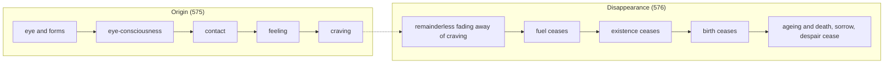

import { Tabs, TabItem } from '@astrojs/starlight/components';

Original text: [13S4/1.3.1.3 Dukkhasamudayasutta 575–577](https://tipitaka2500.github.io/tipitaka/13S4/1/1.3/1.3.1/1.3.1.3.html#575) in the [World Tipitaka Edition](https://tipitaka2500.github.io)

## Summary

The Bhagavā teaches the origin and the disappearance of suffering through the six senses. Dependent on the eye and forms eye-consciousness arises, the coming together of the three is contact, with contact as cause feeling, with feeling as cause craving: this is the origin. With the remainderless fading away and cessation of that craving, fuel, existence and birth cease, and with them ageing and death, sorrow, lamentation, pain, displeasure and despair: this is the disappearance, stated for the eye, the tongue and the mind and abbreviated for the rest.

## Diagram

## Text

<Tabs syncKey="paliquote">
<TabItem label="My Translation">
(106.)

575\. “I will teach, Bhikkhave, the origin and the disappearance of suffering. Listen to it. And what, Bhikkhave, is the origin of suffering? Dependent on the eye and forms, eye-consciousness arises. The coming together of the three is `phassa` (contact). With contact as cause, `vedanā` (feeling) [arises]; with feeling as cause, `taṇhā` (craving) [arises]. This is the origin of suffering … and so on … Dependent on the tongue and tastes, tongue-consciousness arises. The coming together of the three is contact. With contact as cause, feeling [arises]; with feeling as cause, craving [arises]. This is the origin of suffering … and so on … Dependent on the mind and mental phenomena, mind-consciousness arises. The coming together of the three is contact. With contact as cause, feeling [arises]; with feeling as cause, craving [arises]. This, Bhikkhave, is the origin of suffering.

576\. And what, Bhikkhave, is the disappearance of suffering? Dependent on the eye and forms, eye-consciousness arises. The coming together of the three is contact. With contact as cause, feeling [arises]; with feeling as cause, craving [arises]. With the remainderless fading away and cessation of that very craving comes the cessation of `upādāna` (fuel for existence); with the cessation of fuel comes the cessation of existence (constructed self); with the cessation of existence comes the cessation of the birth (of suffering); with the cessation of birth, ageing and death, sorrow, lamentation, pain, displeasure and despair cease. Thus is the cessation of this whole mass of suffering. This is the disappearance of suffering … and so on … Dependent on the tongue and tastes, tongue-consciousness arises … and so on … Dependent on the mind and mental phenomena, mind-consciousness arises. The coming together of the three is contact. With contact as cause, feeling [arises]; with feeling as cause, craving [arises]. With the remainderless fading away and cessation of that very craving comes the cessation of fuel; with the cessation of fuel comes the cessation of existence; with the cessation of existence comes the cessation of birth; with the cessation of birth, ageing and death, sorrow, lamentation, pain, displeasure and despair cease. Thus is the cessation of this whole mass of suffering. This, Bhikkhave, is the disappearance of suffering.”

577\. The third [discourse of the chapter].
</TabItem>

<TabItem label="Pāḷi (Roman IAST)">
(106.)

575\. “Dukkhassa, bhikkhave, samudayañca atthaṅgamañca desessāmi. Taṃ suṇātha. Katamo ca, bhikkhave, dukkhassa samudayo? Cakkhuñca paṭicca rūpe ca uppajjati cakkhuviññāṇaṃ. Tiṇṇaṃ saṅgati phasso. Phassapaccayā vedanā; vedanāpaccayā taṇhā. Ayaṃ dukkhassa samudayo…pe… jivhañca paṭicca rase ca uppajjati jivhāviññāṇaṃ. Tiṇṇaṃ saṅgati phasso. Phassapaccayā vedanā; vedanāpaccayā taṇhā. Ayaṃ dukkhassa samudayo…pe… manañca paṭicca dhamme ca uppajjati manoviññāṇaṃ. Tiṇṇaṃ saṅgati phasso. Phassapaccayā vedanā; vedanāpaccayā taṇhā. Ayaṃ kho, bhikkhave, dukkhassa samudayo.

576\. Katamo ca, bhikkhave, dukkhassa atthaṅgamo? Cakkhuñca paṭicca rūpe ca uppajjati cakkhuviññāṇaṃ. Tiṇṇaṃ saṅgati phasso. Phassapaccayā vedanā; vedanāpaccayā taṇhā. Tassāyeva taṇhāya asesavirāganirodhā upādānanirodho; upādānanirodhā bhavanirodho; bhavanirodhā jātinirodho; jātinirodhā jarāmaraṇaṃ sokaparidevadukkhadomanassupāyāsā nirujjhanti. Evametassa kevalassa dukkhakkhandhassa nirodho hoti. Ayaṃ dukkhassa atthaṅgamo…pe… jivhañca paṭicca rase ca uppajjati jivhāviññāṇaṃ…pe… manañca paṭicca dhamme ca uppajjati manoviññāṇaṃ. Tiṇṇaṃ saṅgati phasso. Phassapaccayā vedanā; vedanāpaccayā taṇhā. Tassāyeva taṇhāya asesavirāganirodhā upādānanirodho; upādānanirodhā bhavanirodho; bhavanirodhā jātinirodho; jātinirodhā jarāmaraṇaṃ sokaparidevadukkhadomanassupāyāsā nirujjhanti. Evametassa kevalassa dukkhakkhandhassa nirodho hoti. Ayaṃ kho, bhikkhave, dukkhassa atthaṅgamo”ti.

577\. Tatiyaṃ.
</TabItem>

<TabItem label="Pāḷi (Brahmi)">
(106.)

575\. “𑀤𑀼𑀓𑁆𑀔𑀲𑁆𑀲, 𑀪𑀺𑀓𑁆𑀔𑀯𑁂, 𑀲𑀫𑀼𑀤𑀬𑀜𑁆𑀘 𑀅𑀢𑁆𑀣𑀗𑁆𑀕𑀫𑀜𑁆𑀘 𑀤𑁂𑀲𑁂𑀲𑁆𑀲𑀸𑀫𑀺. 𑀢𑀁 𑀲𑀼𑀡𑀸𑀣. 𑀓𑀢𑀫𑁄 𑀘, 𑀪𑀺𑀓𑁆𑀔𑀯𑁂, 𑀤𑀼𑀓𑁆𑀔𑀲𑁆𑀲 𑀲𑀫𑀼𑀤𑀬𑁄? 𑀘𑀓𑁆𑀔𑀼𑀜𑁆𑀘 𑀧𑀝𑀺𑀘𑁆𑀘 𑀭𑀽𑀧𑁂 𑀘 𑀉𑀧𑁆𑀧𑀚𑁆𑀚𑀢𑀺 𑀘𑀓𑁆𑀔𑀼𑀯𑀺𑀜𑁆𑀜𑀸𑀡𑀁. 𑀢𑀺𑀡𑁆𑀡𑀁 𑀲𑀗𑁆𑀕𑀢𑀺 𑀨𑀲𑁆𑀲𑁄. 𑀨𑀲𑁆𑀲𑀧𑀘𑁆𑀘𑀬𑀸 𑀯𑁂𑀤𑀦𑀸; 𑀯𑁂𑀤𑀦𑀸𑀧𑀘𑁆𑀘𑀬𑀸 𑀢𑀡𑁆𑀳𑀸. 𑀅𑀬𑀁 𑀤𑀼𑀓𑁆𑀔𑀲𑁆𑀲 𑀲𑀫𑀼𑀤𑀬𑁄…𑀧𑁂… 𑀚𑀺𑀯𑁆𑀳𑀜𑁆𑀘 𑀧𑀝𑀺𑀘𑁆𑀘 𑀭𑀲𑁂 𑀘 𑀉𑀧𑁆𑀧𑀚𑁆𑀚𑀢𑀺 𑀚𑀺𑀯𑁆𑀳𑀸𑀯𑀺𑀜𑁆𑀜𑀸𑀡𑀁. 𑀢𑀺𑀡𑁆𑀡𑀁 𑀲𑀗𑁆𑀕𑀢𑀺 𑀨𑀲𑁆𑀲𑁄. 𑀨𑀲𑁆𑀲𑀧𑀘𑁆𑀘𑀬𑀸 𑀯𑁂𑀤𑀦𑀸; 𑀯𑁂𑀤𑀦𑀸𑀧𑀘𑁆𑀘𑀬𑀸 𑀢𑀡𑁆𑀳𑀸. 𑀅𑀬𑀁 𑀤𑀼𑀓𑁆𑀔𑀲𑁆𑀲 𑀲𑀫𑀼𑀤𑀬𑁄…𑀧𑁂… 𑀫𑀦𑀜𑁆𑀘 𑀧𑀝𑀺𑀘𑁆𑀘 𑀥𑀫𑁆𑀫𑁂 𑀘 𑀉𑀧𑁆𑀧𑀚𑁆𑀚𑀢𑀺 𑀫𑀦𑁄𑀯𑀺𑀜𑁆𑀜𑀸𑀡𑀁. 𑀢𑀺𑀡𑁆𑀡𑀁 𑀲𑀗𑁆𑀕𑀢𑀺 𑀨𑀲𑁆𑀲𑁄. 𑀨𑀲𑁆𑀲𑀧𑀘𑁆𑀘𑀬𑀸 𑀯𑁂𑀤𑀦𑀸; 𑀯𑁂𑀤𑀦𑀸𑀧𑀘𑁆𑀘𑀬𑀸 𑀢𑀡𑁆𑀳𑀸. 𑀅𑀬𑀁 𑀔𑁄, 𑀪𑀺𑀓𑁆𑀔𑀯𑁂, 𑀤𑀼𑀓𑁆𑀔𑀲𑁆𑀲 𑀲𑀫𑀼𑀤𑀬𑁄.

576\. 𑀓𑀢𑀫𑁄 𑀘, 𑀪𑀺𑀓𑁆𑀔𑀯𑁂, 𑀤𑀼𑀓𑁆𑀔𑀲𑁆𑀲 𑀅𑀢𑁆𑀣𑀗𑁆𑀕𑀫𑁄? 𑀘𑀓𑁆𑀔𑀼𑀜𑁆𑀘 𑀧𑀝𑀺𑀘𑁆𑀘 𑀭𑀽𑀧𑁂 𑀘 𑀉𑀧𑁆𑀧𑀚𑁆𑀚𑀢𑀺 𑀘𑀓𑁆𑀔𑀼𑀯𑀺𑀜𑁆𑀜𑀸𑀡𑀁. 𑀢𑀺𑀡𑁆𑀡𑀁 𑀲𑀗𑁆𑀕𑀢𑀺 𑀨𑀲𑁆𑀲𑁄. 𑀨𑀲𑁆𑀲𑀧𑀘𑁆𑀘𑀬𑀸 𑀯𑁂𑀤𑀦𑀸; 𑀯𑁂𑀤𑀦𑀸𑀧𑀘𑁆𑀘𑀬𑀸 𑀢𑀡𑁆𑀳𑀸. 𑀢𑀲𑁆𑀲𑀸𑀬𑁂𑀯 𑀢𑀡𑁆𑀳𑀸𑀬 𑀅𑀲𑁂𑀲𑀯𑀺𑀭𑀸𑀕𑀦𑀺𑀭𑁄𑀥𑀸 𑀉𑀧𑀸𑀤𑀸𑀦𑀦𑀺𑀭𑁄𑀥𑁄; 𑀉𑀧𑀸𑀤𑀸𑀦𑀦𑀺𑀭𑁄𑀥𑀸 𑀪𑀯𑀦𑀺𑀭𑁄𑀥𑁄; 𑀪𑀯𑀦𑀺𑀭𑁄𑀥𑀸 𑀚𑀸𑀢𑀺𑀦𑀺𑀭𑁄𑀥𑁄; 𑀚𑀸𑀢𑀺𑀦𑀺𑀭𑁄𑀥𑀸 𑀚𑀭𑀸𑀫𑀭𑀡𑀁 𑀲𑁄𑀓𑀧𑀭𑀺𑀤𑁂𑀯𑀤𑀼𑀓𑁆𑀔𑀤𑁄𑀫𑀦𑀲𑁆𑀲𑀼𑀧𑀸𑀬𑀸𑀲𑀸 𑀦𑀺𑀭𑀼𑀚𑁆𑀛𑀦𑁆𑀢𑀺. 𑀏𑀯𑀫𑁂𑀢𑀲𑁆𑀲 𑀓𑁂𑀯𑀮𑀲𑁆𑀲 𑀤𑀼𑀓𑁆𑀔𑀓𑁆𑀔𑀦𑁆𑀥𑀲𑁆𑀲 𑀦𑀺𑀭𑁄𑀥𑁄 𑀳𑁄𑀢𑀺. 𑀅𑀬𑀁 𑀤𑀼𑀓𑁆𑀔𑀲𑁆𑀲 𑀅𑀢𑁆𑀣𑀗𑁆𑀕𑀫𑁄…𑀧𑁂… 𑀚𑀺𑀯𑁆𑀳𑀜𑁆𑀘 𑀧𑀝𑀺𑀘𑁆𑀘 𑀭𑀲𑁂 𑀘 𑀉𑀧𑁆𑀧𑀚𑁆𑀚𑀢𑀺 𑀚𑀺𑀯𑁆𑀳𑀸𑀯𑀺𑀜𑁆𑀜𑀸𑀡𑀁…𑀧𑁂… 𑀫𑀦𑀜𑁆𑀘 𑀧𑀝𑀺𑀘𑁆𑀘 𑀥𑀫𑁆𑀫𑁂 𑀘 𑀉𑀧𑁆𑀧𑀚𑁆𑀚𑀢𑀺 𑀫𑀦𑁄𑀯𑀺𑀜𑁆𑀜𑀸𑀡𑀁. 𑀢𑀺𑀡𑁆𑀡𑀁 𑀲𑀗𑁆𑀕𑀢𑀺 𑀨𑀲𑁆𑀲𑁄. 𑀨𑀲𑁆𑀲𑀧𑀘𑁆𑀘𑀬𑀸 𑀯𑁂𑀤𑀦𑀸; 𑀯𑁂𑀤𑀦𑀸𑀧𑀘𑁆𑀘𑀬𑀸 𑀢𑀡𑁆𑀳𑀸. 𑀢𑀲𑁆𑀲𑀸𑀬𑁂𑀯 𑀢𑀡𑁆𑀳𑀸𑀬 𑀅𑀲𑁂𑀲𑀯𑀺𑀭𑀸𑀕𑀦𑀺𑀭𑁄𑀥𑀸 𑀉𑀧𑀸𑀤𑀸𑀦𑀦𑀺𑀭𑁄𑀥𑁄; 𑀉𑀧𑀸𑀤𑀸𑀦𑀦𑀺𑀭𑁄𑀥𑀸 𑀪𑀯𑀦𑀺𑀭𑁄𑀥𑁄; 𑀪𑀯𑀦𑀺𑀭𑁄𑀥𑀸 𑀚𑀸𑀢𑀺𑀦𑀺𑀭𑁄𑀥𑁄; 𑀚𑀸𑀢𑀺𑀦𑀺𑀭𑁄𑀥𑀸 𑀚𑀭𑀸𑀫𑀭𑀡𑀁 𑀲𑁄𑀓𑀧𑀭𑀺𑀤𑁂𑀯𑀤𑀼𑀓𑁆𑀔𑀤𑁄𑀫𑀦𑀲𑁆𑀲𑀼𑀧𑀸𑀬𑀸𑀲𑀸 𑀦𑀺𑀭𑀼𑀚𑁆𑀛𑀦𑁆𑀢𑀺. 𑀏𑀯𑀫𑁂𑀢𑀲𑁆𑀲 𑀓𑁂𑀯𑀮𑀲𑁆𑀲 𑀤𑀼𑀓𑁆𑀔𑀓𑁆𑀔𑀦𑁆𑀥𑀲𑁆𑀲 𑀦𑀺𑀭𑁄𑀥𑁄 𑀳𑁄𑀢𑀺. 𑀅𑀬𑀁 𑀔𑁄, 𑀪𑀺𑀓𑁆𑀔𑀯𑁂, 𑀤𑀼𑀓𑁆𑀔𑀲𑁆𑀲 𑀅𑀢𑁆𑀣𑀗𑁆𑀕𑀫𑁄”𑀢𑀺.

577\. 𑀢𑀢𑀺𑀬𑀁.
</TabItem>

<TabItem label="Interlinear">
(106.)

[575](https://tipitaka2500.github.io/tipitaka/13S4/1/1.3/1.3.1/1.3.1.3.html#575) “Dukkhassa, bhikkhave, samudayañca atthaṅgamañca desessāmi.  
🚻⨀⑥(dukkha) 🚹⨂⓪(bhikkhu) 🚹⨀②(samudaya) ⏏️(ca) 🚹⨀②🆎(attha+gama) ⏏️(ca) 🟠⨀👆⏭(deseti)  
of suffering | Bhikkhave | the origin | and | the disappearance | and | I will teach  
“I will teach, Bhikkhave, the origin and the disappearance of suffering.

Taṃ suṇātha.  
*️⃣🤟🚹⨀②(ta) 🟢⨂🤘⏹(suṇāti)  
it | listen  
Listen to it.

Katamo ca, bhikkhave, dukkhassa samudayo?  
*️⃣🤟🚹⨀①(katama) ⏏️(ca) 🚹⨂⓪(bhikkhu) 🚻⨀⑥(dukkha) 🚹⨀①(samudaya)  
what | and | Bhikkhave | of suffering | the origin  
And what, Bhikkhave, is the origin of suffering?

Cakkhuñca paṭicca rūpe ca uppajjati cakkhuviññāṇaṃ.  
🚻⨀②(cakkhu) ⏏️(ca) 🔽(ya)(pacceti) 🚻⨂②(rūpa) ⏏️(ca) 🟢⨀🤟▶️(uppajjati) 🚻⨀①🆎(cakkhu+viññāṇa)  
the eye | and | dependent on | forms | and | arises | eye-consciousness  
Dependent on the eye and forms, eye-consciousness arises.

Tiṇṇaṃ saṅgati phasso.  
🚻⨂⑥(ti) 🚺⨀①(saṅgati) 🚹⨀①(phassa)  
of the three | the coming together | contact  
The coming together of the three is `phassa` (contact).

Phassapaccayā vedanā;  
🚹⨀⑤🆎(phassa+paccaya) 🚺⨀①(vedanā)  
with contact as cause | feeling  
With contact as cause, `vedanā` (feeling) [arises];

vedanāpaccayā taṇhā.  
🚹⨀⑤🆎(vedanā+paccaya) 🚺⨀①(taṇhā)  
with feeling as cause | craving  
with feeling as cause, `taṇhā` (craving) [arises].

Ayaṃ dukkhassa samudayo…pe… jivhañca paṭicca rase ca uppajjati jivhāviññāṇaṃ.  
*️⃣🤟🚹⨀①(ima) 🚻⨀⑥(dukkha) 🚹⨀①(samudaya) ⏏️(peyyāla) 🚺⨀②(jivhā) ⏏️(ca) 🔽(ya)(pacceti) 🚹⨂②(rasa) ⏏️(ca) 🟢⨀🤟▶️(uppajjati) 🚻⨀①🆎(jivhā+viññāṇa)  
this | of suffering | the origin | (and so on) | the tongue | and | dependent on | tastes | and | arises | tongue-consciousness  
This is the origin of suffering … and so on … Dependent on the tongue and tastes, tongue-consciousness arises.

Tiṇṇaṃ saṅgati phasso.  
🚻⨂⑥(ti) 🚺⨀①(saṅgati) 🚹⨀①(phassa)  
of the three | the coming together | contact  
The coming together of the three is contact.

Phassapaccayā vedanā;  
🚹⨀⑤🆎(phassa+paccaya) 🚺⨀①(vedanā)  
with contact as cause | feeling  
With contact as cause, feeling [arises];

vedanāpaccayā taṇhā.  
🚹⨀⑤🆎(vedanā+paccaya) 🚺⨀①(taṇhā)  
with feeling as cause | craving  
with feeling as cause, craving [arises].

Ayaṃ dukkhassa samudayo…pe… manañca paṭicca dhamme ca uppajjati manoviññāṇaṃ.  
*️⃣🤟🚹⨀①(ima) 🚻⨀⑥(dukkha) 🚹⨀①(samudaya) ⏏️(peyyāla) 🚹⨀②(mano) ⏏️(ca) 🔽(ya)(pacceti) 🚹⨂②(dhamma) ⏏️(ca) 🟢⨀🤟▶️(uppajjati) 🚻⨀①🆎(mano+viññāṇa)  
this | of suffering | the origin | (and so on) | the mind | and | dependent on | mental phenomena | and | arises | mind-consciousness  
This is the origin of suffering … and so on … Dependent on the mind and mental phenomena, mind-consciousness arises.

Tiṇṇaṃ saṅgati phasso.  
🚻⨂⑥(ti) 🚺⨀①(saṅgati) 🚹⨀①(phassa)  
of the three | the coming together | contact  
The coming together of the three is contact.

Phassapaccayā vedanā;  
🚹⨀⑤🆎(phassa+paccaya) 🚺⨀①(vedanā)  
with contact as cause | feeling  
With contact as cause, feeling [arises];

vedanāpaccayā taṇhā.  
🚹⨀⑤🆎(vedanā+paccaya) 🚺⨀①(taṇhā)  
with feeling as cause | craving  
with feeling as cause, craving [arises].

Ayaṃ kho, bhikkhave, dukkhassa samudayo.  
*️⃣🤟🚹⨀①(ima) ⏏️(kho) 🚹⨂⓪(bhikkhu) 🚻⨀⑥(dukkha) 🚹⨀①(samudaya)  
this | indeed | Bhikkhave | of suffering | the origin  
This, Bhikkhave, is the origin of suffering.

[576](https://tipitaka2500.github.io/tipitaka/13S4/1/1.3/1.3.1/1.3.1.3.html#576) Katamo ca, bhikkhave, dukkhassa atthaṅgamo?  
*️⃣🤟🚹⨀①(katama) ⏏️(ca) 🚹⨂⓪(bhikkhu) 🚻⨀⑥(dukkha) 🚹⨀①🆎(attha+gama)  
what | and | Bhikkhave | of suffering | the disappearance  
And what, Bhikkhave, is the disappearance of suffering?

Cakkhuñca paṭicca rūpe ca uppajjati cakkhuviññāṇaṃ.  
🚻⨀②(cakkhu) ⏏️(ca) 🔽(ya)(pacceti) 🚻⨂②(rūpa) ⏏️(ca) 🟢⨀🤟▶️(uppajjati) 🚻⨀①🆎(cakkhu+viññāṇa)  
the eye | and | dependent on | forms | and | arises | eye-consciousness  
Dependent on the eye and forms, eye-consciousness arises.

Tiṇṇaṃ saṅgati phasso.  
🚻⨂⑥(ti) 🚺⨀①(saṅgati) 🚹⨀①(phassa)  
of the three | the coming together | contact  
The coming together of the three is contact.

Phassapaccayā vedanā;  
🚹⨀⑤🆎(phassa+paccaya) 🚺⨀①(vedanā)  
with contact as cause | feeling  
With contact as cause, feeling [arises];

vedanāpaccayā taṇhā.  
🚹⨀⑤🆎(vedanā+paccaya) 🚺⨀①(taṇhā)  
with feeling as cause | craving  
with feeling as cause, craving [arises].

Tassāyeva taṇhāya asesavirāganirodhā upādānanirodho;  
*️⃣🤟🚺⨀⑥(ta) ⏏️(eva) 🚺⨀⑥(taṇhā) 🚹⨀⑤🆎(asesa+virāga+nirodha) 🚹⨀①🆎(upādāna+nirodha)  
of that | very | of craving | with the complete fading away and ending | cessation of fuel  
With the remainderless fading away and cessation of that very craving comes the cessation of `upādāna` (fuel for existence);

upādānanirodhā bhavanirodho;  
🚹⨀⑤🆎(upādāna+nirodha) 🚹⨀①🆎(bhava+nirodha)  
with the cessation of fuel | the cessation of existence  
with the cessation of fuel comes the cessation of existence (constructed self);

bhavanirodhā jātinirodho;  
🚹⨀⑤🆎(bhava+nirodha) 🚹⨀①🆎(jāti+nirodha)  
with the cessation of existence | the cessation of birth  
with the cessation of existence comes the cessation of the birth (of suffering);

jātinirodhā jarāmaraṇaṃ sokaparidevadukkhadomanassupāyāsā nirujjhanti.  
🚹⨀⑤🆎(jāti+nirodha) 🚻⨀①🆎(jarā+maraṇa) 🚹⨂①🆎(soka+parideva+dukkha+domanassa+upāyāsa) 🔴⨂🤟▶️(nirujjhati)  
with the cessation of birth | ageing and death | sorrow, lamentation, pain, displeasure and despair | cease  
with the cessation of birth, ageing and death, sorrow, lamentation, pain, displeasure and despair cease.

Evametassa kevalassa dukkhakkhandhassa nirodho hoti.  
⏏️(evaṃ) *️⃣🤟🚹⨀⑥(eta) 🚹⨀⑥(kevala) 🚹⨀⑥🆎(dukkha+khandha) 🚹⨀①(nirodha) 🟢⨀🤟▶️(hoti)  
thus | of this | of the entire | of the mass of suffering | cessation | is  
Thus is the cessation of this whole mass of suffering.

Ayaṃ dukkhassa atthaṅgamo…pe… jivhañca paṭicca rase ca uppajjati jivhāviññāṇaṃ…pe… manañca paṭicca dhamme ca uppajjati manoviññāṇaṃ.  
*️⃣🤟🚹⨀①(ima) 🚻⨀⑥(dukkha) 🚹⨀①🆎(attha+gama) ⏏️(peyyāla) 🚺⨀②(jivhā) ⏏️(ca) 🔽(ya)(pacceti) 🚹⨂②(rasa) ⏏️(ca) 🟢⨀🤟▶️(uppajjati) 🚻⨀①🆎(jivhā+viññāṇa) ⏏️(peyyāla) 🚹⨀②(mano) ⏏️(ca) 🔽(ya)(pacceti) 🚹⨂②(dhamma) ⏏️(ca) 🟢⨀🤟▶️(uppajjati) 🚻⨀①🆎(mano+viññāṇa)  
this | of suffering | the disappearance | (and so on) | the tongue | and | dependent on | tastes | and | arises | tongue-consciousness | (and so on) | the mind | and | dependent on | mental phenomena | and | arises | mind-consciousness  
This is the disappearance of suffering … and so on … Dependent on the tongue and tastes, tongue-consciousness arises … and so on … Dependent on the mind and mental phenomena, mind-consciousness arises.

Tiṇṇaṃ saṅgati phasso.  
🚻⨂⑥(ti) 🚺⨀①(saṅgati) 🚹⨀①(phassa)  
of the three | the coming together | contact  
The coming together of the three is contact.

Phassapaccayā vedanā;  
🚹⨀⑤🆎(phassa+paccaya) 🚺⨀①(vedanā)  
with contact as cause | feeling  
With contact as cause, feeling [arises];

vedanāpaccayā taṇhā.  
🚹⨀⑤🆎(vedanā+paccaya) 🚺⨀①(taṇhā)  
with feeling as cause | craving  
with feeling as cause, craving [arises].

Tassāyeva taṇhāya asesavirāganirodhā upādānanirodho;  
*️⃣🤟🚺⨀⑥(ta) ⏏️(eva) 🚺⨀⑥(taṇhā) 🚹⨀⑤🆎(asesa+virāga+nirodha) 🚹⨀①🆎(upādāna+nirodha)  
of that | very | of craving | with the complete fading away and ending | cessation of fuel  
With the remainderless fading away and cessation of that very craving comes the cessation of fuel;

upādānanirodhā bhavanirodho;  
🚹⨀⑤🆎(upādāna+nirodha) 🚹⨀①🆎(bhava+nirodha)  
with the cessation of fuel | the cessation of existence  
with the cessation of fuel comes the cessation of existence;

bhavanirodhā jātinirodho;  
🚹⨀⑤🆎(bhava+nirodha) 🚹⨀①🆎(jāti+nirodha)  
with the cessation of existence | the cessation of birth  
with the cessation of existence comes the cessation of birth;

jātinirodhā jarāmaraṇaṃ sokaparidevadukkhadomanassupāyāsā nirujjhanti.  
🚹⨀⑤🆎(jāti+nirodha) 🚻⨀①🆎(jarā+maraṇa) 🚹⨂①🆎(soka+parideva+dukkha+domanassa+upāyāsa) 🔴⨂🤟▶️(nirujjhati)  
with the cessation of birth | ageing and death | sorrow, lamentation, pain, displeasure and despair | cease  
with the cessation of birth, ageing and death, sorrow, lamentation, pain, displeasure and despair cease.

Evametassa kevalassa dukkhakkhandhassa nirodho hoti.  
⏏️(evaṃ) *️⃣🤟🚹⨀⑥(eta) 🚹⨀⑥(kevala) 🚹⨀⑥🆎(dukkha+khandha) 🚹⨀①(nirodha) 🟢⨀🤟▶️(hoti)  
thus | of this | of the entire | of the mass of suffering | cessation | is  
Thus is the cessation of this whole mass of suffering.

Ayaṃ kho, bhikkhave, dukkhassa atthaṅgamo”ti.  
*️⃣🤟🚹⨀①(ima) ⏏️(kho) 🚹⨂⓪(bhikkhu) 🚻⨀⑥(dukkha) 🚹⨀①🆎(attha+gama) ⏏️(iti)  
this | indeed | Bhikkhave | of suffering | the disappearance | (end quote)  
This, Bhikkhave, is the disappearance of suffering.”

[577](https://tipitaka2500.github.io/tipitaka/13S4/1/1.3/1.3.1/1.3.1.3.html#577) Tatiyaṃ.  
🚻⨀①(tatiya)  
the third  
The third [discourse of the chapter].
</TabItem>
</Tabs>

## Commentary

- The Saḷāyatanasaṃyutta's form of dependent origination, from a sense and its objects through consciousness and contact to feeling and craving, and back from craving to the mass of suffering; the twelve-link form is on buddhavacana's [Dependent Origination](https://buddhavacana.github.io/sutta/deporig/) page and in the textbook's [chapter 3](https://buddhavacana.github.io/pali-textbook/3-awakening/), whose wording the chain keeps here.
- The links are twins of the textbook's bonus chapter ([selection 19](https://buddhavacana.github.io/pali-textbook/11-pbt/)), which words 575.4–5 and 576.6 differently; the Dependent Origination page's wording is used for them.
- Renderings: `samudaya` "origin" (the glossary's; the title's "Arising" is the brief's), `atthaṅgama` "disappearance", `saṅgati` "coming together", `paṭicca` "dependent on", `upādāna` "fuel for existence".
- The text's own asymmetry: the origin stops at craving, the disappearance runs on from craving's fading away to ageing and death.
- Only the eye is given in full on both sides; the edition's `…pe…` is "… and so on …".

## Parallels

The Chinese parallel is the 218th sūtra of the 雜阿含經 (fascicle 8, CBETA T02, no. 99, pp. 54c–55a), in the Saṃyuktāgama's section on the sense bases [@Choong2000], read here in CBETA's text. The two agree in frame and sequence: the Buddha announces a teaching on the arising and the cessation of suffering; dependent on the eye and forms eye-consciousness arises, the coming together of the three is contact (緣眼、色，生眼識，三事和合觸, p. 54c), with contact as condition feeling, with feeling craving; the same for the other senses; then the cessation side, each link ceasing with the one before it, "thus the whole great mass of suffering ceases" (如是純大苦聚滅, pp. 54c–55a). The differences:

- **The setting and the announcement.** The Chinese opens at Sāvatthī, in Jeta's Grove, Anāthapiṇḍika's park (舍衛國祇樹給孤獨園, p. 54c); the edition's Pāḷi begins with the Bhagavā's words. The Chinese announces "the way to the arising of suffering and the way to the cessation of suffering" (苦集道跡、苦滅道跡) with the full "listen and reflect well, I shall tell you" (諦聽，善思，當為汝說, p. 54c); the Pāḷi "the origin and the disappearance of suffering" (`samudaya`, `atthaṅgama`) and "Listen to it" (575).
- **How far the origin runs.** The Pāḷi's origin stops at craving, "with feeling as cause, craving; this is the origin of suffering" (575); the Chinese runs the whole chain, "with craving as condition grasping, with grasping existence, with existence birth, with birth old age, illness, death, sorrow, lamentation, distress and suffering arise; thus the whole great mass of suffering arises" (緣愛取，緣取有，緣有生，緣生老、病、死、憂、悲、惱、苦集，如是純大苦聚集, p. 54c).
- **Where the cessation begins.** The Pāḷi gives the arising of consciousness, contact, feeling and craving and then "with the remainderless fading away and cessation of that very craving" the cessation of fuel, existence, birth and ageing and death (576); the Chinese gives the arising of consciousness and contact and then "with the cessation of contact feeling ceases, with the cessation of feeling craving ceases" (觸滅則受滅，受滅則愛滅, p. 54c), the cessation starting one link earlier and without the Pāḷi's "remainderless fading away".
- **Illness.** The Chinese lists illness (病) among the members on both sides; the Pāḷi has ageing and death, sorrow, lamentation, pain, displeasure and despair.
- **The senses.** The Chinese states the eye and dismisses the other five with "the ear, nose, tongue, body and mind likewise" (耳、鼻、舌、身、意亦復如是, p. 54c; 耳、鼻、舌、身、意亦如是說, p. 55a); the Pāḷi gives the eye, tongue and mind on the origin side and the eye on the cessation side, with `…pe…` between.
- **The close.** The Chinese ends with the standard close, the bhikkhus rejoicing (歡喜奉行, p. 55a); the Pāḷi with "This, Bhikkhave, is the disappearance of suffering" and the colophon "the third" (576–577).

[Go to previous page (Ādittapariyāyasutta (The Discourse on the Exposition of Burning))](/samyuttanikaya/salayatanasamyutta/adittapariyayasutta/) / [Go to parent page (Saṃyutta Nikāya)](/samyuttanikaya/) / [Go to next page (Sallasutta (The Discourse on the Arrow))](/samyuttanikaya/vedanasamyutta/sallasutta/)

## References
