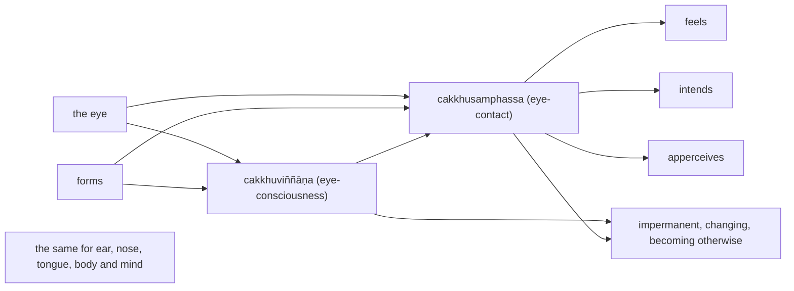

import { Tabs, TabItem } from '@astrojs/starlight/components';

Original text: [13S4/1.2.4.10 Dutiyadvayasutta 449–455](https://tipitaka2500.github.io/tipitaka/13S4/1/1.2/1.2.4/1.2.4.10.html#449) in the [World Tipitaka Edition](https://tipitaka2500.github.io)

## Summary

The Bhagavā explains to the bhikkhū how consciousness arises dependent on a pair: for each sense, the organ and its objects give rise to the corresponding consciousness, and the meeting of the three is contact. The members of the pair, the consciousness, the reason and cause of its arising, and the contact are all impermanent, changing and becoming otherwise, so nothing arisen from an impermanent cause could be permanent; touched, one feels, intends and apperceives, and these too are unsteady and changing. The sutta closes the Channavagga, whose summary verse follows it.

## Diagram

## Text

<Tabs syncKey="paliquote">
<TabItem label="My Translation">
(93.)

449\. “Bhikkhave, `viññāṇa` (consciousness) arises dependent on a pair. And how, Bhikkhave, does consciousness arise dependent on a pair? Dependent on the eye and forms, `cakkhuviññāṇa` (eye-consciousness) arises. The eye is impermanent, changing, becoming otherwise. Forms are impermanent, changing, becoming otherwise. Thus this pair is unsteady and wavering, impermanent, changing, becoming otherwise. Eye-consciousness is impermanent, changing, becoming otherwise. Whatever reason, whatever cause there is for the arising of eye-consciousness, that reason too, that cause too, is impermanent, changing, becoming otherwise. Now, Bhikkhave, eye-consciousness that has arisen dependent on an impermanent cause — how could it be permanent? The meeting, Bhikkhave, the gathering, the coming together of these three phenomena — this is called `cakkhusamphassa` (eye-contact). Eye-contact too is impermanent, changing, becoming otherwise. Whatever reason, whatever cause there is for the arising of eye-contact, that reason too, that cause too, is impermanent, changing, becoming otherwise. Now, Bhikkhave, eye-contact that has arisen dependent on an impermanent cause — how could it be permanent? Touched, Bhikkhave, one feels; touched, one intends; touched, one apperceives. Thus these phenomena too are unsteady and wavering, impermanent, changing, becoming otherwise … and so on …

450\. Dependent on the tongue and tastes, tongue-consciousness arises. The tongue is impermanent, changing, becoming otherwise. Tastes are impermanent, changing, becoming otherwise. Thus this pair is unsteady and wavering, impermanent, changing, becoming otherwise. Tongue-consciousness is impermanent, changing, becoming otherwise. Whatever reason, whatever cause there is for the arising of tongue-consciousness, that reason too, that cause too, is impermanent, changing, becoming otherwise. Now, Bhikkhave, tongue-consciousness that has arisen dependent on an impermanent cause — how could it be permanent? The meeting, Bhikkhave, the gathering, the coming together of these three phenomena — this is called tongue-contact. Tongue-contact too is impermanent, changing, becoming otherwise. Whatever reason, whatever cause there is for the arising of tongue-contact, that reason too, that cause too, is impermanent, changing, becoming otherwise. Now, Bhikkhave, tongue-contact that has arisen dependent on an impermanent cause — how could it be permanent? Touched, Bhikkhave, one feels; touched, one intends; touched, one apperceives. Thus these phenomena too are unsteady and wavering, impermanent, changing, becoming otherwise … and so on …

451\. Dependent on the mind and mental phenomena, mind-consciousness arises. The mind is impermanent, changing, becoming otherwise. Mental phenomena are impermanent, changing, becoming otherwise. Thus this pair is unsteady and wavering, impermanent, changing, becoming otherwise. Mind-consciousness is impermanent, changing, becoming otherwise. Whatever reason, whatever cause there is for the arising of mind-consciousness, that reason too, that cause too, is impermanent, changing, becoming otherwise. Now, Bhikkhave, mind-consciousness that has arisen dependent on an impermanent cause — how could it be permanent? The meeting, Bhikkhave, the gathering, the coming together of these three phenomena — this is called mind-contact. Mind-contact too is impermanent, changing, becoming otherwise. Whatever reason, whatever cause there is for the arising of mind-contact, that reason too, that cause too, is impermanent, changing, becoming otherwise. Now, Bhikkhave, mind-contact that has arisen dependent on an impermanent cause — how could it be permanent? Touched, Bhikkhave, one feels; touched, one intends; touched, one apperceives. Thus these phenomena too are unsteady and wavering, impermanent, changing, becoming otherwise. Thus, Bhikkhave, consciousness arises dependent on a pair.”

452\. The tenth [discourse of the chapter].

453\. The Channa chapter, the fourth.

454\. Its summary:

455\. _Paloka, Suñña, Saṃkhitta,_ \
_Channa, Puṇṇa and Bāhiya;_ \
_And two spoken with Ejā,_ \
_another two with Dvaya._
</TabItem>

<TabItem label="Pāḷi (Roman IAST)">
(93.)

449\. “Dvayaṃ, bhikkhave, paṭicca viññāṇaṃ sambhoti. Kathañca, bhikkhave, dvayaṃ paṭicca viññāṇaṃ sambhoti? Cakkhuñca paṭicca rūpe ca uppajjati cakkhuviññāṇaṃ. Cakkhu aniccaṃ vipariṇāmi aññathābhāvi. Rūpā aniccā vipariṇāmino aññathābhāvino. Itthetaṃ dvayaṃ calañceva byathañca aniccaṃ vipariṇāmi aññathābhāvi. Cakkhuviññāṇaṃ aniccaṃ vipariṇāmi aññathābhāvi. Yopi hetu yopi paccayo cakkhuviññāṇassa uppādāya, sopi hetu sopi paccayo anicco vipariṇāmī aññathābhāvī. Aniccaṃ kho pana, bhikkhave, paccayaṃ paṭicca uppannaṃ cakkhuviññāṇaṃ kuto niccaṃ bhavissati. Yā kho, bhikkhave, imesaṃ tiṇṇaṃ dhammānaṃ saṅgati sannipāto samavāyo, ayaṃ vuccati cakkhusamphasso. Cakkhusamphassopi anicco vipariṇāmī aññathābhāvī. Yopi hetu yopi paccayo cakkhusamphassassa uppādāya, sopi hetu sopi paccayo anicco vipariṇāmī aññathābhāvī. Aniccaṃ kho pana, bhikkhave, paccayaṃ paṭicca uppanno cakkhusamphasso kuto nicco bhavissati. Phuṭṭho, bhikkhave, vedeti, phuṭṭho ceteti, phuṭṭho sañjānāti. Itthetepi dhammā calā ceva byathā ca aniccā vipariṇāmino aññathābhāvino…pe…

450\. Jivhañca paṭicca rase ca uppajjati jivhāviññāṇaṃ. Jivhā aniccā vipariṇāmī aññathābhāvī. Rasā aniccā vipariṇāmino aññathābhāvino. Itthetaṃ dvayaṃ calañceva byathañca aniccaṃ vipariṇāmi aññathābhāvi. Jivhāviññāṇaṃ aniccaṃ vipariṇāmi aññathābhāvi. Yopi hetu yopi paccayo jivhāviññāṇassa uppādāya, sopi hetu sopi paccayo anicco vipariṇāmī aññathābhāvī. Aniccaṃ kho pana, bhikkhave, paccayaṃ paṭicca uppannaṃ jivhāviññāṇaṃ, kuto niccaṃ bhavissati. Yā kho, bhikkhave, imesaṃ tiṇṇaṃ dhammānaṃ saṅgati sannipāto samavāyo, ayaṃ vuccati jivhāsamphasso. Jivhāsamphassopi anicco vipariṇāmī aññathābhāvī. Yopi hetu yopi paccayo jivhāsamphassassa uppādāya, sopi hetu sopi paccayo anicco vipariṇāmī aññathābhāvī. Aniccaṃ kho pana, bhikkhave, paccayaṃ paṭicca uppanno jivhāsamphasso, kuto nicco bhavissati. Phuṭṭho, bhikkhave, vedeti, phuṭṭho ceteti, phuṭṭho sañjānāti. Itthetepi dhammā calā ceva byathā ca aniccā vipariṇāmino aññathābhāvino…pe…

451\. Manañca paṭicca dhamme ca uppajjati manoviññāṇaṃ. Mano anicco vipariṇāmī aññathābhāvī. Dhammā aniccā vipariṇāmino aññathābhāvino. Itthetaṃ dvayaṃ calañceva byathañca aniccaṃ vipariṇāmi aññathābhāvi. Manoviññāṇaṃ aniccaṃ vipariṇāmi aññathābhāvi. Yopi hetu yopi paccayo manoviññāṇassa uppādāya, sopi hetu sopi paccayo anicco vipariṇāmī aññathābhāvī. Aniccaṃ kho pana, bhikkhave, paccayaṃ paṭicca uppannaṃ manoviññāṇaṃ, kuto niccaṃ bhavissati. Yā kho, bhikkhave, imesaṃ tiṇṇaṃ dhammānaṃ saṅgati sannipāto samavāyo, ayaṃ vuccati manosamphasso. Manosamphassopi anicco vipariṇāmī aññathābhāvī. Yopi hetu yopi paccayo manosamphassassa uppādāya, sopi hetu sopi paccayo anicco vipariṇāmī aññathābhāvī. Aniccaṃ kho pana, bhikkhave, paccayaṃ paṭicca uppanno manosamphasso, kuto nicco bhavissati. Phuṭṭho, bhikkhave, vedeti, phuṭṭho ceteti, phuṭṭho sañjānāti. Itthetepi dhammā calā ceva byathā ca aniccā vipariṇāmino aññathābhāvino. Evaṃ kho, bhikkhave, dvayaṃ paṭicca viññāṇaṃ sambhotī”ti.

452\. Dasamaṃ.

453\. Channavaggo catuttho.

454\. Tassuddānaṃ

455\. _Palokasuññā saṃkhittaṃ,_  
_channo puṇṇo ca bāhiyo;_  
_Ejena ca duve vuttā,_  
_dvayehi apare duveti._
</TabItem>

<TabItem label="Pāḷi (Brahmi)">
(93.)

449\. “𑀤𑁆𑀯𑀬𑀁, 𑀪𑀺𑀓𑁆𑀔𑀯𑁂, 𑀧𑀝𑀺𑀘𑁆𑀘 𑀯𑀺𑀜𑁆𑀜𑀸𑀡𑀁 𑀲𑀫𑁆𑀪𑁄𑀢𑀺. 𑀓𑀣𑀜𑁆𑀘, 𑀪𑀺𑀓𑁆𑀔𑀯𑁂, 𑀤𑁆𑀯𑀬𑀁 𑀧𑀝𑀺𑀘𑁆𑀘 𑀯𑀺𑀜𑁆𑀜𑀸𑀡𑀁 𑀲𑀫𑁆𑀪𑁄𑀢𑀺? 𑀘𑀓𑁆𑀔𑀼𑀜𑁆𑀘 𑀧𑀝𑀺𑀘𑁆𑀘 𑀭𑀽𑀧𑁂 𑀘 𑀉𑀧𑁆𑀧𑀚𑁆𑀚𑀢𑀺 𑀘𑀓𑁆𑀔𑀼𑀯𑀺𑀜𑁆𑀜𑀸𑀡𑀁. 𑀘𑀓𑁆𑀔𑀼 𑀅𑀦𑀺𑀘𑁆𑀘𑀁 𑀯𑀺𑀧𑀭𑀺𑀡𑀸𑀫𑀺 𑀅𑀜𑁆𑀜𑀣𑀸𑀪𑀸𑀯𑀺. 𑀭𑀽𑀧𑀸 𑀅𑀦𑀺𑀘𑁆𑀘𑀸 𑀯𑀺𑀧𑀭𑀺𑀡𑀸𑀫𑀺𑀦𑁄 𑀅𑀜𑁆𑀜𑀣𑀸𑀪𑀸𑀯𑀺𑀦𑁄. 𑀇𑀢𑁆𑀣𑁂𑀢𑀁 𑀤𑁆𑀯𑀬𑀁 𑀘𑀮𑀜𑁆𑀘𑁂𑀯 𑀩𑁆𑀬𑀣𑀜𑁆𑀘 𑀅𑀦𑀺𑀘𑁆𑀘𑀁 𑀯𑀺𑀧𑀭𑀺𑀡𑀸𑀫𑀺 𑀅𑀜𑁆𑀜𑀣𑀸𑀪𑀸𑀯𑀺. 𑀘𑀓𑁆𑀔𑀼𑀯𑀺𑀜𑁆𑀜𑀸𑀡𑀁 𑀅𑀦𑀺𑀘𑁆𑀘𑀁 𑀯𑀺𑀧𑀭𑀺𑀡𑀸𑀫𑀺 𑀅𑀜𑁆𑀜𑀣𑀸𑀪𑀸𑀯𑀺. 𑀬𑁄𑀧𑀺 𑀳𑁂𑀢𑀼 𑀬𑁄𑀧𑀺 𑀧𑀘𑁆𑀘𑀬𑁄 𑀘𑀓𑁆𑀔𑀼𑀯𑀺𑀜𑁆𑀜𑀸𑀡𑀲𑁆𑀲 𑀉𑀧𑁆𑀧𑀸𑀤𑀸𑀬, 𑀲𑁄𑀧𑀺 𑀳𑁂𑀢𑀼 𑀲𑁄𑀧𑀺 𑀧𑀘𑁆𑀘𑀬𑁄 𑀅𑀦𑀺𑀘𑁆𑀘𑁄 𑀯𑀺𑀧𑀭𑀺𑀡𑀸𑀫𑀻 𑀅𑀜𑁆𑀜𑀣𑀸𑀪𑀸𑀯𑀻. 𑀅𑀦𑀺𑀘𑁆𑀘𑀁 𑀔𑁄 𑀧𑀦, 𑀪𑀺𑀓𑁆𑀔𑀯𑁂, 𑀧𑀘𑁆𑀘𑀬𑀁 𑀧𑀝𑀺𑀘𑁆𑀘 𑀉𑀧𑁆𑀧𑀦𑁆𑀦𑀁 𑀘𑀓𑁆𑀔𑀼𑀯𑀺𑀜𑁆𑀜𑀸𑀡𑀁 𑀓𑀼𑀢𑁄 𑀦𑀺𑀘𑁆𑀘𑀁 𑀪𑀯𑀺𑀲𑁆𑀲𑀢𑀺. 𑀬𑀸 𑀔𑁄, 𑀪𑀺𑀓𑁆𑀔𑀯𑁂, 𑀇𑀫𑁂𑀲𑀁 𑀢𑀺𑀡𑁆𑀡𑀁 𑀥𑀫𑁆𑀫𑀸𑀦𑀁 𑀲𑀗𑁆𑀕𑀢𑀺 𑀲𑀦𑁆𑀦𑀺𑀧𑀸𑀢𑁄 𑀲𑀫𑀯𑀸𑀬𑁄, 𑀅𑀬𑀁 𑀯𑀼𑀘𑁆𑀘𑀢𑀺 𑀘𑀓𑁆𑀔𑀼𑀲𑀫𑁆𑀨𑀲𑁆𑀲𑁄. 𑀘𑀓𑁆𑀔𑀼𑀲𑀫𑁆𑀨𑀲𑁆𑀲𑁄𑀧𑀺 𑀅𑀦𑀺𑀘𑁆𑀘𑁄 𑀯𑀺𑀧𑀭𑀺𑀡𑀸𑀫𑀻 𑀅𑀜𑁆𑀜𑀣𑀸𑀪𑀸𑀯𑀻. 𑀬𑁄𑀧𑀺 𑀳𑁂𑀢𑀼 𑀬𑁄𑀧𑀺 𑀧𑀘𑁆𑀘𑀬𑁄 𑀘𑀓𑁆𑀔𑀼𑀲𑀫𑁆𑀨𑀲𑁆𑀲𑀲𑁆𑀲 𑀉𑀧𑁆𑀧𑀸𑀤𑀸𑀬, 𑀲𑁄𑀧𑀺 𑀳𑁂𑀢𑀼 𑀲𑁄𑀧𑀺 𑀧𑀘𑁆𑀘𑀬𑁄 𑀅𑀦𑀺𑀘𑁆𑀘𑁄 𑀯𑀺𑀧𑀭𑀺𑀡𑀸𑀫𑀻 𑀅𑀜𑁆𑀜𑀣𑀸𑀪𑀸𑀯𑀻. 𑀅𑀦𑀺𑀘𑁆𑀘𑀁 𑀔𑁄 𑀧𑀦, 𑀪𑀺𑀓𑁆𑀔𑀯𑁂, 𑀧𑀘𑁆𑀘𑀬𑀁 𑀧𑀝𑀺𑀘𑁆𑀘 𑀉𑀧𑁆𑀧𑀦𑁆𑀦𑁄 𑀘𑀓𑁆𑀔𑀼𑀲𑀫𑁆𑀨𑀲𑁆𑀲𑁄 𑀓𑀼𑀢𑁄 𑀦𑀺𑀘𑁆𑀘𑁄 𑀪𑀯𑀺𑀲𑁆𑀲𑀢𑀺. 𑀨𑀼𑀝𑁆𑀞𑁄, 𑀪𑀺𑀓𑁆𑀔𑀯𑁂, 𑀯𑁂𑀤𑁂𑀢𑀺, 𑀨𑀼𑀝𑁆𑀞𑁄 𑀘𑁂𑀢𑁂𑀢𑀺, 𑀨𑀼𑀝𑁆𑀞𑁄 𑀲𑀜𑁆𑀚𑀸𑀦𑀸𑀢𑀺. 𑀇𑀢𑁆𑀣𑁂𑀢𑁂𑀧𑀺 𑀥𑀫𑁆𑀫𑀸 𑀘𑀮𑀸 𑀘𑁂𑀯 𑀩𑁆𑀬𑀣𑀸 𑀘 𑀅𑀦𑀺𑀘𑁆𑀘𑀸 𑀯𑀺𑀧𑀭𑀺𑀡𑀸𑀫𑀺𑀦𑁄 𑀅𑀜𑁆𑀜𑀣𑀸𑀪𑀸𑀯𑀺𑀦𑁄…𑀧𑁂…

450\. 𑀚𑀺𑀯𑁆𑀳𑀜𑁆𑀘 𑀧𑀝𑀺𑀘𑁆𑀘 𑀭𑀲𑁂 𑀘 𑀉𑀧𑁆𑀧𑀚𑁆𑀚𑀢𑀺 𑀚𑀺𑀯𑁆𑀳𑀸𑀯𑀺𑀜𑁆𑀜𑀸𑀡𑀁. 𑀚𑀺𑀯𑁆𑀳𑀸 𑀅𑀦𑀺𑀘𑁆𑀘𑀸 𑀯𑀺𑀧𑀭𑀺𑀡𑀸𑀫𑀻 𑀅𑀜𑁆𑀜𑀣𑀸𑀪𑀸𑀯𑀻. 𑀭𑀲𑀸 𑀅𑀦𑀺𑀘𑁆𑀘𑀸 𑀯𑀺𑀧𑀭𑀺𑀡𑀸𑀫𑀺𑀦𑁄 𑀅𑀜𑁆𑀜𑀣𑀸𑀪𑀸𑀯𑀺𑀦𑁄. 𑀇𑀢𑁆𑀣𑁂𑀢𑀁 𑀤𑁆𑀯𑀬𑀁 𑀘𑀮𑀜𑁆𑀘𑁂𑀯 𑀩𑁆𑀬𑀣𑀜𑁆𑀘 𑀅𑀦𑀺𑀘𑁆𑀘𑀁 𑀯𑀺𑀧𑀭𑀺𑀡𑀸𑀫𑀺 𑀅𑀜𑁆𑀜𑀣𑀸𑀪𑀸𑀯𑀺. 𑀚𑀺𑀯𑁆𑀳𑀸𑀯𑀺𑀜𑁆𑀜𑀸𑀡𑀁 𑀅𑀦𑀺𑀘𑁆𑀘𑀁 𑀯𑀺𑀧𑀭𑀺𑀡𑀸𑀫𑀺 𑀅𑀜𑁆𑀜𑀣𑀸𑀪𑀸𑀯𑀺. 𑀬𑁄𑀧𑀺 𑀳𑁂𑀢𑀼 𑀬𑁄𑀧𑀺 𑀧𑀘𑁆𑀘𑀬𑁄 𑀚𑀺𑀯𑁆𑀳𑀸𑀯𑀺𑀜𑁆𑀜𑀸𑀡𑀲𑁆𑀲 𑀉𑀧𑁆𑀧𑀸𑀤𑀸𑀬, 𑀲𑁄𑀧𑀺 𑀳𑁂𑀢𑀼 𑀲𑁄𑀧𑀺 𑀧𑀘𑁆𑀘𑀬𑁄 𑀅𑀦𑀺𑀘𑁆𑀘𑁄 𑀯𑀺𑀧𑀭𑀺𑀡𑀸𑀫𑀻 𑀅𑀜𑁆𑀜𑀣𑀸𑀪𑀸𑀯𑀻. 𑀅𑀦𑀺𑀘𑁆𑀘𑀁 𑀔𑁄 𑀧𑀦, 𑀪𑀺𑀓𑁆𑀔𑀯𑁂, 𑀧𑀘𑁆𑀘𑀬𑀁 𑀧𑀝𑀺𑀘𑁆𑀘 𑀉𑀧𑁆𑀧𑀦𑁆𑀦𑀁 𑀚𑀺𑀯𑁆𑀳𑀸𑀯𑀺𑀜𑁆𑀜𑀸𑀡𑀁, 𑀓𑀼𑀢𑁄 𑀦𑀺𑀘𑁆𑀘𑀁 𑀪𑀯𑀺𑀲𑁆𑀲𑀢𑀺. 𑀬𑀸 𑀔𑁄, 𑀪𑀺𑀓𑁆𑀔𑀯𑁂, 𑀇𑀫𑁂𑀲𑀁 𑀢𑀺𑀡𑁆𑀡𑀁 𑀥𑀫𑁆𑀫𑀸𑀦𑀁 𑀲𑀗𑁆𑀕𑀢𑀺 𑀲𑀦𑁆𑀦𑀺𑀧𑀸𑀢𑁄 𑀲𑀫𑀯𑀸𑀬𑁄, 𑀅𑀬𑀁 𑀯𑀼𑀘𑁆𑀘𑀢𑀺 𑀚𑀺𑀯𑁆𑀳𑀸𑀲𑀫𑁆𑀨𑀲𑁆𑀲𑁄. 𑀚𑀺𑀯𑁆𑀳𑀸𑀲𑀫𑁆𑀨𑀲𑁆𑀲𑁄𑀧𑀺 𑀅𑀦𑀺𑀘𑁆𑀘𑁄 𑀯𑀺𑀧𑀭𑀺𑀡𑀸𑀫𑀻 𑀅𑀜𑁆𑀜𑀣𑀸𑀪𑀸𑀯𑀻. 𑀬𑁄𑀧𑀺 𑀳𑁂𑀢𑀼 𑀬𑁄𑀧𑀺 𑀧𑀘𑁆𑀘𑀬𑁄 𑀚𑀺𑀯𑁆𑀳𑀸𑀲𑀫𑁆𑀨𑀲𑁆𑀲𑀲𑁆𑀲 𑀉𑀧𑁆𑀧𑀸𑀤𑀸𑀬, 𑀲𑁄𑀧𑀺 𑀳𑁂𑀢𑀼 𑀲𑁄𑀧𑀺 𑀧𑀘𑁆𑀘𑀬𑁄 𑀅𑀦𑀺𑀘𑁆𑀘𑁄 𑀯𑀺𑀧𑀭𑀺𑀡𑀸𑀫𑀻 𑀅𑀜𑁆𑀜𑀣𑀸𑀪𑀸𑀯𑀻. 𑀅𑀦𑀺𑀘𑁆𑀘𑀁 𑀔𑁄 𑀧𑀦, 𑀪𑀺𑀓𑁆𑀔𑀯𑁂, 𑀧𑀘𑁆𑀘𑀬𑀁 𑀧𑀝𑀺𑀘𑁆𑀘 𑀉𑀧𑁆𑀧𑀦𑁆𑀦𑁄 𑀚𑀺𑀯𑁆𑀳𑀸𑀲𑀫𑁆𑀨𑀲𑁆𑀲𑁄, 𑀓𑀼𑀢𑁄 𑀦𑀺𑀘𑁆𑀘𑁄 𑀪𑀯𑀺𑀲𑁆𑀲𑀢𑀺. 𑀨𑀼𑀝𑁆𑀞𑁄, 𑀪𑀺𑀓𑁆𑀔𑀯𑁂, 𑀯𑁂𑀤𑁂𑀢𑀺, 𑀨𑀼𑀝𑁆𑀞𑁄 𑀘𑁂𑀢𑁂𑀢𑀺, 𑀨𑀼𑀝𑁆𑀞𑁄 𑀲𑀜𑁆𑀚𑀸𑀦𑀸𑀢𑀺. 𑀇𑀢𑁆𑀣𑁂𑀢𑁂𑀧𑀺 𑀥𑀫𑁆𑀫𑀸 𑀘𑀮𑀸 𑀘𑁂𑀯 𑀩𑁆𑀬𑀣𑀸 𑀘 𑀅𑀦𑀺𑀘𑁆𑀘𑀸 𑀯𑀺𑀧𑀭𑀺𑀡𑀸𑀫𑀺𑀦𑁄 𑀅𑀜𑁆𑀜𑀣𑀸𑀪𑀸𑀯𑀺𑀦𑁄…𑀧𑁂…

451\. 𑀫𑀦𑀜𑁆𑀘 𑀧𑀝𑀺𑀘𑁆𑀘 𑀥𑀫𑁆𑀫𑁂 𑀘 𑀉𑀧𑁆𑀧𑀚𑁆𑀚𑀢𑀺 𑀫𑀦𑁄𑀯𑀺𑀜𑁆𑀜𑀸𑀡𑀁. 𑀫𑀦𑁄 𑀅𑀦𑀺𑀘𑁆𑀘𑁄 𑀯𑀺𑀧𑀭𑀺𑀡𑀸𑀫𑀻 𑀅𑀜𑁆𑀜𑀣𑀸𑀪𑀸𑀯𑀻. 𑀥𑀫𑁆𑀫𑀸 𑀅𑀦𑀺𑀘𑁆𑀘𑀸 𑀯𑀺𑀧𑀭𑀺𑀡𑀸𑀫𑀺𑀦𑁄 𑀅𑀜𑁆𑀜𑀣𑀸𑀪𑀸𑀯𑀺𑀦𑁄. 𑀇𑀢𑁆𑀣𑁂𑀢𑀁 𑀤𑁆𑀯𑀬𑀁 𑀘𑀮𑀜𑁆𑀘𑁂𑀯 𑀩𑁆𑀬𑀣𑀜𑁆𑀘 𑀅𑀦𑀺𑀘𑁆𑀘𑀁 𑀯𑀺𑀧𑀭𑀺𑀡𑀸𑀫𑀺 𑀅𑀜𑁆𑀜𑀣𑀸𑀪𑀸𑀯𑀺. 𑀫𑀦𑁄𑀯𑀺𑀜𑁆𑀜𑀸𑀡𑀁 𑀅𑀦𑀺𑀘𑁆𑀘𑀁 𑀯𑀺𑀧𑀭𑀺𑀡𑀸𑀫𑀺 𑀅𑀜𑁆𑀜𑀣𑀸𑀪𑀸𑀯𑀺. 𑀬𑁄𑀧𑀺 𑀳𑁂𑀢𑀼 𑀬𑁄𑀧𑀺 𑀧𑀘𑁆𑀘𑀬𑁄 𑀫𑀦𑁄𑀯𑀺𑀜𑁆𑀜𑀸𑀡𑀲𑁆𑀲 𑀉𑀧𑁆𑀧𑀸𑀤𑀸𑀬, 𑀲𑁄𑀧𑀺 𑀳𑁂𑀢𑀼 𑀲𑁄𑀧𑀺 𑀧𑀘𑁆𑀘𑀬𑁄 𑀅𑀦𑀺𑀘𑁆𑀘𑁄 𑀯𑀺𑀧𑀭𑀺𑀡𑀸𑀫𑀻 𑀅𑀜𑁆𑀜𑀣𑀸𑀪𑀸𑀯𑀻. 𑀅𑀦𑀺𑀘𑁆𑀘𑀁 𑀔𑁄 𑀧𑀦, 𑀪𑀺𑀓𑁆𑀔𑀯𑁂, 𑀧𑀘𑁆𑀘𑀬𑀁 𑀧𑀝𑀺𑀘𑁆𑀘 𑀉𑀧𑁆𑀧𑀦𑁆𑀦𑀁 𑀫𑀦𑁄𑀯𑀺𑀜𑁆𑀜𑀸𑀡𑀁, 𑀓𑀼𑀢𑁄 𑀦𑀺𑀘𑁆𑀘𑀁 𑀪𑀯𑀺𑀲𑁆𑀲𑀢𑀺. 𑀬𑀸 𑀔𑁄, 𑀪𑀺𑀓𑁆𑀔𑀯𑁂, 𑀇𑀫𑁂𑀲𑀁 𑀢𑀺𑀡𑁆𑀡𑀁 𑀥𑀫𑁆𑀫𑀸𑀦𑀁 𑀲𑀗𑁆𑀕𑀢𑀺 𑀲𑀦𑁆𑀦𑀺𑀧𑀸𑀢𑁄 𑀲𑀫𑀯𑀸𑀬𑁄, 𑀅𑀬𑀁 𑀯𑀼𑀘𑁆𑀘𑀢𑀺 𑀫𑀦𑁄𑀲𑀫𑁆𑀨𑀲𑁆𑀲𑁄. 𑀫𑀦𑁄𑀲𑀫𑁆𑀨𑀲𑁆𑀲𑁄𑀧𑀺 𑀅𑀦𑀺𑀘𑁆𑀘𑁄 𑀯𑀺𑀧𑀭𑀺𑀡𑀸𑀫𑀻 𑀅𑀜𑁆𑀜𑀣𑀸𑀪𑀸𑀯𑀻. 𑀬𑁄𑀧𑀺 𑀳𑁂𑀢𑀼 𑀬𑁄𑀧𑀺 𑀧𑀘𑁆𑀘𑀬𑁄 𑀫𑀦𑁄𑀲𑀫𑁆𑀨𑀲𑁆𑀲𑀲𑁆𑀲 𑀉𑀧𑁆𑀧𑀸𑀤𑀸𑀬, 𑀲𑁄𑀧𑀺 𑀳𑁂𑀢𑀼 𑀲𑁄𑀧𑀺 𑀧𑀘𑁆𑀘𑀬𑁄 𑀅𑀦𑀺𑀘𑁆𑀘𑁄 𑀯𑀺𑀧𑀭𑀺𑀡𑀸𑀫𑀻 𑀅𑀜𑁆𑀜𑀣𑀸𑀪𑀸𑀯𑀻. 𑀅𑀦𑀺𑀘𑁆𑀘𑀁 𑀔𑁄 𑀧𑀦, 𑀪𑀺𑀓𑁆𑀔𑀯𑁂, 𑀧𑀘𑁆𑀘𑀬𑀁 𑀧𑀝𑀺𑀘𑁆𑀘 𑀉𑀧𑁆𑀧𑀦𑁆𑀦𑁄 𑀫𑀦𑁄𑀲𑀫𑁆𑀨𑀲𑁆𑀲𑁄, 𑀓𑀼𑀢𑁄 𑀦𑀺𑀘𑁆𑀘𑁄 𑀪𑀯𑀺𑀲𑁆𑀲𑀢𑀺. 𑀨𑀼𑀝𑁆𑀞𑁄, 𑀪𑀺𑀓𑁆𑀔𑀯𑁂, 𑀯𑁂𑀤𑁂𑀢𑀺, 𑀨𑀼𑀝𑁆𑀞𑁄 𑀘𑁂𑀢𑁂𑀢𑀺, 𑀨𑀼𑀝𑁆𑀞𑁄 𑀲𑀜𑁆𑀚𑀸𑀦𑀸𑀢𑀺. 𑀇𑀢𑁆𑀣𑁂𑀢𑁂𑀧𑀺 𑀥𑀫𑁆𑀫𑀸 𑀘𑀮𑀸 𑀘𑁂𑀯 𑀩𑁆𑀬𑀣𑀸 𑀘 𑀅𑀦𑀺𑀘𑁆𑀘𑀸 𑀯𑀺𑀧𑀭𑀺𑀡𑀸𑀫𑀺𑀦𑁄 𑀅𑀜𑁆𑀜𑀣𑀸𑀪𑀸𑀯𑀺𑀦𑁄. 𑀏𑀯𑀁 𑀔𑁄, 𑀪𑀺𑀓𑁆𑀔𑀯𑁂, 𑀤𑁆𑀯𑀬𑀁 𑀧𑀝𑀺𑀘𑁆𑀘 𑀯𑀺𑀜𑁆𑀜𑀸𑀡𑀁 𑀲𑀫𑁆𑀪𑁄𑀢𑀻”𑀢𑀺.

452\. 𑀤𑀲𑀫𑀁.

453\. 𑀙𑀦𑁆𑀦𑀯𑀕𑁆𑀕𑁄 𑀘𑀢𑀼𑀢𑁆𑀣𑁄.

454\. 𑀢𑀲𑁆𑀲𑀼𑀤𑁆𑀤𑀸𑀦𑀁

455\. _𑀧𑀮𑁄𑀓𑀲𑀼𑀜𑁆𑀜𑀸 𑀲𑀁𑀔𑀺𑀢𑁆𑀢𑀁,_  
_𑀙𑀦𑁆𑀦𑁄 𑀧𑀼𑀡𑁆𑀡𑁄 𑀘 𑀩𑀸𑀳𑀺𑀬𑁄;_  
_𑀏𑀚𑁂𑀦 𑀘 𑀤𑀼𑀯𑁂 𑀯𑀼𑀢𑁆𑀢𑀸,_  
_𑀤𑁆𑀯𑀬𑁂𑀳𑀺 𑀅𑀧𑀭𑁂 𑀤𑀼𑀯𑁂𑀢𑀺._
</TabItem>

<TabItem label="Interlinear">
(93.)

[449](https://tipitaka2500.github.io/tipitaka/13S4/1/1.2/1.2.4/1.2.4.10.html#449) “Dvayaṃ, bhikkhave, paṭicca viññāṇaṃ sambhoti.  
🚻⨀②(dvaya) 🚹⨂⓪(bhikkhu) 🔽(ya)(pacceti) 🚻⨀①(viññāṇa) 🟢⨀🤟▶️(sambhoti)  
a pair | Bhikkhave | dependent on | consciousness | arises  
“Bhikkhave, `viññāṇa` (consciousness) arises dependent on a pair.

Kathañca, bhikkhave, dvayaṃ paṭicca viññāṇaṃ sambhoti?  
⏏️(kathaṃ) ⏏️(ca) 🚹⨂⓪(bhikkhu) 🚻⨀②(dvaya) 🔽(ya)(pacceti) 🚻⨀①(viññāṇa) 🟢⨀🤟▶️(sambhoti)  
how | and | Bhikkhave | a pair | dependent on | consciousness | arises  
And how, Bhikkhave, does consciousness arise dependent on a pair?

Cakkhuñca paṭicca rūpe ca uppajjati cakkhuviññāṇaṃ.  
🚻⨀②(cakkhu) ⏏️(ca) 🔽(ya)(pacceti) 🚻⨂②(rūpa) ⏏️(ca) 🟢⨀🤟▶️(uppajjati) 🚻⨀①🆎(cakkhu+viññāṇa)  
the eye | and | dependent on | forms | and | arises | eye-consciousness  
Dependent on the eye and forms, `cakkhuviññāṇa` (eye-consciousness) arises.

Cakkhu aniccaṃ vipariṇāmi aññathābhāvi.  
🚻⨀①(cakkhu) 🚻⨀①🆎(na+nicca) 🚻⨀①(vipariṇāmī) 🚻⨀①🆎(aññathā+bhāvī)  
the eye | impermanent | changing | becoming otherwise  
The eye is impermanent, changing, becoming otherwise.

Rūpā aniccā vipariṇāmino aññathābhāvino.  
🚻⨂①(rūpa) 🚻⨂①🆎(na+nicca) 🚻⨂①(vipariṇāmī) 🚻⨂①🆎(aññathā+bhāvī)  
forms | impermanent | changing | becoming otherwise  
Forms are impermanent, changing, becoming otherwise.

Itthetaṃ dvayaṃ calañceva byathañca aniccaṃ vipariṇāmi aññathābhāvi.  
⏏️(ittha) *️⃣🤟🚻⨀①(eta) 🚻⨀①(dvaya) 🚻⨀①(cala) ⏏️(ca) ⏏️(eva) 🚻⨀①(byatha) ⏏️(ca) 🚻⨀①🆎(na+nicca) 🚻⨀①(vipariṇāmī) 🚻⨀①🆎(aññathā+bhāvī)  
thus | this | pair | unsteady | and | just | wavering | and | impermanent | changing | becoming otherwise  
Thus this pair is unsteady and wavering, impermanent, changing, becoming otherwise.

Cakkhuviññāṇaṃ aniccaṃ vipariṇāmi aññathābhāvi.  
🚻⨀①🆎(cakkhu+viññāṇa) 🚻⨀①🆎(na+nicca) 🚻⨀①(vipariṇāmī) 🚻⨀①🆎(aññathā+bhāvī)  
eye-consciousness | impermanent | changing | becoming otherwise  
Eye-consciousness is impermanent, changing, becoming otherwise.

Yopi hetu yopi paccayo cakkhuviññāṇassa uppādāya, sopi hetu sopi paccayo anicco vipariṇāmī aññathābhāvī.  
*️⃣🤟🚹⨀①(ya) ⏏️(api) 🚹⨀①(hetu) *️⃣🤟🚹⨀①(ya) ⏏️(api) 🚹⨀①(paccaya) 🚻⨀⑥🆎(cakkhu+viññāṇa) 🚹⨀④(uppāda) *️⃣🤟🚹⨀①(ta) ⏏️(api) 🚹⨀①(hetu) *️⃣🤟🚹⨀①(ta) ⏏️(api) 🚹⨀①(paccaya) 🚹⨀①🆎(na+nicca) 🚹⨀①(vipariṇāmī) 🚹⨀①🆎(aññathā+bhāvī)  
whatever | also | reason | whatever | also | cause | of eye-consciousness | for the arising | that | too | reason | that | too | cause | impermanent | changing | becoming otherwise  
Whatever reason, whatever cause there is for the arising of eye-consciousness, that reason too, that cause too, is impermanent, changing, becoming otherwise.

Aniccaṃ kho pana, bhikkhave, paccayaṃ paṭicca uppannaṃ cakkhuviññāṇaṃ kuto niccaṃ bhavissati.  
🚹⨀②🆎(na+nicca) ⏏️(kho) ⏏️(pana) 🚹⨂⓪(bhikkhu) 🚹⨀②(paccaya) 🔽(ya)(pacceti) 🚻⨀①🔽(ta)(uppanna) 🚻⨀①🆎(cakkhu+viññāṇa) ⏏️(kuto) 🚻⨀①(nicca) 🟢⨀🤟⏭(bhavati)  
impermanent | indeed | now | Bhikkhave | cause | dependent on | arisen | eye-consciousness | how | permanent | could be  
Now, Bhikkhave, eye-consciousness that has arisen dependent on an impermanent cause — how could it be permanent?

Yā kho, bhikkhave, imesaṃ tiṇṇaṃ dhammānaṃ saṅgati sannipāto samavāyo, ayaṃ vuccati cakkhusamphasso.  
*️⃣🤟🚺⨀①(ya) ⏏️(kho) 🚹⨂⓪(bhikkhu) *️⃣🤟🚹⨂⑥(ima) 🚹⨂⑥(ti) 🚹⨂⑥(dhamma) 🚺⨀①(saṅgati) 🚹⨀①(sannipāta) 🚹⨀①(samavāya) *️⃣🤟🚹⨀①(ima) 🔴⨀🤟▶️(vuccati) 🚹⨀①🆎(cakkhu+samphassa)  
whatever | indeed | Bhikkhave | of these | three | phenomena | meeting | gathering | coming together | this | is called | eye-contact  
The meeting, Bhikkhave, the gathering, the coming together of these three phenomena — this is called `cakkhusamphassa` (eye-contact).

Cakkhusamphassopi anicco vipariṇāmī aññathābhāvī.  
🚹⨀①🆎(cakkhu+samphassa) ⏏️(api) 🚹⨀①🆎(na+nicca) 🚹⨀①(vipariṇāmī) 🚹⨀①🆎(aññathā+bhāvī)  
eye-contact | too | impermanent | changing | becoming otherwise  
Eye-contact too is impermanent, changing, becoming otherwise.

Yopi hetu yopi paccayo cakkhusamphassassa uppādāya, sopi hetu sopi paccayo anicco vipariṇāmī aññathābhāvī.  
*️⃣🤟🚹⨀①(ya) ⏏️(api) 🚹⨀①(hetu) *️⃣🤟🚹⨀①(ya) ⏏️(api) 🚹⨀①(paccaya) 🚹⨀⑥🆎(cakkhu+samphassa) 🚹⨀④(uppāda) *️⃣🤟🚹⨀①(ta) ⏏️(api) 🚹⨀①(hetu) *️⃣🤟🚹⨀①(ta) ⏏️(api) 🚹⨀①(paccaya) 🚹⨀①🆎(na+nicca) 🚹⨀①(vipariṇāmī) 🚹⨀①🆎(aññathā+bhāvī)  
whatever | also | reason | whatever | also | cause | of eye-contact | for the arising | that | too | reason | that | too | cause | impermanent | changing | becoming otherwise  
Whatever reason, whatever cause there is for the arising of eye-contact, that reason too, that cause too, is impermanent, changing, becoming otherwise.

Aniccaṃ kho pana, bhikkhave, paccayaṃ paṭicca uppanno cakkhusamphasso kuto nicco bhavissati.  
🚹⨀②🆎(na+nicca) ⏏️(kho) ⏏️(pana) 🚹⨂⓪(bhikkhu) 🚹⨀②(paccaya) 🔽(ya)(pacceti) 🚹⨀①🔽(ta)(uppanna) 🚹⨀①🆎(cakkhu+samphassa) ⏏️(kuto) 🚹⨀①(nicca) 🟢⨀🤟⏭(bhavati)  
impermanent | indeed | now | Bhikkhave | cause | dependent on | arisen | eye-contact | how | permanent | could be  
Now, Bhikkhave, eye-contact that has arisen dependent on an impermanent cause — how could it be permanent?

Phuṭṭho, bhikkhave, vedeti, phuṭṭho ceteti, phuṭṭho sañjānāti.  
🚹⨀①🔽(ta)(phuṭṭha) 🚹⨂⓪(bhikkhu) 🟢⨀🤟▶️(vedeti) 🚹⨀①🔽(ta)(phuṭṭha) 🟢⨀🤟▶️(ceteti) 🚹⨀①🔽(ta)(phuṭṭha) 🟢⨀🤟▶️(sañjānāti)  
touched | Bhikkhave | feels | touched | intends | touched | apperceives  
Touched, Bhikkhave, one feels; touched, one intends; touched, one apperceives.

Itthetepi dhammā calā ceva byathā ca aniccā vipariṇāmino aññathābhāvino…pe…  
⏏️(ittha) *️⃣🤟🚹⨂①(eta) ⏏️(api) 🚹⨂①(dhamma) 🚹⨂①(cala) ⏏️(ca) ⏏️(eva) 🚹⨂①(byatha) ⏏️(ca) 🚹⨂①🆎(na+nicca) 🚹⨂①(vipariṇāmī) 🚹⨂①🆎(aññathā+bhāvī) ⏏️(peyyāla)  
thus | these | too | phenomena | unsteady | and | just | wavering | and | impermanent | changing | becoming otherwise | (and so on)  
Thus these phenomena too are unsteady and wavering, impermanent, changing, becoming otherwise … and so on …

[450](https://tipitaka2500.github.io/tipitaka/13S4/1/1.2/1.2.4/1.2.4.10.html#450) Jivhañca paṭicca rase ca uppajjati jivhāviññāṇaṃ.  
🚺⨀②(jivhā) ⏏️(ca) 🔽(ya)(pacceti) 🚹⨂②(rasa) ⏏️(ca) 🟢⨀🤟▶️(uppajjati) 🚻⨀①🆎(jivhā+viññāṇa)  
the tongue | and | dependent on | tastes | and | arises | tongue-consciousness  
Dependent on the tongue and tastes, tongue-consciousness arises.

Jivhā aniccā vipariṇāmī aññathābhāvī.  
🚺⨀①(jivhā) 🚺⨀①🆎(na+nicca) 🚺⨀①(vipariṇāmī) 🚺⨀①🆎(aññathā+bhāvī)  
the tongue | impermanent | changing | becoming otherwise  
The tongue is impermanent, changing, becoming otherwise.

Rasā aniccā vipariṇāmino aññathābhāvino.  
🚹⨂①(rasa) 🚹⨂①🆎(na+nicca) 🚹⨂①(vipariṇāmī) 🚹⨂①🆎(aññathā+bhāvī)  
tastes | impermanent | changing | becoming otherwise  
Tastes are impermanent, changing, becoming otherwise.

Itthetaṃ dvayaṃ calañceva byathañca aniccaṃ vipariṇāmi aññathābhāvi.  
⏏️(ittha) *️⃣🤟🚻⨀①(eta) 🚻⨀①(dvaya) 🚻⨀①(cala) ⏏️(ca) ⏏️(eva) 🚻⨀①(byatha) ⏏️(ca) 🚻⨀①🆎(na+nicca) 🚻⨀①(vipariṇāmī) 🚻⨀①🆎(aññathā+bhāvī)  
thus | this | pair | unsteady | and | just | wavering | and | impermanent | changing | becoming otherwise  
Thus this pair is unsteady and wavering, impermanent, changing, becoming otherwise.

Jivhāviññāṇaṃ aniccaṃ vipariṇāmi aññathābhāvi.  
🚻⨀①🆎(jivhā+viññāṇa) 🚻⨀①🆎(na+nicca) 🚻⨀①(vipariṇāmī) 🚻⨀①🆎(aññathā+bhāvī)  
tongue-consciousness | impermanent | changing | becoming otherwise  
Tongue-consciousness is impermanent, changing, becoming otherwise.

Yopi hetu yopi paccayo jivhāviññāṇassa uppādāya, sopi hetu sopi paccayo anicco vipariṇāmī aññathābhāvī.  
*️⃣🤟🚹⨀①(ya) ⏏️(api) 🚹⨀①(hetu) *️⃣🤟🚹⨀①(ya) ⏏️(api) 🚹⨀①(paccaya) 🚻⨀⑥🆎(jivhā+viññāṇa) 🚹⨀④(uppāda) *️⃣🤟🚹⨀①(ta) ⏏️(api) 🚹⨀①(hetu) *️⃣🤟🚹⨀①(ta) ⏏️(api) 🚹⨀①(paccaya) 🚹⨀①🆎(na+nicca) 🚹⨀①(vipariṇāmī) 🚹⨀①🆎(aññathā+bhāvī)  
whatever | also | reason | whatever | also | cause | of tongue-consciousness | for the arising | that | too | reason | that | too | cause | impermanent | changing | becoming otherwise  
Whatever reason, whatever cause there is for the arising of tongue-consciousness, that reason too, that cause too, is impermanent, changing, becoming otherwise.

Aniccaṃ kho pana, bhikkhave, paccayaṃ paṭicca uppannaṃ jivhāviññāṇaṃ, kuto niccaṃ bhavissati.  
🚹⨀②🆎(na+nicca) ⏏️(kho) ⏏️(pana) 🚹⨂⓪(bhikkhu) 🚹⨀②(paccaya) 🔽(ya)(pacceti) 🚻⨀①🔽(ta)(uppanna) 🚻⨀①🆎(jivhā+viññāṇa) ⏏️(kuto) 🚻⨀①(nicca) 🟢⨀🤟⏭(bhavati)  
impermanent | indeed | now | Bhikkhave | cause | dependent on | arisen | tongue-consciousness | how | permanent | could be  
Now, Bhikkhave, tongue-consciousness that has arisen dependent on an impermanent cause — how could it be permanent?

Yā kho, bhikkhave, imesaṃ tiṇṇaṃ dhammānaṃ saṅgati sannipāto samavāyo, ayaṃ vuccati jivhāsamphasso.  
*️⃣🤟🚺⨀①(ya) ⏏️(kho) 🚹⨂⓪(bhikkhu) *️⃣🤟🚹⨂⑥(ima) 🚹⨂⑥(ti) 🚹⨂⑥(dhamma) 🚺⨀①(saṅgati) 🚹⨀①(sannipāta) 🚹⨀①(samavāya) *️⃣🤟🚹⨀①(ima) 🔴⨀🤟▶️(vuccati) 🚹⨀①🆎(jivhā+samphassa)  
whatever | indeed | Bhikkhave | of these | three | phenomena | meeting | gathering | coming together | this | is called | tongue-contact  
The meeting, Bhikkhave, the gathering, the coming together of these three phenomena — this is called tongue-contact.

Jivhāsamphassopi anicco vipariṇāmī aññathābhāvī.  
🚹⨀①🆎(jivhā+samphassa) ⏏️(api) 🚹⨀①🆎(na+nicca) 🚹⨀①(vipariṇāmī) 🚹⨀①🆎(aññathā+bhāvī)  
tongue-contact | too | impermanent | changing | becoming otherwise  
Tongue-contact too is impermanent, changing, becoming otherwise.

Yopi hetu yopi paccayo jivhāsamphassassa uppādāya, sopi hetu sopi paccayo anicco vipariṇāmī aññathābhāvī.  
*️⃣🤟🚹⨀①(ya) ⏏️(api) 🚹⨀①(hetu) *️⃣🤟🚹⨀①(ya) ⏏️(api) 🚹⨀①(paccaya) 🚹⨀⑥🆎(jivhā+samphassa) 🚹⨀④(uppāda) *️⃣🤟🚹⨀①(ta) ⏏️(api) 🚹⨀①(hetu) *️⃣🤟🚹⨀①(ta) ⏏️(api) 🚹⨀①(paccaya) 🚹⨀①🆎(na+nicca) 🚹⨀①(vipariṇāmī) 🚹⨀①🆎(aññathā+bhāvī)  
whatever | also | reason | whatever | also | cause | of tongue-contact | for the arising | that | too | reason | that | too | cause | impermanent | changing | becoming otherwise  
Whatever reason, whatever cause there is for the arising of tongue-contact, that reason too, that cause too, is impermanent, changing, becoming otherwise.

Aniccaṃ kho pana, bhikkhave, paccayaṃ paṭicca uppanno jivhāsamphasso, kuto nicco bhavissati.  
🚹⨀②🆎(na+nicca) ⏏️(kho) ⏏️(pana) 🚹⨂⓪(bhikkhu) 🚹⨀②(paccaya) 🔽(ya)(pacceti) 🚹⨀①🔽(ta)(uppanna) 🚹⨀①🆎(jivhā+samphassa) ⏏️(kuto) 🚹⨀①(nicca) 🟢⨀🤟⏭(bhavati)  
impermanent | indeed | now | Bhikkhave | cause | dependent on | arisen | tongue-contact | how | permanent | could be  
Now, Bhikkhave, tongue-contact that has arisen dependent on an impermanent cause — how could it be permanent?

Phuṭṭho, bhikkhave, vedeti, phuṭṭho ceteti, phuṭṭho sañjānāti.  
🚹⨀①🔽(ta)(phuṭṭha) 🚹⨂⓪(bhikkhu) 🟢⨀🤟▶️(vedeti) 🚹⨀①🔽(ta)(phuṭṭha) 🟢⨀🤟▶️(ceteti) 🚹⨀①🔽(ta)(phuṭṭha) 🟢⨀🤟▶️(sañjānāti)  
touched | Bhikkhave | feels | touched | intends | touched | apperceives  
Touched, Bhikkhave, one feels; touched, one intends; touched, one apperceives.

Itthetepi dhammā calā ceva byathā ca aniccā vipariṇāmino aññathābhāvino…pe…  
⏏️(ittha) *️⃣🤟🚹⨂①(eta) ⏏️(api) 🚹⨂①(dhamma) 🚹⨂①(cala) ⏏️(ca) ⏏️(eva) 🚹⨂①(byatha) ⏏️(ca) 🚹⨂①🆎(na+nicca) 🚹⨂①(vipariṇāmī) 🚹⨂①🆎(aññathā+bhāvī) ⏏️(peyyāla)  
thus | these | too | phenomena | unsteady | and | just | wavering | and | impermanent | changing | becoming otherwise | (and so on)  
Thus these phenomena too are unsteady and wavering, impermanent, changing, becoming otherwise … and so on …

[451](https://tipitaka2500.github.io/tipitaka/13S4/1/1.2/1.2.4/1.2.4.10.html#451) Manañca paṭicca dhamme ca uppajjati manoviññāṇaṃ.  
🚹⨀②(mano) ⏏️(ca) 🔽(ya)(pacceti) 🚹⨂②(dhamma) ⏏️(ca) 🟢⨀🤟▶️(uppajjati) 🚻⨀①🆎(mano+viññāṇa)  
the mind | and | dependent on | mental phenomena | and | arises | mind-consciousness  
Dependent on the mind and mental phenomena, mind-consciousness arises.

Mano anicco vipariṇāmī aññathābhāvī.  
🚹⨀①(mano) 🚹⨀①🆎(na+nicca) 🚹⨀①(vipariṇāmī) 🚹⨀①🆎(aññathā+bhāvī)  
the mind | impermanent | changing | becoming otherwise  
The mind is impermanent, changing, becoming otherwise.

Dhammā aniccā vipariṇāmino aññathābhāvino.  
🚹⨂①(dhamma) 🚹⨂①🆎(na+nicca) 🚹⨂①(vipariṇāmī) 🚹⨂①🆎(aññathā+bhāvī)  
mental phenomena | impermanent | changing | becoming otherwise  
Mental phenomena are impermanent, changing, becoming otherwise.

Itthetaṃ dvayaṃ calañceva byathañca aniccaṃ vipariṇāmi aññathābhāvi.  
⏏️(ittha) *️⃣🤟🚻⨀①(eta) 🚻⨀①(dvaya) 🚻⨀①(cala) ⏏️(ca) ⏏️(eva) 🚻⨀①(byatha) ⏏️(ca) 🚻⨀①🆎(na+nicca) 🚻⨀①(vipariṇāmī) 🚻⨀①🆎(aññathā+bhāvī)  
thus | this | pair | unsteady | and | just | wavering | and | impermanent | changing | becoming otherwise  
Thus this pair is unsteady and wavering, impermanent, changing, becoming otherwise.

Manoviññāṇaṃ aniccaṃ vipariṇāmi aññathābhāvi.  
🚻⨀①🆎(mano+viññāṇa) 🚻⨀①🆎(na+nicca) 🚻⨀①(vipariṇāmī) 🚻⨀①🆎(aññathā+bhāvī)  
mind-consciousness | impermanent | changing | becoming otherwise  
Mind-consciousness is impermanent, changing, becoming otherwise.

Yopi hetu yopi paccayo manoviññāṇassa uppādāya, sopi hetu sopi paccayo anicco vipariṇāmī aññathābhāvī.  
*️⃣🤟🚹⨀①(ya) ⏏️(api) 🚹⨀①(hetu) *️⃣🤟🚹⨀①(ya) ⏏️(api) 🚹⨀①(paccaya) 🚻⨀⑥🆎(mano+viññāṇa) 🚹⨀④(uppāda) *️⃣🤟🚹⨀①(ta) ⏏️(api) 🚹⨀①(hetu) *️⃣🤟🚹⨀①(ta) ⏏️(api) 🚹⨀①(paccaya) 🚹⨀①🆎(na+nicca) 🚹⨀①(vipariṇāmī) 🚹⨀①🆎(aññathā+bhāvī)  
whatever | also | reason | whatever | also | cause | of mind-consciousness | for the arising | that | too | reason | that | too | cause | impermanent | changing | becoming otherwise  
Whatever reason, whatever cause there is for the arising of mind-consciousness, that reason too, that cause too, is impermanent, changing, becoming otherwise.

Aniccaṃ kho pana, bhikkhave, paccayaṃ paṭicca uppannaṃ manoviññāṇaṃ, kuto niccaṃ bhavissati.  
🚹⨀②🆎(na+nicca) ⏏️(kho) ⏏️(pana) 🚹⨂⓪(bhikkhu) 🚹⨀②(paccaya) 🔽(ya)(pacceti) 🚻⨀①🔽(ta)(uppanna) 🚻⨀①🆎(mano+viññāṇa) ⏏️(kuto) 🚻⨀①(nicca) 🟢⨀🤟⏭(bhavati)  
impermanent | indeed | now | Bhikkhave | cause | dependent on | arisen | mind-consciousness | how | permanent | could be  
Now, Bhikkhave, mind-consciousness that has arisen dependent on an impermanent cause — how could it be permanent?

Yā kho, bhikkhave, imesaṃ tiṇṇaṃ dhammānaṃ saṅgati sannipāto samavāyo, ayaṃ vuccati manosamphasso.  
*️⃣🤟🚺⨀①(ya) ⏏️(kho) 🚹⨂⓪(bhikkhu) *️⃣🤟🚹⨂⑥(ima) 🚹⨂⑥(ti) 🚹⨂⑥(dhamma) 🚺⨀①(saṅgati) 🚹⨀①(sannipāta) 🚹⨀①(samavāya) *️⃣🤟🚹⨀①(ima) 🔴⨀🤟▶️(vuccati) 🚹⨀①🆎(mano+samphassa)  
whatever | indeed | Bhikkhave | of these | three | phenomena | meeting | gathering | coming together | this | is called | mind-contact  
The meeting, Bhikkhave, the gathering, the coming together of these three phenomena — this is called mind-contact.

Manosamphassopi anicco vipariṇāmī aññathābhāvī.  
🚹⨀①🆎(mano+samphassa) ⏏️(api) 🚹⨀①🆎(na+nicca) 🚹⨀①(vipariṇāmī) 🚹⨀①🆎(aññathā+bhāvī)  
mind-contact | too | impermanent | changing | becoming otherwise  
Mind-contact too is impermanent, changing, becoming otherwise.

Yopi hetu yopi paccayo manosamphassassa uppādāya, sopi hetu sopi paccayo anicco vipariṇāmī aññathābhāvī.  
*️⃣🤟🚹⨀①(ya) ⏏️(api) 🚹⨀①(hetu) *️⃣🤟🚹⨀①(ya) ⏏️(api) 🚹⨀①(paccaya) 🚹⨀⑥🆎(mano+samphassa) 🚹⨀④(uppāda) *️⃣🤟🚹⨀①(ta) ⏏️(api) 🚹⨀①(hetu) *️⃣🤟🚹⨀①(ta) ⏏️(api) 🚹⨀①(paccaya) 🚹⨀①🆎(na+nicca) 🚹⨀①(vipariṇāmī) 🚹⨀①🆎(aññathā+bhāvī)  
whatever | also | reason | whatever | also | cause | of mind-contact | for the arising | that | too | reason | that | too | cause | impermanent | changing | becoming otherwise  
Whatever reason, whatever cause there is for the arising of mind-contact, that reason too, that cause too, is impermanent, changing, becoming otherwise.

Aniccaṃ kho pana, bhikkhave, paccayaṃ paṭicca uppanno manosamphasso, kuto nicco bhavissati.  
🚹⨀②🆎(na+nicca) ⏏️(kho) ⏏️(pana) 🚹⨂⓪(bhikkhu) 🚹⨀②(paccaya) 🔽(ya)(pacceti) 🚹⨀①🔽(ta)(uppanna) 🚹⨀①🆎(mano+samphassa) ⏏️(kuto) 🚹⨀①(nicca) 🟢⨀🤟⏭(bhavati)  
impermanent | indeed | now | Bhikkhave | cause | dependent on | arisen | mind-contact | how | permanent | could be  
Now, Bhikkhave, mind-contact that has arisen dependent on an impermanent cause — how could it be permanent?

Phuṭṭho, bhikkhave, vedeti, phuṭṭho ceteti, phuṭṭho sañjānāti.  
🚹⨀①🔽(ta)(phuṭṭha) 🚹⨂⓪(bhikkhu) 🟢⨀🤟▶️(vedeti) 🚹⨀①🔽(ta)(phuṭṭha) 🟢⨀🤟▶️(ceteti) 🚹⨀①🔽(ta)(phuṭṭha) 🟢⨀🤟▶️(sañjānāti)  
touched | Bhikkhave | feels | touched | intends | touched | apperceives  
Touched, Bhikkhave, one feels; touched, one intends; touched, one apperceives.

Itthetepi dhammā calā ceva byathā ca aniccā vipariṇāmino aññathābhāvino.  
⏏️(ittha) *️⃣🤟🚹⨂①(eta) ⏏️(api) 🚹⨂①(dhamma) 🚹⨂①(cala) ⏏️(ca) ⏏️(eva) 🚹⨂①(byatha) ⏏️(ca) 🚹⨂①🆎(na+nicca) 🚹⨂①(vipariṇāmī) 🚹⨂①🆎(aññathā+bhāvī)  
thus | these | too | phenomena | unsteady | and | just | wavering | and | impermanent | changing | becoming otherwise  
Thus these phenomena too are unsteady and wavering, impermanent, changing, becoming otherwise.

Evaṃ kho, bhikkhave, dvayaṃ paṭicca viññāṇaṃ sambhotī”ti.  
⏏️(evaṃ) ⏏️(kho) 🚹⨂⓪(bhikkhu) 🚻⨀②(dvaya) 🔽(ya)(pacceti) 🚻⨀①(viññāṇa) 🟢⨀🤟▶️(sambhoti) ⏏️(iti)  
thus | indeed | Bhikkhave | a pair | dependent on | consciousness | arises | (end quote)  
Thus, Bhikkhave, consciousness arises dependent on a pair.”

[452](https://tipitaka2500.github.io/tipitaka/13S4/1/1.2/1.2.4/1.2.4.10.html#452) Dasamaṃ.  
🚻⨀①(dasama)  
the tenth  
The tenth [discourse of the chapter].

[453](https://tipitaka2500.github.io/tipitaka/13S4/1/1.2/1.2.4/1.2.4.10.html#453) Channavaggo catuttho.  
🚹⨀①🆎(channa+vagga) 🚹⨀①(catuttha)  
the Channa chapter | the fourth  
The Channa chapter, the fourth.

[454](https://tipitaka2500.github.io/tipitaka/13S4/1/1.2/1.2.4/1.2.4.10.html#454) Tassuddānaṃ  
*️⃣🤟🚹⨀⑥(ta) 🚻⨀①(uddāna)  
its | summary  
Its summary:

[455](https://tipitaka2500.github.io/tipitaka/13S4/1/1.2/1.2.4/1.2.4.10.html#455) Palokasuññā saṃkhittaṃ,  
🚹⨂①🆎(paloka+suñña) 🚻⨀①🔽(ta)(saṃkhitta)  
Paloka and Suñña | Saṃkhitta  
channo puṇṇo ca bāhiyo;  
🚹⨀①(channa) 🚹⨀①(puṇṇa) ⏏️(ca) 🚹⨀①(bāhiya)  
Channa | Puṇṇa | and | Bāhiya  
Ejena ca duve vuttā,  
🚻⨀③(eja) ⏏️(ca) ⚧⨂①(dvi) 🚹⨂①🔽(ta)(vutta)  
with Ejā | and | two | spoken  
dvayehi apare duveti.  
🚻⨂③(dvaya) *️⃣🤟🚹⨂①(apara) ⚧⨂①(dvi) ⏏️(iti)  
with the pairs | other | two | (end quote)  

Paloka, Suñña, Saṃkhitta,  
Channa, Puṇṇa and Bāhiya;  
And two spoken with Ejā,  
another two with Dvaya.
</TabItem>
</Tabs>

## Commentary

- The second Dvaya discourse of the Channavagga: the first defines the pair (sense and object); this one shows the pair, the consciousness, the cause of its arising and the contact as impermanent, changing and becoming otherwise. The edition's 449–455 are CST 93; the ear, nose and body sections are elided after the eye and the tongue, the mind given in full.
- Renderings: `vipariṇāmī` "changing", `aññathābhāvī` "becoming otherwise", `cala` "unsteady", `byatha` "wavering", `saṅgati sannipāto samavāyo` "meeting, gathering, coming together" are the DPD's; `sañjānāti` "apperceives" matches `saññā` (apperception).
- `Cakkhuñca paṭicca rūpe ca uppajjati cakkhuviññāṇaṃ` is the textbook's sentence (https://buddhavacana.github.io/pali-textbook/11-pbt/), joined there to `tiṇṇaṃ saṅgati phasso`; worded afresh here.
- The sense bases and contact on buddhavacana: https://buddhavacana.github.io/sutta/senses/; the same terms in the Fire Sermon https://buddhavacana.github.io/pali-textbook/9-fire/
- The vagga's summary verse (`uddāna`, 455) names the Channavagga's ten suttas by catchword; the names stay in Pāḷi.

## Parallels

SA 214 has the Pāḷi's frame and its sequence of members, in a much shorter form. The Buddha at Sāvatthī tells the bhikkhū that "there are two conditions from which consciousness arises" (有二因緣生識, p. 54a) and names the six pairs, eye and forms to mind and mental phenomena; the text then abbreviates with "as explained in full above, up to 'because it is not his domain'" (如是廣說，乃至「非其境界故」, p. 54a), referring the reader to the preceding sūtra. What it does give matches the Pāḷi's order: eye and forms as conditions give rise to eye-consciousness; these are impermanent, conditioned, arisen from mental conditions (無常、有為、心緣生); the meeting of the three is contact (此三法和合觸); from contact feeling, from feeling intention, from intention apperception (觸已受，受已思，思已想); and these too are impermanent, conditioned, arisen from mental conditions, "namely contact, apperception, intention" (所謂觸、想、思); "the ear, nose, tongue, body and mind are likewise" (p. 54a). The correspondence is therefore of outline only: the two texts agree on the pair, the consciousness, the three meeting as contact, and feeling, intention and apperception following contact, but SA 214 carries none of the Pāḷi's argument.

- Predicates: the Pāḷi's refrain "impermanent, changing, becoming otherwise" (`aniccaṃ vipariṇāmi aññathābhāvi`) answers to "impermanent, conditioned, arisen from mental conditions" (無常、有為、心緣生, p. 54a), the Chinese collection's usual triad; "unsteady and wavering" (`calañceva byathañca`) has no counterpart.
- The cause: the Pāḷi's "whatever reason, whatever cause there is for the arising of eye-consciousness, that too is impermanent" and "how could what has arisen dependent on an impermanent cause be permanent?" (449) have no counterpart in SA 214.
- Contact's results: the Pāḷi's three parallel clauses "touched, one feels; touched, one intends; touched, one apperceives" (449) appear in SA 214 as a sequence, contact to feeling to intention to apperception (觸已受，受已思，思已想), and the closing list names them in the order contact, apperception, intention (p. 54a).
- The abbreviation: SA 214's "as explained in full above, up to 'because it is not his domain'" quotes the closing phrase of the all's definition (非其境界故, as in SA 319, the Sabbasutta's parallel), so the sūtra presents itself as the sequel of the preceding one, as the Pāḷi's Dutiyadvaya follows the Paṭhamadvaya; the Pāḷi carries no such cross-reference.
- The frame: SA 214 opens with "Thus have I heard, at one time the Buddha was staying at Sāvatthī, in Jeta's Grove" (p. 54a) and closes with the bhikkhū rejoicing (p. 54b); the Pāḷi has no opening (the vagga's `Sāvatthinidānaṃ` is understood) and ends with the chapter count, the vagga's title and its summary verse (452–455), which SA 214 lacks.

[Go to previous page (Sabbasutta (The Discourse on the All))](/samyuttanikaya/salayatanasamyutta/sabbasutta/) / [Go to parent page (Saṃyutta Nikāya)](/samyuttanikaya/) / [Go to next page (Ādittasutta (The Discourse on Burning))](/samyuttanikaya/salayatanasamyutta/adittasutta/)
