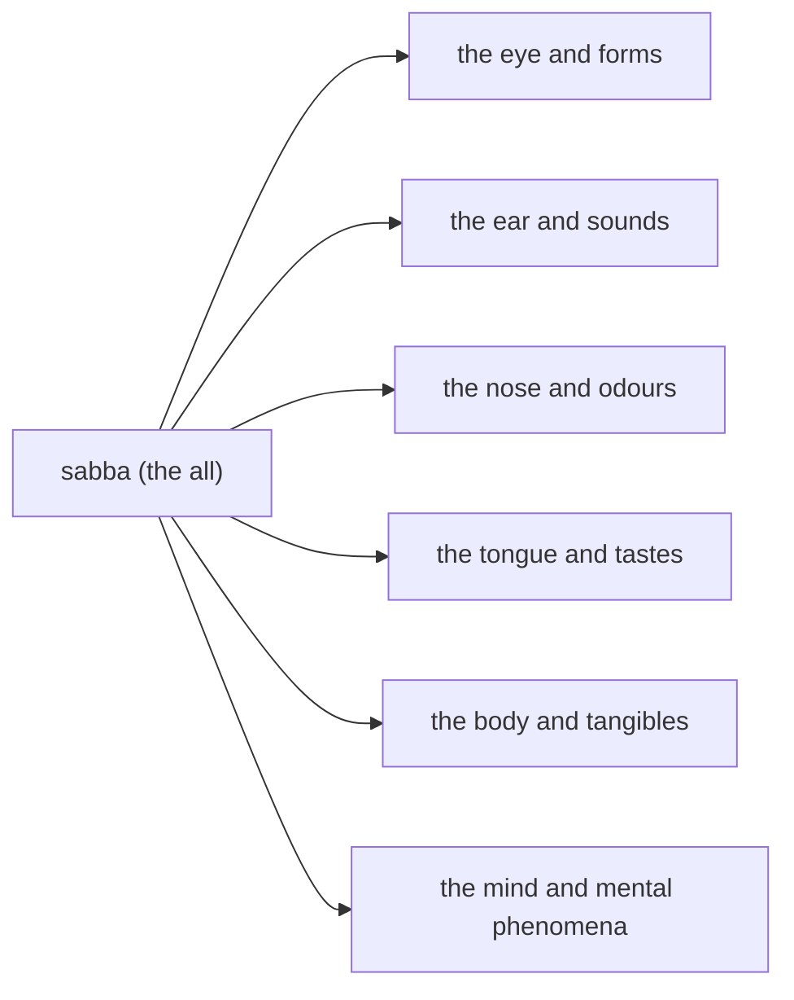

import { Tabs, TabItem } from '@astrojs/starlight/components';

Original text: [13S4/1.1.3.1 Sabbasutta 63–64](https://tipitaka2500.github.io/tipitaka/13S4/1/1.1/1.1.3/1.1.3.1.html#63) in the [World Tipitaka Edition](https://tipitaka2500.github.io)

## Summary

At Sāvatthī the Bhagavā teaches the bhikkhū what the all is: the six senses and their objects, from the eye and forms to the mind and mental phenomena. Anyone who would reject this all and declare another would be making a groundless statement, unable to answer when questioned and meeting with trouble, because such an all lies outside his domain.

## Diagram

## Text

<Tabs syncKey="paliquote">
<TabItem label="My Translation">
(23.)

63\. [The Bhagavā] was dwelling at Sāvatthī. “Bhikkhave, I will teach you the all. Listen to it. And what, Bhikkhave, is the all? The eye and forms, the ear and sounds, the nose and odours, the tongue and tastes, the body and tangibles, the mind and mental phenomena — this, Bhikkhave, is called the all. Whoever, Bhikkhave, should speak thus: ‘Rejecting this all, I will declare another all’ — that would be merely a groundless statement on his part; and when questioned he would not be able to answer, and further he would meet with trouble. For what reason? Because, Bhikkhave, that is outside his domain.”

64\. The first [discourse of the chapter].
</TabItem>

<TabItem label="Pāḷi (Roman IAST)">
(23.)

63\. Sāvatthinidānaṃ. “Sabbaṃ vo, bhikkhave, desessāmi. Taṃ suṇātha. Kiñca, bhikkhave, sabbaṃ? Cakkhuñceva rūpā ca, sotañca saddā ca, ghānañca gandhā ca, jivhā ca rasā ca, kāyo ca phoṭṭhabbā ca, mano ca dhammā ca— idaṃ vuccati, bhikkhave, sabbaṃ. Yo, bhikkhave, evaṃ vadeyya— ‘ahametaṃ sabbaṃ paccakkhāya aññaṃ sabbaṃ paññāpessāmī’ti, tassa vācāvatthukamevassa; puṭṭho ca na sampāyeyya, uttariñca vighātaṃ āpajjeyya. Taṃ kissa hetu? Yathā taṃ, bhikkhave, avisayasmin”ti.

64\. Paṭhamaṃ.
</TabItem>

<TabItem label="Pāḷi (Brahmi)">
(23.)

63\. 𑀲𑀸𑀯𑀢𑁆𑀣𑀺𑀦𑀺𑀤𑀸𑀦𑀁. “𑀲𑀩𑁆𑀩𑀁 𑀯𑁄, 𑀪𑀺𑀓𑁆𑀔𑀯𑁂, 𑀤𑁂𑀲𑁂𑀲𑁆𑀲𑀸𑀫𑀺. 𑀢𑀁 𑀲𑀼𑀡𑀸𑀣. 𑀓𑀺𑀜𑁆𑀘, 𑀪𑀺𑀓𑁆𑀔𑀯𑁂, 𑀲𑀩𑁆𑀩𑀁? 𑀘𑀓𑁆𑀔𑀼𑀜𑁆𑀘𑁂𑀯 𑀭𑀽𑀧𑀸 𑀘, 𑀲𑁄𑀢𑀜𑁆𑀘 𑀲𑀤𑁆𑀤𑀸 𑀘, 𑀖𑀸𑀦𑀜𑁆𑀘 𑀕𑀦𑁆𑀥𑀸 𑀘, 𑀚𑀺𑀯𑁆𑀳𑀸 𑀘 𑀭𑀲𑀸 𑀘, 𑀓𑀸𑀬𑁄 𑀘 𑀨𑁄𑀝𑁆𑀞𑀩𑁆𑀩𑀸 𑀘, 𑀫𑀦𑁄 𑀘 𑀥𑀫𑁆𑀫𑀸 𑀘— 𑀇𑀤𑀁 𑀯𑀼𑀘𑁆𑀘𑀢𑀺, 𑀪𑀺𑀓𑁆𑀔𑀯𑁂, 𑀲𑀩𑁆𑀩𑀁. 𑀬𑁄, 𑀪𑀺𑀓𑁆𑀔𑀯𑁂, 𑀏𑀯𑀁 𑀯𑀤𑁂𑀬𑁆𑀬— ‘𑀅𑀳𑀫𑁂𑀢𑀁 𑀲𑀩𑁆𑀩𑀁 𑀧𑀘𑁆𑀘𑀓𑁆𑀔𑀸𑀬 𑀅𑀜𑁆𑀜𑀁 𑀲𑀩𑁆𑀩𑀁 𑀧𑀜𑁆𑀜𑀸𑀧𑁂𑀲𑁆𑀲𑀸𑀫𑀻’𑀢𑀺, 𑀢𑀲𑁆𑀲 𑀯𑀸𑀘𑀸𑀯𑀢𑁆𑀣𑀼𑀓𑀫𑁂𑀯𑀲𑁆𑀲; 𑀧𑀼𑀝𑁆𑀞𑁄 𑀘 𑀦 𑀲𑀫𑁆𑀧𑀸𑀬𑁂𑀬𑁆𑀬, 𑀉𑀢𑁆𑀢𑀭𑀺𑀜𑁆𑀘 𑀯𑀺𑀖𑀸𑀢𑀁 𑀆𑀧𑀚𑁆𑀚𑁂𑀬𑁆𑀬. 𑀢𑀁 𑀓𑀺𑀲𑁆𑀲 𑀳𑁂𑀢𑀼? 𑀬𑀣𑀸 𑀢𑀁, 𑀪𑀺𑀓𑁆𑀔𑀯𑁂, 𑀅𑀯𑀺𑀲𑀬𑀲𑁆𑀫𑀺𑀦𑁆”𑀢𑀺.

64\. 𑀧𑀞𑀫𑀁.
</TabItem>

<TabItem label="Interlinear">
(23.)

[63](https://tipitaka2500.github.io/tipitaka/13S4/1/1.1/1.1.3/1.1.3.1.html#63) Sāvatthinidānaṃ.  
🚻⨀①🆎(sāvatthī+nidāna)  
set at Sāvatthī  
[The Bhagavā] was dwelling at Sāvatthī.

“Sabbaṃ vo, bhikkhave, desessāmi.  
*️⃣🤟🚻⨀②(sabba) *️⃣🤘⚧⨂④(tvaṃ) 🚹⨂⓪(bhikkhu) 🟠⨀👆⏭(deseti)  
the all | to you | Bhikkhave | I will teach  
“Bhikkhave, I will teach you the all.

Taṃ suṇātha.  
*️⃣🤟🚻⨀②(ta) 🟢⨂🤘⏹(suṇāti)  
that | listen  
Listen to it.

Kiñca, bhikkhave, sabbaṃ?  
*️⃣🤟🚻⨀①(kiṃ) ⏏️(ca) 🚹⨂⓪(bhikkhu) *️⃣🤟🚻⨀①(sabba)  
what | and | Bhikkhave | the all  
And what, Bhikkhave, is the all?

Cakkhuñceva rūpā ca, sotañca saddā ca, ghānañca gandhā ca, jivhā ca rasā ca, kāyo ca phoṭṭhabbā ca, mano ca dhammā ca— idaṃ vuccati, bhikkhave, sabbaṃ.  
🚻⨀①(cakkhu) ⏏️(ca) ⏏️(eva) 🚻⨂①(rūpa) ⏏️(ca) 🚻⨀①(sota) ⏏️(ca) 🚹⨂①(sadda) ⏏️(ca) 🚻⨀①(ghāna) ⏏️(ca) 🚹⨂①(gandha) ⏏️(ca) 🚺⨀①(jivhā) ⏏️(ca) 🚹⨂①(rasa) ⏏️(ca) 🚹⨀①(kāya) ⏏️(ca) 🚻⨂①(phoṭṭhabba) ⏏️(ca) 🚹⨀①(mano) ⏏️(ca) 🚹⨂①(dhamma) ⏏️(ca) *️⃣🤟🚻⨀①(ima) 🔴⨀🤟▶️(vuccati) 🚹⨂⓪(bhikkhu) *️⃣🤟🚻⨀①(sabba)  
the eye | and | just | forms | and | the ear | and | sounds | and | the nose | and | odours | and | the tongue | and | tastes | and | the body | and | tangibles | and | the mind | and | mental phenomena | and | this | is called | Bhikkhave | the all  
The eye and forms, the ear and sounds, the nose and odours, the tongue and tastes, the body and tangibles, the mind and mental phenomena — this, Bhikkhave, is called the all.

Yo, bhikkhave, evaṃ vadeyya— ‘ahametaṃ sabbaṃ paccakkhāya aññaṃ sabbaṃ paññāpessāmī’ti, tassa vācāvatthukamevassa;  
*️⃣🤟🚹⨀①(ya) 🚹⨂⓪(bhikkhu) ⏏️(evaṃ) 🟢⨀🤟⏯(vadati) *️⃣👆⚧⨀①(ahaṃ) *️⃣🤟🚻⨀②(eta) *️⃣🤟🚻⨀②(sabba) 🔽(ya)(paccakkhāti) *️⃣🤟🚻⨀②(añña) *️⃣🤟🚻⨀②(sabba) 🟠⨀👆⏭(paññāpeti) ⏏️(iti) *️⃣🤟🚹⨀⑥(ta) 🚻⨀①🆎(vācā+vatthuka) ⏏️(eva) 🟢⨀🤟⏯(atthi)  
whoever | Bhikkhave | thus | should speak | I | this | all | rejecting | another | all | will declare | (end quote) | for him | a groundless statement | merely | would be  
Whoever, Bhikkhave, should speak thus: ‘Rejecting this all, I will declare another all’ — that would be merely a groundless statement on his part;

puṭṭho ca na sampāyeyya, uttariñca vighātaṃ āpajjeyya.  
🚹⨀①🔽(ta)(puṭṭha) ⏏️(ca) ⏏️(na) 🟢⨀🤟⏯(sampāyati) ⏏️(uttariṃ) ⏏️(ca) 🚹⨀②(vighāta) 🟢⨀🤟⏯(āpajjati)  
questioned | and | not | would be able to answer | further | and | trouble | would meet with  
and when questioned he would not be able to answer, and further he would meet with trouble.

Taṃ kissa hetu?  
*️⃣🤟🚻⨀①(ta) *️⃣🤟🚻⨀⑥(kiṃ) 🚹⨀①(hetu)  
that | of what | the reason  
For what reason?

Yathā taṃ, bhikkhave, avisayasmin”ti.  
⏏️(yathā) *️⃣🤟🚻⨀①(ta) 🚹⨂⓪(bhikkhu) 🚹⨀⑦🆎(na+visaya) ⏏️(iti)  
since | that | Bhikkhave | outside his domain | (end quote)  
Because, Bhikkhave, that is outside his domain.”

[64](https://tipitaka2500.github.io/tipitaka/13S4/1/1.1/1.1.3/1.1.3.1.html#64) Paṭhamaṃ.  
🚻⨀①(paṭhama)  
the first  
The first [discourse of the chapter].
</TabItem>
</Tabs>

## Commentary

- The shortest discourse of the Saḷāyatanasaṃyutta's third vagga, the Sabbavagga: a definition of `sabba` (the all) as the six senses with their objects, and a refusal of any all beyond them. The edition's 63–64 are CST 23.
- `sabbaṃ` "the all" and the six pairs take the Fire Sermon's wording on both sites (https://buddhavacana.github.io/pali-textbook/9-fire/, /khandhaka/1-12/): forms, sounds, odours, tastes, tangibles, mental phenomena.
- `vācāvatthuka` "groundless statement", `sampāyati` "is able to answer", `vighāta` "trouble" and `avisaya` "outside one's domain" are the DPD's; `Sāvatthinidānaṃ` is buddhavacana's twin "[The Bhagavā] was dwelling at Sāvatthī."
- The six sense bases on buddhavacana: https://buddhavacana.github.io/sutta/senses/

## Parallels

The frame and the sequence are the same: the Buddha at Sāvatthī defines the all as the six senses with their objects — eye and forms, ear and sounds, nose and odours, tongue and tastes, body and tangibles, mind and mental phenomena (眼色、耳聲、鼻香、舌味、身觸、意法, p. 91a) — and says that one who would set this all aside and establish another all "has mere words" (彼但有言說, p. 91b), does not know when questioned, and only adds to his doubt, because that is not his domain (非其境界故, p. 91b).

- The listener: SA 319 is spoken to the brahmin 生聞 (Jāṇussoṇi), who comes to the Buddha, exchanges greetings, sits to one side and asks "Gotama, what is called 'the all'?" (瞿曇！所謂一切者，云何名一切, p. 91a); the Pāḷi is addressed to the bhikkhū without a questioner, and the Bhagavā announces the topic himself ("I will teach you the all. Listen to it.", 63).
- The name: SA 319 calls the all "the twelve sense bases" (十二入處, p. 91a) before listing them; the Pāḷi only lists the pairs.
- The objector: in SA 319 he says "this is not the all; I now reject the all taught by the wanderer Gotama and establish another all" (此非一切，沙門瞿曇所說一切，我今捨，別立餘一切, pp. 91a–b); the Pāḷi's objector names no teacher ("Rejecting this all, I will declare another all", 63).
- The consequence: the Pāḷi's "he would meet with further trouble" (`uttariñca vighātaṃ āpajjeyya`) corresponds to "increasing his doubt and confusion" (增其疑惑, p. 91b).
- The close: SA 319 ends with the brahmin rejoicing at what the Buddha said and departing (歡喜隨喜奉行, p. 91b); the Pāḷi ends with the Bhagavā's words and the chapter count.

[Go to previous page (Pālileyyasutta (The Discourse at Pālileyya))](/samyuttanikaya/khandhasamyutta/palileyyasutta/) / [Go to parent page (Saṃyutta Nikāya)](/samyuttanikaya/) / [Go to next page (Dutiyadvayasutta (The Second Discourse on the Pair))](/samyuttanikaya/salayatanasamyutta/dutiyadvayasutta/)
