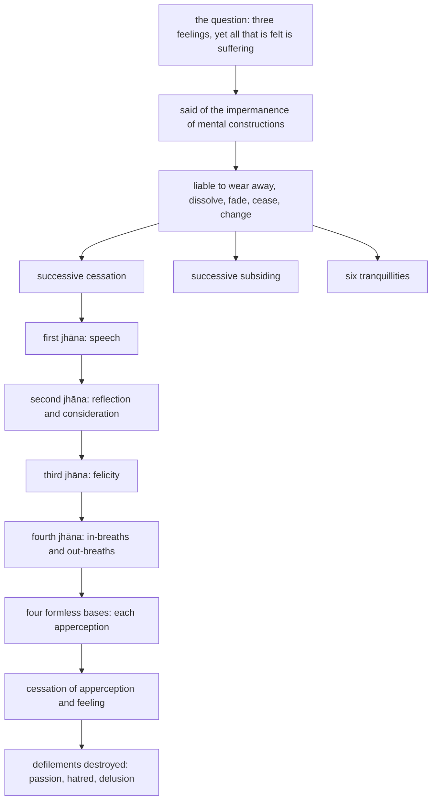

import { Tabs, TabItem } from '@astrojs/starlight/components';

Original text: [13S4/2.2.1 Rahogatasutta 1150–1152](https://tipitaka2500.github.io/tipitaka/13S4/2/2.2/2.2.1.html#1150) in the [World Tipitaka Edition](https://tipitaka2500.github.io)

## Summary

A bhikkhu, reflecting in seclusion, asks the Bhagavā how the saying ‘whatever is felt is within suffering’ stands beside the teaching of three feelings, pleasant, painful and neutral. The Bhagavā answers that it was said of the impermanence of mental constructions and their liability to wear away, dissolve, fade, cease and change, and then sets out the successive cessation, subsiding and tranquillising of mental constructions through the four `jhāna`, the four formless bases and the cessation of apperception and feeling, ending with the bhikkhu whose defilements are destroyed.

## Diagram

## Text

<Tabs syncKey="paliquote">
<TabItem label="My Translation">
(259.)

1150\. Then a certain bhikkhu approached the Bhagavā. Having approached, he bowed to the Bhagavā and sat down to one side. Seated to one side, that bhikkhu said this to the Bhagavā: “Here, Bhante, while I was alone in seclusion, this reflection arose in my mind: three `vedanā` (feelings) have been spoken of by the Bhagavā. Pleasant feeling, painful feeling, neutral feeling — these three feelings have been spoken of by the Bhagavā. But this has indeed been said by the Bhagavā: ‘Whatever is felt, that is within suffering.’ With reference to what was this said by the Bhagavā: ‘Whatever is felt, that is within suffering’?”

1151\. “Excellent, excellent, Bhikkhu. These three feelings, Bhikkhu, have been spoken of by me. Pleasant feeling, painful feeling, neutral feeling — these three feelings have been spoken of by me. But this has indeed been said by me, Bhikkhu: ‘Whatever is felt, that is within suffering.’ But that, Bhikkhu, was said by me with reference just to the impermanence of `saṅkhāra` (mental constructions): ‘Whatever is felt, that is within suffering.’ But that, Bhikkhu, was said by me with reference just to the liability of mental constructions to wearing away … and so on … to dissolution … and so on … to fading away … and so on … to cessation … and so on … to change: ‘Whatever is felt, that is within suffering.’ And moreover, Bhikkhu, the successive cessation of mental constructions has been declared by me. For one who has entered the first `jhāna` (mental disposition), speech has ceased. For one who has entered the second jhāna, reflection and consideration have ceased. For one who has entered the third jhāna, felicity has ceased. For one who has entered the fourth jhāna, in-breaths and out-breaths have ceased. For one who has entered the base of the infinity of space, the apperception of form has ceased. For one who has entered the base of the infinity of consciousness, the apperception of the base of the infinity of space has ceased. For one who has entered the base of nothingness, the apperception of the base of the infinity of consciousness has ceased. For one who has entered the base of neither apperception nor non-apperception, the apperception of the base of nothingness has ceased. For one who has entered the cessation of apperception and feeling, apperception and feeling have ceased. For a bhikkhu with the defilements destroyed, passion has ceased, hatred has ceased, delusion has ceased. And, Bhikkhu, the successive subsiding of mental constructions has been declared by me. For one who has entered the first jhāna, speech has subsided. For one who has entered the second jhāna, reflection and consideration have subsided … and so on … for one who has entered the cessation of apperception and feeling, apperception and feeling have subsided. For a bhikkhu with the defilements destroyed, passion has subsided, hatred has subsided, delusion has subsided. There are these six tranquillities, Bhikkhu. For one who has entered the first jhāna, speech has become tranquil. For one who has entered the second jhāna, reflection and consideration have become tranquil. For one who has entered the third jhāna, felicity has become tranquil. For one who has entered the fourth jhāna, in-breaths and out-breaths have become tranquil. For one who has entered the cessation of apperception and feeling, apperception and feeling have become tranquil. For a bhikkhu with the defilements destroyed, passion has become tranquil, hatred has become tranquil, delusion has become tranquil.”

1152\. The first [discourse of the chapter].
</TabItem>

<TabItem label="Pāḷi (Roman IAST)">
(259.)

1150\. Atha kho aññataro bhikkhu yena bhagavā tenupasaṅkami; upasaṅkamitvā bhagavantaṃ abhivādetvā ekamantaṃ nisīdi. Ekamantaṃ nisinno kho so bhikkhu bhagavantaṃ etadavoca— “idha mayhaṃ, bhante, rahogatassa paṭisallīnassa evaṃ cetaso parivitakko udapādi— tisso vedanā vuttā bhagavatā. Sukhā vedanā, dukkhā vedanā, adukkhamasukhā vedanā— imā tisso vedanā vuttā bhagavatā. Vuttaṃ kho panetaṃ bhagavatā— ‘yaṃ kiñci vedayitaṃ taṃ dukkhasmin’ti. Kiṃ nu kho etaṃ bhagavatā sandhāya bhāsitaṃ— ‘yaṃ kiñci vedayitaṃ taṃ dukkhasmin’”ti?

1151\. “Sādhu sādhu, bhikkhu. Tisso imā, bhikkhu, vedanā vuttā mayā. Sukhā vedanā, dukkhā vedanā, adukkhamasukhā vedanā— imā tisso vedanā vuttā mayā. Vuttaṃ kho panetaṃ, bhikkhu, mayā— ‘yaṃ kiñci vedayitaṃ, taṃ dukkhasmin’ti. Taṃ kho panetaṃ, bhikkhu, mayā saṅkhārānaṃyeva aniccataṃ sandhāya bhāsitaṃ— ‘yaṃ kiñci vedayitaṃ taṃ dukkhasmin’ti. Taṃ kho panetaṃ, bhikkhu, mayā saṅkhārānaṃyeva khayadhammataṃ…pe… vayadhammataṃ…pe… virāgadhammataṃ…pe… nirodhadhammataṃ…pe… vipariṇāmadhammataṃ sandhāya bhāsitaṃ— ‘yaṃ kiñci vedayitaṃ taṃ dukkhasmin’ti. Atha kho pana, bhikkhu, mayā anupubbasaṅkhārānaṃ nirodho akkhāto. Paṭhamaṃ jhānaṃ samāpannassa vācā niruddhā hoti. Dutiyaṃ jhānaṃ samāpannassa vitakkavicārā niruddhā honti. Tatiyaṃ jhānaṃ samāpannassa pīti niruddhā hoti. Catutthaṃ jhānaṃ samāpannassa assāsapassāsā niruddhā honti. Ākāsānañcāyatanaṃ samāpannassa rūpasaññā niruddhā hoti. Viññāṇañcāyatanaṃ samāpannassa ākāsānañcāyatanasaññā niruddhā hoti. Ākiñcaññāyatanaṃ samāpannassa viññāṇañcāyatanasaññā niruddhā hoti. Nevasaññānāsaññāyatanaṃ samāpannassa ākiñcaññāyatanasaññā niruddhā hoti. Saññāvedayitanirodhaṃ samāpannassa saññā ca vedanā ca niruddhā honti. Khīṇāsavassa bhikkhuno rāgo niruddho hoti, doso niruddho hoti, moho niruddho hoti. Atha kho, bhikkhu, mayā anupubbasaṅkhārānaṃ vūpasamo akkhāto. Paṭhamaṃ jhānaṃ samāpannassa vācā vūpasantā hoti. Dutiyaṃ jhānaṃ samāpannassa vitakkavicārā vūpasantā honti…pe… saññāvedayitanirodhaṃ samāpannassa saññā ca vedanā ca vūpasantā honti. Khīṇāsavassa bhikkhuno rāgo vūpasanto hoti, doso vūpasanto hoti, moho vūpasanto hoti. Chayimā, bhikkhu, passaddhiyo. Paṭhamaṃ jhānaṃ samāpannassa vācā paṭippassaddhā hoti. Dutiyaṃ jhānaṃ samāpannassa vitakkavicārā paṭippassaddhā honti. Tatiyaṃ jhānaṃ samāpannassa pīti paṭippassaddhā hoti. Catutthaṃ jhānaṃ samāpannassa assāsapassāsā paṭippassaddhā honti. Saññāvedayitanirodhaṃ samāpannassa saññā ca vedanā ca paṭippassaddhā honti. Khīṇāsavassa bhikkhuno rāgo paṭippassaddho hoti, doso paṭippassaddho hoti, moho paṭippassaddho hotī”ti.

1152\. Paṭhamaṃ.
</TabItem>

<TabItem label="Pāḷi (Brahmi)">
(259.)

1150\. 𑀅𑀣 𑀔𑁄 𑀅𑀜𑁆𑀜𑀢𑀭𑁄 𑀪𑀺𑀓𑁆𑀔𑀼 𑀬𑁂𑀦 𑀪𑀕𑀯𑀸 𑀢𑁂𑀦𑀼𑀧𑀲𑀗𑁆𑀓𑀫𑀺; 𑀉𑀧𑀲𑀗𑁆𑀓𑀫𑀺𑀢𑁆𑀯𑀸 𑀪𑀕𑀯𑀦𑁆𑀢𑀁 𑀅𑀪𑀺𑀯𑀸𑀤𑁂𑀢𑁆𑀯𑀸 𑀏𑀓𑀫𑀦𑁆𑀢𑀁 𑀦𑀺𑀲𑀻𑀤𑀺. 𑀏𑀓𑀫𑀦𑁆𑀢𑀁 𑀦𑀺𑀲𑀺𑀦𑁆𑀦𑁄 𑀔𑁄 𑀲𑁄 𑀪𑀺𑀓𑁆𑀔𑀼 𑀪𑀕𑀯𑀦𑁆𑀢𑀁 𑀏𑀢𑀤𑀯𑁄𑀘— “𑀇𑀥 𑀫𑀬𑁆𑀳𑀁, 𑀪𑀦𑁆𑀢𑁂, 𑀭𑀳𑁄𑀕𑀢𑀲𑁆𑀲 𑀧𑀝𑀺𑀲𑀮𑁆𑀮𑀻𑀦𑀲𑁆𑀲 𑀏𑀯𑀁 𑀘𑁂𑀢𑀲𑁄 𑀧𑀭𑀺𑀯𑀺𑀢𑀓𑁆𑀓𑁄 𑀉𑀤𑀧𑀸𑀤𑀺— 𑀢𑀺𑀲𑁆𑀲𑁄 𑀯𑁂𑀤𑀦𑀸 𑀯𑀼𑀢𑁆𑀢𑀸 𑀪𑀕𑀯𑀢𑀸. 𑀲𑀼𑀔𑀸 𑀯𑁂𑀤𑀦𑀸, 𑀤𑀼𑀓𑁆𑀔𑀸 𑀯𑁂𑀤𑀦𑀸, 𑀅𑀤𑀼𑀓𑁆𑀔𑀫𑀲𑀼𑀔𑀸 𑀯𑁂𑀤𑀦𑀸— 𑀇𑀫𑀸 𑀢𑀺𑀲𑁆𑀲𑁄 𑀯𑁂𑀤𑀦𑀸 𑀯𑀼𑀢𑁆𑀢𑀸 𑀪𑀕𑀯𑀢𑀸. 𑀯𑀼𑀢𑁆𑀢𑀁 𑀔𑁄 𑀧𑀦𑁂𑀢𑀁 𑀪𑀕𑀯𑀢𑀸— ‘𑀬𑀁 𑀓𑀺𑀜𑁆𑀘𑀺 𑀯𑁂𑀤𑀬𑀺𑀢𑀁 𑀢𑀁 𑀤𑀼𑀓𑁆𑀔𑀲𑁆𑀫𑀺𑀦𑁆’𑀢𑀺. 𑀓𑀺𑀁 𑀦𑀼 𑀔𑁄 𑀏𑀢𑀁 𑀪𑀕𑀯𑀢𑀸 𑀲𑀦𑁆𑀥𑀸𑀬 𑀪𑀸𑀲𑀺𑀢𑀁— ‘𑀬𑀁 𑀓𑀺𑀜𑁆𑀘𑀺 𑀯𑁂𑀤𑀬𑀺𑀢𑀁 𑀢𑀁 𑀤𑀼𑀓𑁆𑀔𑀲𑁆𑀫𑀺𑀦𑁆’”𑀢𑀺?

1151\. “𑀲𑀸𑀥𑀼 𑀲𑀸𑀥𑀼, 𑀪𑀺𑀓𑁆𑀔𑀼. 𑀢𑀺𑀲𑁆𑀲𑁄 𑀇𑀫𑀸, 𑀪𑀺𑀓𑁆𑀔𑀼, 𑀯𑁂𑀤𑀦𑀸 𑀯𑀼𑀢𑁆𑀢𑀸 𑀫𑀬𑀸. 𑀲𑀼𑀔𑀸 𑀯𑁂𑀤𑀦𑀸, 𑀤𑀼𑀓𑁆𑀔𑀸 𑀯𑁂𑀤𑀦𑀸, 𑀅𑀤𑀼𑀓𑁆𑀔𑀫𑀲𑀼𑀔𑀸 𑀯𑁂𑀤𑀦𑀸— 𑀇𑀫𑀸 𑀢𑀺𑀲𑁆𑀲𑁄 𑀯𑁂𑀤𑀦𑀸 𑀯𑀼𑀢𑁆𑀢𑀸 𑀫𑀬𑀸. 𑀯𑀼𑀢𑁆𑀢𑀁 𑀔𑁄 𑀧𑀦𑁂𑀢𑀁, 𑀪𑀺𑀓𑁆𑀔𑀼, 𑀫𑀬𑀸— ‘𑀬𑀁 𑀓𑀺𑀜𑁆𑀘𑀺 𑀯𑁂𑀤𑀬𑀺𑀢𑀁, 𑀢𑀁 𑀤𑀼𑀓𑁆𑀔𑀲𑁆𑀫𑀺𑀦𑁆’𑀢𑀺. 𑀢𑀁 𑀔𑁄 𑀧𑀦𑁂𑀢𑀁, 𑀪𑀺𑀓𑁆𑀔𑀼, 𑀫𑀬𑀸 𑀲𑀗𑁆𑀔𑀸𑀭𑀸𑀦𑀁𑀬𑁂𑀯 𑀅𑀦𑀺𑀘𑁆𑀘𑀢𑀁 𑀲𑀦𑁆𑀥𑀸𑀬 𑀪𑀸𑀲𑀺𑀢𑀁— ‘𑀬𑀁 𑀓𑀺𑀜𑁆𑀘𑀺 𑀯𑁂𑀤𑀬𑀺𑀢𑀁 𑀢𑀁 𑀤𑀼𑀓𑁆𑀔𑀲𑁆𑀫𑀺𑀦𑁆’𑀢𑀺. 𑀢𑀁 𑀔𑁄 𑀧𑀦𑁂𑀢𑀁, 𑀪𑀺𑀓𑁆𑀔𑀼, 𑀫𑀬𑀸 𑀲𑀗𑁆𑀔𑀸𑀭𑀸𑀦𑀁𑀬𑁂𑀯 𑀔𑀬𑀥𑀫𑁆𑀫𑀢𑀁…𑀧𑁂… 𑀯𑀬𑀥𑀫𑁆𑀫𑀢𑀁…𑀧𑁂… 𑀯𑀺𑀭𑀸𑀕𑀥𑀫𑁆𑀫𑀢𑀁…𑀧𑁂… 𑀦𑀺𑀭𑁄𑀥𑀥𑀫𑁆𑀫𑀢𑀁…𑀧𑁂… 𑀯𑀺𑀧𑀭𑀺𑀡𑀸𑀫𑀥𑀫𑁆𑀫𑀢𑀁 𑀲𑀦𑁆𑀥𑀸𑀬 𑀪𑀸𑀲𑀺𑀢𑀁— ‘𑀬𑀁 𑀓𑀺𑀜𑁆𑀘𑀺 𑀯𑁂𑀤𑀬𑀺𑀢𑀁 𑀢𑀁 𑀤𑀼𑀓𑁆𑀔𑀲𑁆𑀫𑀺𑀦𑁆’𑀢𑀺. 𑀅𑀣 𑀔𑁄 𑀧𑀦, 𑀪𑀺𑀓𑁆𑀔𑀼, 𑀫𑀬𑀸 𑀅𑀦𑀼𑀧𑀼𑀩𑁆𑀩𑀲𑀗𑁆𑀔𑀸𑀭𑀸𑀦𑀁 𑀦𑀺𑀭𑁄𑀥𑁄 𑀅𑀓𑁆𑀔𑀸𑀢𑁄. 𑀧𑀞𑀫𑀁 𑀛𑀸𑀦𑀁 𑀲𑀫𑀸𑀧𑀦𑁆𑀦𑀲𑁆𑀲 𑀯𑀸𑀘𑀸 𑀦𑀺𑀭𑀼𑀤𑁆𑀥𑀸 𑀳𑁄𑀢𑀺. 𑀤𑀼𑀢𑀺𑀬𑀁 𑀛𑀸𑀦𑀁 𑀲𑀫𑀸𑀧𑀦𑁆𑀦𑀲𑁆𑀲 𑀯𑀺𑀢𑀓𑁆𑀓𑀯𑀺𑀘𑀸𑀭𑀸 𑀦𑀺𑀭𑀼𑀤𑁆𑀥𑀸 𑀳𑁄𑀦𑁆𑀢𑀺. 𑀢𑀢𑀺𑀬𑀁 𑀛𑀸𑀦𑀁 𑀲𑀫𑀸𑀧𑀦𑁆𑀦𑀲𑁆𑀲 𑀧𑀻𑀢𑀺 𑀦𑀺𑀭𑀼𑀤𑁆𑀥𑀸 𑀳𑁄𑀢𑀺. 𑀘𑀢𑀼𑀢𑁆𑀣𑀁 𑀛𑀸𑀦𑀁 𑀲𑀫𑀸𑀧𑀦𑁆𑀦𑀲𑁆𑀲 𑀅𑀲𑁆𑀲𑀸𑀲𑀧𑀲𑁆𑀲𑀸𑀲𑀸 𑀦𑀺𑀭𑀼𑀤𑁆𑀥𑀸 𑀳𑁄𑀦𑁆𑀢𑀺. 𑀆𑀓𑀸𑀲𑀸𑀦𑀜𑁆𑀘𑀸𑀬𑀢𑀦𑀁 𑀲𑀫𑀸𑀧𑀦𑁆𑀦𑀲𑁆𑀲 𑀭𑀽𑀧𑀲𑀜𑁆𑀜𑀸 𑀦𑀺𑀭𑀼𑀤𑁆𑀥𑀸 𑀳𑁄𑀢𑀺. 𑀯𑀺𑀜𑁆𑀜𑀸𑀡𑀜𑁆𑀘𑀸𑀬𑀢𑀦𑀁 𑀲𑀫𑀸𑀧𑀦𑁆𑀦𑀲𑁆𑀲 𑀆𑀓𑀸𑀲𑀸𑀦𑀜𑁆𑀘𑀸𑀬𑀢𑀦𑀲𑀜𑁆𑀜𑀸 𑀦𑀺𑀭𑀼𑀤𑁆𑀥𑀸 𑀳𑁄𑀢𑀺. 𑀆𑀓𑀺𑀜𑁆𑀘𑀜𑁆𑀜𑀸𑀬𑀢𑀦𑀁 𑀲𑀫𑀸𑀧𑀦𑁆𑀦𑀲𑁆𑀲 𑀯𑀺𑀜𑁆𑀜𑀸𑀡𑀜𑁆𑀘𑀸𑀬𑀢𑀦𑀲𑀜𑁆𑀜𑀸 𑀦𑀺𑀭𑀼𑀤𑁆𑀥𑀸 𑀳𑁄𑀢𑀺. 𑀦𑁂𑀯𑀲𑀜𑁆𑀜𑀸𑀦𑀸𑀲𑀜𑁆𑀜𑀸𑀬𑀢𑀦𑀁 𑀲𑀫𑀸𑀧𑀦𑁆𑀦𑀲𑁆𑀲 𑀆𑀓𑀺𑀜𑁆𑀘𑀜𑁆𑀜𑀸𑀬𑀢𑀦𑀲𑀜𑁆𑀜𑀸 𑀦𑀺𑀭𑀼𑀤𑁆𑀥𑀸 𑀳𑁄𑀢𑀺. 𑀲𑀜𑁆𑀜𑀸𑀯𑁂𑀤𑀬𑀺𑀢𑀦𑀺𑀭𑁄𑀥𑀁 𑀲𑀫𑀸𑀧𑀦𑁆𑀦𑀲𑁆𑀲 𑀲𑀜𑁆𑀜𑀸 𑀘 𑀯𑁂𑀤𑀦𑀸 𑀘 𑀦𑀺𑀭𑀼𑀤𑁆𑀥𑀸 𑀳𑁄𑀦𑁆𑀢𑀺. 𑀔𑀻𑀡𑀸𑀲𑀯𑀲𑁆𑀲 𑀪𑀺𑀓𑁆𑀔𑀼𑀦𑁄 𑀭𑀸𑀕𑁄 𑀦𑀺𑀭𑀼𑀤𑁆𑀥𑁄 𑀳𑁄𑀢𑀺, 𑀤𑁄𑀲𑁄 𑀦𑀺𑀭𑀼𑀤𑁆𑀥𑁄 𑀳𑁄𑀢𑀺, 𑀫𑁄𑀳𑁄 𑀦𑀺𑀭𑀼𑀤𑁆𑀥𑁄 𑀳𑁄𑀢𑀺. 𑀅𑀣 𑀔𑁄, 𑀪𑀺𑀓𑁆𑀔𑀼, 𑀫𑀬𑀸 𑀅𑀦𑀼𑀧𑀼𑀩𑁆𑀩𑀲𑀗𑁆𑀔𑀸𑀭𑀸𑀦𑀁 𑀯𑀽𑀧𑀲𑀫𑁄 𑀅𑀓𑁆𑀔𑀸𑀢𑁄. 𑀧𑀞𑀫𑀁 𑀛𑀸𑀦𑀁 𑀲𑀫𑀸𑀧𑀦𑁆𑀦𑀲𑁆𑀲 𑀯𑀸𑀘𑀸 𑀯𑀽𑀧𑀲𑀦𑁆𑀢𑀸 𑀳𑁄𑀢𑀺. 𑀤𑀼𑀢𑀺𑀬𑀁 𑀛𑀸𑀦𑀁 𑀲𑀫𑀸𑀧𑀦𑁆𑀦𑀲𑁆𑀲 𑀯𑀺𑀢𑀓𑁆𑀓𑀯𑀺𑀘𑀸𑀭𑀸 𑀯𑀽𑀧𑀲𑀦𑁆𑀢𑀸 𑀳𑁄𑀦𑁆𑀢𑀺…𑀧𑁂… 𑀲𑀜𑁆𑀜𑀸𑀯𑁂𑀤𑀬𑀺𑀢𑀦𑀺𑀭𑁄𑀥𑀁 𑀲𑀫𑀸𑀧𑀦𑁆𑀦𑀲𑁆𑀲 𑀲𑀜𑁆𑀜𑀸 𑀘 𑀯𑁂𑀤𑀦𑀸 𑀘 𑀯𑀽𑀧𑀲𑀦𑁆𑀢𑀸 𑀳𑁄𑀦𑁆𑀢𑀺. 𑀔𑀻𑀡𑀸𑀲𑀯𑀲𑁆𑀲 𑀪𑀺𑀓𑁆𑀔𑀼𑀦𑁄 𑀭𑀸𑀕𑁄 𑀯𑀽𑀧𑀲𑀦𑁆𑀢𑁄 𑀳𑁄𑀢𑀺, 𑀤𑁄𑀲𑁄 𑀯𑀽𑀧𑀲𑀦𑁆𑀢𑁄 𑀳𑁄𑀢𑀺, 𑀫𑁄𑀳𑁄 𑀯𑀽𑀧𑀲𑀦𑁆𑀢𑁄 𑀳𑁄𑀢𑀺. 𑀙𑀬𑀺𑀫𑀸, 𑀪𑀺𑀓𑁆𑀔𑀼, 𑀧𑀲𑁆𑀲𑀤𑁆𑀥𑀺𑀬𑁄. 𑀧𑀞𑀫𑀁 𑀛𑀸𑀦𑀁 𑀲𑀫𑀸𑀧𑀦𑁆𑀦𑀲𑁆𑀲 𑀯𑀸𑀘𑀸 𑀧𑀝𑀺𑀧𑁆𑀧𑀲𑁆𑀲𑀤𑁆𑀥𑀸 𑀳𑁄𑀢𑀺. 𑀤𑀼𑀢𑀺𑀬𑀁 𑀛𑀸𑀦𑀁 𑀲𑀫𑀸𑀧𑀦𑁆𑀦𑀲𑁆𑀲 𑀯𑀺𑀢𑀓𑁆𑀓𑀯𑀺𑀘𑀸𑀭𑀸 𑀧𑀝𑀺𑀧𑁆𑀧𑀲𑁆𑀲𑀤𑁆𑀥𑀸 𑀳𑁄𑀦𑁆𑀢𑀺. 𑀢𑀢𑀺𑀬𑀁 𑀛𑀸𑀦𑀁 𑀲𑀫𑀸𑀧𑀦𑁆𑀦𑀲𑁆𑀲 𑀧𑀻𑀢𑀺 𑀧𑀝𑀺𑀧𑁆𑀧𑀲𑁆𑀲𑀤𑁆𑀥𑀸 𑀳𑁄𑀢𑀺. 𑀘𑀢𑀼𑀢𑁆𑀣𑀁 𑀛𑀸𑀦𑀁 𑀲𑀫𑀸𑀧𑀦𑁆𑀦𑀲𑁆𑀲 𑀅𑀲𑁆𑀲𑀸𑀲𑀧𑀲𑁆𑀲𑀸𑀲𑀸 𑀧𑀝𑀺𑀧𑁆𑀧𑀲𑁆𑀲𑀤𑁆𑀥𑀸 𑀳𑁄𑀦𑁆𑀢𑀺. 𑀲𑀜𑁆𑀜𑀸𑀯𑁂𑀤𑀬𑀺𑀢𑀦𑀺𑀭𑁄𑀥𑀁 𑀲𑀫𑀸𑀧𑀦𑁆𑀦𑀲𑁆𑀲 𑀲𑀜𑁆𑀜𑀸 𑀘 𑀯𑁂𑀤𑀦𑀸 𑀘 𑀧𑀝𑀺𑀧𑁆𑀧𑀲𑁆𑀲𑀤𑁆𑀥𑀸 𑀳𑁄𑀦𑁆𑀢𑀺. 𑀔𑀻𑀡𑀸𑀲𑀯𑀲𑁆𑀲 𑀪𑀺𑀓𑁆𑀔𑀼𑀦𑁄 𑀭𑀸𑀕𑁄 𑀧𑀝𑀺𑀧𑁆𑀧𑀲𑁆𑀲𑀤𑁆𑀥𑁄 𑀳𑁄𑀢𑀺, 𑀤𑁄𑀲𑁄 𑀧𑀝𑀺𑀧𑁆𑀧𑀲𑁆𑀲𑀤𑁆𑀥𑁄 𑀳𑁄𑀢𑀺, 𑀫𑁄𑀳𑁄 𑀧𑀝𑀺𑀧𑁆𑀧𑀲𑁆𑀲𑀤𑁆𑀥𑁄 𑀳𑁄𑀢𑀻”𑀢𑀺.

1152\. 𑀧𑀞𑀫𑀁.
</TabItem>

<TabItem label="Interlinear">
(259.)

[1150](https://tipitaka2500.github.io/tipitaka/13S4/2/2.2/2.2.1.html#1150) Atha kho aññataro bhikkhu yena bhagavā tenupasaṅkami;  
⏏️(atha) ⏏️(kho) *️⃣🤟🚹⨀①(aññatara) 🚹⨀①(bhikkhu) *️⃣🤟🚹⨀③(ya) 🚹⨀①(bhagavant) *️⃣🤟🚹⨀③(ta) 🟢⨀🤟⏮(upasaṅkamati)  
then | indeed | a certain | bhikkhu | by where | the Bhagavā | by there | approached  
Then a certain bhikkhu approached the Bhagavā.

upasaṅkamitvā bhagavantaṃ abhivādetvā ekamantaṃ nisīdi.  
🔽(tvā)(upasaṅkamati) 🚹⨀②(bhagavant) 🔽(tvā)(abhivādeti) ⏏️🆎(eka+anta) 🟢⨀🤟⏮(nisīdati)  
having approached | the Bhagavā | having bowed down to | to one side | sat down  
Having approached, he bowed to the Bhagavā and sat down to one side.

Ekamantaṃ nisinno kho so bhikkhu bhagavantaṃ etadavoca— “idha mayhaṃ, bhante, rahogatassa paṭisallīnassa evaṃ cetaso parivitakko udapādi— tisso vedanā vuttā bhagavatā.  
⏏️🆎(eka+anta) 🚹⨀①🔽(ta)(nisinna) ⏏️(kho) *️⃣🤟🚹⨀①(ta) 🚹⨀①(bhikkhu) 🚹⨀②(bhagavant) *️⃣🤟🚻⨀②(eta) 🟢⨀🤟⏮(vadati) ⏏️(idha) *️⃣👆⚧⨀④(ahaṃ) 🚹⨀⓪(bhavant) 🚹⨀④🆎(raho+gata) 🚹⨀④🔽(ta)(paṭisallīna) ⏏️(evaṃ) 🚹⨀⑥(cetas) 🚹⨀①(parivitakka) 🟢⨀🤟⏮(uppajjati) 🚺⨂①(ti) 🚺⨂①(vedanā) 🚺⨂①🔽(ta)(vutta) 🚹⨀③(bhagavant)  
to one side | seated | indeed | that | bhikkhu | to the Bhagavā | this | said | here | to me | Bhante | alone | in seclusion | thus | of mind | reflection | arose | three | feelings | spoken of | by the Bhagavā  
Seated to one side, that bhikkhu said this to the Bhagavā: “Here, Bhante, while I was alone in seclusion, this reflection arose in my mind: three `vedanā` (feelings) have been spoken of by the Bhagavā.

Sukhā vedanā, dukkhā vedanā, adukkhamasukhā vedanā— imā tisso vedanā vuttā bhagavatā.  
🚺⨀①(sukha) 🚺⨀①(vedanā) 🚺⨀①(dukkha) 🚺⨀①(vedanā) 🚺⨀①🆎(na+dukkha+na+sukha) 🚺⨀①(vedanā) *️⃣🤟🚺⨂①(ima) 🚺⨂①(ti) 🚺⨂①(vedanā) 🚺⨂①🔽(ta)(vutta) 🚹⨀③(bhagavant)  
pleasant | feeling | painful | feeling | neutral | feeling | these | three | feelings | spoken of | by the Bhagavā  
Pleasant feeling, painful feeling, neutral feeling — these three feelings have been spoken of by the Bhagavā.

Vuttaṃ kho panetaṃ bhagavatā— ‘yaṃ kiñci vedayitaṃ taṃ dukkhasmin’ti.  
🚻⨀①🔽(ta)(vutta) ⏏️(kho) ⏏️(pana) *️⃣🤟🚻⨀①(eta) 🚹⨀③(bhagavant) *️⃣🤟🚻⨀①(ya) *️⃣🤟🚻⨀①(kaci) 🚻⨀①🔽(ta)(vedayita) *️⃣🤟🚻⨀①(ta) 🚻⨀⑦(dukkha) ⏏️(iti)  
said | indeed | but | this | by the Bhagavā | whatever | anything | which is felt | that | within suffering | (end quote)  
But this has indeed been said by the Bhagavā: ‘Whatever is felt, that is within suffering.’

Kiṃ nu kho etaṃ bhagavatā sandhāya bhāsitaṃ— ‘yaṃ kiñci vedayitaṃ taṃ dukkhasmin’”ti?  
*️⃣🤟🚻⨀②(kiṃ) ⏏️(nu) ⏏️(kho) *️⃣🤟🚻⨀①(eta) 🚹⨀③(bhagavant) 🔽(ya)(sandahati) 🚻⨀①🔽(ta)(bhāsita) *️⃣🤟🚻⨀①(ya) *️⃣🤟🚻⨀①(kaci) 🚻⨀①🔽(ta)(vedayita) *️⃣🤟🚻⨀①(ta) 🚻⨀⑦(dukkha) ⏏️(iti)  
what | (question) | indeed | this | by the Bhagavā | with reference to | said | whatever | anything | which is felt | that | within suffering | (end quote)  
With reference to what was this said by the Bhagavā: ‘Whatever is felt, that is within suffering’?”

[1151](https://tipitaka2500.github.io/tipitaka/13S4/2/2.2/2.2.1.html#1151) “Sādhu sādhu, bhikkhu.  
⏏️(sādhu) ⏏️(sādhu) 🚹⨀⓪(bhikkhu)  
excellent | excellent | Bhikkhu  
“Excellent, excellent, Bhikkhu.

Tisso imā, bhikkhu, vedanā vuttā mayā.  
🚺⨂①(ti) *️⃣🤟🚺⨂①(ima) 🚹⨀⓪(bhikkhu) 🚺⨂①(vedanā) 🚺⨂①🔽(ta)(vutta) *️⃣👆⚧⨀③(ahaṃ)  
three | these | Bhikkhu | feelings | spoken of | by me  
These three feelings, Bhikkhu, have been spoken of by me.

Sukhā vedanā, dukkhā vedanā, adukkhamasukhā vedanā— imā tisso vedanā vuttā mayā.  
🚺⨀①(sukha) 🚺⨀①(vedanā) 🚺⨀①(dukkha) 🚺⨀①(vedanā) 🚺⨀①🆎(na+dukkha+na+sukha) 🚺⨀①(vedanā) *️⃣🤟🚺⨂①(ima) 🚺⨂①(ti) 🚺⨂①(vedanā) 🚺⨂①🔽(ta)(vutta) *️⃣👆⚧⨀③(ahaṃ)  
pleasant | feeling | painful | feeling | neutral | feeling | these | three | feelings | spoken of | by me  
Pleasant feeling, painful feeling, neutral feeling — these three feelings have been spoken of by me.

Vuttaṃ kho panetaṃ, bhikkhu, mayā— ‘yaṃ kiñci vedayitaṃ, taṃ dukkhasmin’ti.  
🚻⨀①🔽(ta)(vutta) ⏏️(kho) ⏏️(pana) *️⃣🤟🚻⨀①(eta) 🚹⨀⓪(bhikkhu) *️⃣👆⚧⨀③(ahaṃ) *️⃣🤟🚻⨀①(ya) *️⃣🤟🚻⨀①(kaci) 🚻⨀①🔽(ta)(vedayita) *️⃣🤟🚻⨀①(ta) 🚻⨀⑦(dukkha) ⏏️(iti)  
said | indeed | but | this | Bhikkhu | by me | whatever | anything | which is felt | that | within suffering | (end quote)  
But this has indeed been said by me, Bhikkhu: ‘Whatever is felt, that is within suffering.’

Taṃ kho panetaṃ, bhikkhu, mayā saṅkhārānaṃyeva aniccataṃ sandhāya bhāsitaṃ— ‘yaṃ kiñci vedayitaṃ taṃ dukkhasmin’ti.  
*️⃣🤟🚻⨀①(ta) ⏏️(kho) ⏏️(pana) *️⃣🤟🚻⨀①(eta) 🚹⨀⓪(bhikkhu) *️⃣👆⚧⨀③(ahaṃ) 🚹⨂⑥(saṅkhāra) ⏏️(eva) 🚺⨀②🔽(tā)(aniccatā) 🔽(ya)(sandahati) 🚻⨀①🔽(ta)(bhāsita) *️⃣🤟🚻⨀①(ya) *️⃣🤟🚻⨀①(kaci) 🚻⨀①🔽(ta)(vedayita) *️⃣🤟🚻⨀①(ta) 🚻⨀⑦(dukkha) ⏏️(iti)  
that | indeed | but | this | Bhikkhu | by me | of mental constructions | just | impermanence | with reference to | said | whatever | anything | which is felt | that | within suffering | (end quote)  
But that, Bhikkhu, was said by me with reference just to the impermanence of `saṅkhāra` (mental constructions): ‘Whatever is felt, that is within suffering.’

Taṃ kho panetaṃ, bhikkhu, mayā saṅkhārānaṃyeva khayadhammataṃ…pe… vayadhammataṃ…pe… virāgadhammataṃ…pe… nirodhadhammataṃ…pe… vipariṇāmadhammataṃ sandhāya bhāsitaṃ— ‘yaṃ kiñci vedayitaṃ taṃ dukkhasmin’ti.  
*️⃣🤟🚻⨀①(ta) ⏏️(kho) ⏏️(pana) *️⃣🤟🚻⨀①(eta) 🚹⨀⓪(bhikkhu) *️⃣👆⚧⨀③(ahaṃ) 🚹⨂⑥(saṅkhāra) ⏏️(eva) 🚺⨀②🆎(khaya+dhammatā) ⏏️(peyyāla) 🚺⨀②🆎(vaya+dhammatā) ⏏️(peyyāla) 🚺⨀②🆎(virāga+dhammatā) ⏏️(peyyāla) 🚺⨀②🆎(nirodha+dhammatā) ⏏️(peyyāla) 🚺⨀②🆎(vipariṇāma+dhammatā) 🔽(ya)(sandahati) 🚻⨀①🔽(ta)(bhāsita) *️⃣🤟🚻⨀①(ya) *️⃣🤟🚻⨀①(kaci) 🚻⨀①🔽(ta)(vedayita) *️⃣🤟🚻⨀①(ta) 🚻⨀⑦(dukkha) ⏏️(iti)  
that | indeed | but | this | Bhikkhu | by me | of mental constructions | just | liability to wearing away | (and so on) | liability to dissolution | (and so on) | liability to fading away | (and so on) | liability to cessation | (and so on) | liability to change | with reference to | said | whatever | anything | which is felt | that | within suffering | (end quote)  
But that, Bhikkhu, was said by me with reference just to the liability of mental constructions to wearing away … and so on … to dissolution … and so on … to fading away … and so on … to cessation … and so on … to change: ‘Whatever is felt, that is within suffering.’

Atha kho pana, bhikkhu, mayā anupubbasaṅkhārānaṃ nirodho akkhāto.  
⏏️(atha) ⏏️(kho) ⏏️(pana) 🚹⨀⓪(bhikkhu) *️⃣👆⚧⨀③(ahaṃ) 🚹⨂⑥🆎(anupubba+saṅkhāra) 🚹⨀①(nirodha) 🚹⨀①🔽(ta)(akkhāta)  
and | indeed | moreover | Bhikkhu | by me | of successive mental constructions | cessation | declared  
And moreover, Bhikkhu, the successive cessation of mental constructions has been declared by me.

Paṭhamaṃ jhānaṃ samāpannassa vācā niruddhā hoti.  
🚻⨀②(paṭhama) 🚻⨀②(jhāna) 🚹⨀⑥🔽(ta)(samāpanna) 🚺⨀①(vācā) 🚺⨀①🔽(ta)(niruddha) 🟢⨀🤟▶️(hoti)  
first | mental disposition | for one who has entered | speech | ceased | is  
For one who has entered the first `jhāna` (mental disposition), speech has ceased.

Dutiyaṃ jhānaṃ samāpannassa vitakkavicārā niruddhā honti.  
🚻⨀②(dutiya) 🚻⨀②(jhāna) 🚹⨀⑥🔽(ta)(samāpanna) 🚹⨂①🆎(vitakka+vicāra) 🚹⨂①🔽(ta)(niruddha) 🟢⨂🤟▶️(hoti)  
second | mental disposition | for one who has entered | reflection and consideration | ceased | are  
For one who has entered the second jhāna, reflection and consideration have ceased.

Tatiyaṃ jhānaṃ samāpannassa pīti niruddhā hoti.  
🚻⨀②(tatiya) 🚻⨀②(jhāna) 🚹⨀⑥🔽(ta)(samāpanna) 🚺⨀①(pīti) 🚺⨀①🔽(ta)(niruddha) 🟢⨀🤟▶️(hoti)  
third | mental disposition | for one who has entered | felicity | ceased | is  
For one who has entered the third jhāna, felicity has ceased.

Catutthaṃ jhānaṃ samāpannassa assāsapassāsā niruddhā honti.  
🚻⨀②(catuttha) 🚻⨀②(jhāna) 🚹⨀⑥🔽(ta)(samāpanna) 🚹⨂①🆎(assāsa+passāsa) 🚹⨂①🔽(ta)(niruddha) 🟢⨂🤟▶️(hoti)  
fourth | mental disposition | for one who has entered | in-breaths and out-breaths | ceased | are  
For one who has entered the fourth jhāna, in-breaths and out-breaths have ceased.

Ākāsānañcāyatanaṃ samāpannassa rūpasaññā niruddhā hoti.  
🚻⨀②🆎(ākāsa+ānañca+āyatana) 🚹⨀⑥🔽(ta)(samāpanna) 🚺⨀①🆎(rūpa+saññā) 🚺⨀①🔽(ta)(niruddha) 🟢⨀🤟▶️(hoti)  
the base of the infinity of space | for one who has entered | the apperception of form | ceased | is  
For one who has entered the base of the infinity of space, the apperception of form has ceased.

Viññāṇañcāyatanaṃ samāpannassa ākāsānañcāyatanasaññā niruddhā hoti.  
🚻⨀②🆎(viññāṇa+ānañca+āyatana) 🚹⨀⑥🔽(ta)(samāpanna) 🚺⨀①🆎(ākāsa+ānañca+āyatana+saññā) 🚺⨀①🔽(ta)(niruddha) 🟢⨀🤟▶️(hoti)  
the base of the infinity of consciousness | for one who has entered | the apperception of the base of the infinity of space | ceased | is  
For one who has entered the base of the infinity of consciousness, the apperception of the base of the infinity of space has ceased.

Ākiñcaññāyatanaṃ samāpannassa viññāṇañcāyatanasaññā niruddhā hoti.  
🚻⨀②🆎(ākiñcañña+āyatana) 🚹⨀⑥🔽(ta)(samāpanna) 🚺⨀①🆎(viññāṇa+ānañca+āyatana+saññā) 🚺⨀①🔽(ta)(niruddha) 🟢⨀🤟▶️(hoti)  
the base of nothingness | for one who has entered | the apperception of the base of the infinity of consciousness | ceased | is  
For one who has entered the base of nothingness, the apperception of the base of the infinity of consciousness has ceased.

Nevasaññānāsaññāyatanaṃ samāpannassa ākiñcaññāyatanasaññā niruddhā hoti.  
🚻⨀②🆎(na+eva+saññā+na+saññā+āyatana) 🚹⨀⑥🔽(ta)(samāpanna) 🚺⨀①🆎(ākiñcañña+āyatana+saññā) 🚺⨀①🔽(ta)(niruddha) 🟢⨀🤟▶️(hoti)  
the base of neither apperception nor non-apperception | for one who has entered | the apperception of the base of nothingness | ceased | is  
For one who has entered the base of neither apperception nor non-apperception, the apperception of the base of nothingness has ceased.

Saññāvedayitanirodhaṃ samāpannassa saññā ca vedanā ca niruddhā honti.  
🚹⨀②🆎(saññā+vedayita+nirodha) 🚹⨀⑥🔽(ta)(samāpanna) 🚺⨀①(saññā) ⏏️(ca) 🚺⨀①(vedanā) ⏏️(ca) 🚺⨂①🔽(ta)(niruddha) 🟢⨂🤟▶️(hoti)  
the cessation of apperception and feeling | for one who has entered | apperception | and | feeling | and | ceased | are  
For one who has entered the cessation of apperception and feeling, apperception and feeling have ceased.

Khīṇāsavassa bhikkhuno rāgo niruddho hoti, doso niruddho hoti, moho niruddho hoti.  
🚹⨀⑥🆎(khīṇa+āsava) 🚹⨀⑥(bhikkhu) 🚹⨀①(rāga) 🚹⨀①🔽(ta)(niruddha) 🟢⨀🤟▶️(hoti) 🚹⨀①(dosa) 🚹⨀①🔽(ta)(niruddha) 🟢⨀🤟▶️(hoti) 🚹⨀①(moha) 🚹⨀①🔽(ta)(niruddha) 🟢⨀🤟▶️(hoti)  
with the defilements destroyed | for a bhikkhu | passion | ceased | is | hatred | ceased | is | delusion | ceased | is  
For a bhikkhu with the defilements destroyed, passion has ceased, hatred has ceased, delusion has ceased.

Atha kho, bhikkhu, mayā anupubbasaṅkhārānaṃ vūpasamo akkhāto.  
⏏️(atha) ⏏️(kho) 🚹⨀⓪(bhikkhu) *️⃣👆⚧⨀③(ahaṃ) 🚹⨂⑥🆎(anupubba+saṅkhāra) 🚹⨀①(vūpasama) 🚹⨀①🔽(ta)(akkhāta)  
and | indeed | Bhikkhu | by me | of successive mental constructions | subsiding | declared  
And, Bhikkhu, the successive subsiding of mental constructions has been declared by me.

Paṭhamaṃ jhānaṃ samāpannassa vācā vūpasantā hoti.  
🚻⨀②(paṭhama) 🚻⨀②(jhāna) 🚹⨀⑥🔽(ta)(samāpanna) 🚺⨀①(vācā) 🚺⨀①🔽(ta)(vūpasanta) 🟢⨀🤟▶️(hoti)  
first | mental disposition | for one who has entered | speech | subsided | is  
For one who has entered the first jhāna, speech has subsided.

Dutiyaṃ jhānaṃ samāpannassa vitakkavicārā vūpasantā honti…pe… saññāvedayitanirodhaṃ samāpannassa saññā ca vedanā ca vūpasantā honti.  
🚻⨀②(dutiya) 🚻⨀②(jhāna) 🚹⨀⑥🔽(ta)(samāpanna) 🚹⨂①🆎(vitakka+vicāra) 🚹⨂①🔽(ta)(vūpasanta) 🟢⨂🤟▶️(hoti) ⏏️(peyyāla) 🚹⨀②🆎(saññā+vedayita+nirodha) 🚹⨀⑥🔽(ta)(samāpanna) 🚺⨀①(saññā) ⏏️(ca) 🚺⨀①(vedanā) ⏏️(ca) 🚺⨂①🔽(ta)(vūpasanta) 🟢⨂🤟▶️(hoti)  
second | mental disposition | for one who has entered | reflection and consideration | subsided | are | (and so on) | the cessation of apperception and feeling | for one who has entered | apperception | and | feeling | and | subsided | are  
For one who has entered the second jhāna, reflection and consideration have subsided … and so on … for one who has entered the cessation of apperception and feeling, apperception and feeling have subsided.

Khīṇāsavassa bhikkhuno rāgo vūpasanto hoti, doso vūpasanto hoti, moho vūpasanto hoti.  
🚹⨀⑥🆎(khīṇa+āsava) 🚹⨀⑥(bhikkhu) 🚹⨀①(rāga) 🚹⨀①🔽(ta)(vūpasanta) 🟢⨀🤟▶️(hoti) 🚹⨀①(dosa) 🚹⨀①🔽(ta)(vūpasanta) 🟢⨀🤟▶️(hoti) 🚹⨀①(moha) 🚹⨀①🔽(ta)(vūpasanta) 🟢⨀🤟▶️(hoti)  
with the defilements destroyed | for a bhikkhu | passion | subsided | is | hatred | subsided | is | delusion | subsided | is  
For a bhikkhu with the defilements destroyed, passion has subsided, hatred has subsided, delusion has subsided.

Chayimā, bhikkhu, passaddhiyo.  
⚧⨂①(cha) *️⃣🤟🚺⨂①(ima) 🚹⨀⓪(bhikkhu) 🚺⨂①(passaddhi)  
six | these | Bhikkhu | tranquillities  
There are these six tranquillities, Bhikkhu.

Paṭhamaṃ jhānaṃ samāpannassa vācā paṭippassaddhā hoti.  
🚻⨀②(paṭhama) 🚻⨀②(jhāna) 🚹⨀⑥🔽(ta)(samāpanna) 🚺⨀①(vācā) 🚺⨀①🔽(ta)(paṭippassaddha) 🟢⨀🤟▶️(hoti)  
first | mental disposition | for one who has entered | speech | tranquil | is  
For one who has entered the first jhāna, speech has become tranquil.

Dutiyaṃ jhānaṃ samāpannassa vitakkavicārā paṭippassaddhā honti.  
🚻⨀②(dutiya) 🚻⨀②(jhāna) 🚹⨀⑥🔽(ta)(samāpanna) 🚹⨂①🆎(vitakka+vicāra) 🚹⨂①🔽(ta)(paṭippassaddha) 🟢⨂🤟▶️(hoti)  
second | mental disposition | for one who has entered | reflection and consideration | tranquil | are  
For one who has entered the second jhāna, reflection and consideration have become tranquil.

Tatiyaṃ jhānaṃ samāpannassa pīti paṭippassaddhā hoti.  
🚻⨀②(tatiya) 🚻⨀②(jhāna) 🚹⨀⑥🔽(ta)(samāpanna) 🚺⨀①(pīti) 🚺⨀①🔽(ta)(paṭippassaddha) 🟢⨀🤟▶️(hoti)  
third | mental disposition | for one who has entered | felicity | tranquil | is  
For one who has entered the third jhāna, felicity has become tranquil.

Catutthaṃ jhānaṃ samāpannassa assāsapassāsā paṭippassaddhā honti.  
🚻⨀②(catuttha) 🚻⨀②(jhāna) 🚹⨀⑥🔽(ta)(samāpanna) 🚹⨂①🆎(assāsa+passāsa) 🚹⨂①🔽(ta)(paṭippassaddha) 🟢⨂🤟▶️(hoti)  
fourth | mental disposition | for one who has entered | in-breaths and out-breaths | tranquil | are  
For one who has entered the fourth jhāna, in-breaths and out-breaths have become tranquil.

Saññāvedayitanirodhaṃ samāpannassa saññā ca vedanā ca paṭippassaddhā honti.  
🚹⨀②🆎(saññā+vedayita+nirodha) 🚹⨀⑥🔽(ta)(samāpanna) 🚺⨀①(saññā) ⏏️(ca) 🚺⨀①(vedanā) ⏏️(ca) 🚺⨂①🔽(ta)(paṭippassaddha) 🟢⨂🤟▶️(hoti)  
the cessation of apperception and feeling | for one who has entered | apperception | and | feeling | and | tranquil | are  
For one who has entered the cessation of apperception and feeling, apperception and feeling have become tranquil.

Khīṇāsavassa bhikkhuno rāgo paṭippassaddho hoti, doso paṭippassaddho hoti, moho paṭippassaddho hotī”ti.  
🚹⨀⑥🆎(khīṇa+āsava) 🚹⨀⑥(bhikkhu) 🚹⨀①(rāga) 🚹⨀①🔽(ta)(paṭippassaddha) 🟢⨀🤟▶️(hoti) 🚹⨀①(dosa) 🚹⨀①🔽(ta)(paṭippassaddha) 🟢⨀🤟▶️(hoti) 🚹⨀①(moha) 🚹⨀①🔽(ta)(paṭippassaddha) 🟢⨀🤟▶️(hoti) ⏏️(iti)  
with the defilements destroyed | for a bhikkhu | passion | tranquil | is | hatred | tranquil | is | delusion | tranquil | is | (end quote)  
For a bhikkhu with the defilements destroyed, passion has become tranquil, hatred has become tranquil, delusion has become tranquil.”

[1152](https://tipitaka2500.github.io/tipitaka/13S4/2/2.2/2.2.1.html#1152) Paṭhamaṃ.  
🚻⨀①(paṭhama)  
the first  
The first [discourse of the chapter].
</TabItem>
</Tabs>

## Commentary

- The question is how `yaṃ kiñci vedayitaṃ taṃ dukkhasmiṃ` stands beside the three feelings; the answer makes it a statement about mental constructions, not about feeling as such. buddhavacana reads happiness without feeling at https://buddhavacana.github.io/articles/enlightenment/.
- Three lists, three renderings kept apart: `nirodha` "cessation" (`niruddha` "ceased"), `vūpasama` "subsiding" (`vūpasanta` "subsided"), `passaddhi` "tranquillity" (`paṭippassaddha` "tranquil"); `saṅkhāra` "mental construction"; `khīṇāsava` "with the defilements destroyed" as on buddhavacana's Kosambi page.
- The nine attainments are worded as the Saṅgītisutta's nine successive cessations (/dighanikaya/sangitisutta/10-navaka/), six of whose units are twins here; the four `jhāna` are treated at https://buddhavacana.github.io/sutta/dispositions/.
- The `…pe…` of 1151.6 and 1151.20 elides the repeated frame; each is one sentence with "… and so on …".
- The vocative `bhikkhu` is capitalised, "Bhikkhu", as Bhante and Bhikkhave are.

## Parallels

The Chinese parallel is the 474th sūtra of the 雜阿含經 (Saṃyuktāgama; fascicle 17, CBETA T02, no. 99, pp. 121a–b), read here in CBETA's text; its neighbour, the 473rd, was not read. The two agree in frame and sequence: a disciple, reflecting alone in seclusion (獨一靜處禪思, p. 121a), puts the same question, how the three feelings (三受——樂受、苦受、不苦不樂受) stand beside the saying that all that is felt is suffering (諸所有受悉皆是苦); the Buddha answers that the saying was made with reference to the impermanence and changeability of all mental constructions (一切行無常故，一切行變易法故) and then to their gradual cessation and stilling (漸次寂滅, 漸次止息), and sets out the same nine attainments, speech ceasing in the first `jhāna`, reflection and consideration in the second, felicity in the third, in-breaths and out-breaths in the fourth, the apperception of form and of each lower base in the four formless bases, and apperception and feeling in their cessation (p. 121b). The differences, checked in CBETA's text:

- **The setting and the questioner.** The Pāḷi names no place and the questioner is a certain bhikkhu (1150); the Chinese sets the discourse at Rājagaha in the Kalandaka Bamboo Grove (王舍城迦蘭陀竹園) and the questioner is āyasmā Ānanda (尊者阿難), who rises from his meditation to ask (p. 121a).
- **The grounds of the saying.** The Pāḷi gives six, the impermanence of mental constructions and their liability to wear away, dissolve, fade, cease and change (1151.5–6); the Chinese gives two, impermanence and liability to change (無常, 變易法), and then adds as a second reason the gradual cessation and gradual stilling themselves (以諸行漸次寂滅故說，以諸行漸次止息故說, p. 121a).
- **How the lists are introduced.** In the Pāḷi the Bhagavā states the successive cessation, the successive subsiding and the six tranquillities in one speech (1151.7–28); in the Chinese Ānanda asks twice what the gradual cessation and the gradual stilling are, and each list is a separate answer (p. 121b).
- **The destroyed defilements.** The Pāḷi closes each of the three lists with the bhikkhu whose defilements are destroyed, for whom passion, hatred and delusion have ceased, subsided and become tranquil (1151.17, 21, 28); the Chinese has no such member in its lists, but after them Ānanda repeats "this is the gradual stilling of mental constructions" and the Buddha adds a superior, extraordinary, supreme, unsurpassed stilling (勝止息、奇特止息、上止息、無上止息), which is the mind's non-delight in and liberation from lust, hatred and delusion (於貪欲心不樂、解脫，恚、癡心不樂、解脫, p. 121b).
- **The third list.** The Pāḷi's six tranquillities (`cha passaddhiyo`, 1151.22–28: the four `jhāna`, the cessation of apperception and feeling, and the bhikkhu with the defilements destroyed) have no counterpart in the Chinese, which has two lists only.
- **The close.** The Pāḷi ends with the Bhagavā's words; the Chinese adds that Ānanda, having heard what the Buddha said, rejoiced and received it respectfully (歡喜奉行, p. 121b).

[Go to previous page (Sallasutta (The Discourse on the Arrow))](/samyuttanikaya/vedanasamyutta/sallasutta/) / [Go to parent page (Saṃyutta Nikāya)](/samyuttanikaya/) / [Go to next page (Sīvakasutta (The Discourse to Sīvaka))](/samyuttanikaya/vedanasamyutta/sivakasutta/)
