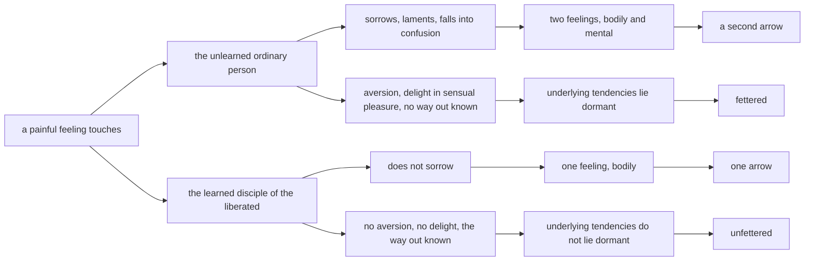

import { Tabs, TabItem } from '@astrojs/starlight/components';

Original text: [13S4/2.1.6 Sallasutta 1118–1124](https://tipitaka2500.github.io/tipitaka/13S4/2/2.1/2.1.6.html#1118) in the [World Tipitaka Edition](https://tipitaka2500.github.io)

## Summary

The Bhagavā distinguishes the unlearned ordinary person from the learned disciple of the liberated by what a painful feeling does to each. The one sorrows and laments and feels two feelings, bodily and mental, like a man pierced by a second arrow after the first; he has aversion, seeks sensual pleasure, does not know the way out, the underlying tendencies lie dormant in him, and he feels every feeling fettered. The other feels the bodily feeling alone, as if pierced by one arrow, knows the way out, and feels every feeling unfettered. Three verses close the discourse.

## Diagram

## Text

<Tabs syncKey="paliquote">
<TabItem label="My Translation">
(254.)

1118\. “An unlearned `puthujjana` (ordinary person), Bhikkhave, feels a pleasant `vedanā` (feeling), feels a painful feeling, and feels a neutral feeling. The `sutavā` (learned) `ariyasāvaka` (disciple of the liberated), Bhikkhave, feels a pleasant feeling, feels a painful feeling, and feels a neutral feeling. What there, Bhikkhave, is the distinction, what the disparity, what the difference between the learned disciple of the liberated and the unlearned ordinary person?” Bhante, our teachings are rooted in the Bhagavā … and so on … An unlearned ordinary person, Bhikkhave, touched by a painful feeling, sorrows, becomes weary, laments, wails beating his breast, and falls into confusion. He feels two feelings — a bodily one and a mental one. Just as, Bhikkhave, one might pierce a man with a `salla` (arrow). Then one might pierce him again with a second arrow. In this way indeed, Bhikkhave, that man feels a feeling from two arrows. In the same way, Bhikkhave, an unlearned ordinary person, touched by a painful feeling, sorrows, becomes weary, laments, wails beating his breast, and falls into confusion. He feels two feelings — a bodily one and a mental one. And touched by that very painful feeling, he has aversion. In him, who has aversion to painful feeling, the `paṭighānusaya` (underlying tendency towards aversion) in regard to painful feeling lies dormant. Touched by a painful feeling, he delights in `kāmasukha` (sensual pleasure). For what reason? For the unlearned ordinary person, Bhikkhave, does not know clearly any `nissaraṇa` (way out) of painful feeling other than sensual pleasure, and as he delights in sensual pleasure, the `rāgānusaya` (underlying tendency towards desire) in regard to pleasant feeling lies dormant in him. He does not know clearly, as it really is, the origin, the disappearance, the `assāda` (gratification), the `ādīnava` (danger) and the way out of those feelings. As he does not know clearly, as it really is, the origin, the disappearance, the gratification, the danger and the way out of those feelings, the `avijjānusaya` (underlying tendency towards ignorance) in regard to neutral feeling lies dormant in him. If he feels a pleasant feeling, he feels it `saññutta` (fettered). If he feels a painful feeling, he feels it fettered. If he feels a neutral feeling, he feels it fettered. This one, Bhikkhave, is called ‘an unlearned ordinary person fettered by birth, ageing, death, by sorrows, lamentations, pains, griefs, and despairs, fettered by suffering,’ I say.

1119\. But the learned disciple of the liberated, Bhikkhave, touched by a painful feeling, does not sorrow, does not become weary, does not lament, does not wail beating his breast, and does not fall into confusion. He feels one feeling — a bodily one, not a mental one.

1120\. Just as, Bhikkhave, one might pierce a man with an arrow. Then one might not pierce him again with a second arrow. In this way indeed, Bhikkhave, that man feels a feeling from one arrow. In the same way, Bhikkhave, the learned disciple of the liberated, touched by a painful feeling, does not sorrow, does not become weary, does not lament, does not wail beating his breast, and does not fall into confusion. He feels one feeling — a bodily one, not a mental one. And touched by that very painful feeling, he has no aversion. In him, who has no aversion to painful feeling, the underlying tendency towards aversion in regard to painful feeling does not lie dormant. Touched by a painful feeling, he does not delight in sensual pleasure. For what reason? For the learned disciple of the liberated, Bhikkhave, knows clearly a way out of painful feeling other than sensual pleasure. As he does not delight in sensual pleasure, the underlying tendency towards desire in regard to pleasant feeling does not lie dormant in him. He knows clearly, as it really is, the origin, the disappearance, the gratification, the danger and the way out of those feelings. As he knows clearly, as it really is, the origin, the disappearance, the gratification, the danger and the way out of those feelings, the underlying tendency towards ignorance in regard to neutral feeling does not lie dormant in him. If he feels a pleasant feeling, he feels it `visaññutta` (unfettered). If he feels a painful feeling, he feels it unfettered. If he feels a neutral feeling, he feels it unfettered. This one, Bhikkhave, is called ‘a learned disciple of the liberated unfettered from birth, ageing, death, from sorrows, lamentations, pains, griefs, and despairs, unfettered from suffering,’ I say. This, Bhikkhave, is the distinction, this the disparity, this the difference between the learned disciple of the liberated and the unlearned ordinary person.

1121\. _The wise one, the very learned one too, does not feel_ \
_A feeling, whether pleasant or painful;_ \
_And this is the great distinction_ \
_Of the wise and skilful one from the ordinary person._

1122\. _For the very learned one who has comprehended the Dhamma,_ \
_Who sees deeply into this world and the next,_ \
_The phenomena of what is liked do not stir the mind,_ \
_Nor does he come to repulsion from what is disliked._

1123\. _For him, favour or opposition_ \
_Are dispelled, gone, they do not exist;_ \
_And having known the pure, sorrowless state,_ \
_The one gone beyond existence knows clearly and correctly.”_

1124\. The sixth [discourse of the chapter].
</TabItem>

<TabItem label="Pāḷi (Roman IAST)">
(254.)

1118\. “Assutavā, bhikkhave, puthujjano sukhampi vedanaṃ vedayati, dukkhampi vedanaṃ vedayati, adukkhamasukhampi vedanaṃ vedayati. Sutavā, bhikkhave, ariyasāvako sukhampi vedanaṃ vedayati, dukkhampi vedanaṃ vedayati, adukkhamasukhampi vedanaṃ vedayati. Tatra, bhikkhave, ko viseso ko adhippayāso kiṃ nānākaraṇaṃ sutavato ariyasāvakassa assutavatā puthujjanenā”ti? Bhagavaṃmūlakā no, bhante, dhammā…pe… assutavā, bhikkhave, puthujjano dukkhāya vedanāya phuṭṭho samāno socati kilamati paridevati urattāḷiṃ kandati sammohaṃ āpajjati. So dve vedanā vedayati— kāyikañca, cetasikañca. Seyyathāpi, bhikkhave, purisaṃ sallena vijjheyya. Tamenaṃ dutiyena sallena anuvedhaṃ vijjheyya. Evañhi so, bhikkhave, puriso dvisallena vedanaṃ vedayati. Evameva kho, bhikkhave, assutavā puthujjano dukkhāya vedanāya phuṭṭho samāno socati kilamati paridevati urattāḷiṃ kandati sammohaṃ āpajjati. So dve vedanā vedayati— kāyikañca, cetasikañca. Tassāyeva kho pana dukkhāya vedanāya phuṭṭho samāno paṭighavā hoti. Tamenaṃ dukkhāya vedanāya paṭighavantaṃ, yo dukkhāya vedanāya paṭighānusayo, so anuseti. So dukkhāya vedanāya phuṭṭho samāno kāmasukhaṃ abhinandati. Taṃ kissa hetu? Na hi so, bhikkhave, pajānāti assutavā puthujjano aññatra kāmasukhā dukkhāya vedanāya nissaraṇaṃ, tassa kāmasukhañca abhinandato, yo sukhāya vedanāya rāgānusayo, so anuseti. So tāsaṃ vedanānaṃ samudayañca atthaṅgamañca assādañca ādīnavañca nissaraṇañca yathābhūtaṃ nappajānāti. Tassa tāsaṃ vedanānaṃ samudayañca atthaṅgamañca assādañca ādīnavañca nissaraṇañca yathābhūtaṃ appajānato, yo adukkhamasukhāya vedanāya avijjānusayo, so anuseti. So sukhañce vedanaṃ vedayati, saññutto naṃ vedayati. Dukkhañce vedanaṃ vedayati, saññutto naṃ vedayati. Adukkhamasukhañce vedanaṃ vedayati, saññutto naṃ vedayati. Ayaṃ vuccati, bhikkhave, ‘assutavā puthujjano saññutto jātiyā jarāya maraṇena sokehi paridevehi dukkhehi domanassehi upāyāsehi, saññutto dukkhasmā’ti vadāmi.

1119\. Sutavā ca kho, bhikkhave, ariyasāvako dukkhāya vedanāya phuṭṭho samāno na socati, na kilamati, na paridevati, na urattāḷiṃ kandati, na sammohaṃ āpajjati. So ekaṃ vedanaṃ vedayati— kāyikaṃ, na cetasikaṃ.

1120\. Seyyathāpi, bhikkhave, purisaṃ sallena vijjheyya. Tamenaṃ dutiyena sallena anuvedhaṃ na vijjheyya. Evañhi so, bhikkhave, puriso ekasallena vedanaṃ vedayati. Evameva kho, bhikkhave, sutavā ariyasāvako dukkhāya vedanāya phuṭṭho samāno na socati, na kilamati, na paridevati, na urattāḷiṃ kandati, na sammohaṃ āpajjati. So ekaṃ vedanaṃ vedayati— kāyikaṃ, na cetasikaṃ. Tassāyeva kho pana dukkhāya vedanāya phuṭṭho samāno paṭighavā na hoti. Tamenaṃ dukkhāya vedanāya appaṭighavantaṃ, yo dukkhāya vedanāya paṭighānusayo, so nānuseti. So dukkhāya vedanāya phuṭṭho samāno kāmasukhaṃ nābhinandati. Taṃ kissa hetu? Pajānāti hi so, bhikkhave, sutavā ariyasāvako aññatra kāmasukhā dukkhāya vedanāya nissaraṇaṃ. Tassa kāmasukhaṃ nābhinandato yo sukhāya vedanāya rāgānusayo, so nānuseti. So tāsaṃ vedanānaṃ samudayañca atthaṅgamañca assādañca ādīnavaṃ ca nissaraṇañca yathābhūtaṃ pajānāti. Tassa tāsaṃ vedanānaṃ samudayañca atthaṅgamañca assādañca ādīnavañca nissaraṇañca yathābhūtaṃ pajānato, yo adukkhamasukhāya vedanāya avijjānusayo, so nānuseti. So sukhañce vedanaṃ vedayati, visaññutto naṃ vedayati. Dukkhañce vedanaṃ vedayati, visaññutto naṃ vedayati. Adukkhamasukhañce vedanaṃ vedayati, visaññutto naṃ vedayati. Ayaṃ vuccati, bhikkhave, ‘sutavā ariyasāvako visaññutto jātiyā jarāya maraṇena sokehi paridevehi dukkhehi domanassehi upāyāsehi, visaññutto dukkhasmā’ti vadāmi. Ayaṃ kho, bhikkhave, viseso, ayaṃ adhippayāso, idaṃ nānākaraṇaṃ sutavato ariyasāvakassa assutavatā puthujjanenāti.

1121\. _Na vedanaṃ vedayati sapañño,_  
_Sukhampi dukkhampi bahussutopi;_  
_Ayañca dhīrassa puthujjanena,_  
_Mahā viseso kusalassa hoti._

1122\. _Saṅkhātadhammassa bahussutassa,_  
_Vipassato lokamimaṃ parañca;_  
_Iṭṭhassa dhammā na mathenti cittaṃ,_  
_Aniṭṭhato no paṭighātameti._

1123\. _Tassānurodhā athavā virodhā,_  
_Vidhūpitā atthagatā na santi;_  
_Padañca ñatvā virajaṃ asokaṃ,_  
_Sammā pajānāti bhavassa pāragū”ti._

1124\. Chaṭṭhaṃ.
</TabItem>

<TabItem label="Pāḷi (Brahmi)">
(254.)

1118\. “𑀅𑀲𑁆𑀲𑀼𑀢𑀯𑀸, 𑀪𑀺𑀓𑁆𑀔𑀯𑁂, 𑀧𑀼𑀣𑀼𑀚𑁆𑀚𑀦𑁄 𑀲𑀼𑀔𑀫𑁆𑀧𑀺 𑀯𑁂𑀤𑀦𑀁 𑀯𑁂𑀤𑀬𑀢𑀺, 𑀤𑀼𑀓𑁆𑀔𑀫𑁆𑀧𑀺 𑀯𑁂𑀤𑀦𑀁 𑀯𑁂𑀤𑀬𑀢𑀺, 𑀅𑀤𑀼𑀓𑁆𑀔𑀫𑀲𑀼𑀔𑀫𑁆𑀧𑀺 𑀯𑁂𑀤𑀦𑀁 𑀯𑁂𑀤𑀬𑀢𑀺. 𑀲𑀼𑀢𑀯𑀸, 𑀪𑀺𑀓𑁆𑀔𑀯𑁂, 𑀅𑀭𑀺𑀬𑀲𑀸𑀯𑀓𑁄 𑀲𑀼𑀔𑀫𑁆𑀧𑀺 𑀯𑁂𑀤𑀦𑀁 𑀯𑁂𑀤𑀬𑀢𑀺, 𑀤𑀼𑀓𑁆𑀔𑀫𑁆𑀧𑀺 𑀯𑁂𑀤𑀦𑀁 𑀯𑁂𑀤𑀬𑀢𑀺, 𑀅𑀤𑀼𑀓𑁆𑀔𑀫𑀲𑀼𑀔𑀫𑁆𑀧𑀺 𑀯𑁂𑀤𑀦𑀁 𑀯𑁂𑀤𑀬𑀢𑀺. 𑀢𑀢𑁆𑀭, 𑀪𑀺𑀓𑁆𑀔𑀯𑁂, 𑀓𑁄 𑀯𑀺𑀲𑁂𑀲𑁄 𑀓𑁄 𑀅𑀥𑀺𑀧𑁆𑀧𑀬𑀸𑀲𑁄 𑀓𑀺𑀁 𑀦𑀸𑀦𑀸𑀓𑀭𑀡𑀁 𑀲𑀼𑀢𑀯𑀢𑁄 𑀅𑀭𑀺𑀬𑀲𑀸𑀯𑀓𑀲𑁆𑀲 𑀅𑀲𑁆𑀲𑀼𑀢𑀯𑀢𑀸 𑀧𑀼𑀣𑀼𑀚𑁆𑀚𑀦𑁂𑀦𑀸”𑀢𑀺? 𑀪𑀕𑀯𑀁𑀫𑀽𑀮𑀓𑀸 𑀦𑁄, 𑀪𑀦𑁆𑀢𑁂, 𑀥𑀫𑁆𑀫𑀸…𑀧𑁂… 𑀅𑀲𑁆𑀲𑀼𑀢𑀯𑀸, 𑀪𑀺𑀓𑁆𑀔𑀯𑁂, 𑀧𑀼𑀣𑀼𑀚𑁆𑀚𑀦𑁄 𑀤𑀼𑀓𑁆𑀔𑀸𑀬 𑀯𑁂𑀤𑀦𑀸𑀬 𑀨𑀼𑀝𑁆𑀞𑁄 𑀲𑀫𑀸𑀦𑁄 𑀲𑁄𑀘𑀢𑀺 𑀓𑀺𑀮𑀫𑀢𑀺 𑀧𑀭𑀺𑀤𑁂𑀯𑀢𑀺 𑀉𑀭𑀢𑁆𑀢𑀸𑀍𑀇𑀁 𑀓𑀦𑁆𑀤𑀢𑀺 𑀲𑀫𑁆𑀫𑁄𑀳𑀁 𑀆𑀧𑀚𑁆𑀚𑀢𑀺. 𑀲𑁄 𑀤𑁆𑀯𑁂 𑀯𑁂𑀤𑀦𑀸 𑀯𑁂𑀤𑀬𑀢𑀺— 𑀓𑀸𑀬𑀺𑀓𑀜𑁆𑀘, 𑀘𑁂𑀢𑀲𑀺𑀓𑀜𑁆𑀘. 𑀲𑁂𑀬𑁆𑀬𑀣𑀸𑀧𑀺, 𑀪𑀺𑀓𑁆𑀔𑀯𑁂, 𑀧𑀼𑀭𑀺𑀲𑀁 𑀲𑀮𑁆𑀮𑁂𑀦 𑀯𑀺𑀚𑁆𑀛𑁂𑀬𑁆𑀬. 𑀢𑀫𑁂𑀦𑀁 𑀤𑀼𑀢𑀺𑀬𑁂𑀦 𑀲𑀮𑁆𑀮𑁂𑀦 𑀅𑀦𑀼𑀯𑁂𑀥𑀁 𑀯𑀺𑀚𑁆𑀛𑁂𑀬𑁆𑀬. 𑀏𑀯𑀜𑁆𑀳𑀺 𑀲𑁄, 𑀪𑀺𑀓𑁆𑀔𑀯𑁂, 𑀧𑀼𑀭𑀺𑀲𑁄 𑀤𑁆𑀯𑀺𑀲𑀮𑁆𑀮𑁂𑀦 𑀯𑁂𑀤𑀦𑀁 𑀯𑁂𑀤𑀬𑀢𑀺. 𑀏𑀯𑀫𑁂𑀯 𑀔𑁄, 𑀪𑀺𑀓𑁆𑀔𑀯𑁂, 𑀅𑀲𑁆𑀲𑀼𑀢𑀯𑀸 𑀧𑀼𑀣𑀼𑀚𑁆𑀚𑀦𑁄 𑀤𑀼𑀓𑁆𑀔𑀸𑀬 𑀯𑁂𑀤𑀦𑀸𑀬 𑀨𑀼𑀝𑁆𑀞𑁄 𑀲𑀫𑀸𑀦𑁄 𑀲𑁄𑀘𑀢𑀺 𑀓𑀺𑀮𑀫𑀢𑀺 𑀧𑀭𑀺𑀤𑁂𑀯𑀢𑀺 𑀉𑀭𑀢𑁆𑀢𑀸𑀍𑀇𑀁 𑀓𑀦𑁆𑀤𑀢𑀺 𑀲𑀫𑁆𑀫𑁄𑀳𑀁 𑀆𑀧𑀚𑁆𑀚𑀢𑀺. 𑀲𑁄 𑀤𑁆𑀯𑁂 𑀯𑁂𑀤𑀦𑀸 𑀯𑁂𑀤𑀬𑀢𑀺— 𑀓𑀸𑀬𑀺𑀓𑀜𑁆𑀘, 𑀘𑁂𑀢𑀲𑀺𑀓𑀜𑁆𑀘. 𑀢𑀲𑁆𑀲𑀸𑀬𑁂𑀯 𑀔𑁄 𑀧𑀦 𑀤𑀼𑀓𑁆𑀔𑀸𑀬 𑀯𑁂𑀤𑀦𑀸𑀬 𑀨𑀼𑀝𑁆𑀞𑁄 𑀲𑀫𑀸𑀦𑁄 𑀧𑀝𑀺𑀖𑀯𑀸 𑀳𑁄𑀢𑀺. 𑀢𑀫𑁂𑀦𑀁 𑀤𑀼𑀓𑁆𑀔𑀸𑀬 𑀯𑁂𑀤𑀦𑀸𑀬 𑀧𑀝𑀺𑀖𑀯𑀦𑁆𑀢𑀁, 𑀬𑁄 𑀤𑀼𑀓𑁆𑀔𑀸𑀬 𑀯𑁂𑀤𑀦𑀸𑀬 𑀧𑀝𑀺𑀖𑀸𑀦𑀼𑀲𑀬𑁄, 𑀲𑁄 𑀅𑀦𑀼𑀲𑁂𑀢𑀺. 𑀲𑁄 𑀤𑀼𑀓𑁆𑀔𑀸𑀬 𑀯𑁂𑀤𑀦𑀸𑀬 𑀨𑀼𑀝𑁆𑀞𑁄 𑀲𑀫𑀸𑀦𑁄 𑀓𑀸𑀫𑀲𑀼𑀔𑀁 𑀅𑀪𑀺𑀦𑀦𑁆𑀤𑀢𑀺. 𑀢𑀁 𑀓𑀺𑀲𑁆𑀲 𑀳𑁂𑀢𑀼? 𑀦 𑀳𑀺 𑀲𑁄, 𑀪𑀺𑀓𑁆𑀔𑀯𑁂, 𑀧𑀚𑀸𑀦𑀸𑀢𑀺 𑀅𑀲𑁆𑀲𑀼𑀢𑀯𑀸 𑀧𑀼𑀣𑀼𑀚𑁆𑀚𑀦𑁄 𑀅𑀜𑁆𑀜𑀢𑁆𑀭 𑀓𑀸𑀫𑀲𑀼𑀔𑀸 𑀤𑀼𑀓𑁆𑀔𑀸𑀬 𑀯𑁂𑀤𑀦𑀸𑀬 𑀦𑀺𑀲𑁆𑀲𑀭𑀡𑀁, 𑀢𑀲𑁆𑀲 𑀓𑀸𑀫𑀲𑀼𑀔𑀜𑁆𑀘 𑀅𑀪𑀺𑀦𑀦𑁆𑀤𑀢𑁄, 𑀬𑁄 𑀲𑀼𑀔𑀸𑀬 𑀯𑁂𑀤𑀦𑀸𑀬 𑀭𑀸𑀕𑀸𑀦𑀼𑀲𑀬𑁄, 𑀲𑁄 𑀅𑀦𑀼𑀲𑁂𑀢𑀺. 𑀲𑁄 𑀢𑀸𑀲𑀁 𑀯𑁂𑀤𑀦𑀸𑀦𑀁 𑀲𑀫𑀼𑀤𑀬𑀜𑁆𑀘 𑀅𑀢𑁆𑀣𑀗𑁆𑀕𑀫𑀜𑁆𑀘 𑀅𑀲𑁆𑀲𑀸𑀤𑀜𑁆𑀘 𑀆𑀤𑀻𑀦𑀯𑀜𑁆𑀘 𑀦𑀺𑀲𑁆𑀲𑀭𑀡𑀜𑁆𑀘 𑀬𑀣𑀸𑀪𑀽𑀢𑀁 𑀦𑀧𑁆𑀧𑀚𑀸𑀦𑀸𑀢𑀺. 𑀢𑀲𑁆𑀲 𑀢𑀸𑀲𑀁 𑀯𑁂𑀤𑀦𑀸𑀦𑀁 𑀲𑀫𑀼𑀤𑀬𑀜𑁆𑀘 𑀅𑀢𑁆𑀣𑀗𑁆𑀕𑀫𑀜𑁆𑀘 𑀅𑀲𑁆𑀲𑀸𑀤𑀜𑁆𑀘 𑀆𑀤𑀻𑀦𑀯𑀜𑁆𑀘 𑀦𑀺𑀲𑁆𑀲𑀭𑀡𑀜𑁆𑀘 𑀬𑀣𑀸𑀪𑀽𑀢𑀁 𑀅𑀧𑁆𑀧𑀚𑀸𑀦𑀢𑁄, 𑀬𑁄 𑀅𑀤𑀼𑀓𑁆𑀔𑀫𑀲𑀼𑀔𑀸𑀬 𑀯𑁂𑀤𑀦𑀸𑀬 𑀅𑀯𑀺𑀚𑁆𑀚𑀸𑀦𑀼𑀲𑀬𑁄, 𑀲𑁄 𑀅𑀦𑀼𑀲𑁂𑀢𑀺. 𑀲𑁄 𑀲𑀼𑀔𑀜𑁆𑀘𑁂 𑀯𑁂𑀤𑀦𑀁 𑀯𑁂𑀤𑀬𑀢𑀺, 𑀲𑀜𑁆𑀜𑀼𑀢𑁆𑀢𑁄 𑀦𑀁 𑀯𑁂𑀤𑀬𑀢𑀺. 𑀤𑀼𑀓𑁆𑀔𑀜𑁆𑀘𑁂 𑀯𑁂𑀤𑀦𑀁 𑀯𑁂𑀤𑀬𑀢𑀺, 𑀲𑀜𑁆𑀜𑀼𑀢𑁆𑀢𑁄 𑀦𑀁 𑀯𑁂𑀤𑀬𑀢𑀺. 𑀅𑀤𑀼𑀓𑁆𑀔𑀫𑀲𑀼𑀔𑀜𑁆𑀘𑁂 𑀯𑁂𑀤𑀦𑀁 𑀯𑁂𑀤𑀬𑀢𑀺, 𑀲𑀜𑁆𑀜𑀼𑀢𑁆𑀢𑁄 𑀦𑀁 𑀯𑁂𑀤𑀬𑀢𑀺. 𑀅𑀬𑀁 𑀯𑀼𑀘𑁆𑀘𑀢𑀺, 𑀪𑀺𑀓𑁆𑀔𑀯𑁂, ‘𑀅𑀲𑁆𑀲𑀼𑀢𑀯𑀸 𑀧𑀼𑀣𑀼𑀚𑁆𑀚𑀦𑁄 𑀲𑀜𑁆𑀜𑀼𑀢𑁆𑀢𑁄 𑀚𑀸𑀢𑀺𑀬𑀸 𑀚𑀭𑀸𑀬 𑀫𑀭𑀡𑁂𑀦 𑀲𑁄𑀓𑁂𑀳𑀺 𑀧𑀭𑀺𑀤𑁂𑀯𑁂𑀳𑀺 𑀤𑀼𑀓𑁆𑀔𑁂𑀳𑀺 𑀤𑁄𑀫𑀦𑀲𑁆𑀲𑁂𑀳𑀺 𑀉𑀧𑀸𑀬𑀸𑀲𑁂𑀳𑀺, 𑀲𑀜𑁆𑀜𑀼𑀢𑁆𑀢𑁄 𑀤𑀼𑀓𑁆𑀔𑀲𑁆𑀫𑀸’𑀢𑀺 𑀯𑀤𑀸𑀫𑀺.

1119\. 𑀲𑀼𑀢𑀯𑀸 𑀘 𑀔𑁄, 𑀪𑀺𑀓𑁆𑀔𑀯𑁂, 𑀅𑀭𑀺𑀬𑀲𑀸𑀯𑀓𑁄 𑀤𑀼𑀓𑁆𑀔𑀸𑀬 𑀯𑁂𑀤𑀦𑀸𑀬 𑀨𑀼𑀝𑁆𑀞𑁄 𑀲𑀫𑀸𑀦𑁄 𑀦 𑀲𑁄𑀘𑀢𑀺, 𑀦 𑀓𑀺𑀮𑀫𑀢𑀺, 𑀦 𑀧𑀭𑀺𑀤𑁂𑀯𑀢𑀺, 𑀦 𑀉𑀭𑀢𑁆𑀢𑀸𑀍𑀇𑀁 𑀓𑀦𑁆𑀤𑀢𑀺, 𑀦 𑀲𑀫𑁆𑀫𑁄𑀳𑀁 𑀆𑀧𑀚𑁆𑀚𑀢𑀺. 𑀲𑁄 𑀏𑀓𑀁 𑀯𑁂𑀤𑀦𑀁 𑀯𑁂𑀤𑀬𑀢𑀺— 𑀓𑀸𑀬𑀺𑀓𑀁, 𑀦 𑀘𑁂𑀢𑀲𑀺𑀓𑀁.

1120\. 𑀲𑁂𑀬𑁆𑀬𑀣𑀸𑀧𑀺, 𑀪𑀺𑀓𑁆𑀔𑀯𑁂, 𑀧𑀼𑀭𑀺𑀲𑀁 𑀲𑀮𑁆𑀮𑁂𑀦 𑀯𑀺𑀚𑁆𑀛𑁂𑀬𑁆𑀬. 𑀢𑀫𑁂𑀦𑀁 𑀤𑀼𑀢𑀺𑀬𑁂𑀦 𑀲𑀮𑁆𑀮𑁂𑀦 𑀅𑀦𑀼𑀯𑁂𑀥𑀁 𑀦 𑀯𑀺𑀚𑁆𑀛𑁂𑀬𑁆𑀬. 𑀏𑀯𑀜𑁆𑀳𑀺 𑀲𑁄, 𑀪𑀺𑀓𑁆𑀔𑀯𑁂, 𑀧𑀼𑀭𑀺𑀲𑁄 𑀏𑀓𑀲𑀮𑁆𑀮𑁂𑀦 𑀯𑁂𑀤𑀦𑀁 𑀯𑁂𑀤𑀬𑀢𑀺. 𑀏𑀯𑀫𑁂𑀯 𑀔𑁄, 𑀪𑀺𑀓𑁆𑀔𑀯𑁂, 𑀲𑀼𑀢𑀯𑀸 𑀅𑀭𑀺𑀬𑀲𑀸𑀯𑀓𑁄 𑀤𑀼𑀓𑁆𑀔𑀸𑀬 𑀯𑁂𑀤𑀦𑀸𑀬 𑀨𑀼𑀝𑁆𑀞𑁄 𑀲𑀫𑀸𑀦𑁄 𑀦 𑀲𑁄𑀘𑀢𑀺, 𑀦 𑀓𑀺𑀮𑀫𑀢𑀺, 𑀦 𑀧𑀭𑀺𑀤𑁂𑀯𑀢𑀺, 𑀦 𑀉𑀭𑀢𑁆𑀢𑀸𑀍𑀇𑀁 𑀓𑀦𑁆𑀤𑀢𑀺, 𑀦 𑀲𑀫𑁆𑀫𑁄𑀳𑀁 𑀆𑀧𑀚𑁆𑀚𑀢𑀺. 𑀲𑁄 𑀏𑀓𑀁 𑀯𑁂𑀤𑀦𑀁 𑀯𑁂𑀤𑀬𑀢𑀺— 𑀓𑀸𑀬𑀺𑀓𑀁, 𑀦 𑀘𑁂𑀢𑀲𑀺𑀓𑀁. 𑀢𑀲𑁆𑀲𑀸𑀬𑁂𑀯 𑀔𑁄 𑀧𑀦 𑀤𑀼𑀓𑁆𑀔𑀸𑀬 𑀯𑁂𑀤𑀦𑀸𑀬 𑀨𑀼𑀝𑁆𑀞𑁄 𑀲𑀫𑀸𑀦𑁄 𑀧𑀝𑀺𑀖𑀯𑀸 𑀦 𑀳𑁄𑀢𑀺. 𑀢𑀫𑁂𑀦𑀁 𑀤𑀼𑀓𑁆𑀔𑀸𑀬 𑀯𑁂𑀤𑀦𑀸𑀬 𑀅𑀧𑁆𑀧𑀝𑀺𑀖𑀯𑀦𑁆𑀢𑀁, 𑀬𑁄 𑀤𑀼𑀓𑁆𑀔𑀸𑀬 𑀯𑁂𑀤𑀦𑀸𑀬 𑀧𑀝𑀺𑀖𑀸𑀦𑀼𑀲𑀬𑁄, 𑀲𑁄 𑀦𑀸𑀦𑀼𑀲𑁂𑀢𑀺. 𑀲𑁄 𑀤𑀼𑀓𑁆𑀔𑀸𑀬 𑀯𑁂𑀤𑀦𑀸𑀬 𑀨𑀼𑀝𑁆𑀞𑁄 𑀲𑀫𑀸𑀦𑁄 𑀓𑀸𑀫𑀲𑀼𑀔𑀁 𑀦𑀸𑀪𑀺𑀦𑀦𑁆𑀤𑀢𑀺. 𑀢𑀁 𑀓𑀺𑀲𑁆𑀲 𑀳𑁂𑀢𑀼? 𑀧𑀚𑀸𑀦𑀸𑀢𑀺 𑀳𑀺 𑀲𑁄, 𑀪𑀺𑀓𑁆𑀔𑀯𑁂, 𑀲𑀼𑀢𑀯𑀸 𑀅𑀭𑀺𑀬𑀲𑀸𑀯𑀓𑁄 𑀅𑀜𑁆𑀜𑀢𑁆𑀭 𑀓𑀸𑀫𑀲𑀼𑀔𑀸 𑀤𑀼𑀓𑁆𑀔𑀸𑀬 𑀯𑁂𑀤𑀦𑀸𑀬 𑀦𑀺𑀲𑁆𑀲𑀭𑀡𑀁. 𑀢𑀲𑁆𑀲 𑀓𑀸𑀫𑀲𑀼𑀔𑀁 𑀦𑀸𑀪𑀺𑀦𑀦𑁆𑀤𑀢𑁄 𑀬𑁄 𑀲𑀼𑀔𑀸𑀬 𑀯𑁂𑀤𑀦𑀸𑀬 𑀭𑀸𑀕𑀸𑀦𑀼𑀲𑀬𑁄, 𑀲𑁄 𑀦𑀸𑀦𑀼𑀲𑁂𑀢𑀺. 𑀲𑁄 𑀢𑀸𑀲𑀁 𑀯𑁂𑀤𑀦𑀸𑀦𑀁 𑀲𑀫𑀼𑀤𑀬𑀜𑁆𑀘 𑀅𑀢𑁆𑀣𑀗𑁆𑀕𑀫𑀜𑁆𑀘 𑀅𑀲𑁆𑀲𑀸𑀤𑀜𑁆𑀘 𑀆𑀤𑀻𑀦𑀯𑀁 𑀘 𑀦𑀺𑀲𑁆𑀲𑀭𑀡𑀜𑁆𑀘 𑀬𑀣𑀸𑀪𑀽𑀢𑀁 𑀧𑀚𑀸𑀦𑀸𑀢𑀺. 𑀢𑀲𑁆𑀲 𑀢𑀸𑀲𑀁 𑀯𑁂𑀤𑀦𑀸𑀦𑀁 𑀲𑀫𑀼𑀤𑀬𑀜𑁆𑀘 𑀅𑀢𑁆𑀣𑀗𑁆𑀕𑀫𑀜𑁆𑀘 𑀅𑀲𑁆𑀲𑀸𑀤𑀜𑁆𑀘 𑀆𑀤𑀻𑀦𑀯𑀜𑁆𑀘 𑀦𑀺𑀲𑁆𑀲𑀭𑀡𑀜𑁆𑀘 𑀬𑀣𑀸𑀪𑀽𑀢𑀁 𑀧𑀚𑀸𑀦𑀢𑁄, 𑀬𑁄 𑀅𑀤𑀼𑀓𑁆𑀔𑀫𑀲𑀼𑀔𑀸𑀬 𑀯𑁂𑀤𑀦𑀸𑀬 𑀅𑀯𑀺𑀚𑁆𑀚𑀸𑀦𑀼𑀲𑀬𑁄, 𑀲𑁄 𑀦𑀸𑀦𑀼𑀲𑁂𑀢𑀺. 𑀲𑁄 𑀲𑀼𑀔𑀜𑁆𑀘𑁂 𑀯𑁂𑀤𑀦𑀁 𑀯𑁂𑀤𑀬𑀢𑀺, 𑀯𑀺𑀲𑀜𑁆𑀜𑀼𑀢𑁆𑀢𑁄 𑀦𑀁 𑀯𑁂𑀤𑀬𑀢𑀺. 𑀤𑀼𑀓𑁆𑀔𑀜𑁆𑀘𑁂 𑀯𑁂𑀤𑀦𑀁 𑀯𑁂𑀤𑀬𑀢𑀺, 𑀯𑀺𑀲𑀜𑁆𑀜𑀼𑀢𑁆𑀢𑁄 𑀦𑀁 𑀯𑁂𑀤𑀬𑀢𑀺. 𑀅𑀤𑀼𑀓𑁆𑀔𑀫𑀲𑀼𑀔𑀜𑁆𑀘𑁂 𑀯𑁂𑀤𑀦𑀁 𑀯𑁂𑀤𑀬𑀢𑀺, 𑀯𑀺𑀲𑀜𑁆𑀜𑀼𑀢𑁆𑀢𑁄 𑀦𑀁 𑀯𑁂𑀤𑀬𑀢𑀺. 𑀅𑀬𑀁 𑀯𑀼𑀘𑁆𑀘𑀢𑀺, 𑀪𑀺𑀓𑁆𑀔𑀯𑁂, ‘𑀲𑀼𑀢𑀯𑀸 𑀅𑀭𑀺𑀬𑀲𑀸𑀯𑀓𑁄 𑀯𑀺𑀲𑀜𑁆𑀜𑀼𑀢𑁆𑀢𑁄 𑀚𑀸𑀢𑀺𑀬𑀸 𑀚𑀭𑀸𑀬 𑀫𑀭𑀡𑁂𑀦 𑀲𑁄𑀓𑁂𑀳𑀺 𑀧𑀭𑀺𑀤𑁂𑀯𑁂𑀳𑀺 𑀤𑀼𑀓𑁆𑀔𑁂𑀳𑀺 𑀤𑁄𑀫𑀦𑀲𑁆𑀲𑁂𑀳𑀺 𑀉𑀧𑀸𑀬𑀸𑀲𑁂𑀳𑀺, 𑀯𑀺𑀲𑀜𑁆𑀜𑀼𑀢𑁆𑀢𑁄 𑀤𑀼𑀓𑁆𑀔𑀲𑁆𑀫𑀸’𑀢𑀺 𑀯𑀤𑀸𑀫𑀺. 𑀅𑀬𑀁 𑀔𑁄, 𑀪𑀺𑀓𑁆𑀔𑀯𑁂, 𑀯𑀺𑀲𑁂𑀲𑁄, 𑀅𑀬𑀁 𑀅𑀥𑀺𑀧𑁆𑀧𑀬𑀸𑀲𑁄, 𑀇𑀤𑀁 𑀦𑀸𑀦𑀸𑀓𑀭𑀡𑀁 𑀲𑀼𑀢𑀯𑀢𑁄 𑀅𑀭𑀺𑀬𑀲𑀸𑀯𑀓𑀲𑁆𑀲 𑀅𑀲𑁆𑀲𑀼𑀢𑀯𑀢𑀸 𑀧𑀼𑀣𑀼𑀚𑁆𑀚𑀦𑁂𑀦𑀸𑀢𑀺.

1121\. _𑀦 𑀯𑁂𑀤𑀦𑀁 𑀯𑁂𑀤𑀬𑀢𑀺 𑀲𑀧𑀜𑁆𑀜𑁄,_  
_𑀲𑀼𑀔𑀫𑁆𑀧𑀺 𑀤𑀼𑀓𑁆𑀔𑀫𑁆𑀧𑀺 𑀩𑀳𑀼𑀲𑁆𑀲𑀼𑀢𑁄𑀧𑀺;_  
_𑀅𑀬𑀜𑁆𑀘 𑀥𑀻𑀭𑀲𑁆𑀲 𑀧𑀼𑀣𑀼𑀚𑁆𑀚𑀦𑁂𑀦,_  
_𑀫𑀳𑀸 𑀯𑀺𑀲𑁂𑀲𑁄 𑀓𑀼𑀲𑀮𑀲𑁆𑀲 𑀳𑁄𑀢𑀺._

1122\. _𑀲𑀗𑁆𑀔𑀸𑀢𑀥𑀫𑁆𑀫𑀲𑁆𑀲 𑀩𑀳𑀼𑀲𑁆𑀲𑀼𑀢𑀲𑁆𑀲,_  
_𑀯𑀺𑀧𑀲𑁆𑀲𑀢𑁄 𑀮𑁄𑀓𑀫𑀺𑀫𑀁 𑀧𑀭𑀜𑁆𑀘;_  
_𑀇𑀝𑁆𑀞𑀲𑁆𑀲 𑀥𑀫𑁆𑀫𑀸 𑀦 𑀫𑀣𑁂𑀦𑁆𑀢𑀺 𑀘𑀺𑀢𑁆𑀢𑀁,_  
_𑀅𑀦𑀺𑀝𑁆𑀞𑀢𑁄 𑀦𑁄 𑀧𑀝𑀺𑀖𑀸𑀢𑀫𑁂𑀢𑀺._

1123\. _𑀢𑀲𑁆𑀲𑀸𑀦𑀼𑀭𑁄𑀥𑀸 𑀅𑀣𑀯𑀸 𑀯𑀺𑀭𑁄𑀥𑀸,_  
_𑀯𑀺𑀥𑀽𑀧𑀺𑀢𑀸 𑀅𑀢𑁆𑀣𑀕𑀢𑀸 𑀦 𑀲𑀦𑁆𑀢𑀺;_  
_𑀧𑀤𑀜𑁆𑀘 𑀜𑀢𑁆𑀯𑀸 𑀯𑀺𑀭𑀚𑀁 𑀅𑀲𑁄𑀓𑀁,_  
_𑀲𑀫𑁆𑀫𑀸 𑀧𑀚𑀸𑀦𑀸𑀢𑀺 𑀪𑀯𑀲𑁆𑀲 𑀧𑀸𑀭𑀕𑀽”𑀢𑀺._

1124\. 𑀙𑀝𑁆𑀞𑀁.
</TabItem>

<TabItem label="Interlinear">
(254.)

[1118](https://tipitaka2500.github.io/tipitaka/13S4/2/2.1/2.1.6.html#1118) “Assutavā, bhikkhave, puthujjano sukhampi vedanaṃ vedayati, dukkhampi vedanaṃ vedayati, adukkhamasukhampi vedanaṃ vedayati.  
🚹⨀①🆎(na+sutavant) 🚹⨂⓪(bhikkhu) 🚹⨀①🆎(puthu+jana) 🚺⨀②(sukha) ⏏️(api) 🚺⨀②(vedanā) 🟢⨀🤟▶️(vedayati) 🚺⨀②(dukkha) ⏏️(api) 🚺⨀②(vedanā) 🟢⨀🤟▶️(vedayati) 🚺⨀②🆎(na+dukkha+na+sukha) ⏏️(api) 🚺⨀②(vedanā) 🟢⨀🤟▶️(vedayati)  
unlearned | Bhikkhave | ordinary person | pleasant | too | feeling | feels | painful | too | feeling | feels | neither painful nor pleasant | too | feeling | feels  
“An unlearned `puthujjana` (ordinary person), Bhikkhave, feels a pleasant `vedanā` (feeling), feels a painful feeling, and feels a neutral feeling.

Sutavā, bhikkhave, ariyasāvako sukhampi vedanaṃ vedayati, dukkhampi vedanaṃ vedayati, adukkhamasukhampi vedanaṃ vedayati.  
🚹⨀①(sutavant) 🚹⨂⓪(bhikkhu) 🚹⨀①🆎(ariya+sāvaka) 🚺⨀②(sukha) ⏏️(api) 🚺⨀②(vedanā) 🟢⨀🤟▶️(vedayati) 🚺⨀②(dukkha) ⏏️(api) 🚺⨀②(vedanā) 🟢⨀🤟▶️(vedayati) 🚺⨀②🆎(na+dukkha+na+sukha) ⏏️(api) 🚺⨀②(vedanā) 🟢⨀🤟▶️(vedayati)  
learned | Bhikkhave | disciple of the liberated | pleasant | too | feeling | feels | painful | too | feeling | feels | neither painful nor pleasant | too | feeling | feels  
The `sutavā` (learned) `ariyasāvaka` (disciple of the liberated), Bhikkhave, feels a pleasant feeling, feels a painful feeling, and feels a neutral feeling.

Tatra, bhikkhave, ko viseso ko adhippayāso kiṃ nānākaraṇaṃ sutavato ariyasāvakassa assutavatā puthujjanenā”ti?  
⏏️(tatra) 🚹⨂⓪(bhikkhu) *️⃣🤟🚹⨀①(kiṃ) 🚹⨀①(visesa) *️⃣🤟🚹⨀①(kiṃ) 🚹⨀①(adhippayāsa) *️⃣🤟🚻⨀①(kiṃ) 🚻⨀①🆎(nānā+karaṇa) 🚹⨀⑥(sutavant) 🚹⨀⑥🆎(ariya+sāvaka) 🚹⨀③🆎(na+sutavant) 🚹⨀③🆎(puthu+jana) ⏏️(iti)  
there | Bhikkhave | what | distinction | what | disparity | what | difference | of the learned | disciple of the liberated | from the unlearned | ordinary person | (end quote)  
What there, Bhikkhave, is the distinction, what the disparity, what the difference between the learned disciple of the liberated and the unlearned ordinary person?”

Bhagavaṃmūlakā no, bhante, dhammā…pe… assutavā, bhikkhave, puthujjano dukkhāya vedanāya phuṭṭho samāno socati kilamati paridevati urattāḷiṃ kandati sammohaṃ āpajjati.  
🚹⨂①🆎(bhagavant+mūlaka) *️⃣👆⚧⨂⑥(ahaṃ) 🚹⨀⓪(bhavant) 🚹⨂①(dhamma) ⏏️(peyyāla) 🚹⨀①🆎(na+sutavant) 🚹⨂⓪(bhikkhu) 🚹⨀①🆎(puthu+jana) 🚺⨀③(dukkha) 🚺⨀③(vedanā) 🚹⨀①🔽(ta)(phuṭṭha) 🚹⨀①🔽(māna)(samāna) 🟢⨀🤟▶️(socati) 🟢⨀🤟▶️(kilamati) 🟢⨀🤟▶️(paridevati) ⏏️(urattāḷiṃ) 🟢⨀🤟▶️(kandati) 🚹⨀②(sammoha) 🟢⨀🤟▶️(āpajjati)  
rooted in the Bhagavā | our | Bhante | teachings | (and so on) | unlearned | Bhikkhave | ordinary person | by painful | feeling | touched | being | sorrows | becomes weary | laments | beating his breast | wails | confusion | falls into  
Bhante, our teachings are rooted in the Bhagavā … and so on … An unlearned ordinary person, Bhikkhave, touched by a painful feeling, sorrows, becomes weary, laments, wails beating his breast, and falls into confusion.

So dve vedanā vedayati— kāyikañca, cetasikañca.  
*️⃣🤟🚹⨀①(ta) ⚧⨂②(dvi) 🚺⨂②(vedanā) 🟢⨀🤟▶️(vedayati) 🚺⨀②(kāyika) ⏏️(ca) 🚺⨀②(cetasika) ⏏️(ca)  
he | two | feelings | feels | bodily | and | mental | and  
He feels two feelings — a bodily one and a mental one.

Seyyathāpi, bhikkhave, purisaṃ sallena vijjheyya.  
⏏️(seyyathāpi) 🚹⨂⓪(bhikkhu) 🚹⨀②(purisa) 🚹⨀③(salla) 🟢⨀🤟⏯(vijjhati)  
just as | Bhikkhave | a man | with an arrow | one might pierce  
Just as, Bhikkhave, one might pierce a man with a `salla` (arrow).

Tamenaṃ dutiyena sallena anuvedhaṃ vijjheyya.  
*️⃣🤟🚹⨀②(ta) *️⃣🤟🚹⨀②(eta) 🚹⨀③(dutiya) 🚹⨀③(salla) ⏏️(anuvedhaṃ) 🟢⨀🤟⏯(vijjhati)  
that | him | with a second | arrow | piercing again | one might pierce  
Then one might pierce him again with a second arrow.

Evañhi so, bhikkhave, puriso dvisallena vedanaṃ vedayati.  
⏏️(evaṃ) ⏏️(hi) *️⃣🤟🚹⨀①(ta) 🚹⨂⓪(bhikkhu) 🚹⨀①(purisa) 🚹⨀③🆎(dvi+salla) 🚺⨀②(vedanā) 🟢⨀🤟▶️(vedayati)  
thus | indeed | that | Bhikkhave | man | from two arrows | feeling | feels  
In this way indeed, Bhikkhave, that man feels a feeling from two arrows.

Evameva kho, bhikkhave, assutavā puthujjano dukkhāya vedanāya phuṭṭho samāno socati kilamati paridevati urattāḷiṃ kandati sammohaṃ āpajjati.  
⏏️(evaṃ) ⏏️(eva) ⏏️(kho) 🚹⨂⓪(bhikkhu) 🚹⨀①🆎(na+sutavant) 🚹⨀①🆎(puthu+jana) 🚺⨀③(dukkha) 🚺⨀③(vedanā) 🚹⨀①🔽(ta)(phuṭṭha) 🚹⨀①🔽(māna)(samāna) 🟢⨀🤟▶️(socati) 🟢⨀🤟▶️(kilamati) 🟢⨀🤟▶️(paridevati) ⏏️(urattāḷiṃ) 🟢⨀🤟▶️(kandati) 🚹⨀②(sammoha) 🟢⨀🤟▶️(āpajjati)  
in the same way | just | indeed | Bhikkhave | unlearned | ordinary person | by painful | feeling | touched | being | sorrows | becomes weary | laments | beating his breast | wails | confusion | falls into  
In the same way, Bhikkhave, an unlearned ordinary person, touched by a painful feeling, sorrows, becomes weary, laments, wails beating his breast, and falls into confusion.

So dve vedanā vedayati— kāyikañca, cetasikañca.  
*️⃣🤟🚹⨀①(ta) ⚧⨂②(dvi) 🚺⨂②(vedanā) 🟢⨀🤟▶️(vedayati) 🚺⨀②(kāyika) ⏏️(ca) 🚺⨀②(cetasika) ⏏️(ca)  
he | two | feelings | feels | bodily | and | mental | and  
He feels two feelings — a bodily one and a mental one.

Tassāyeva kho pana dukkhāya vedanāya phuṭṭho samāno paṭighavā hoti.  
*️⃣🤟🚺⨀③(ta) ⏏️(eva) ⏏️(kho) ⏏️(pana) 🚺⨀③(dukkha) 🚺⨀③(vedanā) 🚹⨀①🔽(ta)(phuṭṭha) 🚹⨀①🔽(māna)(samāna) 🚹⨀①(paṭighavant) 🟢⨀🤟▶️(hoti)  
by that | very | indeed | now | by painful | feeling | touched | being | having aversion | he is  
And touched by that very painful feeling, he has aversion.

Tamenaṃ dukkhāya vedanāya paṭighavantaṃ, yo dukkhāya vedanāya paṭighānusayo, so anuseti.  
*️⃣🤟🚹⨀②(ta) *️⃣🤟🚹⨀②(eta) 🚺⨀④(dukkha) 🚺⨀④(vedanā) 🚹⨀②(paṭighavant) *️⃣🤟🚹⨀①(ya) 🚺⨀④(dukkha) 🚺⨀④(vedanā) 🚹⨀①🆎(paṭigha+anusaya) *️⃣🤟🚹⨀①(ta) 🟢⨀🤟▶️(anuseti)  
that | him | to painful | feeling | having aversion | which | to painful | feeling | underlying tendency towards aversion | that | lies dormant  
In him, who has aversion to painful feeling, the `paṭighānusaya` (underlying tendency towards aversion) in regard to painful feeling lies dormant.

So dukkhāya vedanāya phuṭṭho samāno kāmasukhaṃ abhinandati.  
*️⃣🤟🚹⨀①(ta) 🚺⨀③(dukkha) 🚺⨀③(vedanā) 🚹⨀①🔽(ta)(phuṭṭha) 🚹⨀①🔽(māna)(samāna) 🚻⨀②🆎(kāma+sukha) 🟢⨀🤟▶️(abhinandati)  
he | by painful | feeling | touched | being | sensual pleasure | delights in  
Touched by a painful feeling, he delights in `kāmasukha` (sensual pleasure).

Taṃ kissa hetu?  
*️⃣🤟🚻⨀①(ta) *️⃣🤟🚻⨀⑥(kiṃ) 🚹⨀①(hetu)  
that | of what | the reason  
For what reason?

Na hi so, bhikkhave, pajānāti assutavā puthujjano aññatra kāmasukhā dukkhāya vedanāya nissaraṇaṃ, tassa kāmasukhañca abhinandato, yo sukhāya vedanāya rāgānusayo, so anuseti.  
⏏️(na) ⏏️(hi) *️⃣🤟🚹⨀①(ta) 🚹⨂⓪(bhikkhu) 🟢⨀🤟▶️(pajānāti) 🚹⨀①🆎(na+sutavant) 🚹⨀①🆎(puthu+jana) ⏏️(aññatra) 🚻⨀⑤🆎(kāma+sukha) 🚺⨀⑥(dukkha) 🚺⨀⑥(vedanā) 🚻⨀②(nissaraṇa) *️⃣🤟🚹⨀⑥(ta) 🚻⨀②🆎(kāma+sukha) ⏏️(ca) 🚹⨀⑥🔽(anta)(abhinandanta) *️⃣🤟🚹⨀①(ya) 🚺⨀④(sukha) 🚺⨀④(vedanā) 🚹⨀①🆎(rāga+anusaya) *️⃣🤟🚹⨀①(ta) 🟢⨀🤟▶️(anuseti)  
not | for | he | Bhikkhave | knows clearly | unlearned | ordinary person | other than | sensual pleasure | of painful | feeling | way out | of him | sensual pleasure | and | delighting in | which | to pleasant | feeling | underlying tendency towards desire | that | lies dormant  
For the unlearned ordinary person, Bhikkhave, does not know clearly any `nissaraṇa` (way out) of painful feeling other than sensual pleasure, and as he delights in sensual pleasure, the `rāgānusaya` (underlying tendency towards desire) in regard to pleasant feeling lies dormant in him.

So tāsaṃ vedanānaṃ samudayañca atthaṅgamañca assādañca ādīnavañca nissaraṇañca yathābhūtaṃ nappajānāti.  
*️⃣🤟🚹⨀①(ta) *️⃣🤟🚺⨂⑥(ta) 🚺⨂⑥(vedanā) 🚹⨀②(samudaya) ⏏️(ca) 🚹⨀②🆎(attha+gama) ⏏️(ca) 🚹⨀②(assāda) ⏏️(ca) 🚹⨀②(ādīnava) ⏏️(ca) 🚻⨀②(nissaraṇa) ⏏️(ca) ⏏️🆎(yathā+bhūta) 🟢⨀🤟▶️(nappajānāti)  
he | of those | feelings | the origin | and | the disappearance | and | the gratification | and | the danger | and | the way out | and | as it really is | does not know clearly  
He does not know clearly, as it really is, the origin, the disappearance, the `assāda` (gratification), the `ādīnava` (danger) and the way out of those feelings.

Tassa tāsaṃ vedanānaṃ samudayañca atthaṅgamañca assādañca ādīnavañca nissaraṇañca yathābhūtaṃ appajānato, yo adukkhamasukhāya vedanāya avijjānusayo, so anuseti.  
*️⃣🤟🚹⨀⑥(ta) *️⃣🤟🚺⨂⑥(ta) 🚺⨂⑥(vedanā) 🚹⨀②(samudaya) ⏏️(ca) 🚹⨀②🆎(attha+gama) ⏏️(ca) 🚹⨀②(assāda) ⏏️(ca) 🚹⨀②(ādīnava) ⏏️(ca) 🚻⨀②(nissaraṇa) ⏏️(ca) ⏏️🆎(yathā+bhūta) 🚹⨀⑥🔽(anta)(appajānanta) *️⃣🤟🚹⨀①(ya) 🚺⨀④🆎(na+dukkha+na+sukha) 🚺⨀④(vedanā) 🚹⨀①🆎(avijjā+anusaya) *️⃣🤟🚹⨀①(ta) 🟢⨀🤟▶️(anuseti)  
of him | of those | feelings | the origin | and | the disappearance | and | the gratification | and | the danger | and | the way out | and | as it really is | not knowing clearly | which | to neither painful nor pleasant | feeling | underlying tendency towards ignorance | that | lies dormant  
As he does not know clearly, as it really is, the origin, the disappearance, the gratification, the danger and the way out of those feelings, the `avijjānusaya` (underlying tendency towards ignorance) in regard to neutral feeling lies dormant in him.

So sukhañce vedanaṃ vedayati, saññutto naṃ vedayati.  
*️⃣🤟🚹⨀①(ta) 🚺⨀②(sukha) ⏏️(ce) 🚺⨀②(vedanā) 🟢⨀🤟▶️(vedayati) 🚹⨀①🔽(ta)(saññutta) *️⃣🤟🚺⨀②(ta) 🟢⨀🤟▶️(vedayati)  
he | pleasant | if | feeling | feels | fettered | it | feels  
If he feels a pleasant feeling, he feels it `saññutta` (fettered).

Dukkhañce vedanaṃ vedayati, saññutto naṃ vedayati.  
🚺⨀②(dukkha) ⏏️(ce) 🚺⨀②(vedanā) 🟢⨀🤟▶️(vedayati) 🚹⨀①🔽(ta)(saññutta) *️⃣🤟🚺⨀②(ta) 🟢⨀🤟▶️(vedayati)  
painful | if | feeling | feels | fettered | it | feels  
If he feels a painful feeling, he feels it fettered.

Adukkhamasukhañce vedanaṃ vedayati, saññutto naṃ vedayati.  
🚺⨀②🆎(na+dukkha+na+sukha) ⏏️(ce) 🚺⨀②(vedanā) 🟢⨀🤟▶️(vedayati) 🚹⨀①🔽(ta)(saññutta) *️⃣🤟🚺⨀②(ta) 🟢⨀🤟▶️(vedayati)  
neither painful nor pleasant | if | feeling | feels | fettered | it | feels  
If he feels a neutral feeling, he feels it fettered.

Ayaṃ vuccati, bhikkhave, ‘assutavā puthujjano saññutto jātiyā jarāya maraṇena sokehi paridevehi dukkhehi domanassehi upāyāsehi, saññutto dukkhasmā’ti vadāmi.  
*️⃣🤟🚹⨀①(ima) 🔴⨀🤟▶️(vuccati) 🚹⨂⓪(bhikkhu) 🚹⨀①🆎(na+sutavant) 🚹⨀①🆎(puthu+jana) 🚹⨀①🔽(ta)(saññutta) 🚺⨀③(jāti) 🚺⨀③(jarā) 🚻⨀③(maraṇa) 🚹⨂③(soka) 🚹⨂③(parideva) 🚻⨂③(dukkha) 🚻⨂③(domanassa) 🚹⨂③(upāyāsa) 🚹⨀①🔽(ta)(saññutta) 🚻⨀⑤(dukkha) ⏏️(iti) 🟢⨀👆▶️(vadati)  
this one | is called | Bhikkhave | unlearned | ordinary person | fettered | by birth | by ageing | by death | by sorrows | by lamentations | by pains | by griefs | by despairs | fettered | by suffering | (end quote) | I say  
This one, Bhikkhave, is called ‘an unlearned ordinary person fettered by birth, ageing, death, by sorrows, lamentations, pains, griefs, and despairs, fettered by suffering,’ I say.

[1119](https://tipitaka2500.github.io/tipitaka/13S4/2/2.1/2.1.6.html#1119) Sutavā ca kho, bhikkhave, ariyasāvako dukkhāya vedanāya phuṭṭho samāno na socati, na kilamati, na paridevati, na urattāḷiṃ kandati, na sammohaṃ āpajjati.  
🚹⨀①(sutavant) ⏏️(ca) ⏏️(kho) 🚹⨂⓪(bhikkhu) 🚹⨀①🆎(ariya+sāvaka) 🚺⨀③(dukkha) 🚺⨀③(vedanā) 🚹⨀①🔽(ta)(phuṭṭha) 🚹⨀①🔽(māna)(samāna) ⏏️(na) 🟢⨀🤟▶️(socati) ⏏️(na) 🟢⨀🤟▶️(kilamati) ⏏️(na) 🟢⨀🤟▶️(paridevati) ⏏️(na) ⏏️(urattāḷiṃ) 🟢⨀🤟▶️(kandati) ⏏️(na) 🚹⨀②(sammoha) 🟢⨀🤟▶️(āpajjati)  
learned | but | indeed | Bhikkhave | disciple of the liberated | by painful | feeling | touched | being | not | sorrows | not | becomes weary | not | laments | not | beating his breast | wails | not | confusion | falls into  
But the learned disciple of the liberated, Bhikkhave, touched by a painful feeling, does not sorrow, does not become weary, does not lament, does not wail beating his breast, and does not fall into confusion.

So ekaṃ vedanaṃ vedayati— kāyikaṃ, na cetasikaṃ.  
*️⃣🤟🚹⨀①(ta) 🚺⨀②(eka) 🚺⨀②(vedanā) 🟢⨀🤟▶️(vedayati) 🚺⨀②(kāyika) ⏏️(na) 🚺⨀②(cetasika)  
he | one | feeling | feels | bodily | not | mental  
He feels one feeling — a bodily one, not a mental one.

[1120](https://tipitaka2500.github.io/tipitaka/13S4/2/2.1/2.1.6.html#1120) Seyyathāpi, bhikkhave, purisaṃ sallena vijjheyya.  
⏏️(seyyathāpi) 🚹⨂⓪(bhikkhu) 🚹⨀②(purisa) 🚹⨀③(salla) 🟢⨀🤟⏯(vijjhati)  
just as | Bhikkhave | a man | with an arrow | one might pierce  
Just as, Bhikkhave, one might pierce a man with an arrow.

Tamenaṃ dutiyena sallena anuvedhaṃ na vijjheyya.  
*️⃣🤟🚹⨀②(ta) *️⃣🤟🚹⨀②(eta) 🚹⨀③(dutiya) 🚹⨀③(salla) ⏏️(anuvedhaṃ) ⏏️(na) 🟢⨀🤟⏯(vijjhati)  
that | him | with a second | arrow | piercing again | not | one might pierce  
Then one might not pierce him again with a second arrow.

Evañhi so, bhikkhave, puriso ekasallena vedanaṃ vedayati.  
⏏️(evaṃ) ⏏️(hi) *️⃣🤟🚹⨀①(ta) 🚹⨂⓪(bhikkhu) 🚹⨀①(purisa) 🚹⨀③🆎(eka+salla) 🚺⨀②(vedanā) 🟢⨀🤟▶️(vedayati)  
thus | indeed | that | Bhikkhave | man | from one arrow | feeling | feels  
In this way indeed, Bhikkhave, that man feels a feeling from one arrow.

Evameva kho, bhikkhave, sutavā ariyasāvako dukkhāya vedanāya phuṭṭho samāno na socati, na kilamati, na paridevati, na urattāḷiṃ kandati, na sammohaṃ āpajjati.  
⏏️(evaṃ) ⏏️(eva) ⏏️(kho) 🚹⨂⓪(bhikkhu) 🚹⨀①(sutavant) 🚹⨀①🆎(ariya+sāvaka) 🚺⨀③(dukkha) 🚺⨀③(vedanā) 🚹⨀①🔽(ta)(phuṭṭha) 🚹⨀①🔽(māna)(samāna) ⏏️(na) 🟢⨀🤟▶️(socati) ⏏️(na) 🟢⨀🤟▶️(kilamati) ⏏️(na) 🟢⨀🤟▶️(paridevati) ⏏️(na) ⏏️(urattāḷiṃ) 🟢⨀🤟▶️(kandati) ⏏️(na) 🚹⨀②(sammoha) 🟢⨀🤟▶️(āpajjati)  
in the same way | just | indeed | Bhikkhave | learned | disciple of the liberated | by painful | feeling | touched | being | not | sorrows | not | becomes weary | not | laments | not | beating his breast | wails | not | confusion | falls into  
In the same way, Bhikkhave, the learned disciple of the liberated, touched by a painful feeling, does not sorrow, does not become weary, does not lament, does not wail beating his breast, and does not fall into confusion.

So ekaṃ vedanaṃ vedayati— kāyikaṃ, na cetasikaṃ.  
*️⃣🤟🚹⨀①(ta) 🚺⨀②(eka) 🚺⨀②(vedanā) 🟢⨀🤟▶️(vedayati) 🚺⨀②(kāyika) ⏏️(na) 🚺⨀②(cetasika)  
he | one | feeling | feels | bodily | not | mental  
He feels one feeling — a bodily one, not a mental one.

Tassāyeva kho pana dukkhāya vedanāya phuṭṭho samāno paṭighavā na hoti.  
*️⃣🤟🚺⨀③(ta) ⏏️(eva) ⏏️(kho) ⏏️(pana) 🚺⨀③(dukkha) 🚺⨀③(vedanā) 🚹⨀①🔽(ta)(phuṭṭha) 🚹⨀①🔽(māna)(samāna) 🚹⨀①(paṭighavant) ⏏️(na) 🟢⨀🤟▶️(hoti)  
by that | very | indeed | now | by painful | feeling | touched | being | having aversion | not | he is  
And touched by that very painful feeling, he has no aversion.

Tamenaṃ dukkhāya vedanāya appaṭighavantaṃ, yo dukkhāya vedanāya paṭighānusayo, so nānuseti.  
*️⃣🤟🚹⨀②(ta) *️⃣🤟🚹⨀②(eta) 🚺⨀④(dukkha) 🚺⨀④(vedanā) 🚹⨀②🆎(na+paṭighavant) *️⃣🤟🚹⨀①(ya) 🚺⨀④(dukkha) 🚺⨀④(vedanā) 🚹⨀①🆎(paṭigha+anusaya) *️⃣🤟🚹⨀①(ta) 🟢⨀🤟▶️(nānuseti)  
that | him | to painful | feeling | having no aversion | which | to painful | feeling | underlying tendency towards aversion | that | does not lie dormant  
In him, who has no aversion to painful feeling, the underlying tendency towards aversion in regard to painful feeling does not lie dormant.

So dukkhāya vedanāya phuṭṭho samāno kāmasukhaṃ nābhinandati.  
*️⃣🤟🚹⨀①(ta) 🚺⨀③(dukkha) 🚺⨀③(vedanā) 🚹⨀①🔽(ta)(phuṭṭha) 🚹⨀①🔽(māna)(samāna) 🚻⨀②🆎(kāma+sukha) 🟢⨀🤟▶️(nābhinandati)  
he | by painful | feeling | touched | being | sensual pleasure | does not delight in  
Touched by a painful feeling, he does not delight in sensual pleasure.

Taṃ kissa hetu?  
*️⃣🤟🚻⨀①(ta) *️⃣🤟🚻⨀⑥(kiṃ) 🚹⨀①(hetu)  
that | of what | the reason  
For what reason?

Pajānāti hi so, bhikkhave, sutavā ariyasāvako aññatra kāmasukhā dukkhāya vedanāya nissaraṇaṃ.  
🟢⨀🤟▶️(pajānāti) ⏏️(hi) *️⃣🤟🚹⨀①(ta) 🚹⨂⓪(bhikkhu) 🚹⨀①(sutavant) 🚹⨀①🆎(ariya+sāvaka) ⏏️(aññatra) 🚻⨀⑤🆎(kāma+sukha) 🚺⨀⑥(dukkha) 🚺⨀⑥(vedanā) 🚻⨀②(nissaraṇa)  
knows clearly | for | he | Bhikkhave | learned | disciple of the liberated | other than | sensual pleasure | of painful | feeling | way out  
For the learned disciple of the liberated, Bhikkhave, knows clearly a way out of painful feeling other than sensual pleasure.

Tassa kāmasukhaṃ nābhinandato yo sukhāya vedanāya rāgānusayo, so nānuseti.  
*️⃣🤟🚹⨀⑥(ta) 🚻⨀②🆎(kāma+sukha) 🚹⨀⑥🔽(anta)(nābhinandanta) *️⃣🤟🚹⨀①(ya) 🚺⨀④(sukha) 🚺⨀④(vedanā) 🚹⨀①🆎(rāga+anusaya) *️⃣🤟🚹⨀①(ta) 🟢⨀🤟▶️(nānuseti)  
of him | sensual pleasure | not delighting in | which | to pleasant | feeling | underlying tendency towards desire | that | does not lie dormant  
As he does not delight in sensual pleasure, the underlying tendency towards desire in regard to pleasant feeling does not lie dormant in him.

So tāsaṃ vedanānaṃ samudayañca atthaṅgamañca assādañca ādīnavaṃ ca nissaraṇañca yathābhūtaṃ pajānāti.  
*️⃣🤟🚹⨀①(ta) *️⃣🤟🚺⨂⑥(ta) 🚺⨂⑥(vedanā) 🚹⨀②(samudaya) ⏏️(ca) 🚹⨀②🆎(attha+gama) ⏏️(ca) 🚹⨀②(assāda) ⏏️(ca) 🚹⨀②(ādīnava) ⏏️(ca) 🚻⨀②(nissaraṇa) ⏏️(ca) ⏏️🆎(yathā+bhūta) 🟢⨀🤟▶️(pajānāti)  
he | of those | feelings | the origin | and | the disappearance | and | the gratification | and | the danger | and | the way out | and | as it really is | knows clearly  
He knows clearly, as it really is, the origin, the disappearance, the gratification, the danger and the way out of those feelings.

Tassa tāsaṃ vedanānaṃ samudayañca atthaṅgamañca assādañca ādīnavañca nissaraṇañca yathābhūtaṃ pajānato, yo adukkhamasukhāya vedanāya avijjānusayo, so nānuseti.  
*️⃣🤟🚹⨀⑥(ta) *️⃣🤟🚺⨂⑥(ta) 🚺⨂⑥(vedanā) 🚹⨀②(samudaya) ⏏️(ca) 🚹⨀②🆎(attha+gama) ⏏️(ca) 🚹⨀②(assāda) ⏏️(ca) 🚹⨀②(ādīnava) ⏏️(ca) 🚻⨀②(nissaraṇa) ⏏️(ca) ⏏️🆎(yathā+bhūta) 🚹⨀⑥🔽(anta)(pajānanta) *️⃣🤟🚹⨀①(ya) 🚺⨀④🆎(na+dukkha+na+sukha) 🚺⨀④(vedanā) 🚹⨀①🆎(avijjā+anusaya) *️⃣🤟🚹⨀①(ta) 🟢⨀🤟▶️(nānuseti)  
of him | of those | feelings | the origin | and | the disappearance | and | the gratification | and | the danger | and | the way out | and | as it really is | knowing clearly | which | to neither painful nor pleasant | feeling | underlying tendency towards ignorance | that | does not lie dormant  
As he knows clearly, as it really is, the origin, the disappearance, the gratification, the danger and the way out of those feelings, the underlying tendency towards ignorance in regard to neutral feeling does not lie dormant in him.

So sukhañce vedanaṃ vedayati, visaññutto naṃ vedayati.  
*️⃣🤟🚹⨀①(ta) 🚺⨀②(sukha) ⏏️(ce) 🚺⨀②(vedanā) 🟢⨀🤟▶️(vedayati) 🚹⨀①🔽(ta)(visaññutta) *️⃣🤟🚺⨀②(ta) 🟢⨀🤟▶️(vedayati)  
he | pleasant | if | feeling | feels | unfettered | it | feels  
If he feels a pleasant feeling, he feels it `visaññutta` (unfettered).

Dukkhañce vedanaṃ vedayati, visaññutto naṃ vedayati.  
🚺⨀②(dukkha) ⏏️(ce) 🚺⨀②(vedanā) 🟢⨀🤟▶️(vedayati) 🚹⨀①🔽(ta)(visaññutta) *️⃣🤟🚺⨀②(ta) 🟢⨀🤟▶️(vedayati)  
painful | if | feeling | feels | unfettered | it | feels  
If he feels a painful feeling, he feels it unfettered.

Adukkhamasukhañce vedanaṃ vedayati, visaññutto naṃ vedayati.  
🚺⨀②🆎(na+dukkha+na+sukha) ⏏️(ce) 🚺⨀②(vedanā) 🟢⨀🤟▶️(vedayati) 🚹⨀①🔽(ta)(visaññutta) *️⃣🤟🚺⨀②(ta) 🟢⨀🤟▶️(vedayati)  
neither painful nor pleasant | if | feeling | feels | unfettered | it | feels  
If he feels a neutral feeling, he feels it unfettered.

Ayaṃ vuccati, bhikkhave, ‘sutavā ariyasāvako visaññutto jātiyā jarāya maraṇena sokehi paridevehi dukkhehi domanassehi upāyāsehi, visaññutto dukkhasmā’ti vadāmi.  
*️⃣🤟🚹⨀①(ima) 🔴⨀🤟▶️(vuccati) 🚹⨂⓪(bhikkhu) 🚹⨀①(sutavant) 🚹⨀①🆎(ariya+sāvaka) 🚹⨀①🔽(ta)(visaññutta) 🚺⨀③(jāti) 🚺⨀③(jarā) 🚻⨀③(maraṇa) 🚹⨂③(soka) 🚹⨂③(parideva) 🚻⨂③(dukkha) 🚻⨂③(domanassa) 🚹⨂③(upāyāsa) 🚹⨀①🔽(ta)(visaññutta) 🚻⨀⑤(dukkha) ⏏️(iti) 🟢⨀👆▶️(vadati)  
this one | is called | Bhikkhave | learned | disciple of the liberated | unfettered | from birth | from ageing | from death | from sorrows | from lamentations | from pains | from griefs | from despairs | unfettered | from suffering | (end quote) | I say  
This one, Bhikkhave, is called ‘a learned disciple of the liberated unfettered from birth, ageing, death, from sorrows, lamentations, pains, griefs, and despairs, unfettered from suffering,’ I say.

Ayaṃ kho, bhikkhave, viseso, ayaṃ adhippayāso, idaṃ nānākaraṇaṃ sutavato ariyasāvakassa assutavatā puthujjanenāti.  
*️⃣🤟🚹⨀①(ima) ⏏️(kho) 🚹⨂⓪(bhikkhu) 🚹⨀①(visesa) *️⃣🤟🚹⨀①(ima) 🚹⨀①(adhippayāsa) *️⃣🤟🚻⨀①(ima) 🚻⨀①🆎(nānā+karaṇa) 🚹⨀⑥(sutavant) 🚹⨀⑥🆎(ariya+sāvaka) 🚹⨀③🆎(na+sutavant) 🚹⨀③🆎(puthu+jana) ⏏️(iti)  
this | indeed | Bhikkhave | distinction | this | disparity | this | difference | of the learned | disciple of the liberated | from the unlearned | ordinary person | thus  
This, Bhikkhave, is the distinction, this the disparity, this the difference between the learned disciple of the liberated and the unlearned ordinary person.

[1121](https://tipitaka2500.github.io/tipitaka/13S4/2/2.1/2.1.6.html#1121) Na vedanaṃ vedayati sapañño,  
⏏️(na) 🚺⨀②(vedanā) 🟢⨀🤟▶️(vedayati) 🚹⨀①(sapañña)  
not | feeling | feels | the wise one  
Sukhampi dukkhampi bahussutopi;  
🚺⨀②(sukha) ⏏️(api) 🚺⨀②(dukkha) ⏏️(api) 🚹⨀①(bahussuta) ⏏️(api)  
pleasant | also | painful | also | the very learned one | too  
Ayañca dhīrassa puthujjanena,  
*️⃣🤟🚹⨀①(ima) ⏏️(ca) 🚹⨀⑥(dhīra) 🚹⨀③🆎(puthu+jana)  
this | and | of the wise one | from the ordinary person  
Mahā viseso kusalassa hoti.  
🚹⨀①(mahanta) 🚹⨀①(visesa) 🚹⨀⑥(kusala) 🟢⨀🤟▶️(hoti)  
great | distinction | of the skilful one | is  

The wise one, the very learned one too, does not feel  
A feeling, whether pleasant or painful;  
And this is the great distinction  
Of the wise and skilful one from the ordinary person.

[1122](https://tipitaka2500.github.io/tipitaka/13S4/2/2.1/2.1.6.html#1122) Saṅkhātadhammassa bahussutassa,  
🚹⨀⑥🆎(saṅkhāta+dhamma) 🚹⨀⑥(bahussuta)  
of one who has comprehended the Dhamma | of the very learned one  
Vipassato lokamimaṃ parañca;  
🚹⨀⑥🔽(anta)(vipassanta) 🚹⨀②(loka) *️⃣🤟🚹⨀②(ima) 🚹⨀②(para) ⏏️(ca)  
of one seeing deeply into | world | this | the next | and  
Iṭṭhassa dhammā na mathenti cittaṃ,  
🚻⨀⑥(iṭṭha) 🚹⨂①(dhamma) ⏏️(na) 🟠⨂🤟▶️(matheti) 🚻⨀②(citta)  
of what is liked | phenomena | not | stir | the mind  
Aniṭṭhato no paṭighātameti.  
🚻⨀⑤🆎(na+iṭṭha) ⏏️(no) 🚹⨀②(paṭighāta) 🟢⨀🤟▶️(eti)  
from what is disliked | not | to repulsion | he comes  

For the very learned one who has comprehended the Dhamma,  
Who sees deeply into this world and the next,  
The phenomena of what is liked do not stir the mind,  
Nor does he come to repulsion from what is disliked.

[1123](https://tipitaka2500.github.io/tipitaka/13S4/2/2.1/2.1.6.html#1123) Tassānurodhā athavā virodhā,  
*️⃣🤟🚹⨀⑥(ta) 🚹⨂①(anurodha) ⏏️(athavā) 🚹⨂①(virodha)  
his | favour | or | opposition  
Vidhūpitā atthagatā na santi;  
🚹⨂①🔽(ta)(vidhūpita) 🚹⨂①🔽(ta)(atthagata) ⏏️(na) 🟢⨂🤟▶️(atthi)  
dispelled | gone | not | they are  
Padañca ñatvā virajaṃ asokaṃ,  
🚻⨀②(pada) ⏏️(ca) 🔽(tvā)(jānāti) 🚻⨀②(viraja) 🚻⨀②🆎(na+soka)  
the state | and | having known | pure | free from sorrow  
Sammā pajānāti bhavassa pāragū”ti.  
⏏️(sammā) 🟢⨀🤟▶️(pajānāti) 🚹⨀⑥(bhava) 🚹⨀①(pāragū) ⏏️(iti)  
correctly | knows clearly | of existence | the one gone beyond | (end quote)  

For him, favour or opposition  
Are dispelled, gone, they do not exist;  
And having known the pure, sorrowless state,  
The one gone beyond existence knows clearly and correctly.”

[1124](https://tipitaka2500.github.io/tipitaka/13S4/2/2.1/2.1.6.html#1124) Chaṭṭhaṃ.  
🚻⨀①(chaṭṭha)  
the sixth  
The sixth [discourse of the chapter].
</TabItem>
</Tabs>

## Commentary

- What the text does: it places the difference between the ordinary person and the learned disciple in the second, mental feeling and in the three `anusaya` (underlying tendencies), aversion bound to painful feeling, desire to pleasant feeling, ignorance to neutral feeling; `vedanā` as a collection is on buddhavacana's [Collections](https://buddhavacana.github.io/sutta/collections/) page.
- Renderings: `anusaya` "underlying tendency" and `paṭigha` "aversion" as in the Saṅgītisutta's sevens ([8D/10](/dighanikaya/sangitisutta/8-sattaka/)), `kāmasukha` "sensual pleasure", `saññutta`/`visaññutta` "fettered"/"unfettered", `nissaraṇa` "way out", `assāda` "gratification", `ādīnava` "danger", `anuseti` "lies dormant".
- The edition cuts the bhikkhū's reply with `…pe…` (1118) and the Bhagavā's answer runs on without an opening quotation mark; the closing mark stands only after the verses, as the edition prints it.
- The first verse's "does not feel a feeling" is the commentarial reading of the mental feeling; `saṅkhātadhamma` "one who has comprehended the Dhamma" (the DPD: an arahant), `pāragū` "the one gone beyond".

## Parallels

The Chinese parallel is the 470th sūtra of the 雜阿含經 (fascicle 17, CBETA T02, no. 99, pp. 119c–120b), in the Saṃyuktāgama's section on feeling, the one Choong found to differ from its Pāḷi counterpart only in minor points [@Choong2000], read here in CBETA's text. The two agree in frame and sequence: the ordinary person and the learned disciple both feel pleasant, painful and neutral feelings, so what is the difference between them; the bhikkhus ask the Buddha to explain; touched by a painful feeling the ordinary person grieves and wails and feels two feelings, bodily and mental (增長二受，若身受、若心受, p. 120a), like a man struck by poisoned arrows, and is driven by the tendencies of greed, anger and delusion, not knowing the arising, cessation, gratification, danger and escape of feelings; the learned disciple feels one feeling, bodily, not mental (唯生一受，所謂身受，不生心受, p. 120a), like a man struck by one arrow and not a second, knows the five as they are, and is not bound (解脫不繫, p. 120b); verses close the discourse. The differences:

- **The setting and the request.** The Chinese opens at Rājagaha, in the Kalandaka Bamboo Grove (王舍城迦蘭陀竹園, p. 119c); the edition's Pāḷi begins with the Bhagavā's words. The bhikkhus' request is given in full, "the World-honoured One is the root of the Dhamma, the eye of the Dhamma, the resort of the Dhamma; may the World-honoured One expound it" (世尊是法根、法眼、法依。善哉！世尊！唯願廣說, p. 120a); the Pāḷi abbreviates it after its first words with `…pe…` (1118).
- **The ordinary person's grief.** The Chinese has feelings "arising from bodily contact, oppressed by pain even to the taking of life" (身觸生諸受，苦痛逼迫，乃至奪命), and "the mind becomes deranged" (心生狂亂, p. 120a); the Pāḷi "touched by a painful feeling, sorrows, becomes weary, laments, wails beating his breast, and falls into confusion" (1118). The Chinese calls him "foolish" throughout (愚癡無聞凡夫).
- **The arrows.** The Chinese ordinary person is "struck in the body by two poisoned arrows" at once (身被雙毒箭, p. 120a); the Pāḷi's is pierced by one arrow and then "again with a second arrow" (1118). For the learned disciple both have one arrow and not a second (被一毒箭，不被第二毒箭, p. 120a).
- **The tendencies.** The Chinese order is pleasant feeling first: on contact with pleasant feeling in the five sense pleasures he enjoys them and "is driven by the tendency of greed" (為貪使所使), on contact with painful feeling anger arises and he "is driven by the tendency of anger" (為恚使所使), and, not knowing the five aspects of "these two feelings" (於此二受), "neutral feeling arises and he is driven by the tendency of delusion" (生不苦不樂受，為癡使所使, p. 120a). The Pāḷi begins with aversion to the painful feeling, then the delight in sensual pleasure, then the five aspects of "those feelings" and ignorance (1118); it says the tendencies "lie dormant" (`anuseti`), not that they drive him, and names the third `avijjā` (ignorance), not delusion.
- **Bound.** The Chinese adds "bound by what? By greed, anger and delusion, by birth, old age, illness, death, sorrow, lamentation, distress and suffering" (為貪、恚、癡所繫，為生、老、病、死、憂、悲、惱、苦所繫, p. 120a) and the same for the learned disciple's freedom (p. 120b); the Pāḷi's list has no greed, anger and delusion and no illness (1118, 1120).
- **The verses.** The Chinese has four stanzas to the Pāḷi's three, with an introduction, "then the World-honoured One spoke these verses" (爾時，世尊即說偈言, p. 120b), which the Pāḷi lacks. Its first reads the opening line without the negation, "the learned one, as to pain and pleasure, is not without feeling and knowing them; compared with the ordinary person he truly has great learning" (多聞於苦樂，非不受覺知，彼於凡夫人，其實大有聞), where the Pāḷi's wise one "does not feel a feeling, whether pleasant or painful" (1121); its second has the Pāḷi's third stanza's "neither complying nor opposing" (不順亦不違, p. 120b) for `anurodha` and `virodha` (1123); its third and fourth, the bhikkhu diligent in effort who fully knows all feelings, ends the defilements in this life and, "at the body's death does not fall into reckoning, forever abiding in parinirvāṇa" (身死不墮數，永處般涅槃, p. 120b), have no counterpart to the Pāḷi's one "who has comprehended the Dhamma, who sees deeply into this world and the next" (1122) or to "the pure, sorrowless state" (1123).
- **The close.** The Chinese ends with the standard close (歡喜奉行, p. 120b); the Pāḷi with the colophon "the sixth" (1124).

[Go to previous page (Dukkhasamudayasutta (The Discourse on the Arising of Suffering))](/samyuttanikaya/salayatanasamyutta/dukkhasamudayasutta/) / [Go to parent page (Saṃyutta Nikāya)](/samyuttanikaya/) / [Go to next page (Rahogatasutta (The Discourse on One Gone into Seclusion))](/samyuttanikaya/vedanasamyutta/rahogatasutta/)

## References
