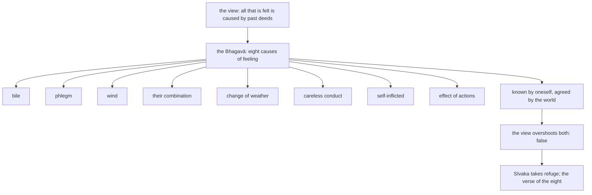

import { Tabs, TabItem } from '@astrojs/starlight/components';

Original text: [13S4/2.3.1 Sīvakasutta 1196–1201](https://tipitaka2500.github.io/tipitaka/13S4/2/2.3/2.3.1.html#1196) in the [World Tipitaka Edition](https://tipitaka2500.github.io)

## Summary

The renunciant Moḷiyasīvaka asks the Bhagavā about the view that whatever a person feels is caused by what was done before. The Bhagavā answers that feelings arise from eight causes, bile, phlegm, wind, their combination, change of weather, careless conduct, what is self-inflicted and the effect of actions, as one can know for oneself and as the world agrees, so that those who hold that view overshoot both. Sīvaka takes refuge as a lay disciple, and a verse lists the eight.

## Diagram

## Text

<Tabs syncKey="paliquote">
<TabItem label="My Translation">
(269.)

1196\. At one time the Bhagavā was dwelling at Rājagaha, in the Bamboo Grove, at the Squirrels’ Feeding Place. Then Moḷiyasīvaka the renunciant approached the Bhagavā. Having approached, he exchanged friendly greetings with the Bhagavā. When they had concluded their courteous and amiable talk, he sat down to one side. Seated to one side, Moḷiyasīvaka the renunciant said this to the Bhagavā: “There are, Bho Gotama, some religious practitioners of such a doctrine, of such a view: ‘Whatever this individual experiences, whether pleasant, painful or neutral, all that is caused by what was done before.’ In this case, what does Bho Gotama say?”

1197\. “Here, Sīvaka, some feelings arise originating from bile too. This, Sīvaka, is to be known by oneself too: how some feelings arise here originating from bile too. And this, Sīvaka, is regarded as true by the world too: how some feelings arise here originating from bile too. In that regard, Sīvaka, there are those religious practitioners of such a doctrine, of such a view: ‘Whatever this individual experiences, whether pleasant, painful or neutral, all that is caused by what was done before.’ They overshoot what is known by oneself, and they overshoot what is regarded as true in the world. Therefore I say of those religious practitioners: ‘[It is] false.’

1198\. Originating from phlegm too, Sīvaka, … and so on … originating from wind too, Sīvaka, … and so on … from a combination of the humours too, Sīvaka, … and so on … produced by change of weather too, Sīvaka, … and so on … produced by careless conduct too, Sīvaka, … and so on … self-inflicted too, Sīvaka, … and so on … caused by the effect of actions too, Sīvaka, some feelings arise here. This, Sīvaka, is to be known by oneself too. How some feelings arise here caused by the effect of actions too; this, Sīvaka, is regarded as true by the world too. How some feelings arise here caused by the effect of actions too; in that regard, Sīvaka, there are those religious practitioners of such a doctrine, of such a view: ‘Whatever this individual experiences, whether pleasant, painful or neutral, all that is caused by what was done before.’ They overshoot what is known by oneself, and they overshoot what is regarded as true in the world. Therefore I say: ‘[It is] false of those religious practitioners.’”

1199\. When this was said, Moḷiyasīvaka the renunciant said this to the Bhagavā: “Excellent, Bho Gotama! Excellent, Bho Gotama! … and so on … May Bho Gotama remember me as an `upāsaka` (lay disciple) who has gone for refuge for life, from today onwards.”

1200\. _“Bile, phlegm and wind,_ \
_Combinations and weather conditions;_ \
_Careless conduct, the self-inflicted,_ \
_With the effect of actions as the eighth.”_

1201\. The first [discourse of the chapter].
</TabItem>

<TabItem label="Pāḷi (Roman IAST)">
(269.)

1196\. Ekaṃ samayaṃ bhagavā rājagahe viharati veḷuvane kalandakanivāpe. Atha kho moḷiyasīvako paribbājako yena bhagavā tenupasaṅkami; upasaṅkamitvā bhagavatā saddhiṃ sammodi. Sammodanīyaṃ kathaṃ sāraṇīyaṃ vītisāretvā ekamantaṃ nisīdi. Ekamantaṃ nisinno kho moḷiyasīvako paribbājako bhagavantaṃ etadavoca— “santi, bho gotama, eke samaṇabrāhmaṇā evaṃvādino evaṃdiṭṭhino— ‘yaṃ kiñcāyaṃ purisapuggalo paṭisaṃvedeti sukhaṃ vā dukkhaṃ vā adukkhamasukhaṃ vā sabbaṃ taṃ pubbekatahetū’ti. Idha bhavaṃ gotamo kimāhā”ti?

1197\. “Pittasamuṭṭhānānipi kho, sīvaka, idhekaccāni vedayitāni uppajjanti. Sāmampi kho etaṃ, sīvaka, veditabbaṃ yathā pittasamuṭṭhānānipi idhekaccāni vedayitāni uppajjanti. Lokassapi kho etaṃ, sīvaka, saccasammataṃ yathā pittasamuṭṭhānānipi idhekaccāni vedayitāni uppajjanti. Tatra, sīvaka, ye te samaṇabrāhmaṇā evaṃvādino evaṃdiṭṭhino— ‘yaṃ kiñcāyaṃ purisapuggalo paṭisaṃvedeti sukhaṃ vā dukkhaṃ vā adukkhamasukhaṃ vā sabbaṃ taṃ pubbekatahetū’ti. Yañca sāmaṃ ñātaṃ tañca atidhāvanti, yañca loke saccasammataṃ tañca atidhāvanti. Tasmā tesaṃ samaṇabrāhmaṇānaṃ micchāti vadāmi.

1198\. Semhasamuṭṭhānānipi kho, sīvaka…pe… vātasamuṭṭhānānipi kho, sīvaka…pe… sannipātikānipi kho, sīvaka…pe… utupariṇāmajānipi kho, sīvaka…pe… visamaparihārajānipi kho, sīvaka…pe… opakkamikānipi kho, sīvaka…pe… kammavipākajānipi kho, sīvaka, idhekaccāni vedayitāni uppajjanti. Sāmampi kho etaṃ, sīvaka, veditabbaṃ. Yathā kammavipākajānipi idhekaccāni vedayitāni uppajjanti; lokassapi kho etaṃ, sīvaka, saccasammataṃ. Yathā kammavipākajānipi idhekaccāni vedayitāni uppajjanti; tatra, sīvaka, ye te samaṇabrāhmaṇā evaṃvādino evaṃdiṭṭhino— ‘yaṃ kiñcāyaṃ purisapuggalo paṭisaṃvedeti sukhaṃ vā dukkhaṃ vā adukkhamasukhaṃ vā sabbaṃ taṃ pubbekatahetū’ti. Yañca sāmaṃ ñātaṃ tañca atidhāvanti yañca loke saccasammataṃ tañca atidhāvanti. Tasmā ‘tesaṃ samaṇabrāhmaṇānaṃ micchā’ti vadāmī”ti.

1199\. Evaṃ vutte, moḷiyasīvako paribbājako bhagavantaṃ etadavoca— “abhikkantaṃ, bho gotama, abhikkantaṃ, bho gotama…pe… upāsakaṃ maṃ bhavaṃ gotamo dhāretu ajjatagge pāṇupetaṃ saraṇaṃ gatan”ti.

1200\. _“Pittaṃ semhañca vāto ca,_  
_Sannipātā utūni ca;_  
_Visamaṃ opakkamikaṃ,_  
_Kammavipākena aṭṭhamī”ti._

1201\. Paṭhamaṃ.
</TabItem>

<TabItem label="Pāḷi (Brahmi)">
(269.)

1196\. 𑀏𑀓𑀁 𑀲𑀫𑀬𑀁 𑀪𑀕𑀯𑀸 𑀭𑀸𑀚𑀕𑀳𑁂 𑀯𑀺𑀳𑀭𑀢𑀺 𑀯𑁂𑀍𑀉𑀯𑀦𑁂 𑀓𑀮𑀦𑁆𑀤𑀓𑀦𑀺𑀯𑀸𑀧𑁂. 𑀅𑀣 𑀔𑁄 𑀫𑁄𑀍𑀇𑀬𑀲𑀻𑀯𑀓𑁄 𑀧𑀭𑀺𑀩𑁆𑀩𑀸𑀚𑀓𑁄 𑀬𑁂𑀦 𑀪𑀕𑀯𑀸 𑀢𑁂𑀦𑀼𑀧𑀲𑀗𑁆𑀓𑀫𑀺; 𑀉𑀧𑀲𑀗𑁆𑀓𑀫𑀺𑀢𑁆𑀯𑀸 𑀪𑀕𑀯𑀢𑀸 𑀲𑀤𑁆𑀥𑀺𑀁 𑀲𑀫𑁆𑀫𑁄𑀤𑀺. 𑀲𑀫𑁆𑀫𑁄𑀤𑀦𑀻𑀬𑀁 𑀓𑀣𑀁 𑀲𑀸𑀭𑀡𑀻𑀬𑀁 𑀯𑀻𑀢𑀺𑀲𑀸𑀭𑁂𑀢𑁆𑀯𑀸 𑀏𑀓𑀫𑀦𑁆𑀢𑀁 𑀦𑀺𑀲𑀻𑀤𑀺. 𑀏𑀓𑀫𑀦𑁆𑀢𑀁 𑀦𑀺𑀲𑀺𑀦𑁆𑀦𑁄 𑀔𑁄 𑀫𑁄𑀍𑀇𑀬𑀲𑀻𑀯𑀓𑁄 𑀧𑀭𑀺𑀩𑁆𑀩𑀸𑀚𑀓𑁄 𑀪𑀕𑀯𑀦𑁆𑀢𑀁 𑀏𑀢𑀤𑀯𑁄𑀘— “𑀲𑀦𑁆𑀢𑀺, 𑀪𑁄 𑀕𑁄𑀢𑀫, 𑀏𑀓𑁂 𑀲𑀫𑀡𑀩𑁆𑀭𑀸𑀳𑁆𑀫𑀡𑀸 𑀏𑀯𑀁𑀯𑀸𑀤𑀺𑀦𑁄 𑀏𑀯𑀁𑀤𑀺𑀝𑁆𑀞𑀺𑀦𑁄— ‘𑀬𑀁 𑀓𑀺𑀜𑁆𑀘𑀸𑀬𑀁 𑀧𑀼𑀭𑀺𑀲𑀧𑀼𑀕𑁆𑀕𑀮𑁄 𑀧𑀝𑀺𑀲𑀁𑀯𑁂𑀤𑁂𑀢𑀺 𑀲𑀼𑀔𑀁 𑀯𑀸 𑀤𑀼𑀓𑁆𑀔𑀁 𑀯𑀸 𑀅𑀤𑀼𑀓𑁆𑀔𑀫𑀲𑀼𑀔𑀁 𑀯𑀸 𑀲𑀩𑁆𑀩𑀁 𑀢𑀁 𑀧𑀼𑀩𑁆𑀩𑁂𑀓𑀢𑀳𑁂𑀢𑀽’𑀢𑀺. 𑀇𑀥 𑀪𑀯𑀁 𑀕𑁄𑀢𑀫𑁄 𑀓𑀺𑀫𑀸𑀳𑀸”𑀢𑀺?

1197\. “𑀧𑀺𑀢𑁆𑀢𑀲𑀫𑀼𑀝𑁆𑀞𑀸𑀦𑀸𑀦𑀺𑀧𑀺 𑀔𑁄, 𑀲𑀻𑀯𑀓, 𑀇𑀥𑁂𑀓𑀘𑁆𑀘𑀸𑀦𑀺 𑀯𑁂𑀤𑀬𑀺𑀢𑀸𑀦𑀺 𑀉𑀧𑁆𑀧𑀚𑁆𑀚𑀦𑁆𑀢𑀺. 𑀲𑀸𑀫𑀫𑁆𑀧𑀺 𑀔𑁄 𑀏𑀢𑀁, 𑀲𑀻𑀯𑀓, 𑀯𑁂𑀤𑀺𑀢𑀩𑁆𑀩𑀁 𑀬𑀣𑀸 𑀧𑀺𑀢𑁆𑀢𑀲𑀫𑀼𑀝𑁆𑀞𑀸𑀦𑀸𑀦𑀺𑀧𑀺 𑀇𑀥𑁂𑀓𑀘𑁆𑀘𑀸𑀦𑀺 𑀯𑁂𑀤𑀬𑀺𑀢𑀸𑀦𑀺 𑀉𑀧𑁆𑀧𑀚𑁆𑀚𑀦𑁆𑀢𑀺. 𑀮𑁄𑀓𑀲𑁆𑀲𑀧𑀺 𑀔𑁄 𑀏𑀢𑀁, 𑀲𑀻𑀯𑀓, 𑀲𑀘𑁆𑀘𑀲𑀫𑁆𑀫𑀢𑀁 𑀬𑀣𑀸 𑀧𑀺𑀢𑁆𑀢𑀲𑀫𑀼𑀝𑁆𑀞𑀸𑀦𑀸𑀦𑀺𑀧𑀺 𑀇𑀥𑁂𑀓𑀘𑁆𑀘𑀸𑀦𑀺 𑀯𑁂𑀤𑀬𑀺𑀢𑀸𑀦𑀺 𑀉𑀧𑁆𑀧𑀚𑁆𑀚𑀦𑁆𑀢𑀺. 𑀢𑀢𑁆𑀭, 𑀲𑀻𑀯𑀓, 𑀬𑁂 𑀢𑁂 𑀲𑀫𑀡𑀩𑁆𑀭𑀸𑀳𑁆𑀫𑀡𑀸 𑀏𑀯𑀁𑀯𑀸𑀤𑀺𑀦𑁄 𑀏𑀯𑀁𑀤𑀺𑀝𑁆𑀞𑀺𑀦𑁄— ‘𑀬𑀁 𑀓𑀺𑀜𑁆𑀘𑀸𑀬𑀁 𑀧𑀼𑀭𑀺𑀲𑀧𑀼𑀕𑁆𑀕𑀮𑁄 𑀧𑀝𑀺𑀲𑀁𑀯𑁂𑀤𑁂𑀢𑀺 𑀲𑀼𑀔𑀁 𑀯𑀸 𑀤𑀼𑀓𑁆𑀔𑀁 𑀯𑀸 𑀅𑀤𑀼𑀓𑁆𑀔𑀫𑀲𑀼𑀔𑀁 𑀯𑀸 𑀲𑀩𑁆𑀩𑀁 𑀢𑀁 𑀧𑀼𑀩𑁆𑀩𑁂𑀓𑀢𑀳𑁂𑀢𑀽’𑀢𑀺. 𑀬𑀜𑁆𑀘 𑀲𑀸𑀫𑀁 𑀜𑀸𑀢𑀁 𑀢𑀜𑁆𑀘 𑀅𑀢𑀺𑀥𑀸𑀯𑀦𑁆𑀢𑀺, 𑀬𑀜𑁆𑀘 𑀮𑁄𑀓𑁂 𑀲𑀘𑁆𑀘𑀲𑀫𑁆𑀫𑀢𑀁 𑀢𑀜𑁆𑀘 𑀅𑀢𑀺𑀥𑀸𑀯𑀦𑁆𑀢𑀺. 𑀢𑀲𑁆𑀫𑀸 𑀢𑁂𑀲𑀁 𑀲𑀫𑀡𑀩𑁆𑀭𑀸𑀳𑁆𑀫𑀡𑀸𑀦𑀁 𑀫𑀺𑀘𑁆𑀙𑀸𑀢𑀺 𑀯𑀤𑀸𑀫𑀺.

1198\. 𑀲𑁂𑀫𑁆𑀳𑀲𑀫𑀼𑀝𑁆𑀞𑀸𑀦𑀸𑀦𑀺𑀧𑀺 𑀔𑁄, 𑀲𑀻𑀯𑀓…𑀧𑁂… 𑀯𑀸𑀢𑀲𑀫𑀼𑀝𑁆𑀞𑀸𑀦𑀸𑀦𑀺𑀧𑀺 𑀔𑁄, 𑀲𑀻𑀯𑀓…𑀧𑁂… 𑀲𑀦𑁆𑀦𑀺𑀧𑀸𑀢𑀺𑀓𑀸𑀦𑀺𑀧𑀺 𑀔𑁄, 𑀲𑀻𑀯𑀓…𑀧𑁂… 𑀉𑀢𑀼𑀧𑀭𑀺𑀡𑀸𑀫𑀚𑀸𑀦𑀺𑀧𑀺 𑀔𑁄, 𑀲𑀻𑀯𑀓…𑀧𑁂… 𑀯𑀺𑀲𑀫𑀧𑀭𑀺𑀳𑀸𑀭𑀚𑀸𑀦𑀺𑀧𑀺 𑀔𑁄, 𑀲𑀻𑀯𑀓…𑀧𑁂… 𑀑𑀧𑀓𑁆𑀓𑀫𑀺𑀓𑀸𑀦𑀺𑀧𑀺 𑀔𑁄, 𑀲𑀻𑀯𑀓…𑀧𑁂… 𑀓𑀫𑁆𑀫𑀯𑀺𑀧𑀸𑀓𑀚𑀸𑀦𑀺𑀧𑀺 𑀔𑁄, 𑀲𑀻𑀯𑀓, 𑀇𑀥𑁂𑀓𑀘𑁆𑀘𑀸𑀦𑀺 𑀯𑁂𑀤𑀬𑀺𑀢𑀸𑀦𑀺 𑀉𑀧𑁆𑀧𑀚𑁆𑀚𑀦𑁆𑀢𑀺. 𑀲𑀸𑀫𑀫𑁆𑀧𑀺 𑀔𑁄 𑀏𑀢𑀁, 𑀲𑀻𑀯𑀓, 𑀯𑁂𑀤𑀺𑀢𑀩𑁆𑀩𑀁. 𑀬𑀣𑀸 𑀓𑀫𑁆𑀫𑀯𑀺𑀧𑀸𑀓𑀚𑀸𑀦𑀺𑀧𑀺 𑀇𑀥𑁂𑀓𑀘𑁆𑀘𑀸𑀦𑀺 𑀯𑁂𑀤𑀬𑀺𑀢𑀸𑀦𑀺 𑀉𑀧𑁆𑀧𑀚𑁆𑀚𑀦𑁆𑀢𑀺; 𑀮𑁄𑀓𑀲𑁆𑀲𑀧𑀺 𑀔𑁄 𑀏𑀢𑀁, 𑀲𑀻𑀯𑀓, 𑀲𑀘𑁆𑀘𑀲𑀫𑁆𑀫𑀢𑀁. 𑀬𑀣𑀸 𑀓𑀫𑁆𑀫𑀯𑀺𑀧𑀸𑀓𑀚𑀸𑀦𑀺𑀧𑀺 𑀇𑀥𑁂𑀓𑀘𑁆𑀘𑀸𑀦𑀺 𑀯𑁂𑀤𑀬𑀺𑀢𑀸𑀦𑀺 𑀉𑀧𑁆𑀧𑀚𑁆𑀚𑀦𑁆𑀢𑀺; 𑀢𑀢𑁆𑀭, 𑀲𑀻𑀯𑀓, 𑀬𑁂 𑀢𑁂 𑀲𑀫𑀡𑀩𑁆𑀭𑀸𑀳𑁆𑀫𑀡𑀸 𑀏𑀯𑀁𑀯𑀸𑀤𑀺𑀦𑁄 𑀏𑀯𑀁𑀤𑀺𑀝𑁆𑀞𑀺𑀦𑁄— ‘𑀬𑀁 𑀓𑀺𑀜𑁆𑀘𑀸𑀬𑀁 𑀧𑀼𑀭𑀺𑀲𑀧𑀼𑀕𑁆𑀕𑀮𑁄 𑀧𑀝𑀺𑀲𑀁𑀯𑁂𑀤𑁂𑀢𑀺 𑀲𑀼𑀔𑀁 𑀯𑀸 𑀤𑀼𑀓𑁆𑀔𑀁 𑀯𑀸 𑀅𑀤𑀼𑀓𑁆𑀔𑀫𑀲𑀼𑀔𑀁 𑀯𑀸 𑀲𑀩𑁆𑀩𑀁 𑀢𑀁 𑀧𑀼𑀩𑁆𑀩𑁂𑀓𑀢𑀳𑁂𑀢𑀽’𑀢𑀺. 𑀬𑀜𑁆𑀘 𑀲𑀸𑀫𑀁 𑀜𑀸𑀢𑀁 𑀢𑀜𑁆𑀘 𑀅𑀢𑀺𑀥𑀸𑀯𑀦𑁆𑀢𑀺 𑀬𑀜𑁆𑀘 𑀮𑁄𑀓𑁂 𑀲𑀘𑁆𑀘𑀲𑀫𑁆𑀫𑀢𑀁 𑀢𑀜𑁆𑀘 𑀅𑀢𑀺𑀥𑀸𑀯𑀦𑁆𑀢𑀺. 𑀢𑀲𑁆𑀫𑀸 ‘𑀢𑁂𑀲𑀁 𑀲𑀫𑀡𑀩𑁆𑀭𑀸𑀳𑁆𑀫𑀡𑀸𑀦𑀁 𑀫𑀺𑀘𑁆𑀙𑀸’𑀢𑀺 𑀯𑀤𑀸𑀫𑀻”𑀢𑀺.

1199\. 𑀏𑀯𑀁 𑀯𑀼𑀢𑁆𑀢𑁂, 𑀫𑁄𑀍𑀇𑀬𑀲𑀻𑀯𑀓𑁄 𑀧𑀭𑀺𑀩𑁆𑀩𑀸𑀚𑀓𑁄 𑀪𑀕𑀯𑀦𑁆𑀢𑀁 𑀏𑀢𑀤𑀯𑁄𑀘— “𑀅𑀪𑀺𑀓𑁆𑀓𑀦𑁆𑀢𑀁, 𑀪𑁄 𑀕𑁄𑀢𑀫, 𑀅𑀪𑀺𑀓𑁆𑀓𑀦𑁆𑀢𑀁, 𑀪𑁄 𑀕𑁄𑀢𑀫…𑀧𑁂… 𑀉𑀧𑀸𑀲𑀓𑀁 𑀫𑀁 𑀪𑀯𑀁 𑀕𑁄𑀢𑀫𑁄 𑀥𑀸𑀭𑁂𑀢𑀼 𑀅𑀚𑁆𑀚𑀢𑀕𑁆𑀕𑁂 𑀧𑀸𑀡𑀼𑀧𑁂𑀢𑀁 𑀲𑀭𑀡𑀁 𑀕𑀢𑀦𑁆”𑀢𑀺.

1200\. _“𑀧𑀺𑀢𑁆𑀢𑀁 𑀲𑁂𑀫𑁆𑀳𑀜𑁆𑀘 𑀯𑀸𑀢𑁄 𑀘,_  
_𑀲𑀦𑁆𑀦𑀺𑀧𑀸𑀢𑀸 𑀉𑀢𑀽𑀦𑀺 𑀘;_  
_𑀯𑀺𑀲𑀫𑀁 𑀑𑀧𑀓𑁆𑀓𑀫𑀺𑀓𑀁,_  
_𑀓𑀫𑁆𑀫𑀯𑀺𑀧𑀸𑀓𑁂𑀦 𑀅𑀝𑁆𑀞𑀫𑀻”𑀢𑀺._

1201\. 𑀧𑀞𑀫𑀁.
</TabItem>

<TabItem label="Interlinear">
(269.)

[1196](https://tipitaka2500.github.io/tipitaka/13S4/2/2.3/2.3.1.html#1196) Ekaṃ samayaṃ bhagavā rājagahe viharati veḷuvane kalandakanivāpe.  
*️⃣🤟🚹⨀②(eka) 🚹⨀②(samaya) 🚹⨀①(bhagavant) 🚻⨀⑦(rājagaha) 🟢⨀🤟▶️(viharati) 🚻⨀⑦(veḷuvana) 🚹⨀⑦(kalandakanivāpa)  
one | time | the Bhagavā | at Rājagaha | dwells | in the Bamboo Grove | at the Squirrels’ Feeding Place  
At one time the Bhagavā was dwelling at Rājagaha, in the Bamboo Grove, at the Squirrels’ Feeding Place.

Atha kho moḷiyasīvako paribbājako yena bhagavā tenupasaṅkami;  
⏏️(atha) ⏏️(kho) 🚹⨀①(moḷiyasīvaka) 🚹⨀①(paribbājaka) *️⃣🤟🚹⨀③(ya) 🚹⨀①(bhagavant) *️⃣🤟🚹⨀③(ta) 🟢⨀🤟⏮(upasaṅkamati)  
then | indeed | Moḷiyasīvaka | the renunciant | by where | the Bhagavā | by there | approached  
Then Moḷiyasīvaka the renunciant approached the Bhagavā.

upasaṅkamitvā bhagavatā saddhiṃ sammodi.  
🔽(tvā)(upasaṅkamati) 🚹⨀③(bhagavant) ⏏️(saddhiṃ) 🟢⨀🤟⏮(sammodati)  
having approached | with the Bhagavā | together | exchanged greetings  
Having approached, he exchanged friendly greetings with the Bhagavā.

Sammodanīyaṃ kathaṃ sāraṇīyaṃ vītisāretvā ekamantaṃ nisīdi.  
🚺⨀②🔽(anīya)(sammodanīya) 🚺⨀②(kathā) 🚺⨀②🔽(anīya)(sāraṇīya) 🔽(tvā)(vītisāreti) ⏏️🆎(eka+anta) 🟢⨀🤟⏮(nisīdati)  
courteous | talk | amiable | having concluded | to one side | sat down  
When they had concluded their courteous and amiable talk, he sat down to one side.

Ekamantaṃ nisinno kho moḷiyasīvako paribbājako bhagavantaṃ etadavoca— “santi, bho gotama, eke samaṇabrāhmaṇā evaṃvādino evaṃdiṭṭhino— ‘yaṃ kiñcāyaṃ purisapuggalo paṭisaṃvedeti sukhaṃ vā dukkhaṃ vā adukkhamasukhaṃ vā sabbaṃ taṃ pubbekatahetū’ti.  
⏏️🆎(eka+anta) 🚹⨀①🔽(ta)(nisinna) ⏏️(kho) 🚹⨀①(moḷiyasīvaka) 🚹⨀①(paribbājaka) 🚹⨀②(bhagavant) *️⃣🤟🚻⨀②(eta) 🟢⨀🤟⏮(vadati) 🟢⨂🤟▶️(atthi) 🚹⨀⓪(bhavant) 🚹⨀⓪(gotama) *️⃣🤟🚹⨂①(eka) 🚹⨂①🆎(samaṇa+brāhmaṇa) 🚹⨂①🆎(evaṃ+vādī) 🚹⨂①🆎(evaṃ+diṭṭhī) *️⃣🤟🚻⨀②(ya) *️⃣🤟🚻⨀②(kaci) *️⃣🤟🚹⨀①(ima) 🚹⨀①🆎(purisa+puggala) 🟢⨀🤟▶️(paṭisaṃvedeti) 🚻⨀②(sukha) ⏏️(vā) 🚻⨀②(dukkha) ⏏️(vā) 🚻⨀②🆎(na+dukkha+na+sukha) ⏏️(vā) *️⃣🤟🚻⨀①(sabba) *️⃣🤟🚻⨀①(ta) 🚹⨀①🆎(pubbe+kata+hetu) ⏏️(iti)  
to one side | seated | indeed | Moḷiyasīvaka | the renunciant | to the Bhagavā | this | said | there are | Bho | Gotama | some | religious practitioners | of such a doctrine | of such a view | whatever | anything | this | individual | experiences | pleasant | or | painful | or | neutral | or | all | that | caused by what was done before | (end quote)  
Seated to one side, Moḷiyasīvaka the renunciant said this to the Bhagavā: “There are, Bho Gotama, some religious practitioners of such a doctrine, of such a view: ‘Whatever this individual experiences, whether pleasant, painful or neutral, all that is caused by what was done before.’

Idha bhavaṃ gotamo kimāhā”ti?  
⏏️(idha) 🚹⨀①(bhavant) 🚹⨀①(gotama) *️⃣🤟🚻⨀②(kiṃ) 🟢⨀🤟🔄(āha) ⏏️(iti)  
in this case | Bho | Gotama | what | says | (end quote)  
In this case, what does Bho Gotama say?”

[1197](https://tipitaka2500.github.io/tipitaka/13S4/2/2.3/2.3.1.html#1197) “Pittasamuṭṭhānānipi kho, sīvaka, idhekaccāni vedayitāni uppajjanti.  
🚻⨂①🆎(pitta+samuṭṭhāna) ⏏️(api) ⏏️(kho) 🚹⨀⓪(sīvaka) ⏏️(idha) *️⃣🤟🚻⨂①(ekacca) 🚻⨂①🔽(ta)(vedayita) 🟢⨂🤟▶️(uppajjati)  
originating from bile | too | indeed | Sīvaka | here | some | feelings | arise  
“Here, Sīvaka, some feelings arise originating from bile too.

Sāmampi kho etaṃ, sīvaka, veditabbaṃ yathā pittasamuṭṭhānānipi idhekaccāni vedayitāni uppajjanti.  
⏏️(sāmaṃ) ⏏️(api) ⏏️(kho) *️⃣🤟🚻⨀①(eta) 🚹⨀⓪(sīvaka) 🚻⨀①🔽(tabba)(veditabba) ⏏️(yathā) 🚻⨂①🆎(pitta+samuṭṭhāna) ⏏️(api) ⏏️(idha) *️⃣🤟🚻⨂①(ekacca) 🚻⨂①🔽(ta)(vedayita) 🟢⨂🤟▶️(uppajjati)  
by oneself | too | indeed | this | Sīvaka | is to be known | how | originating from bile | too | here | some | feelings | arise  
This, Sīvaka, is to be known by oneself too: how some feelings arise here originating from bile too.

Lokassapi kho etaṃ, sīvaka, saccasammataṃ yathā pittasamuṭṭhānānipi idhekaccāni vedayitāni uppajjanti.  
🚹⨀④(loka) ⏏️(api) ⏏️(kho) *️⃣🤟🚻⨀①(eta) 🚹⨀⓪(sīvaka) 🚻⨀①🆎(sacca+sammata) ⏏️(yathā) 🚻⨂①🆎(pitta+samuṭṭhāna) ⏏️(api) ⏏️(idha) *️⃣🤟🚻⨂①(ekacca) 🚻⨂①🔽(ta)(vedayita) 🟢⨂🤟▶️(uppajjati)  
by the world | too | indeed | this | Sīvaka | regarded as true | how | originating from bile | too | here | some | feelings | arise  
And this, Sīvaka, is regarded as true by the world too: how some feelings arise here originating from bile too.

Tatra, sīvaka, ye te samaṇabrāhmaṇā evaṃvādino evaṃdiṭṭhino— ‘yaṃ kiñcāyaṃ purisapuggalo paṭisaṃvedeti sukhaṃ vā dukkhaṃ vā adukkhamasukhaṃ vā sabbaṃ taṃ pubbekatahetū’ti.  
⏏️(tatra) 🚹⨀⓪(sīvaka) *️⃣🤟🚹⨂①(ya) *️⃣🤟🚹⨂①(ta) 🚹⨂①🆎(samaṇa+brāhmaṇa) 🚹⨂①🆎(evaṃ+vādī) 🚹⨂①🆎(evaṃ+diṭṭhī) *️⃣🤟🚻⨀②(ya) *️⃣🤟🚻⨀②(kaci) *️⃣🤟🚹⨀①(ima) 🚹⨀①🆎(purisa+puggala) 🟢⨀🤟▶️(paṭisaṃvedeti) 🚻⨀②(sukha) ⏏️(vā) 🚻⨀②(dukkha) ⏏️(vā) 🚻⨀②🆎(na+dukkha+na+sukha) ⏏️(vā) *️⃣🤟🚻⨀①(sabba) *️⃣🤟🚻⨀①(ta) 🚹⨀①🆎(pubbe+kata+hetu) ⏏️(iti)  
in that regard | Sīvaka | those who | those | religious practitioners | of such a doctrine | of such a view | whatever | anything | this | individual | experiences | pleasant | or | painful | or | neutral | or | all | that | caused by what was done before | (end quote)  
In that regard, Sīvaka, there are those religious practitioners of such a doctrine, of such a view: ‘Whatever this individual experiences, whether pleasant, painful or neutral, all that is caused by what was done before.’

Yañca sāmaṃ ñātaṃ tañca atidhāvanti, yañca loke saccasammataṃ tañca atidhāvanti.  
*️⃣🤟🚻⨀①(ya) ⏏️(ca) ⏏️(sāmaṃ) 🚻⨀①🔽(ta)(ñāta) *️⃣🤟🚻⨀②(ta) ⏏️(ca) 🟢⨂🤟▶️(atidhāvati) *️⃣🤟🚻⨀①(ya) ⏏️(ca) 🚹⨀⑦(loka) 🚻⨀①🆎(sacca+sammata) *️⃣🤟🚻⨀②(ta) ⏏️(ca) 🟢⨂🤟▶️(atidhāvati)  
what | and | by oneself | known | that | and | they overshoot | what | and | in the world | regarded as true | that | and | they overshoot  
They overshoot what is known by oneself, and they overshoot what is regarded as true in the world.

Tasmā tesaṃ samaṇabrāhmaṇānaṃ micchāti vadāmi.  
⏏️(tasmā) *️⃣🤟🚹⨂⑥(ta) 🚹⨂⑥🆎(samaṇa+brāhmaṇa) ⏏️(micchā) ⏏️(iti) 🟢⨀👆▶️(vadati)  
therefore | of those | religious practitioners | false | (end quote) | I say  
Therefore I say of those religious practitioners: ‘[It is] false.’

[1198](https://tipitaka2500.github.io/tipitaka/13S4/2/2.3/2.3.1.html#1198) Semhasamuṭṭhānānipi kho, sīvaka…pe… vātasamuṭṭhānānipi kho, sīvaka…pe… sannipātikānipi kho, sīvaka…pe… utupariṇāmajānipi kho, sīvaka…pe… visamaparihārajānipi kho, sīvaka…pe… opakkamikānipi kho, sīvaka…pe… kammavipākajānipi kho, sīvaka, idhekaccāni vedayitāni uppajjanti.  
🚻⨂①🆎(semha+samuṭṭhāna) ⏏️(api) ⏏️(kho) 🚹⨀⓪(sīvaka) ⏏️(peyyāla) 🚻⨂①🆎(vāta+samuṭṭhāna) ⏏️(api) ⏏️(kho) 🚹⨀⓪(sīvaka) ⏏️(peyyāla) 🚻⨂①(sannipātika) ⏏️(api) ⏏️(kho) 🚹⨀⓪(sīvaka) ⏏️(peyyāla) 🚻⨂①🆎(utu+pariṇāma+ja) ⏏️(api) ⏏️(kho) 🚹⨀⓪(sīvaka) ⏏️(peyyāla) 🚻⨂①🆎(visama+parihāra+ja) ⏏️(api) ⏏️(kho) 🚹⨀⓪(sīvaka) ⏏️(peyyāla) 🚻⨂①(opakkamika) ⏏️(api) ⏏️(kho) 🚹⨀⓪(sīvaka) ⏏️(peyyāla) 🚻⨂①🆎(kamma+vipāka+ja) ⏏️(api) ⏏️(kho) 🚹⨀⓪(sīvaka) ⏏️(idha) *️⃣🤟🚻⨂①(ekacca) 🚻⨂①🔽(ta)(vedayita) 🟢⨂🤟▶️(uppajjati)  
originating from phlegm | too | indeed | Sīvaka | (and so on) | originating from wind | too | indeed | Sīvaka | (and so on) | from a combination of the humours | too | indeed | Sīvaka | (and so on) | produced by change of weather | too | indeed | Sīvaka | (and so on) | produced by careless conduct | too | indeed | Sīvaka | (and so on) | self-inflicted | too | indeed | Sīvaka | (and so on) | caused by the effect of actions | too | indeed | Sīvaka | here | some | feelings | arise  
Originating from phlegm too, Sīvaka, … and so on … originating from wind too, Sīvaka, … and so on … from a combination of the humours too, Sīvaka, … and so on … produced by change of weather too, Sīvaka, … and so on … produced by careless conduct too, Sīvaka, … and so on … self-inflicted too, Sīvaka, … and so on … caused by the effect of actions too, Sīvaka, some feelings arise here.

Sāmampi kho etaṃ, sīvaka, veditabbaṃ.  
⏏️(sāmaṃ) ⏏️(api) ⏏️(kho) *️⃣🤟🚻⨀①(eta) 🚹⨀⓪(sīvaka) 🚻⨀①🔽(tabba)(veditabba)  
by oneself | too | indeed | this | Sīvaka | is to be known  
This, Sīvaka, is to be known by oneself too.

Yathā kammavipākajānipi idhekaccāni vedayitāni uppajjanti;  
⏏️(yathā) 🚻⨂①🆎(kamma+vipāka+ja) ⏏️(api) ⏏️(idha) *️⃣🤟🚻⨂①(ekacca) 🚻⨂①🔽(ta)(vedayita) 🟢⨂🤟▶️(uppajjati)  
how | caused by the effect of actions | too | here | some | feelings | arise  
How some feelings arise here caused by the effect of actions too;

lokassapi kho etaṃ, sīvaka, saccasammataṃ.  
🚹⨀④(loka) ⏏️(api) ⏏️(kho) *️⃣🤟🚻⨀①(eta) 🚹⨀⓪(sīvaka) 🚻⨀①🆎(sacca+sammata)  
by the world | too | indeed | this | Sīvaka | regarded as true  
this, Sīvaka, is regarded as true by the world too.

Yathā kammavipākajānipi idhekaccāni vedayitāni uppajjanti;  
⏏️(yathā) 🚻⨂①🆎(kamma+vipāka+ja) ⏏️(api) ⏏️(idha) *️⃣🤟🚻⨂①(ekacca) 🚻⨂①🔽(ta)(vedayita) 🟢⨂🤟▶️(uppajjati)  
how | caused by the effect of actions | too | here | some | feelings | arise  
How some feelings arise here caused by the effect of actions too;

tatra, sīvaka, ye te samaṇabrāhmaṇā evaṃvādino evaṃdiṭṭhino— ‘yaṃ kiñcāyaṃ purisapuggalo paṭisaṃvedeti sukhaṃ vā dukkhaṃ vā adukkhamasukhaṃ vā sabbaṃ taṃ pubbekatahetū’ti.  
⏏️(tatra) 🚹⨀⓪(sīvaka) *️⃣🤟🚹⨂①(ya) *️⃣🤟🚹⨂①(ta) 🚹⨂①🆎(samaṇa+brāhmaṇa) 🚹⨂①🆎(evaṃ+vādī) 🚹⨂①🆎(evaṃ+diṭṭhī) *️⃣🤟🚻⨀②(ya) *️⃣🤟🚻⨀②(kaci) *️⃣🤟🚹⨀①(ima) 🚹⨀①🆎(purisa+puggala) 🟢⨀🤟▶️(paṭisaṃvedeti) 🚻⨀②(sukha) ⏏️(vā) 🚻⨀②(dukkha) ⏏️(vā) 🚻⨀②🆎(na+dukkha+na+sukha) ⏏️(vā) *️⃣🤟🚻⨀①(sabba) *️⃣🤟🚻⨀①(ta) 🚹⨀①🆎(pubbe+kata+hetu) ⏏️(iti)  
in that regard | Sīvaka | those who | those | religious practitioners | of such a doctrine | of such a view | whatever | anything | this | individual | experiences | pleasant | or | painful | or | neutral | or | all | that | caused by what was done before | (end quote)  
in that regard, Sīvaka, there are those religious practitioners of such a doctrine, of such a view: ‘Whatever this individual experiences, whether pleasant, painful or neutral, all that is caused by what was done before.’

Yañca sāmaṃ ñātaṃ tañca atidhāvanti yañca loke saccasammataṃ tañca atidhāvanti.  
*️⃣🤟🚻⨀①(ya) ⏏️(ca) ⏏️(sāmaṃ) 🚻⨀①🔽(ta)(ñāta) *️⃣🤟🚻⨀②(ta) ⏏️(ca) 🟢⨂🤟▶️(atidhāvati) *️⃣🤟🚻⨀①(ya) ⏏️(ca) 🚹⨀⑦(loka) 🚻⨀①🆎(sacca+sammata) *️⃣🤟🚻⨀②(ta) ⏏️(ca) 🟢⨂🤟▶️(atidhāvati)  
what | and | by oneself | known | that | and | they overshoot | what | and | in the world | regarded as true | that | and | they overshoot  
They overshoot what is known by oneself, and they overshoot what is regarded as true in the world.

Tasmā ‘tesaṃ samaṇabrāhmaṇānaṃ micchā’ti vadāmī”ti.  
⏏️(tasmā) *️⃣🤟🚹⨂⑥(ta) 🚹⨂⑥🆎(samaṇa+brāhmaṇa) ⏏️(micchā) ⏏️(iti) 🟢⨀👆▶️(vadati) ⏏️(iti)  
therefore | of those | religious practitioners | false | (end quote) | I say | (end quote)  
Therefore I say: ‘[It is] false of those religious practitioners.’”

[1199](https://tipitaka2500.github.io/tipitaka/13S4/2/2.3/2.3.1.html#1199) Evaṃ vutte, moḷiyasīvako paribbājako bhagavantaṃ etadavoca— “abhikkantaṃ, bho gotama, abhikkantaṃ, bho gotama…pe… upāsakaṃ maṃ bhavaṃ gotamo dhāretu ajjatagge pāṇupetaṃ saraṇaṃ gatan”ti.  
⏏️(evaṃ) 🚻⨀⑦🔽(ta)(vutta) 🚹⨀①(moḷiyasīvaka) 🚹⨀①(paribbājaka) 🚹⨀②(bhagavant) *️⃣🤟🚻⨀②(eta) 🟢⨀🤟⏮(vadati) 🚻⨀①🔽(ta)(abhikkanta) 🚹⨀⓪(bhavant) 🚹⨀⓪(gotama) 🚻⨀①🔽(ta)(abhikkanta) 🚹⨀⓪(bhavant) 🚹⨀⓪(gotama) ⏏️(peyyāla) 🚹⨀②(upāsaka) *️⃣👆⚧⨀②(ahaṃ) 🚹⨀①(bhavant) 🚹⨀①(gotama) 🟢⨀🤟⏹(dhāreti) ⏏️(ajjatagge) 🚹⨀②🆎(pāṇa+upeta) 🚻⨀②(saraṇa) 🚹⨀②🔽(ta)(gata) ⏏️(iti)  
thus | when said | Moḷiyasīvaka | the renunciant | to the Bhagavā | this | said | excellent | Bho | Gotama | excellent | Bho | Gotama | (and so on) | a lay disciple | me | Bho | Gotama | may remember | from today onwards | for life | to refuge | gone | (end quote)  
When this was said, Moḷiyasīvaka the renunciant said this to the Bhagavā: “Excellent, Bho Gotama! Excellent, Bho Gotama! … and so on … May Bho Gotama remember me as an `upāsaka` (lay disciple) who has gone for refuge for life, from today onwards.”

[1200](https://tipitaka2500.github.io/tipitaka/13S4/2/2.3/2.3.1.html#1200) “Pittaṃ semhañca vāto ca,  
🚻⨀①(pitta) 🚻⨀①(semha) ⏏️(ca) 🚹⨀①(vāta) ⏏️(ca)  
bile | phlegm | and | wind | and  
Sannipātā utūni ca;  
🚹⨂①(sannipāta) 🚻⨂①(utu) ⏏️(ca)  
combinations | weather conditions | and  
Visamaṃ opakkamikaṃ,  
🚻⨀①(visama) 🚻⨀①(opakkamika)  
careless conduct | self-inflicted  
Kammavipākena aṭṭhamī”ti.  
🚹⨀③🆎(kamma+vipāka) 🚺⨀①(aṭṭhamī) ⏏️(iti)  
with the effect of actions | the eighth | (end quote)  

“Bile, phlegm and wind,  
Combinations and weather conditions;  
Careless conduct, the self-inflicted,  
With the effect of actions as the eighth.”

[1201](https://tipitaka2500.github.io/tipitaka/13S4/2/2.3/2.3.1.html#1201) Paṭhamaṃ.  
🚻⨀①(paṭhama)  
the first  
The first [discourse of the chapter].
</TabItem>
</Tabs>

## Commentary

- The text refutes `pubbekatahetu`, the view that all feeling is caused by past deeds, one of the three sectarian tenets the Titthāyatanasutta (15A3/2.2.1) names; buddhavacana treats action and its results at https://buddhavacana.github.io/articles/kamma/ and determinism at https://buddhavacana.github.io/articles/determinism/.
- Renderings: `paribbājaka` "renunciant", `samaṇabrāhmaṇā` "religious practitioners", `vedayita` "feeling", `atidhāvati` "overshoot", `micchā` "false"; `opakkamika` "self-inflicted", the DPD's first meaning (buddhavacana's Meditation article has "due to exertion", others "assault").
- `sannipātika` "from a combination of the humours", `utupariṇāmaja` "produced by change of weather", `visamaparihāraja` "produced by careless conduct": the DPD's meanings shortened.
- The `…pe…` run of 1198 repeats the bile argument for each cause; the eight stand in the Pāḷi's order with "… and so on …" between them, and the verse (1200) counts them, the effect of actions "as the eighth".
- The refuge formula (1199) takes the Khandhaka's wording with "Bho Gotama" for `bhavaṃ gotamo`.

## Parallels

The Chinese parallel is the 977th sūtra of the 雜阿含經 (Saṃyuktāgama; fascicle 35, CBETA T02, no. 99, pp. 252c–253a), read here in CBETA's text. The two agree in frame and sequence: at Rājagaha in the Kalandaka Bamboo Grove (王舍城迦蘭陀竹園, p. 252c) the renunciant Sīvaka (尸婆外道出家) comes to the Buddha, exchanges greetings, sits to one side and reports the view of some religious practitioners (沙門婆羅門) that whatever a person experiences is all caused by what was done before (若人有所知覺，彼一切本所作因), and asks what Gotama says; the Buddha answers that feelings arise from the humours, their combination, injury and the weather, that this is known by oneself and is the world's truth (世間真實，非為虛妄, p. 253a), and that those who say all is caused by past deeds abandon the world's truth and follow their own view, speaking falsely (捨世間真實事而隨自見，作虛妄說, p. 253a). The differences, checked in CBETA's text:

- **The name and the view.** The Pāḷi calls him Moḷiyasīvaka; the Chinese Sīvaka only (尸婆). The Pāḷi states the view in one sentence (1196.5); the Chinese adds its programme: by austerities the deeds of the past are exhausted, no new deeds are made, the causes are cut, and in future there are no more defilements, so that with the deeds ended suffering ends and its limit is reached (修諸苦行，令過去業盡，更不造新業，斷於因緣 … 苦盡者究竟苦邊, p. 252c).
- **The Buddha's verdict.** The Pāḷi says "I say of those religious practitioners: false" (1197.6, 1198.8); the Chinese opens the answer with it: their statement is vague talk, unexamined and unweighed, foolish, unskilful and undiscerning (洛漠說耳，不審不數，愚癡不善不辯, p. 252c).
- **The causes.** The Pāḷi has eight, bile, phlegm, wind, their combination, change of weather, careless conduct, the self-inflicted and the effect of actions (1197–1198, 1200); the Chinese has seven, wind (風), phlegm (痰), saliva (唌唾), their combination (等分), self-harm (自害), harm by others (他害) and the seasons (節氣), with no cause from the result of deeds (p. 252c). The Chinese divides what the Pāḷi's `opakkamika` covers into self-harm, illustrated by austerities, pulling out hair and beard, standing with arms raised, squatting, lying on ashes or thorns, bathing three times a day, standing on one foot following the sun (p. 252c), and harm by others, by hand, stone, knife or stick (p. 252c); and it illustrates the seasons, great cold in winter, great heat in spring, both in summer (p. 253a). The Pāḷi illustrates nothing.
- **Knowing for oneself.** The Pāḷi's `sāmampi kho etaṃ veditabbaṃ` (1197.2, 1198.2) is in the Chinese "you too have this affliction yourself … you know it as it really is" (汝亦自有此患 … 如是如實覺知, p. 253a).
- **An addition in the Chinese.** After the refutation the Buddha teaches five causes and conditions of mental grief (五因五緣生心法憂苦), the hindrances of sensual desire, ill will, sloth and torpor, restlessness and remorse and doubt (貪欲纏 … 疑纏), and five by which it does not arise, a Dhamma visible here, not a matter of time, to be seen for oneself (現法得離熾然，不待時節，通達現見，緣自覺知), and the eightfold path (八正道——正見乃至正定, p. 253a). The Pāḷi has none of this.
- **The close.** In the Pāḷi Sīvaka declares himself a lay disciple gone for refuge for life (1199), and a verse lists the eight causes (1200); in the Chinese, as the Dhamma is spoken, Sīvaka gains the Dhamma Eye (遠塵離垢，得法眼淨), asks for the going forth and the higher ordination (出家、受具足), and attains the liberated state (心善解脫，得阿羅漢, p. 253a); there is no verse.

[Go to previous page (Rahogatasutta (The Discourse on One Gone into Seclusion))](/samyuttanikaya/vedanasamyutta/rahogatasutta/) / [Go to parent page (Saṃyutta Nikāya)](/samyuttanikaya/) / [Go to next page (Dhammacakkappavattanasutta (The Discourse on Setting the Wheel of the Dhamma in Motion))](/samyuttanikaya/saccasamyutta/dhammacakkappavattanasutta/)
